# Clash of Planes

Мультиплеєрна браузерна гра в реальному часі (тема — біплани). Навчальний проєкт курсу «Програмування мовою JavaScript».
Цей репозиторій містить **Lab 01** (тег `lab-01`), **Lab 02** (`lab-02`), **Lab 03** (`lab-03`), **Lab 04** (`lab-04`) і
**Lab 05** (`lab-05`): корабель на canvas у фіксованому кроці симуляції (Lab 1), об'єктна модель сутностей (Lab 2), асинхронний
старт із екраном завантаження, спрайтами й звуком (Lab 3), сервер на Node.js з кімнатами, чатом і потоковими логами (Lab 4), і
тепер **двоє граються в одну гру**: сервер рахує світ, клієнт передбачає свій корабель і звіряється зі знімками, чужі кораблі
інтерполюються, а проводом ходить бінарний протокол (Lab 5).

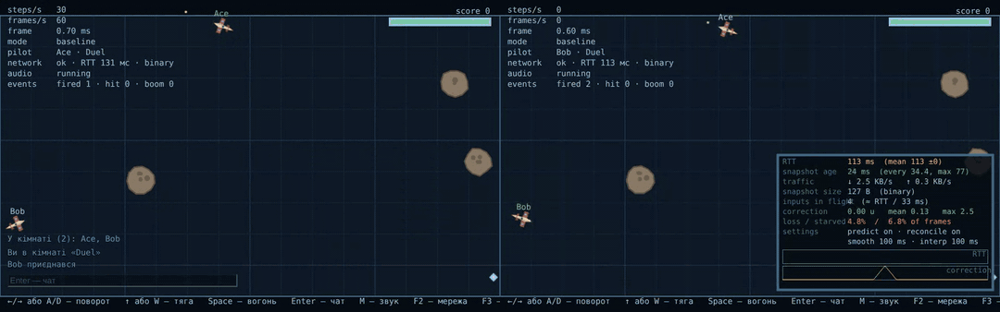

_Два справжні вікна Chromium, один сервер, 20 секунд бою при **100 мс RTT ± 30 мс джитера і 2% втрат** (їх додає сервер, див.
Lab 05 нижче). Праворуч — netgraph: RTT, вік знімка, трафік, черга input і розмір поправки._

## Запуск

Репозиторій — npm workspaces: `shared/` (симуляція, протокол і кодеки — той самий код у браузері й у Node), `client/`
(Vite-застосунок) і `server/` (Node).

```bash
nvm use                 # Node 22 (.nvmrc)
npm install             # ставить усі три пакети

# розробка: два процеси (або `npm run dev` — обидва одразу через concurrently)
npm run dev:server      # http://127.0.0.1:3000  (node --watch, читає server/.env, якщо він є)
npm run dev:client      # http://localhost:5173  (Vite проксує /api і /ws на :3000)

# «продакшн»: Node сам віддає зібраний клієнт
npm run build           # client/dist
PORT=3000 LOG_DIR=./logs npm start      # http://127.0.0.1:3000   (NODE_ENV=production вимикає симулятор мережі)

npm test                # тести всіх пакетів (node:test)
npm run lint
npm run assets          # перегенерувати спрайтшит, звуки й manifest.json (client/public/assets/)
```

Щоб побачити гру вдвох: відкрийте `http://localhost:3000/?lag=100&jitter=30&drop=0.02` у **двох** вікнах, в одному
створіть кімнату, в обох натисніть Join. `lag` — додатковий RTT у мс, `jitter` — ± мс, `drop` — частка втрачених повідомлень;
їх застосовує **сервер** до цього з'єднання. Усе те саме можна крутити наживо в панелі `F2`.

Керування: `←/→` або `A/D` — поворот, `↑` або `W` — тяга, `Space` — вогонь, `Enter` — чат (ще раз `Enter` — надіслати, `Esc` —
повернути клавіатуру грі), `M` — звук, `F2` — панель мережі, `F3` — netgraph, `Esc` на екрані завантаження — скасувати.

Параметри URL клієнта: `?predict=0` (корабель рухається лише за знімками), `?reconcile=0`, `?interp=100` і `?smooth=100`
(мс), `?chaos=0.01` (експеримент із недетермінізмом), `?codec=json` (JSON замість бінарного протоколу). Службові сторінки:
`/?determinism` (Lab 5), `/?puzzles`, `/?bench&latency=150`, `/?fail=…` (Lab 3).

> Шляхи `src/…`, `scripts/…`, `public/…` у розділах Lab 1–3 нижче — з часів, коли клієнт був у корені. Тепер це
> `client/src/…`, `client/scripts/…`, `client/public/…`; `client/src/sim/…` переїхало в `shared/src/sim/…`, а `server/src/protocol.js` — у
> `shared/src/protocol.js` (Lab 5). Dev-middleware
> для галереї збоїв (`server/devApi.js`) став `client/dev/faults.js`; статичний `GET /api/rooms` із Lab 3 замінено справжнім сервером
> (Lab 4). Кроком симуляції тепер є 1/30 с, а не 1/60 (на нього «налаштований» сервер); розділи Lab 1–2 описують свій час.

## Архітектура

```txt
package.json              workspaces: ["shared", "client", "server"]; dev / build / start / test / lint
eslint.config.js          одна конфігурація; shared/src НЕ отримує глобалів ні браузера, ні Node (lint заборонить window/process/console)
shared/                   @dogfight/shared: те, що однаково працює в браузері й у Node (Lab 5)
  src/sim/                чиста симуляція: Vector2, Entity/Ship/Bullet/Asteroid/Pickup, World, зіткнення, homing, Rng (mulberry32)
  src/protocol.js         протокол v1: валідація повідомлень, коди закриття
  src/input.js            форма input і її перевірка
  src/codec/              binary.js (DataView, специфікація формату в коментарі), json.js, index.js
  src/snapshot.js         World → логічний знімок (однаковий для обох кодеків)
  src/hash.js, scenario.js  відбиток стану симуляції та сценарій для перевірки детермінізму
  src/constants.js        TICK_RATE = 30, STEP, ліміти input
  test/                   83 тести: симуляція, детермінізм, чистота пакета, кодеки, протокол
  scripts/                measure-codecs.js, experiments.js
client/                   Vite-застосунок
  vite.config.js          proxy: /api → :3000, /ws → :3000 (ws: true)
  dev/faults.js           ?delay= / ?status= / чесний 404 для галереї збоїв
  scripts/gen-assets.js   процедурна генерація спрайтів і звуків
  public/assets/          manifest.json, config/game.json (+ presets арен), sprites/, sfx/
  src/
    main.js               завантаження → лобі → сокет (join) → гра + чат + netgraph; ?predict= ?lag= ?codec= ?determinism …
    game/session.js       GameSession: input → prediction → send; snapshot → reconcile; render → сцена (без DOM, працює в Node)
    game/predictor.js     prediction + reconciliation (replay) + згладжування поправки (критично загальмована пружина)
    game/snapshotBuffer.js  буфер знімків, оцінка годинника сервера, інтерполяція чужих сутностей
    game/netstats.js      RTT, вік знімка, байти/с, поправки, втрати, голодування буфера
    net/connection.js     WebSocket: черга send, reconnect з backoff, бінарні кадри, sendNow
    net/protocol.js       клієнтські побудовники повідомлень і тексти (сам протокол — у shared)
    net/http.js, assets/, lobby/   fetchJson/withRetry, завантаження ассетів, лобі (Lab 3–4)
    render/               canvas, draw (малює СЦЕНУ), netgraph, particles, sprites, interpolate
    ui/                   chat, netpanel (F2), loadingScreen, hudFeed
    events.js             EventBus для звуку/HUD/частинок
server/                   Node.js, "type": "module"; залежності: ws і @dogfight/shared
  src/
    index.js              createApp(config); SIGINT/SIGTERM → graceful shutdown
    match.js              Match: авторитетна симуляція кімнати, тік на 30 Гц через абсолютний таймер, input → snapshot
    netsim.js             затримка, джитер і втрати для з'єднання (в обидва боки)
    ws.js                 життєвий цикл сокета: join, ping/pong, ліміти, бінарні/JSON input, snapshot у кодеку клієнта
    rooms.js, http.js, static.js, config.js, log/, rateLimit.js   (Lab 4; http.js отримав /api/stats)
    rollingStats.js       ковзне вікно для p50/p99/max тривалості й запізнення тактів (/api/stats)
  scripts/                bots.js, netcode-report.js, rss-bench.js, block-demo.js, demo-crash.js, …
  test/                   harness.js (мережа у віртуальному часі), netcode.test.js, match.test.js, game.e2e.test.js, …
docs/lab-03/, docs/lab-04/, docs/lab-05/   скриншоти, GIF, CSV, графіки для README
```

Ключові рішення (Lab 1, без змін):

- `Vector2` **не мутує** себе чи аргумент — тому `prevPos`/`pos` у кожної сутності це просто два посилання
  на різні об'єкти `Vector2`, і рендер може інтерполювати між ними без жодного додаткового копіювання.
- Симуляція працює у _світових одиницях_, а не в пікселях: розмір вікна/DPR не впливають на фізику.
- `justPressed` — по **кроках симуляції**, а не по кадрах.
- Drag — експоненційний (`v *= e^(-k·dt)`), тож його ефект не залежить від того, як нарізано час.

---

## Lab 01 — The Event Loop Is the Game Loop

### Експерименти «зламай і поміряй»

Кожен вмикається параметром URL. HUD показує режим (`mode`). Виміряно в Chrome, 10 с на кожен запуск.
Числа беру зі скріншотів HUD: це ковзне вікно 1 с, тому між запусками вони трохи «пливуть» (наприклад,
jitter базової лінії в різних запусках: 0.10 / 0.39 / 0.46 / 0.61 мс).
Мій дисплей: 60 Гц. Браузер/ОС: Chrome, macOS.

#### Експеримент 1 — блокуючий цикл у кадрі (`/?exp=block`)

`busyWait(100)` у `render` кожен 60-й кадр.

| Метрика       | Базова лінія | З блокуванням |
| ------------- | ------------ | ------------- |
| steps/s       | 59–60        | 60            |
| frames/s      | 60           | 55            |
| max delta, мс | 17.6         | 100.0         |
| jitter, мс    | 0.61         | 10.68         |


Baseline показує то 59, то 60 steps/s: вікно вимірювання закривається на першому кадрі після 1000 мс, тобто
триває трохи довше секунди, і 60 кроків округлюються до 59. Це похибка вимірювання, не втрата кроків.

- Що бачить гравець: приблизно раз на секунду (кожен 60-й кадр) усе завмирає: корабель, сітка й HUD. `max delta = 100.0 мс` — це рівно 6 періодів дисплея (6 × 16.67), тобто ~5 кадрів пропущено. Потім корабель різко «стрибає» вперед: у наступному кадрі в акумуляторі ~0.1 с боргу, і симуляція виконує ~6 кроків підряд. Клавіші, натиснуті під час заморозки, реагують із затримкою.
- Що показує HUD: `frames/s` падає з 60 до 55 (60 кадрів тепер займають ≈ 1000 + 83 ≈ 1083 мс, а 60 / 1.083 ≈ 55), `jitter` зростає з 0.61 до 10.68 мс, а `steps/s` лишається 60: акумулятор наздоганяє прострочений час, тому симуляція не відстає, але картинка смикається. Поле `frame` показує лише останній кадр (на скріншоті 0.40 мс), тому блокування там майже непомітне, а надійний індикатор — `max delta`.
- Чому синхронний блок на 100 мс не можна «обійти» з JavaScript на тому ж потоці (поясніть через стек викликів, event loop та render-крок):
  1. JavaScript виконується до завершення (run-to-completion). Event loop бере наступну задачу лише тоді, коли стек порожній, а `busyWait` тримає стек зайнятим.
  2. rAF-колбеки, обробники подій, таймери й мікротаски не можуть запуститись, а сама відмальовка (style → layout → paint) теж іде на цьому потоці. Браузер не може перервати виконуваний JS. У нашому експерименті за ці 100 мс не виконався жоден rAF-колбек і жоден обробник клавіатури.
  3. `await` чи `setTimeout` усередині циклу нічого не дадуть: вони лише планують роботу на потім, а синхронний код їх не пропускає.
  4. Виходу два: нарізати роботу на шматки менші за бюджет кадру й віддавати керування між ними, або перенести її в Web Worker з окремим потоком (це stretch-завдання лаби).

#### Експеримент 2 — `setInterval(frame, 16)` замість rAF (`/?exp=interval`)

| Метрика       | rAF   | setInterval(16) |
| ------------- | ----- | --------------- |
| steps/s       | 59–60 | 61              |
| frames/s      | 60    | 63              |
| jitter, мс    | 0.61  | 0.48            |
| max delta, мс | 17.6  | 17.0            |


Після повернення з фонової вкладки (перший показ HUD після повернення):

| Метрика       | rAF     | setInterval(16) |
| ------------- | ------- | --------------- |
| steps/s       | 7       | 24              |
| frames/s      | 5       | 2               |
| jitter, мс    | 1163.03 | 371.45          |
| max delta, мс | 7733.4  | 999.7           |


`max delta` для rAF (7733 мс) означає, що вкладка була прихована ≈ 7.7 с, а не рівно 5 с.

- Чим відрізнялось і чому (вирівнювання з дисплеєм, дрейф таймера, throttling фонових вкладок, 16 ≠ 16.667):
  1. **Активна вкладка.** За jitter режими розрізнити не вдалося: 0.48 проти 0.61 мс лежить у межах розкиду між запусками однієї лише базової лінії (0.10–0.61), а головний потік у нас вільний. Я очікував більший jitter у `setInterval`, вимір цього не підтвердив. Реальна різниця у частоті: 63 виклики/с ≈ 1000 / 16 = 62.5, тоді як дисплей оновлюється 60 разів/с (16.67 мс). Таймер не знає про vsync: раз на кілька викликів припадає зайве малювання, яке не потрапляє на екран, а фаза таймера відносно оновлення екрана постійно дрейфує. `steps/s` при цьому ≈ 60–61: саме акумулятор тримає симуляцію на 60 Гц, незалежно від джерела тиків.
  2. **Фонова вкладка, rAF.** Браузер повністю зупиняє rAF у прихованій вкладці: 7.7 с жодного виклику, потім один колбек з delta 7733 мс. Clamp (0.25 с) обмежує наздоганяння 15 кроками, тож решта ~7.5 с ігрового часу свідомо втрачається (захист від «спіралі смерті»). `steps/s = 7` і `frames/s = 5` — це усереднення за вікном, що містить увесь простій, а не швидкість гри.
  3. **Фонова вкладка, setInterval.** Таймер не зупиняється, але Chrome тротлить його до ~1 разу на секунду: `max delta = 999.7 мс`, `frames/s = 2`. Кожен такий виклик має delta ≈ 1 с, яку clamp урізає до 0.25 с, тобто 15 кроків замість 60. Отже, ігровий час у фоні тече приблизно в 4 рази повільніше; `steps/s = 24` — усереднення такого режиму з нормальними кадрами після повернення. Виходить, що rAF коректно «засинає», а `setInterval` продовжує будити вкладку, витрачаючи ресурси, і гра повзе в сповільненні.

#### Експеримент 3 — змінний крок (`/?exp=variable`)

Натисніть `T` — 5 с симульованого часу з однаковим скриптом вводу; результат друкується в консоль і в HUD (`last run`).
Для throttling: DevTools → Performance → ⚙ → CPU: 6× slowdown.

| Режим                      | CPU без throttling     | CPU 6× throttling      | Різниця              |
| -------------------------- | ---------------------- | ---------------------- | -------------------- |
| variable (`?exp=variable`) | x=492.6535, y=692.8162 | x=491.4863, y=692.2484 | Δx=1.1672; Δy=0.5678 |
| fixed                      | x=492.6534, y=692.8149 | x=492.6534, y=692.8149 | 0                    |


###


Кут після 5 с: variable — 2.0292 без throttling і 2.0303 з ним; fixed — 2.0292 в обох випадках.

- Що видно з чисел: фіксований крок дає ідентичний результат до 4 знаків незалежно від навантаження. Змінний крок не збігається з ним навіть без throttling (Δy = 0.0013): реальні інтервали між кадрами за HUD 15.7–17.7 мс, а не рівно 16.667. З throttling розбіжність зростає до ≈ 1.2 одиниці.
- Чому фіксований крок дає однаковий результат, а змінний — ні: у фіксованому режимі `dt` завжди 1/60, тож стан залежить лише від кількості кроків і вводу, а не від часу між кадрами. У змінному `dt` дорівнює реальному інтервалу кадру, а `integrate` залежить від `dt` нелінійно (тяга, експоненційне гальмування, clamp швидкості, зсув позиції), тому інша послідовність `dt` дає інший стан. Крім того, скрипт вимикає поворот на межі кадру, коли `run.time` досягає 1 с, і ця межа залежить від `dt`: кут 2.0303 замість 2.0292 відповідає повороту тривалістю 1.0003 с замість 1.0000 с. Розбіжність невелика, бо кадр дуже легкий (за HUD `frame` ≈ 0–0.3 мс, навіть ×6 це ~2 мс) і `dt` майже не виріс; юніт-тест `npm test` показує ефект «в чистому вигляді»: 5 с тяги при `dt = 1/60` та `dt = 1/10` закінчуються ≈ на 17 одиниць одна від одної.
- Що це означає для мультиплеєра (Lab 5): клієнт і авторитетний сервер мають з однакових вхідних даних отримувати однаковий стан. Якщо симуляція залежить від частоти кадрів, то клієнт на 144 Гц і сервер на 60 Гц рахуватимуть різну фізику, передбачення на клієнті розходитиметься з сервером, і гравця постійно «відкочуватиме» назад (rubber-banding). Детермінізм також потрібен, щоб перерахувати незапідтверджені вводи під час reconciliation, для повторів (replay) і відтворюваних тестів.

### Що я вивчив (Lab 1)

Я зрозумів, що ігровий цикл — це не просто «намалюй кадр», а окремо фізика (симуляція) і окремо
малювання (рендер), і крутяться вони незалежно одне від одного. Симуляція завжди йде рівно 60 разів
на секунду, а малювання — стільки разів, скільки встигає дисплей, тому на різних моніторах гра не
прискорюється і не сповільнюється.

Побачив на власні очі, чому важливий requestAnimationFrame, а не setInterval: rAF синхронізований з
екраном і сам ставиться на паузу, коли вкладка неактивна, а setInterval — ні, і в фоні він марно
будить сторінку й тягне за собою уповільнену симуляцію.

Зрозумів, чому JavaScript одним потоком — це не абстракція: коли код у циклі рендера виконується
довго (наш штучний busyWait), нічого іншого в цей момент статися не може — ні клавіатура, ні
таймери, ні сама відмальовка. Це прямий наслідок того, що event loop бере наступну задачу тільки
коли стек викликів порожній.

Найбільш неочевидним виявилось те, що навіть без жодних штучних гальмувань фіксований і змінний
крок дають трохи різний результат вже на звичайній машині — просто тому, що реальний інтервал між
кадрами ніколи не дорівнює рівно 16.667 мс. Це показало мені, навіщо взагалі потрібен акумулятор:
без нього фізика в грі залежала б від заліза гравця, а для мультиплеєра це неприйнятно, бо сервер і
клієнт мають рахувати однаково.

---

## Lab 02 — Об'єкти, прототипи та `this`: модель сутностей

### Що додано до проєкту

Корабель із Lab 1 перетворено на `class Ship extends Entity` (один рівень успадкування). З'явилися кулі з
TTL, астероїди, що відскакують від країв арени (а не «загортаються», як корабель), вибухи-частки при
знищенні, і два види pickup'ів. `World` зберігає всі сутності в `Map<id, Entity>`, рахує колізії наївним
O(n²)-проходом (окрема, замінна система в `collision.js`) і прибирає мертвих сутностей відкладено — одним
sweep-проходом наприкінці кроку, а не прямо під час ітерації.

### Баг із `this`: `ship.fire` як слухач подій

Лаба попереджає: наївне `button.addEventListener("click", ship.fire)` ламає `this` усередині `fire()`.
Я відтворив це ізольовано (`experiments.js` → `runBugDemo`, URL-прапорець `?bug=…`) і виявив, що насправді
тут **дві різні поламки**, а не одна:

```js
const bareFire = ship.fire;
bareFire(world);
// TypeError: Cannot read properties of undefined (reading '#cooldown')
// — звичайний виклик f(), rule 4 (default binding): this === undefined у строгому режимі модуля.

ship.fire.call(buttonElement, clickEvent);
// TypeError: Cannot read private member #cooldown from an object whose class did not declare it
// — саме так браузер насправді викликає слухача: listener.call(currentTarget, event).
// this === кнопка, а не undefined! Інша, але так само непрацююча помилка.
```


Це розходиться з найпростішим поясненням «this буде undefined»: специфікація DOM каже, що подієва система
викликає слухача як `listener.call(currentTarget, event)` — тобто `this` стає елементом, на якому стався
клік, а не `undefined`. `undefined` буває тільки тоді, коли викликати саму функцію-посилання без жодного
отримувача, як у прикладі `bareFire(world)` вище (і саме так це перевірено в `ship.test.js`).

**Фікс, який використано в реальному коді гри:** `main.js` ніколи не передає `ship.fire` як посилання на
функцію. Стрільба викликається прямо як `ship.fire(world)` усередині `simulate(dt)`:

```js
if (controls.fire) ship.fire(world); // obj.f() — implicit binding, this === ship
```

**Три альтернативні фікси**, якби стрільбу справді треба було повісити на подію (всі перевірені, працюють):

| Фікс                 | Код                                                      | Застереження                                                                                                                                                                                                                                                             |
| -------------------- | -------------------------------------------------------- | ------------------------------------------------------------------------------------------------------------------------------------------------------------------------------------------------------------------------------------------------------------------------ |
| Стрілочна функція    | `addEventListener("click", () => ship.fire(world))`      | Жодних — стрілка не має власного `this` і сама явно передає `world`. Рекомендований варіант.                                                                                                                                                                             |
| `.bind(ship, world)` | `addEventListener("click", ship.fire.bind(ship, world))` | `.bind(ship)` **без** другого аргументу — пастка: прив'язує `this`, але не аргумент, і слухач отримав би `Event` замість `world` (`world.spawn is not a function`) — переконався в цьому на власному прикладі. `.bind` прив'язує і `this`, і додаткові аргументи одразу. |
| Поле-стрілка в класі | `fire = (world) => { … }` замість методу на прототипі    | Кожен екземпляр `Ship` отримує власну функцію — зайва пам'ять, якщо кораблів багато (в мультиплеєрі, Lab 5); виправдано лише для одного-двох об'єктів, що справді передаються як колбеки.                                                                                |

### Композиція замість успадкування: homing і pickup

Дві фічі з M4 навмисно ламають дерево класів, якби я пішов шляхом `Entity → Moving → Homing → …`:

- **Homing** потрібен і кулі, і астероїду (`src/sim/homing.js`). Спільного предка в них немає:
  куля має `ttl`/`damage`, астероїд — `hp` і відскакує від країв. Довести обидва до спільного класу
  `Homing` означало б або дублювати код у двох гілках, або тягнути astronaut-подібного спільного предка,
  якому самі кулі й астероїди не потрібні ніде, крім цієї однієї фічі.
- **Pickup** стоїть на місці, колізиться, але **не корабель** — немає тяги, HP чи стрільби. Засовувати
  його в ту саму гілку, що й `Ship`, заради самої лише здатності колізитись — штучно.

Ієрархія успадкування під ці дві вимоги виглядала б приблизно так:

```
Entity
 └─ Moving
     ├─ Homing
     │   ├─ HomingBullet
     │   └─ HomingAsteroid
     ├─ Ship
     └─ Asteroid   ← не-homing астероїд теж має існувати окремо від HomingAsteroid
 └─ Stationary
     └─ Pickup
```

Це дерево ламається одразу, як тільки з'являється третя комбінація (наприклад, "нерухома приманка, що
сама стріляє"), бо `Moving`/`Stationary` і `Homing`/не-`Homing` — незалежні осі, а `extends` дає лише одну
вісь за раз. Довелося б або дублювати код `Bullet`/`Asteroid` у homing- та non-homing-варіантах, або
городити множинне успадкування, якого в JS просто немає.

**Обраний підхід — «behavior as data» (Section 3 лаби):**

```js
// homing.js — жодного класу, просто дані + одна функція-система
export function attachHoming(entity, target, params = HOMING_PARAMS) {
  entity.homing = { target, turnRate: params.turnRate }; // довільне поле на будь-якій сутності
  return entity;
}
export function applyHoming(entity, dt) {
  if (!entity.homing) return; // O(1) для переважної більшості сутностей, які homing не мають
  // … керує entity.vel у бік entity.homing.target.pos
}
```

`World.step` викликає `applyHoming(e, dt)` для кожної сутності й нічого не питає про її клас — тільки
про наявність поля `.homing`. Та сама функція однаково працює і для `attachHoming(bullet, ship)`, і для
`attachHoming(asteroid, ship)` (саме так у грі з'являється astrероїд, що полює на гравця — `main.js`).
`Pickup` узагалі не успадковується глибше за `Entity`: це окремий клас на тому самому рівні, що й `Ship`,
`Bullet`, `Asteroid`, і система зіткнень (`world.js`) розпізнає його просто за `kind === "pickup"`.

Переваги цього підходу тут: нуль дублювання коду між homing-кулею і homing-астероїдом, нуль витрат для
сутностей без homing (одна перевірка `if`), і додавання третьої homing-сутності (наприклад, у майбутньому
pickup, що тікає від гравця) не потребує жодної нової гілки класів — тільки один виклик `attachHoming`.

### Що я вивчив (Lab 2)

Найкорисніше — що «`this` буде `undefined`» це спрощення, яке справджується тільки для голого виклику
функції; подієва система DOM насправді викликає слухача методом `.call(currentTarget, event)`, тож `this`
стає елементом, а не `undefined` — я в цьому переконався, побачивши в консолі дві різні помилки для двох
різних наївних варіантів. Також зрозумів, що `.bind()` без додаткових аргументів — лише половина фіксу,
якщо функція очікує ще один параметр крім `this`: аргумент, який мав прийти від виклику, підміняється на
те, що насправді передав викликач (у моєму випадку — об'єкт `Event` замість `World`). І головне про
композицію: `Map`-сховище сутностей плюс «behavior as data» (просте поле + одна системна функція) замінює
цілу вісь успадкування там, де дві незалежні властивості (рухається/нерухомий, homing/не-homing) не
вкладаються в одне дерево `extends`.

---

## Lab 03 — Асинхронний JavaScript: Promises, async/await і екран завантаження

### Що додано до проєкту

Гра більше не стартує одразу. Тепер порядок такий:

1. **Екран завантаження.** `main.js` спершу завантажує `manifest.json`, потім усі ассети з нього через `await loadAll(...)`.
   На canvas малюється справжній прогрес-бар: загальний (у байтах, за розмірами з маніфесту) і окремий рядок для кожного файлу
   з його статусом (`очікує` / байти / `повтор #N` / `✓` / `✗` / `—` скасовано). `Esc` скасовує завантаження.
2. **Лобі.** `GET /api/rooms` (поки це middleware у Vite, `server/devApi.js` + `server/rooms.json`; Lab 4 замінить його справжнім сервером).
   Гравець вводить ім'я, обирає кімнату й натискає «Join».
3. **Гра.** Конфіг арени з кімнати (кількість астероїдів, «мисливців», швидкість) потрапляє в `startGame`. Кораблі, кулі, астероїди
   й pickup'и малюються зі спрайтшита. Постріл, влучання й вибух озвучуються через Web Audio.

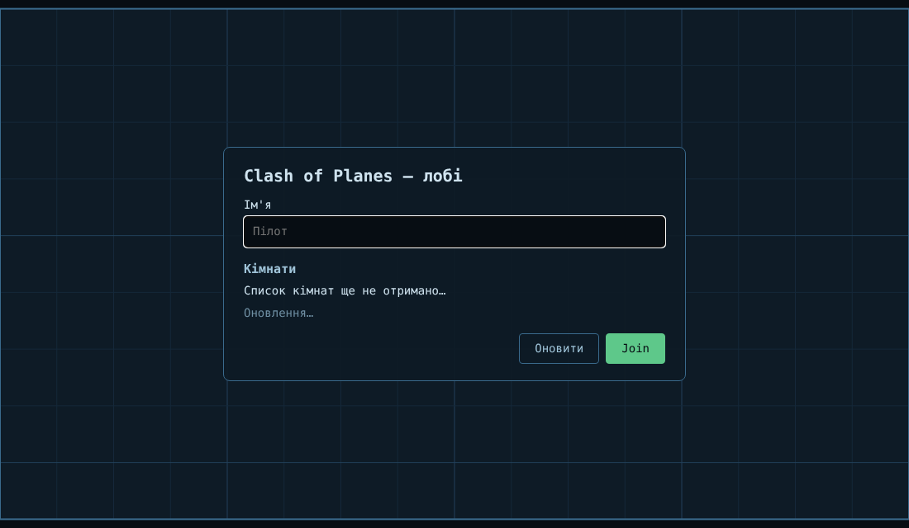 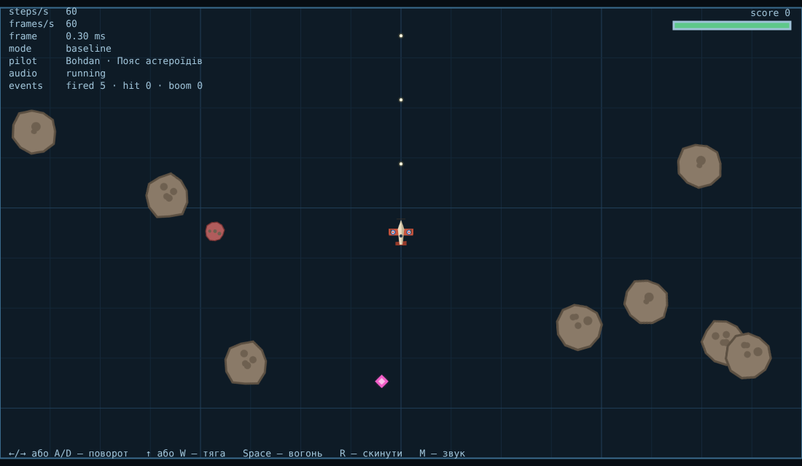

### Пайплайн ассетів

```txt
manifest.json ──loadManifest──► { assets: [{ id, type, url, size, optional? }] }
                                      │  loadAll: усі entries одночасно, Promise.all
          ┌───────────────┬───────────┴───────┬────────────────┐
     loadJson         loadImage           loadAudio          (type → loader)
          └──────────┬────┴───────────────────┘
                fetchBytes(url, { signal, onBytes, onRetry, timeoutMs, attempts })
                     │  withRetry: на кожну спробу AbortSignal.any([signal, AbortSignal.timeout(ms)])
                     │  res.ok? → ні: HttpError(status)
                     │  for await (const chunk of chunksOf(res.body)) → onBytes(loaded, total)
                fetchJson = fetchBytes + JSON.parse (SyntaxError → ParseError)
```

- **Єдиний `fetchJson`** (`src/net/http.js`): ним користуються і `loadJson`, і `loadManifest`, і лобі. `ok` перевіряється в одному
  місці (`fetchBytes`), тому `404` ніколи не дійде до `JSON.parse` чи до декодера зображення як «дані».
- **Кожен loader приймає `AbortSignal`.** Сигнал проходить у `fetch`, у читання тіла і в декодування (`abortable(...)` для
  `img.onload` і `decodeAudioData`, які самі сигналу не приймають).
- **Retry з exponential backoff + full jitter:** затримка = `random() · min(cap, base · 2^n)`, `base = 250 мс`, `cap = 4 с`.
  Jitter потрібен, щоб клієнти, які впали одночасно (наприклад, після перезапуску сервера), не повторювали запити теж одночасно.

  | Помилка                                | Повтор? | Чому                                                                      |
  | -------------------------------------- | ------- | ------------------------------------------------------------------------- |
  | `HttpError` 4xx (404, 403, 429…)       | ні      | запит сам по собі неправильний, повтор дасть ту саму відповідь            |
  | `HttpError` 5xx                        | так     | сервер може бути тимчасово перевантажений                                 |
  | `TimeoutError` (таймаут однієї спроби) | так     | мережа могла «підвиснути»; кожна спроба має власний `AbortSignal.timeout` |
  | `TypeError` від `fetch`                | так     | так `fetch` повідомляє про обрив мережі                                   |
  | `AbortError` (гравець скасував)        | ні      | скасування — це рішення, а не збій; перериває навіть паузу backoff        |
  | `ParseError` (битий JSON)              | ні      | той самий файл буде так само битим                                        |

  429 теж не повторюється, бо лаба вимагає «без ретраю на 4xx». У реальному клієнті 429 варто повторювати з урахуванням `Retry-After`.

- **`loadAll` через `Promise.all`** (`src/assets/loadAll.js`). Обов'язкові ассети (`config/game.json`) і необов'язкові
  (`optional: true` — спрайти, атлас, звуки) обробляються по-різному:
  - необов'язковий файл, що впав, перетворюється на `null` усередині власного `.catch`. `Promise.all` про це не дізнається,
    а гра бере запасний варіант: векторні фігури з Lab 1–2 замість спрайтів, тишу замість звуку;
  - обов'язковий файл, що впав, відхиляє `Promise.all`. Сам `Promise.all` **нічого не скасовує**: інші запити тривали б
    далі. Тому `loadAll` тримає власний `AbortController`, зв'язаний із сигналом гравця через `AbortSignal.any`, і перериває ним
    сусідні завантаження (fail-fast; видно на скриншоті «битий JSON» нижче: два звуки позначені «Скасовано: "config" не завантажився»).
- **Гра стартує лише після `await loadAll`:** `main()` спочатку виконує `await loadUntilReady()` і тільки потім створює лобі й світ.

#### Sequential `await` vs concurrent `Promise.all`

`/?bench&latency=N` (`src/lab3/bench.js`) завантажує ті самі 6 файлів (≈122 KB) двома способами: `loadSequential` (`for…of` +
`await` на кожному файлі) і `loadAll` (усі одразу + `Promise.all`). Кожен прогін має унікальний query, щоб HTTP-кеш не впливав
на результат. `latency` — це затримка, яку dev-сервер додає до **кожної** відповіді (`?delay=`): так локальна мережа поводиться
як віддалений сервер. 5 прогонів, у таблиці медіана.

Умови: headless Chromium 141, Linux, `vite` dev-сервер (HTTP/1.1), та сама машина.

| Затримка на файл | Sequential, мс | Concurrent, мс | Різниця |
| ---------------- | -------------- | -------------- | ------- |
| 0 мс (localhost) | 25             | 12             | ×2.2    |
| 50 мс            | 336            | 68             | ×4.9    |
| 150 мс           | 941            | 164            | ×5.7    |

Сирі прогони при 150 мс: sequential `949, 943, 941, 939, 940`, concurrent `164, 162, 167, 165, 162`.

- Послідовно час ≈ **сума**: 6 × (150 + ~7) ≈ 941 мс. Кожен `await` чекає завершення попереднього файлу, хоча файли
  між собою не залежать.
- Конкурентно час ≈ **максимум**: 150 мс затримки + найдовший окремий файл (`explode.wav`, 78 KB, його ще й треба декодувати) ≈ 164 мс.
- Зі збільшенням затримки множник прямує до кількості файлів (6). На localhost без затримки виграш лише ×2.2: тут
  основний час іде на розбір і декодування, а не на очікування мережі.
- Обмеження чесності: штучна затримка не обмежує пропускну здатність. На вузькому каналі паралельні файли ділять смугу, тож
  виграш буде меншим. Ще одне: браузер відкриває до 6 з'єднань HTTP/1.1 на хост. Файлів у нас рівно 6, тому всі йдуть
  паралельно, а сьомий уже чекав би в черзі.

### Спрайти й звук

- **Спрайтшит** — один `sheet.png` (768×320) + атлас `sheet.json`. Кожен кадр має прямокутник у шиті, точку опори (pivot)
  і `r` — радіус зіткнення в пікселях шита. `SpriteSheet.draw(ctx, name, x, y, { angle, radius })` масштабує кадр так, що `r`
  збігається з радіусом сутності, тож один кадр астероїда годиться для будь-якого розміру. Кадри малюються з подвійною
  роздільністю (`pxPerUnit: 2`) і не розмиваються на HiDPI. Корабель має 3 кадри (без тяги + 2 кадри полум'я, що чергуються),
  астероїд — 3 варіанти + червоний «мисливець». Картинки згенеровано процедурно (`scripts/gen-assets.js`, власний
  мінімальний растеризатор + PNG-кодер на `node:zlib`). У репозиторії немає графіки невідомого походження, і `npm run assets`
  відтворює ті самі файли байт у байт.
- **Звук через Web Audio** (`src/audio/audio.js`). Браузер не дозволяє запускати звук без жесту користувача (autoplay
  policy): `AudioContext`, створений до жесту, лишається у стані `suspended`. Тому:
  - буфери **декодуються під час завантаження** через `OfflineAudioContext`, якому жест не потрібен. `AudioBuffer` не
    прив'язаний до контексту, що його декодував, тому той самий буфер потім грає в «живому» контексті;
  - сам `AudioContext` створюється в першому обробнику `pointerdown`/`keydown`. На практиці це клік по «Join» у лобі, тож у грі
    звук уже працює. HUD показує стан (`audio running` / `locked` / `muted`);
  - кожен звук — це новий `AudioBufferSourceNode` → `GainNode` → master gain з невеликим випадковим `detune`, щоб серія
    пострілів не звучала однаково.

### Шина подій: симуляція не знає про звук і HUD

`src/sim/events.js`: `class EventBus extends EventTarget` з методом `emit(type, detail)` → `dispatchEvent(new CustomEvent(type, { detail }))`.
`World` отримує шину в конструкторі (`new World({ events: bus })`). `Ship.fire` надсилає `"fired"`, розв'язання зіткнень —
`"hit"`, `spawnExplosion` — `"exploded"`. Підписуються ззовні:

```txt
sim/ship.js, sim/world.js ── emit ──►  bus (EventTarget)  ──►  audio/audio.js   (звук)
                                                          └──►  ui/hudFeed.js    (лічильники + стрічка подій у HUD)
```

Усі `import` у `src/sim/` (крім тестів) ведуть лише в `./…` всередині `sim/` (перевірка: `grep -h "^import" src/sim/*.js`). Симуляція
не імпортує ні `audio.js`, ні HUD. `EventTarget` і `CustomEvent`
є і в Node, тому тести симуляції (`src/sim/events.test.js`) працюють без DOM. Важливо: `dispatchEvent` **синхронний**
(див. головоломку 5). Слухачі виконуються всередині кроку симуляції, тому вони мають бути дешевими: запустити звук,
збільшити лічильник. Окремо зауважу: виняток у слухачі `EventTarget` не перериває `dispatchEvent`, браузер просто
повідомляє про нього, тож зламаний звук не зупинить фізику.

### Лобі

- **`class Lobby extends EventTarget`** (`src/lobby/lobby.js`) — лише логіка, без DOM. Події: `"rooms"`, `"status"`, `"join"`.
  `src/lobby/lobbyView.js` — окремий DOM-модуль: будує форму, слухає події лобі, викликає `lobby.join(roomId, name)` / `lobby.refresh()`.
  Усі підписки в'ю мають `{ signal }`, тому `unmount()` знімає їх одним `abort()`.
- **Опитування по інтервалу, поки лобі видиме:** `for await (const tick of ticks(intervalMs, signal))`, де `ticks` — асинхронний
  генератор у `src/async.js`. На відміну від `setInterval`, наступна пауза починається лише **після** відповіді, тож повільний
  сервер не накопичить купу паралельних запитів. Коли вкладка прихована (`visibilityState === "hidden"`), тики пропускаються,
  а після повернення список одразу оновлюється.
- **`AbortSignal.timeout` на кожен запит:** `AbortSignal.any([stopSignal, AbortSignal.timeout(2500)])`. Таймаут перетворюється
  на рядок статусу «Сервер не відповів за 2.5 с. Повтор автоматично». Останній отриманий список при цьому лишається на екрані.
- **Abort, щойно гравець пішов:** `join()` і `stop()` викликають `abort()` на контролері лобі. Це зупиняє цикл тиків
  (`sleep` між тиками відхиляється) і скасовує запит, що саме виконується. Таке скасування не показується як помилка
  (тест `stop() aborts the request in flight, silently`).
- **`/api/rooms`** повертає 4 кімнати з `rooms.json`. Сервер щоразу трохи змінює кількість гравців, тому видно, що список
  справді оновлюється. Повна кімната (`4/4`) вимкнена, ім'я перевіряється (1–16 символів) і запам'ятовується в `localStorage`.

### Головоломки порядку мікрозадача / задача

Перевірено двома способами: `/?puzzles` запускає всі п'ять у браузері й порівнює з очікуваним виводом (у Chromium збіглися всі 5,
у трьох запусках поспіль), а `src/lab3/puzzles.test.js` перевіряє 1, 2, 3 і 5 у Node (там немає `requestAnimationFrame`).
У файлі замість `console.log` стоїть `log`, щоб вивід можна було зібрати.

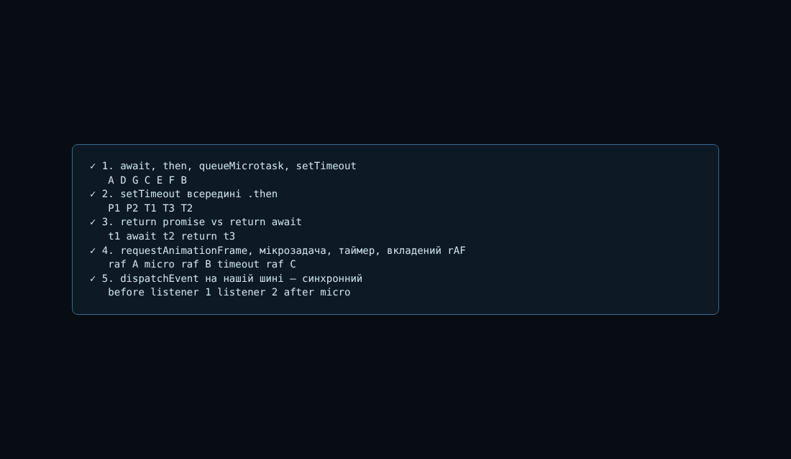

**1. `await` проти `.then`, `queueMicrotask` і `setTimeout`**

```js
console.log("A");
setTimeout(() => console.log("B"), 0);
Promise.resolve().then(() => console.log("C"));
(async () => {
  console.log("D");
  await null;
  console.log("E");
})();
queueMicrotask(() => console.log("F"));
console.log("G");
```

Вивід: `A D G C E F B`. Тіло async-функції до першого `await` виконується синхронно (`D`). Решта функції після `await` стає
мікрозадачею, у черзі вона йде між `C` і `F` у порядку постановки. `B` — задача, тому вона виконується після всіх мікрозадач.

**2. `setTimeout` всередині `.then`**

```js
setTimeout(() => console.log("T1"), 0);
Promise.resolve()
  .then(() => {
    console.log("P1");
    setTimeout(() => console.log("T2"), 0);
  })
  .then(() => console.log("P2"));
setTimeout(() => console.log("T3"), 0);
```

Вивід: `P1 P2 T1 T3 T2`. Увесь ланцюжок мікрозадач (`P1`, `P2`) виконується до першої задачі. `T2` ставиться в чергу задач
лише під час `P1`, тобто після `T1` і `T3`, які вже стоять у черзі з синхронного коду.

**3. `return promise` проти `return await`**

```js
async function viaReturn() {
  return Promise.resolve("return");
}
async function viaAwait() {
  return await Promise.resolve("await");
}
viaReturn().then(console.log);
viaAwait().then(console.log);
Promise.resolve()
  .then(() => console.log("t1"))
  .then(() => console.log("t2"))
  .then(() => console.log("t3"));
```

Вивід: `t1 await t2 return t3`. `await` на вже виконаному нативному промісі коштує один тік, і `.then` спрацьовує на другому.
Повернення промісу з async-функції потребує ще двох тіків (`NewPromiseResolveThenableJob` → `then`), тому `"return"`
з'являється аж на третьому тіку, після `t2`.

**4. `requestAnimationFrame`, мікрозадача, таймер і вкладений rAF**

```js
requestAnimationFrame(() => {
  console.log("raf A");
  requestAnimationFrame(() => console.log("raf C"));
  setTimeout(() => console.log("timeout"), 0);
  Promise.resolve().then(() => console.log("micro"));
});
requestAnimationFrame(() => console.log("raf B"));
```

Вивід: `raf A micro raf B timeout raf C`. Після **кожного** rAF-колбека браузер виконує мікрозадачі (`micro` до `raf B`).
Обидва rAF, зареєстровані до кадру, виконуються в одному кадрі, раніше за таймер, поставлений усередині. rAF, зареєстрований
під час кадру, переноситься на **наступний** кадр (~16 мс), а `setTimeout(0)` спрацьовує раніше. Через це в ігровому циклі
Lab 1 `requestAnimationFrame(tick)` усередині `tick` ніколи не виконується двічі за кадр.

**5. `dispatchEvent` на нашій шині — синхронний**

```js
const bus = new EventTarget();
bus.addEventListener("fired", () => {
  console.log("listener 1");
  Promise.resolve().then(() => console.log("micro"));
});
bus.addEventListener("fired", () => console.log("listener 2"));
console.log("before");
bus.dispatchEvent(new CustomEvent("fired"));
console.log("after");
```

Вивід: `before listener 1 listener 2 after micro`. `dispatchEvent`, викликаний зі скрипта, просто синхронно викликає всіх
слухачів. Між ними стек не порожній, тому мікрозадача чекає до кінця всього скрипта. Інакше буває при справжньому кліку
користувача: тоді браузер викликає слухачів сам і виконує мікрозадачі після кожного. Саме тому `emit("fired")` у `Ship.fire`
відпрацьовує до наступного рядка симуляції.

### Галерея збоїв: гра не падає

Кожен збій вмикається параметром URL (`src/assets/faults.js`) і діє **лише на першу спробу завантаження**. Тому «Retry»
показує саме відновлення, а не той самий збій вдруге. Таймаут і `503` імітує dev-сервер (`?delay=`, `?status=`).
Довелося виправити одну річ: Vite на відсутній файл у `/assets/` повертав `index.html` зі статусом **200** (SPA-fallback).
Middleware тепер відповідає чесним `404`, як справжній статичний сервер.

| Збій                         | Як відтворити            | Що відбувається в коді                                                                                                                                                                                   | Результат                                                       |
| ---------------------------- | ------------------------ | -------------------------------------------------------------------------------------------------------------------------------------------------------------------------------------------------------- | --------------------------------------------------------------- |
| 404 спрайта                  | `/?fail=404`             | `HttpError 404`, 4xx не повторюється (рівно 1 запит). Ассет необов'язковий, тож `null`; `createSpriteSheet` повертає `null`, і `draw.js` малює векторні фігури                                           | **гра стартує**; у лобі примітка про векторну графіку           |
| Таймаут мережі               | `/?fail=timeout`         | `config/game.json` відповідає через 10 с. Кожна спроба обривається `AbortSignal.timeout(3000)`, потім 2 повтори з backoff. Ассет обов'язковий, тому `Promise.all` відхиляється (≈10 с, виміряно 9979 мс) | **кнопка Retry**, після неї — лобі                              |
| Abort посеред завантаження   | `/?fail=abort` або `Esc` | `ac.abort()` через `AbortSignal.any` доходить до кожного `fetch`, читання тіла й декодування; всі файли «— скасовано». Скасування не вважається «необов'язковим» збоєм                                   | **кнопка Retry** («Завантаження скасовано»)                     |
| Битий JSON                   | `/?fail=json`            | `JSON.parse` кидає `SyntaxError`, з нього виходить `ParseError` (не повторюється). Конфіг обов'язковий, тому fail-fast `abort()` скасовує сусідні файли                                                  | **кнопка Retry**                                                |
| 503 один раз (бонус)         | `/?fail=flaky`           | кожен файл спершу отримує `503`, тоді `повтор #2` після випадкової паузи                                                                                                                                 | **гра стартує**, рядки «повтор #2» видно на екрані завантаження |
| Таймаут `/api/rooms` (бонус) | `/?fail=rooms-timeout`   | перші два опитування обриває `AbortSignal.timeout(2500)`, лобі показує помилку й опитує далі; третє успішне                                                                                              | **лобі відновлюється саме** (≈11 с від завантаження сторінки)   |

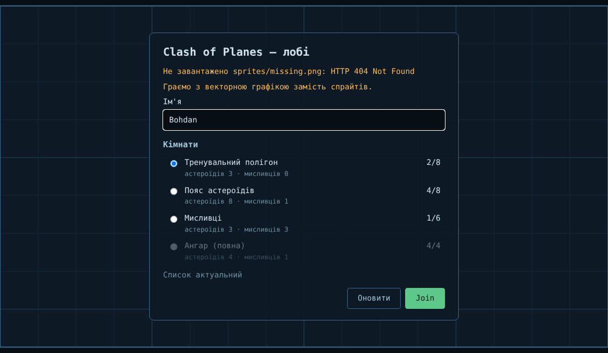 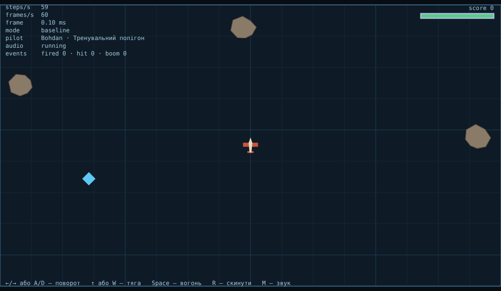

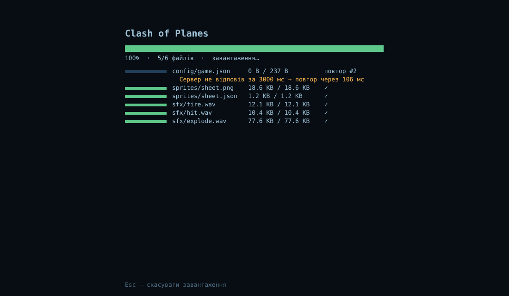 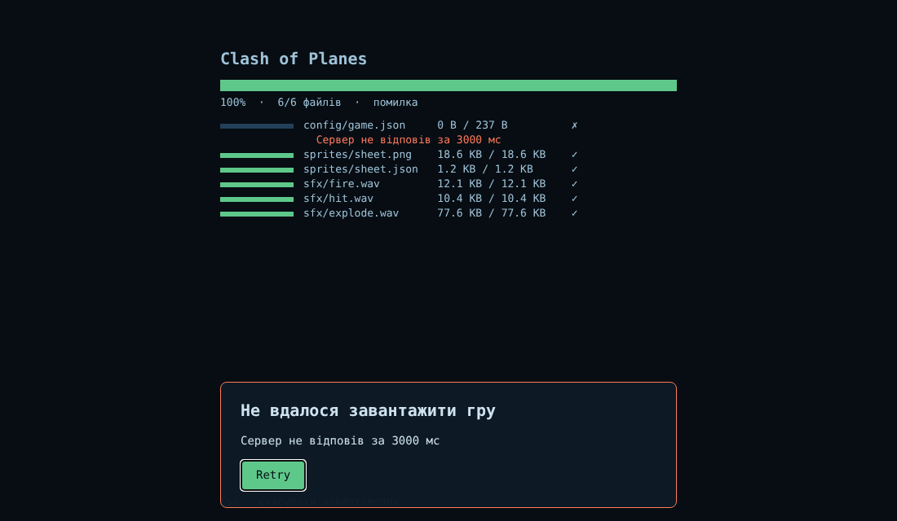

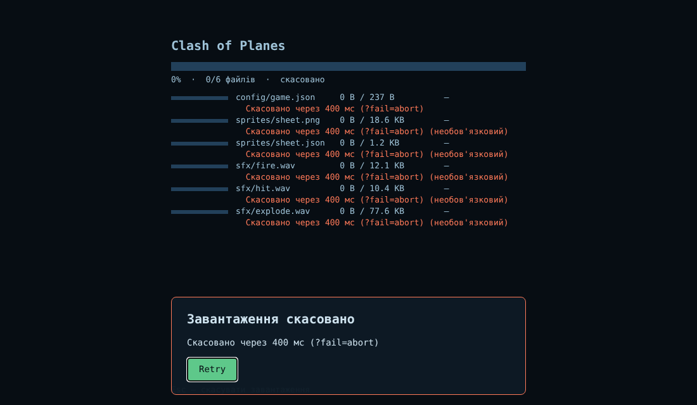 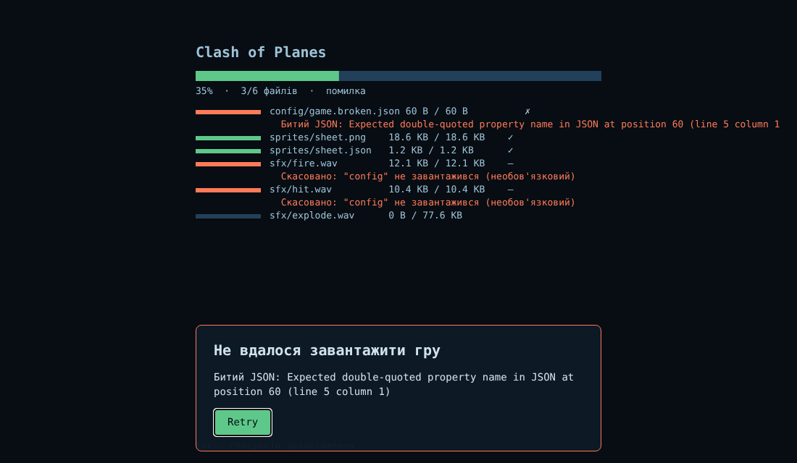

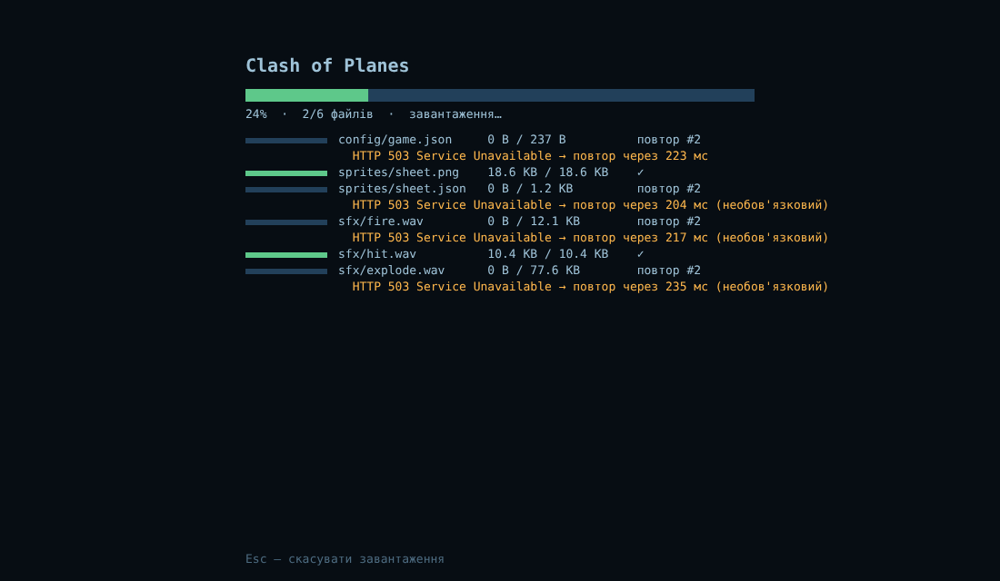 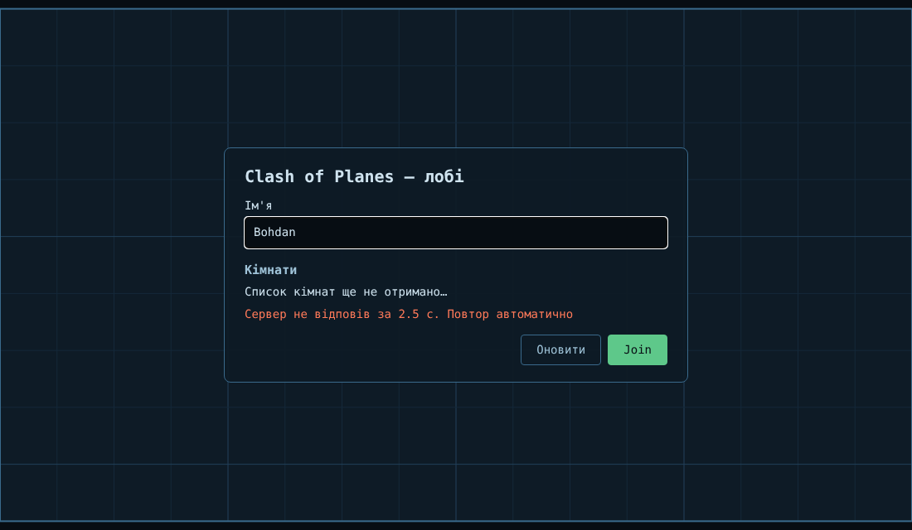

Скриншоти зроблено в headless Chromium (1100×640). Сценарії перевірено автоматично: після «Retry» у кожному випадку з'являється лобі.

### Де які комбінатори і чому

- **`Promise.all`** — у `loadAll`: потрібні всі результати, порядок відповідає маніфесту, і першу фатальну помилку треба
  отримати одразу. Необов'язкові ассети перехоплюються до `Promise.all`, тому один битий звук не валить усе.
- **`Promise.allSettled`** дав би той самий результат для необов'язкових файлів, але без fail-fast: на битому конфігу гра чекала б
  найповільніший звук, перш ніж показати Retry. Тому я його не використовую.
- **`Promise.race`** замінений на `AbortSignal.timeout` + `AbortSignal.any`. `race` лише ігнорує запит, що «програв»,
  а сигнал справді його скасовує: з'єднання закривається, байти більше не завантажуються.
- **`Promise.any`** знадобився б для дзеркал (взяти перший успішний із кількох CDN). Тут джерело одне.
- **Колбек → Promise:** `decodeImage` (`img.onload` / `onerror`) і `sleep` (`setTimeout`) у `src/async.js`.
- **Асинхронна ітерація:** `chunksOf(res.body)` (прогрес по байтах) і `ticks()` (опитування лобі) — обидва async-генератори,
  споживаються через `for await`.

### Що reject, а що ні: 404, мережа, тіло, JSON

`fetch` має два кроки, і три «поламані» кадри галереї потрапляють у різні місця:

| Що сталося                       | Проміс `fetch`                | Хто кидає                       | Що бачить код                 | Повтор? |
| -------------------------------- | ----------------------------- | ------------------------------- | ----------------------------- | ------- |
| 404 спрайта                      | **fulfilled**, `ok === false` | наш `fetchBytes`: `HttpError`   | `err.status === 404`          | ні      |
| 503 від сервера                  | **fulfilled**, `ok === false` | `HttpError`                     | `err.status === 503`          | так     |
| Хоста немає / обрив до відповіді | **rejected**, `TypeError`     | сам `fetch`                     | `err instanceof TypeError`    | так     |
| Обрив під час читання тіла       | fulfilled, тіло — reject      | `reader.read()` у `chunksOf`    | `TypeError` з другого кроку   | так     |
| Таймаут запиту                   | rejected, `TimeoutError`      | `AbortSignal.timeout`           | `err.name === "TimeoutError"` | так     |
| `abort()` гравцем                | rejected, `AbortError`        | `controller.abort()`            | `err.name === "AbortError"`   | ні      |
| Битий JSON                       | fulfilled, `ok === true`      | `JSON.parse` → наш `ParseError` | `SyntaxError` у `cause`       | ні      |

Правило: `fetch` відхиляється лише коли **запиту не відбулось** (мережа, таймаут, abort). Усе, що сервер відповів, навіть
`404`, це fulfilled; помилку HTTP кидаємо самі в єдиному місці, `fetchBytes`.

### Досліди з нотаток (§1–§7)

Усі фрагменти виконано в Chromium на сторінці з dev-сервером. Замість `httpbin.org` для 404 і abort використано власний
сервер (`/assets/…` і `/api/rooms?delay=…`), бо потрібен лише факт «сервер відповів 404» / «відповідь довга».

| §   | Дослід                                                | Передбачення             | Результат                                         |
| --- | ----------------------------------------------------- | ------------------------ | ------------------------------------------------- |
| 1   | `resolve(1); resolve(2)` + `.then(log)`               | лише `1`                 | `1`                                               |
| 1   | `Promise.resolve('ready').then(…)`; `log('after…')`   | `after subscribe`, потім | `after subscribe`, `then ready`                   |
| 2   | `Promise.resolve(1).then(log); log(2)`                | `2, 1`                   | `2, 1`                                            |
| 2   | те саме + `setTimeout(log 4)` зверху                  | `2, 1, 4`                | `2, 1, 4`                                         |
| 2   | `async a(){log 1; await null; log 2}; a(); log 3`     | `1, 3, 2`                | `1, 3, 2`                                         |
| 2   | головоломка з `setTimeout`, `.then.then`, `await 0`   | `4 6 2 5 3 1`            | `4 6 2 5 3 1`                                     |
| 3   | забутий `return` у `.then`                            | `forgot undefined`       | `forgot ` (порожньо) і `returned 2`               |
| 3   | `throw` → `.then` → `.catch` → `.then`                | `a 1, c boom, d`         | `a 1, c boom, d`, рядка `b` немає                 |
| 4   | `fetch(404)`: `r.ok`, `r.status`                      | fulfilled, `false 404`   | `ok false status 404`                             |
| 4   | `fetch('https://no-such-host.invalid/')`              | `reject TypeError`       | `reject TypeError`                                |
| 4   | заголовки, потім `await r.json()`                     | два кроки                | `headers 200 true`, потім ключі `version,assets`  |
| 5   | два `wait(1000)` послідовно vs `Promise.all`          | ≈2000 / ≈1000 мс         | `seq 2001`, `all 1000`                            |
| 5   | `all([slow(300), reject('fast')])`                    | `all fast`, пізніше slow | `all fast`, через ~300 мс `slow still ran`        |
| 6   | `abort()` одразу після `fetch` зі `signal`            | `AbortError`             | `AbortError`                                      |
| 6   | `fetch(…, { signal: AbortSignal.timeout(300) })`      | `AbortError`?            | **`TimeoutError`**, не `AbortError`               |
| 7   | проміс, підписка до і після; `EventTarget` до і після | `early`+`late`; `heard`  | `early ship.png`, `late ship.png`; лише `heard 1` |

Єдина розбіжність із очікуваним: §6. Нотатки пишуть, що `AbortSignal.timeout` дає те саме ім'я помилки, але насправді
це **`TimeoutError`**, а `AbortError` дає лише ручний `abort()`. Це корисно: код може відрізнити «гравець пішов» від «сервер
мовчить». На цьому тримається `isRetryable`: `TimeoutError` повторюємо, `AbortError` — ні.

Ще два результати, які в цих дослідах видно і які відповідають §6 нотаток: необроблений reject у браузері лише
друкує помилку і викликає подію `unhandledrejection`, а `node -e "Promise.reject(new Error('x'))"` завершується з кодом `1`.

### Reflection

**1. Три стани проміса і чому `.then` на готовому промісі все одно асинхронний.** `pending` → `fulfilled` (з
значенням) або `rejected` (з причиною), перехід лише один раз і лише вперед; другий `resolve` ігнорується (дослід §1). Реакція
`.then` ставиться в чергу **мікрозадач**, навіть якщо проміс уже виконаний. Якби готовий проміс кликав колбек синхронно, а
неготовий пізніше, той самий код мав би два порядки виконання залежно від кешу. У грі так само: `onload` картинки з кешу
може спрацювати синхронно, а обгортка `new Promise` дає один порядок для кешу і для мережі.

**2. Десугаринг `async function f() { const a = await g(); return a + 1; }`:**

```js
function f() {
  return Promise.resolve(g()).then((a) => a + 1);
}
```

`g()` викликається синхронно, всередині `f`. Керування повертається в event loop **на `await`**, тобто одразу після
виклику `g()`: `f` віддає викликачеві ще не виконаний проміс, а решта тіла (`a + 1`) стає мікрозадачею, коли `g()` виконається.

**3. Порядок `setTimeout(log1); Promise.resolve().then(log2).then(log3); (async()=>{log4; await 0; log5})(); log6`:**
`4 6 2 5 3 1`. `4` і `6` синхронні (async-функція виконується до першого `await`). Потім спустошується черга мікрозадач:
`2` стояв першим (`.then` на вже готовому промісі), `await 0` поставив `5` слідом, а `3` потрапляє в чергу лише коли відпрацював
`2` (кожен `.then` це новий проміс), тому `5` випереджає `3`. `1` це задача `setTimeout`, вона чекає, поки мікрочерга спорожніє
повністю. Це дослід §2, виконаний у браузері.

**4. Комбінатори в моїй грі.**

- `Promise.all`: `loadAll`, потрібні всі потрібні файли одночасно, перша фатальна помилка завершує все.
- `Promise.allSettled`: «показати лобі, навіть якщо звук не доїхав». У мене це зроблено на рівні файлу: необов'язковий
  ассет повертає `null`, тож `all` його не бачить. `allSettled` дав би те саме, але без fail-fast на битому конфігу.
- `Promise.race`: «хто перший». У мене таймаут зроблено через `AbortSignal.timeout`, бо `race` програвший запит не зупиняє.
- `Promise.any`: перший успішний із кількох дзеркал ассетів (у мене одне джерело, тож не застосовано).

Коли `all` відхиляється, **решта промісів не зупиняється**: вони добігають і витрачають мережу (дослід §5: `slow still ran`
через 300 мс). Тому `loadAll` сам скасовує сусідів через `AbortController`.

**5. Чому `fetch` не відхиляється на 404 і чому тіло — другий `await`.** Проміс `fetch` виконується, коли прийшли
**заголовки**. 404 це повноцінна відповідь сервера, мережа спрацювала, тому проміс fulfilled з `ok === false`. Reject означає
«запиту не було» (мережа, таймаут, abort). Тіло читається окремо, бо воно може бути великим і приходить потоком: заголовки
доступні одразу, а `await r.json()` чекає на решту байтів. Між кроками з'єднання може впасти, тож перший крок fulfilled, а
другий reject. Через це в мене `fetchBytes` перевіряє `ok` і читає тіло чанками (`for await`).

**6. Як `AbortController` скасовує без `.cancel()` у промісі і як зробити свою функцію скасовуваною.** Проміс лише
значення, скасовує роботу той, хто її запустив. `controller.signal` передається в `fetch`, і при `abort()` `fetch` сам
відхиляє свій проміс причиною скасування (`signal.reason`). Своя async-функція приймає `signal`, перевіряє `signal.aborted`
на вході і підписується на `"abort"`, щоб відхилити проміс і прибрати таймери. Приклади в коді: `sleep(ms, signal)` очищає
`setTimeout`, `abortable(promise, signal)` обгортає `img.onload` і `decodeAudioData`, які сигналу не приймають, `Lobby.stop()` скасовує
запит, що виконується зараз.

**7. Проміс чи подія.** Проміс для значення, яке з'являється **один раз** і яке має отримати й той, хто підписався пізно
(картинка, відповідь `/api/rooms`, дослід §7: `late ship.png`). Подія для того, що відбувається **знову і знову**, а хто спізнився,
той пропустив (`fired`, `hit`, `exploded`; `too late` не спрацював). Конвертація подія → проміс:

```js
const once = (target, type) =>
  new Promise((resolve) => target.addEventListener(type, resolve, { once: true }));
```

У проєкті це `once(lobby, "join")` у `main.js`: «чекаємо, поки гравець натисне Join» справді відбувається один раз. Проміс →
подія: `lobby.dispatchEvent(new CustomEvent("rooms", …))` після кожного `await` у `refresh()`.

**8. Необроблений reject у браузері і в Node.** У браузері: помилка в консолі й подія `unhandledrejection`, сторінка
працює далі. У Node (≥ 15): процес падає з кодом `1` (перевірено). Різниця навмисна. Вкладка належить користувачеві й одна
нерозчута помилка не має вбивати всю гру, а серверний процес із тихо проковтнутою помилкою працював би зі зіпсованим станом.
Йому краще впасти гучно й одразу, щоб супервізор його перезапустив. Тому в моєму коді жодного reject без `.catch` чи
`try/catch`: `main().catch(...)` в кінці `main.js` і `#poll` у лобі, що ловить лише `AbortError`.

### Що я вивчив (Lab 3)

Головне: `async/await` — це не окремий механізм, а синтаксис над тими самими промісами й тією самою чергою мікрозадач.
Це добре видно в головоломці 3: різниця між `return promise` і `return await` — це рівно два зайві тіки мікрозадач, і її можна
порахувати вручну.

Другий висновок: «паралельно» в JS означає «одночасно чекати», а не «одночасно рахувати». `Promise.all` не прискорює жоден
окремий файл, він лише не чекає попередній, перш ніж почати наступний. Тому виграш дорівнює майже кількості файлів при великій
затримці мережі й зовсім невеликий на localhost, де очікування майже немає.

Третій: скасування треба проєктувати явно. Ні `Promise.all`, ні `Promise.race` нічого не скасовують, вони лише перестають
чекати. Справжнє скасування робить тільки `AbortSignal`, протягнутий через усі шари: `fetch`, читання тіла, декодування,
паузу backoff, цикл опитування. І лише так abort від гравця можна відрізнити від збою мережі..

---

## Lab 04 — Node.js: EventEmitter, streams, WebSocket-сервер

### Що додано до проєкту

Репозиторій поділено на `client/` (Vite-застосунок із Lab 1–3) і `server/` (Node, без фреймворків: лише `node:http` і бібліотека
`ws`). Сервер віддає зібраний клієнт, має JSON API, кімнати, чат по WebSocket і пише лог матчу потоком на диск. Координати
кораблів по мережі **не** передаються (це Lab 5): світ у кожному вікні поки локальний, а сокет несе лише вхід у кімнату,
ростер і чат.

Шлях гравця тепер: **loading** (Lab 3) → **лобі** (список кімнат із `GET /api/rooms`, створення кімнати через
`POST /api/rooms`) → **`join` по WebSocket** → гра з чатом. Якщо сервер відмовив (кімната заповнена, ім'я зайняте, кімнату
вже видалено), гравець повертається в лобі з причиною.

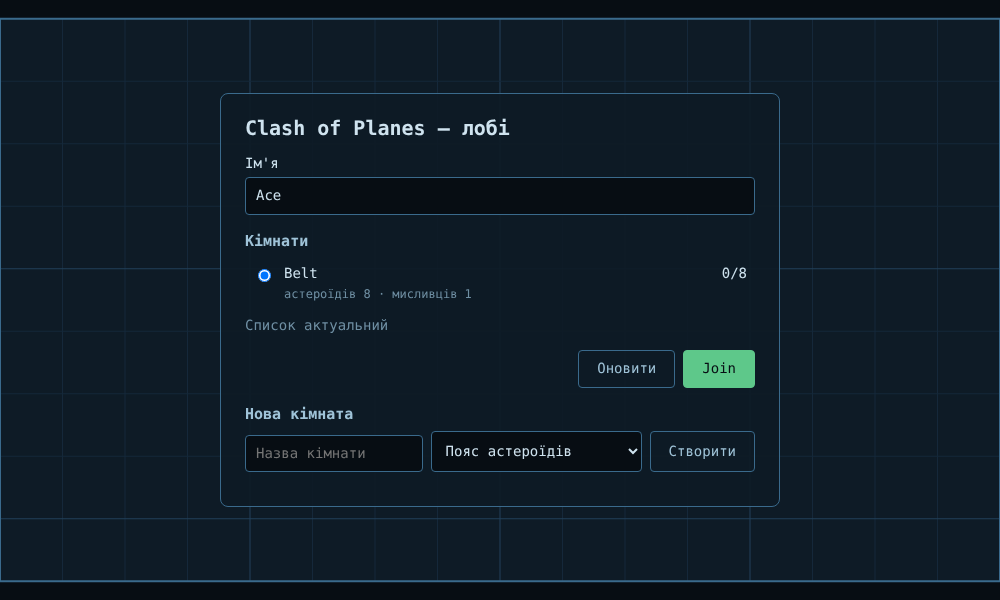 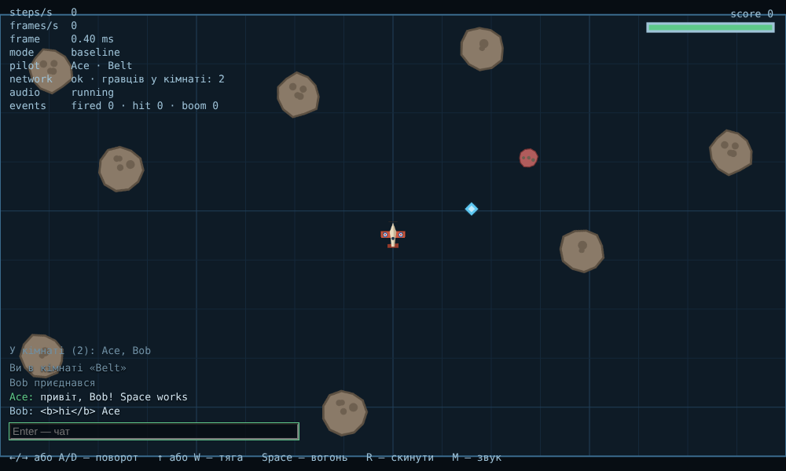

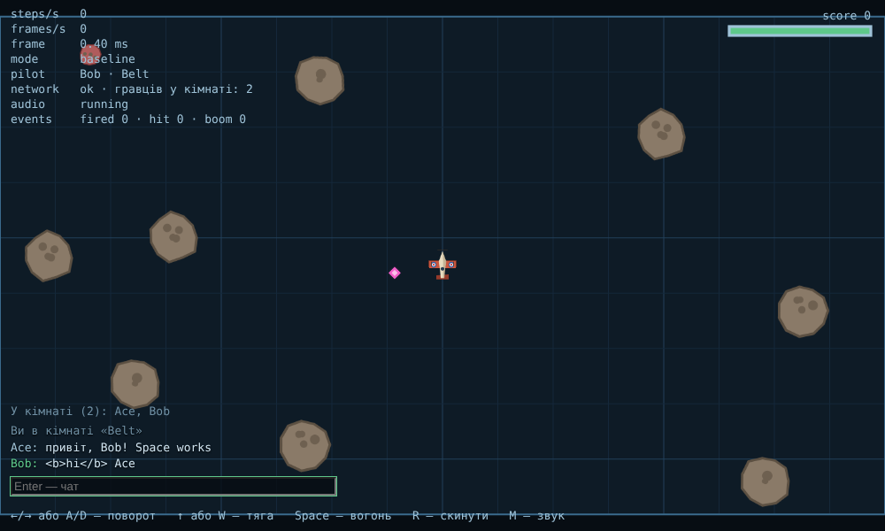 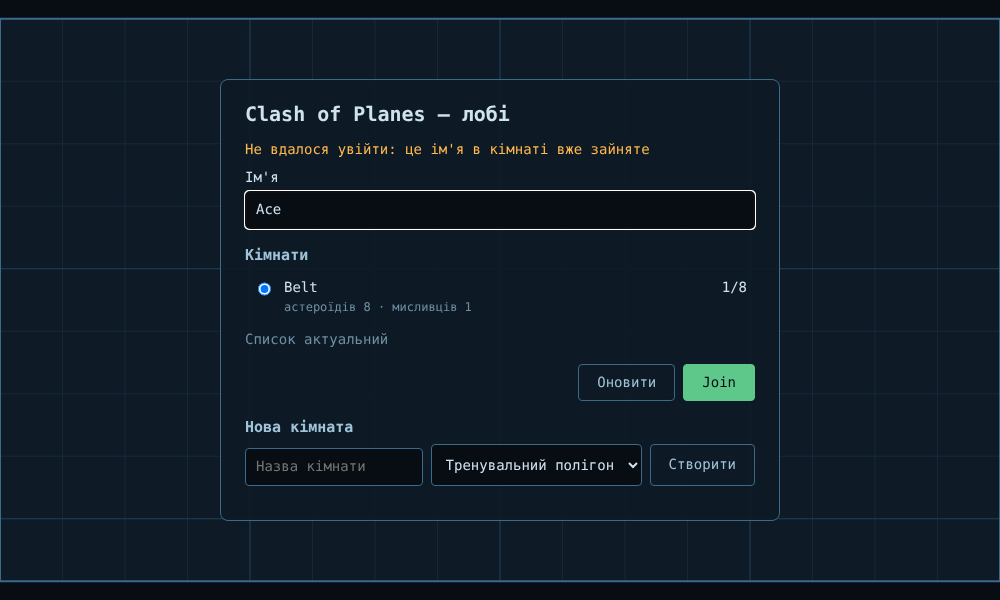

Два вікна: Ace створює кімнату «Belt» і входить, Bob бачить її в лобі (`1/8`) і входить; обидва бачать ростер і чат. Текст
`<b>hi</b>` у чаті лишається текстом (рядки будуються через `textContent`, у DOM не з'являється жодного `<b>`). Другий Ace
отримує відмову «ім'я зайняте» й повертається в лобі.

### M1 — HTTP-сервер на `node:http`

| Маршрут                               | Що робить                                                                                                 |
| ------------------------------------- | --------------------------------------------------------------------------------------------------------- |
| `GET /health`                         | `{ status, uptime, rooms, rss }`                                                                          |
| `GET /api/rooms`                      | список кімнат `{ rooms: [{ id, name, players, maxPlayers, arena }] }`                                     |
| `POST /api/rooms`                     | створити кімнату; тіло ≤ `MAX_BODY_BYTES` (413), валідація (400), ліміт кімнат (409); `201` + `Location`  |
| `GET /api/replays`, `…/:id`           | список логів матчу й **потокова** віддача файлу (M3)                                                      |
| `GET /*`                              | статика з `client/dist`: MIME, `ETag`/304, `Cache-Control` (hash-імена — `immutable`, решта — `no-cache`) |
| `/api/slow`, `/api/replays-naive/:id` | лише з `ENABLE_DEBUG_ROUTES=1`: демонстрації для M3/M4, у звичайному режимі — 404                         |

**Захист від `..`.** `new URL("/a/../b", base)` мовчки нормалізує `..` і тим самим ховає саму спробу, тому перевірка
виконується над **сирим** `req.url` до будь-якого парсингу: percent-decode, потім відмова на сегмент `..` (403), NUL-байт чи
зворотний слеш; зламане кодування — 400. Другий рубіж: розв'язаний шлях має лежати всередині `client/dist`. Тест
(`server/test/http.test.js`) шле запити «сирим» TCP-сокетом, бо `fetch` нормалізує шлях сам. Усі вони дають 403:

```txt
/../package.json                  /assets/../../package.json         /%2e%2e/package.json
/%2E%2E%2Fpackage.json            /assets/..%2f..%2fpackage.json     /..%5cpackage.json
/assets/%2e%2e/%2e%2e/etc/passwd  /api/rooms/../../x
```

А файл, що лише _називається_ з крапками (`a..b.txt`), віддається нормально.

**Конфіг** (`server/src/config.js`): усе з `process.env`, розібране й перевірене в одному місці. Некоректне значення
(`PORT=abc`) — процес не стартує: усі проблеми друкуються разом, код виходу `2`. `ConfigError` ловить тільки `main`.

| Змінна                               | За замовчуванням | Перевірка / призначення                                             |
| ------------------------------------ | ---------------- | ------------------------------------------------------------------- |
| `PORT`                               | `3000`           | ціле 0–65535 (0 — випадковий, для тестів)                           |
| `HOST`                               | `127.0.0.1`      | непорожній (у контейнері — `0.0.0.0`)                               |
| `LOG_DIR`                            | `./logs`         | непорожній; якщо існує — має бути каталогом; створюється при старті |
| `CLIENT_DIST`                        | `../client/dist` | звідки віддавати клієнт                                             |
| `MAX_MESSAGE_BYTES`                  | `2048`           | `maxPayload` для `ws` і ліміт у `validate`                          |
| `JOIN_TIMEOUT_MS`                    | `5000`           | скільки чекати `join`                                               |
| `HEARTBEAT_MS`                       | `15000`          | період ping; `MAX_MISSED_PONGS=2`                                   |
| `RATE_PER_SEC`/`RATE_BURST`          | `10` / `20`      | token bucket на з'єднання                                           |
| `MAX_ROOMS`/`MAX_PLAYERS_PER_ROOM`   | `20` / `8`       | ліміти сервера                                                      |
| `SLOW_DROP_BYTES`/`SLOW_CLOSE_BYTES` | 64 KiB / 1 MiB   | політика повільного клієнта (див. M4)                               |

Всі пороги можна змінити через середовище, тому тести запускають справжній сервер із `HEARTBEAT_MS=40` чи
`JOIN_TIMEOUT_MS=80`, замість того щоб чекати 15 і 5 секунд.

**Graceful shutdown (`SIGINT`/`SIGTERM`).** `app.shutdown()` виконує по порядку: (1) `server.close()` — перестати приймати
нові з'єднання; (2) кожному сокету `close(1001, "server shutting down")` і чекаємо, доки вони закриються (до
`SHUTDOWN_GRACE_MS`, далі `terminate`); (3) `rooms.closeAll()` — кожна кімната пише у свій лог останній рядок
`room_closed`; (4) `logs.closeAll()` чекає, поки кожен NDJSON-файл дописаний і закритий; (5) `process.exit(0)`. Другий сигнал
під час зупинки — негайний вихід з кодом `1`. Тест (`shutdown.test.js`) запускає **справжній процес**, підключає сокет, шле
`SIGTERM` (і окремо `SIGINT`) і перевіряє: клієнт отримав `1001`, код виходу `0`, а останній рядок лог-файла — `room_closed`,
тобто лог дописано до виходу.

### M2 — Кімнати й життєвий цикл WebSocket

**`Room extends EventEmitter`** (`server/src/rooms.js`) нічого не знає про сокети й JSON: гравці — це
`{ id, name, send }`, а кімната лише емітить події. Слухачі виконуються синхронно, у порядку реєстрації.

| Подія            | Коли                                                                                | Хто слухає                            |
| ---------------- | ----------------------------------------------------------------------------------- | ------------------------------------- |
| `join` / `leave` | гравець зайшов / вийшов                                                             | `attachBroadcast` (розсилає `roster`) |
| `chat`           | повідомлення чату                                                                   | `attachBroadcast` (розсилає `chat`)   |
| `empty`          | вийшов останній гравець                                                             | `RoomManager` — видаляє кімнату       |
| `event`          | **кожна** з подій вище + `room_opened`/`room_closed` у формі `{ t, room, type, … }` | `MatchLogs` (лог на диск)             |

`RoomManager` створює, шукає й видаляє кімнати; порожню видаляє по `"empty"`. Кімнату, у яку ніхто не зайшов за
`ROOM_IDLE_MS` (60 с), теж видаляє: інакше забуті `POST /api/rooms` забили б сервер. `RoomError` має код
(`room_full`, `name_taken`, `too_many_rooms`), який сервер перетворює на повідомлення клієнту.

**Протокол v1** (`server/src/protocol.js`): JSON-повідомлення `{ v: 1, type, … }`. Кожне вхідне повідомлення проходить
`validate()`: розмір у **байтах** (кирилиця — 2 байти на літеру), JSON, версія, `type`, і **точна** форма (зайве поле —
помилка, `name` 1–16 друкованих символів, `text` 1–200).

| Напрям | `type`   | Поля              | Відповідь                                                     |
| ------ | -------- | ----------------- | ------------------------------------------------------------- |
| C → S  | `join`   | `room`, `name`    | `joined { room, you, players }` або `error` + закриття `4004` |
| C → S  | `chat`   | `text`            | усім у кімнаті `chat { from, text, t }`                       |
| C → S  | `leave`  | —                 | закриття `1000`                                               |
| S → C  | `roster` | `players`         | коли хтось зайшов/вийшов                                      |
| S → C  | `error`  | `code`, `message` | перед закриттям через відмову входу                           |

| Код    | Значення                                         | Клієнт перепідключається? |
| ------ | ------------------------------------------------ | ------------------------- |
| `1000` | нормальне закриття (`leave`)                     | ні (він сам пішов)        |
| `1001` | сервер зупиняється                               | **так**                   |
| `1003` | бінарний кадр                                    | ні                        |
| `1008` | перевищено ліміт повідомлень                     | ні                        |
| `1009` | повідомлення більше `MAX_MESSAGE_BYTES`          | ні                        |
| `1013` | повільний клієнт, розірвано щоб захистити сервер | **так**                   |
| `4000` | не JSON / не та версія / зламана форма           | ні                        |
| `4001` | невідомий `type`                                 | ні                        |
| `4002` | повідомлення до `join`                           | ні                        |
| `4003` | `join` не прийшов за 5 с                         | ні                        |
| `4004` | кімнати немає / заповнена / ім'я зайняте         | ні                        |
| `4005` | повторний `join`                                 | ні                        |
| `1006` | обрив без закриття (мережа, `terminate`)         | **так**                   |

**Що робить `ws.js` на кожне з'єднання:**

- **`join` протягом 5 с**, інакше закриття `4003` (таймер скасовується успішним `join`).
- **Heartbeat:** один таймер на весь сервер, раз на 15 с. Кожен тик шле `ping` і збільшує лічильник пропущених; `pong`
  обнуляє його. Сокет із двома безвідповідними `ping` на наступному тику `terminate()`-иться: TCP про ноутбук із закритою
  кришкою чи NAT, що «забув» з'єднання, повідомить лише за хвилини. Тест із `HEARTBEAT_MS=40`: клієнт без автоматичного
  `pong` розривається приблизно за три тики, виходить із кімнати, а сервер продовжує працювати.
- **Rate limit** — token bucket (`rateLimit.js`): до `RATE_BURST` повідомлень одразу, далі `RATE_PER_SEC` на секунду, потім `1008`.
  Короткий сплеск проходить, постійний флуд — ні. Тест: 30 повідомлень підряд → `1008`; чотири повідомлення з паузою — живий.
- **`maxPayload`** у `ws` = `MAX_MESSAGE_BYTES`: завелике повідомлення `ws` відкидає сам (`1009`), ще до JSON.parse.
- **Повільний клієнт** (`createSender`): вимірюємо `socket.bufferedAmount`. Понад `SLOW_DROP_BYTES` — **некритичні**
  повідомлення (чат; у Lab 5 це будуть знімки світу) для цього клієнта відкидаємо; понад `SLOW_CLOSE_BYTES` — закриваємо `1013`.
  Критичні (`joined`, `error`, `roster`) проходять, поки не спрацює друга межа.
- **`socket.on("error")` на кожному сокеті**, інакше одна помилка транспорту завалила б процес (див. «`error` без слухача» нижче).
- **Виняток в обробнику повідомлення** ловиться: клієнт, чиє повідомлення зламало обробник, втрачає з'єднання (`terminate`),
  а решта гравців лишаються на сервері.

**Клієнт** (`client/src/net/connection.js`) — обгортка WebSocket:

```txt
idle ─connect()─► connecting ─open─► open ─close (не фатальний)─► reconnecting ─┐
                      ▲                                                       │
                      └────────────────────── таймер ◄────────────────────────┘
будь-де ─close() або фатальний код─► closed
```

- **Черга `send`**: поки сокет не відкритий (підключення, обрив), повідомлення стають у чергу (ліміт 100, далі `send`
  повертає `false`).
- **Handshake на кожне підключення:** `handshake()` повертає `join`, який відправляється **першим** на кожному новому
  сокеті (сервер забув нас разом зі старим сокетом), і лише потім скидається черга. Тож повідомлення, надруковані під час
  обриву, приходять уже після повторного входу, у тому ж порядку.
- **Reconnect з дедалі довшою паузою:** `min(10 с, 0.5 с · 2ⁿ)`, половина кроку фіксована, половина випадкова («equal jitter»,
  на відміну від full jitter він ніколи не дає ~0 і не довбе сервер, що «моргає»). Лічильник спроб обнуляється, коли сервер
  відповів повідомленням.
- **Фатальні коди** (`1003`, `1008`, `1009`, `4000–4099`) зупиняють перепідключення: сервер прочитав і відхилив повідомлення,
  повтор нічого б не змінив.
- **Таймаут самого підключення** (8 с): спроба, що ні відкрилась, ні впала, залишила б клієнта в `connecting` на хвилини.

Перевірено в справжньому браузері через TCP-проксі, який можна «перерізати» (як нестабільну мережу): клієнт помічає обрив і
показує «немає зв'язку, повтор через 0.4 с», повідомлення, надруковане під час обриву, лишається в черзі; після відновлення
клієнт сам входить у кімнату знову, і друге вікно отримує повідомлення.

```txt
0.1s  connected, chat works
0.1s  client noticed: У кімнаті (2): Keeper, Ace · немає зв'язку, повтор через 0.4 с
1.7s  keeper has heard so far: ["Ace: before the outage"]
3.2s  back online. keeper heard: ["Ace: before the outage","Ace: typed while offline"]
```

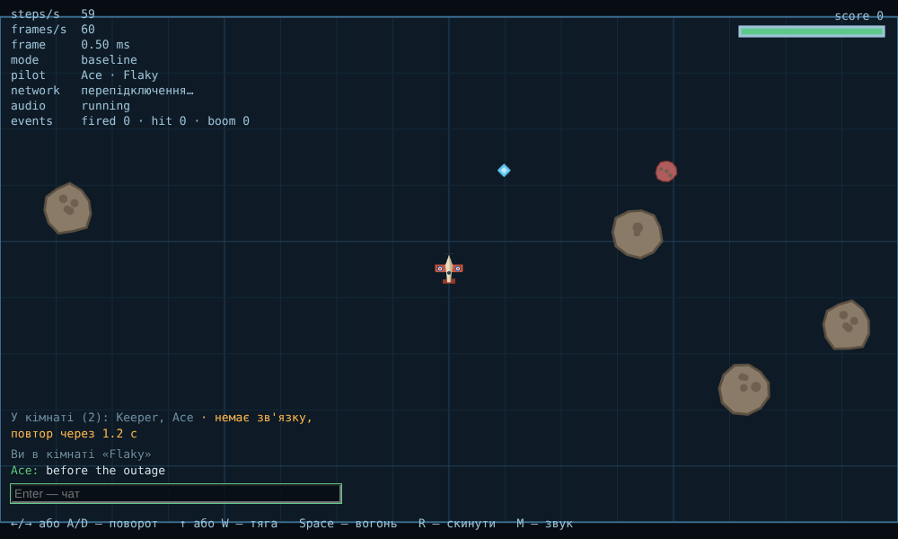 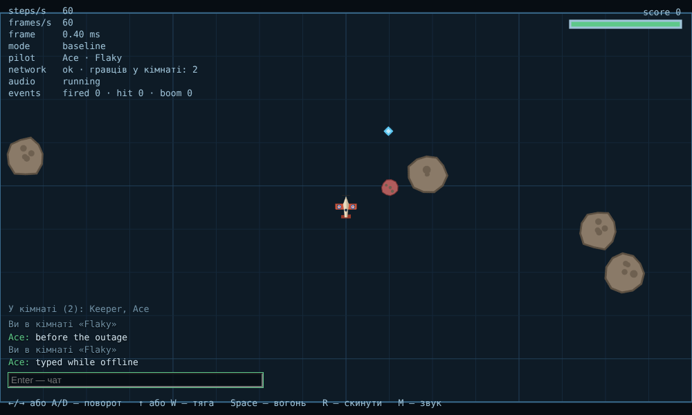

### M3 — Лог матчу потоками

```txt
room.emit("event") ─► events.on(room) ─► async generator ─► Readable.from ─► NdjsonEncoder ─► createWriteStream
                      (підписка одразу,   (yield event)      (objectMode)     (Transform)       LOG_DIR/<room>-<t>.ndjson
                       не лениво)
                                         └───────────── stream.pipeline: backpressure + прибирання при помилці ─────────────┘
```

`NdjsonEncoder extends Transform` із `writableObjectMode: true`: на вході об'єкти `{ t, room, type, … }`, на виході рядки
NDJSON. `createMatchLog` підписується на `room` через `events.on` **синхронно** у момент створення: лениво запущений
генератор пропустив би події між створенням і першим читанням. `stop()` викликає `abort()`: `events.on` віддає всі вже
накопичені події й лише потім завершується, а генератор повертається нормально, тому `pipeline` дописує й закриває файл.
Якщо запис упав (немає каталогу, диск повний), `pipeline` знищує всі ланки (відписує і кімнату), помилка йде в `onError`, а
сервер живе далі (тест перевіряє `room.listenerCount("event") === 0`).

Справжній лог із двох вікон вище (його створив сам сервер):

```txt
{"t":1793534026798,"room":"belt-8479","type":"room_opened","name":"Belt","arena":{"asteroids":8,"hunters":1,"asteroidSpeed":[50,120]},"maxPlayers":8}
{"t":1793534026923,"room":"belt-8479","type":"join","player":"7db2c9e1","name":"Ace"}
{"t":1793534027374,"room":"belt-8479","type":"join","player":"64c57f0b","name":"Bob"}
{"t":1793534027454,"room":"belt-8479","type":"chat","player":"7db2c9e1","name":"Ace","text":"привіт, Bob! Space works"}
{"t":1793534027504,"room":"belt-8479","type":"chat","player":"64c57f0b","name":"Bob","text":"<b>hi</b> Ace"}
{"t":1793534027962,"room":"belt-8479","type":"leave","player":"64c57f0b","name":"Bob"}
{"t":1793534028423,"room":"belt-8479","type":"leave","player":"7db2c9e1","name":"Ace"}
{"t":1793534028423,"room":"belt-8479","type":"room_closed","reason":"empty"}
```

**Повтор матчу тим самим потоком, без читання файла в пам'ять.** `GET /api/replays/:id` робить
`pipeline(createReadStream(file), res)`: файл тече диск → сокет по 64 KiB, а коли клієнт читає повільно, `res.write`
повертає `false`, `pipeline` ставить файл на паузу, і пам'ять не росте. `replay.js` — асинхронний генератор над
`createReadStream` + `readline`: віддає по одному розібраному рядку (`for await (const e of replayEvents(file))`), биті
рядки або кидають помилку з номером рядка, або пропускаються через `onBadLine`. `id` реплею — лише `<slug>-<мс>`
(`replayPath()` відхиляє крапки й слеші), ще й `..` ловить загальний захист.

#### Графік пам'яті (rss) при повільному завантаженні

Умови: лог **200 МБ** (згенерований `server/scripts/make-log.js`, теж потоком), клієнт читає **2 МБ/с** (≈ 16 Мбіт/с; клієнт
ставить сокет на паузу, ядро заповнює вікно прийому, і `res.write` на сервері починає повертати `false`), **60 с** на запуск.
rss вимірюється в самого серверного процесу (`/proc/<pid>/status`, кожні 200 мс), сервер працює як окремий дочірній процес.
Той самий файл і той самий клієнт, дві реалізації на сервері: `pipeline(createReadStream, res)` проти
`readFile` → `res.end(buffer)` (останній — лише `ENABLE_DEBUG_ROUTES=1`). Linux, Node 22.

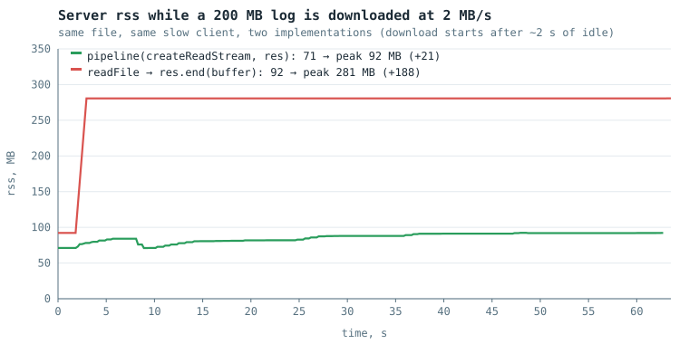

| Реалізація                        | rss до завантаження | пік під час завантаження | приріст     |
| --------------------------------- | ------------------- | ------------------------ | ----------- |
| `pipeline(createReadStream, res)` | 71 МБ               | 92 МБ                    | **+21 МБ**  |
| `readFile` → `res.end(buffer)`    | 92 МБ ¹             | 281 МБ                   | **+188 МБ** |

¹ другий запуск іде в тому самому серверному процесі, тож стартує з rss, на якому закінчився перший.

Як читати графік: крива `pipeline` **не залежить від розміру файла**. Спершу вона трохи піднімається (≈ 40 с, це прогрів
V8-купи й буферів, rss росте, поки не спрацює GC), а потім лежить на **92 МБ** без змін (останні 20 с: 91–92 МБ); за 60 с
клієнт отримав 120 МБ із 200. `readFile` же за мить читає весь файл, rss стрибає на 188 МБ (≈ розмір файла) і лежить там увесь
час, поки повільний клієнт не забере дані. З десятьма такими клієнтами це 2 ГБ.

Те саме з клієнтом, названим у лабі: **Chromium з DevTools-тротлінгом** (`Network.emulateNetworkConditions`,
2 МБ/с, `fetch` читає тіло й відкидає) за 30 с: rss сервера 72 → **макс. 86 МБ** (+14), браузер отримав 56 МБ із 200
(`server/scripts/browser-download.js`, Playwright не є залежністю репозиторію).

Окремо дослід 4 з нотаток (швидкий виробник, повільний споживач, 64 КБ-шматки, споживач потребує 100 мс на шматок):

```txt
pipeline: start, rss 44 MB                      naive: start, rss 44 MB
  t+1.0s  rss 45 MB  consumed 10 chunks           chunk 500   rss 66 MB   writable buffer 31 MB
  t+2.0s  rss 46 MB  consumed 20 chunks           chunk 1500  rss 112 MB  writable buffer 94 MB
  t+3.0s  rss 46 MB  consumed 30 chunks           chunk 2500  rss 157 MB  writable buffer 156 MB
pipeline: end, rss 47 MB                          write() returned false 3000 times and we kept writing
                                                  after the loop: rss 180 MB, writable buffer 188 MB, consumed 1 chunks
```

`write()` повернув `false` 3000 разів, а наївний цикл усе писав: 188 МБ осіло в `writableLength` (внутрішній буфер
потоку), тоді як споживач встиг прийняти один шматок. Цикл обмежено 3000 ітераціями, щоб не вбити машину; без обмеження він
ріс би до смерті процесу.

### M4 — Зловживання та цикл подій

Ліміти й політика повільного клієнта описані вище: token bucket, `maxPayload`, `MAX_ROOMS`/`MAX_PLAYERS_PER_ROOM`,
`bufferedAmount`. Кожен має тест (`ws.test.js`, `rooms.test.js`, `rateLimit.test.js`).

#### Що буде, якщо обробник HTTP займе цикл подій на 300 мс

Цикл подій Node (libuv) іде фазами: **timers → pending → poll (I/O) → check (`setImmediate`) → close**, а між ними
виконуються `process.nextTick` і мікрозадачі промісів. Твій JavaScript при цьому **один потік**: libuv лише передає
диск і мережу на ядро й у свій thread pool, але колбеки повертаються в ту саму єдину чергу. Поки твій код не повернув
керування, жодна фаза не рухається: не приймаються з'єднання, не читаються сокети, не спрацьовують таймери.

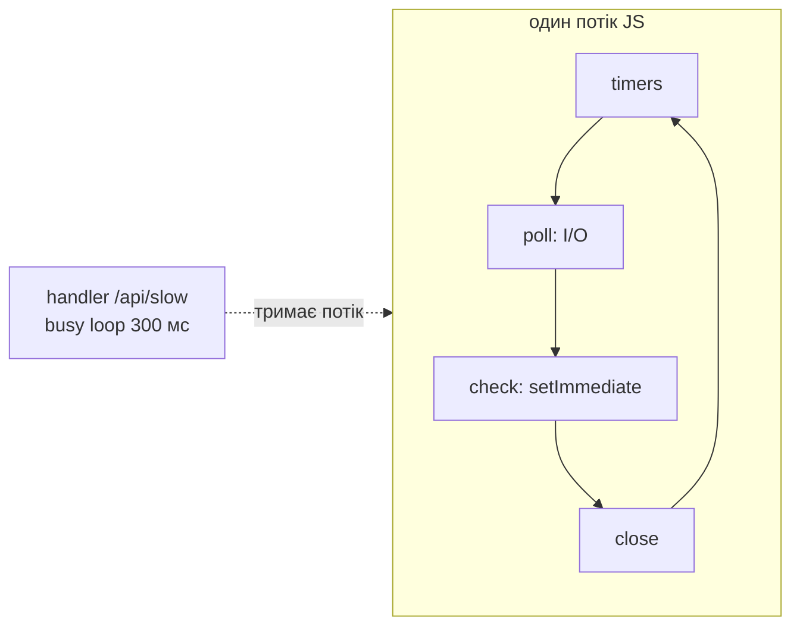

Демонстрація (`server/scripts/block-demo.js`, `ENABLE_DEBUG_ROUTES=1`): Ace шле чат кожні 150 мс із міткою часу, Bob
вимірює, наскільки пізно воно приходить; тим часом третій клієнт чотири рази викликає `GET /api/slow?ms=300` (синхронний
`while (performance.now() < end);`), а ще й міряє `GET /health`:

| Затримка доставки чату A → B через сервер | зразків | p50  | **max**    |
| ----------------------------------------- | ------- | ---- | ---------- |
| без блокування                            | 17      | 1 мс | 2 мс       |
| з чотирма `/api/slow` по 300 мс           | 35      | 1 мс | **302 мс** |

`GET /health`, відправлений у момент блокування, відповів за **286, 282, 282, 283 мс**: звичайний, «безкоштовний» запит
простояв у черзі за чужим обробником. Нічого не впало, але **усі** клієнти одночасно отримали паузу в 300 мс. Для
гри Lab 5 з кроком 60 Гц це 18 пропущених тіків, а ще ping/pong, таймери `join`-timeout і розриви сокетів сервер
обробляє із запізненням. Важка робота в обробнику (JSON.parse великого тіла, хешування, цикл по масиву з мільйона
елементів) шкодить усім, а не лише тому, хто її викликав. Лікування: не робити CPU-роботу в обробниках, нарізати її на шматки
з поверненням керування (`setImmediate`), віддавати файли потоками, а справді важке — у `worker_threads` (Lab 7).

#### Чому `"error"` без слухача валить увесь процес

`EventEmitter.emit("error", err)` — єдина подія зі спеціальним правилом: якщо слухача немає, `emit` **кидає** `err`. Кидок
стається всередині колбека таймера/I/O, без жодного `try/catch` вище, тож це необроблений виняток, і Node завершує процес із
кодом `1`. Потоки (`fs.createWriteStream`, сокети, `ws`) є emitter-ами, тому забута обробка `"error"` на одному з них зупиняє
сервер для всіх. Усі ці режими запускаються `server/scripts/demo-crash.js`; таймер «server is alive» показує момент смерті:

```txt
$ node server/scripts/demo-crash.js stream          # LOG_DIR не існує, на потоці немає "error"
mode: stream
  … server is alive
node:events:497
      throw er; // Unhandled 'error' event
      ^

Error: ENOENT: no such file or directory, open '/no/such/dir/match.ndjson'
Emitted 'error' event on WriteStream instance at:
    at emitErrorNT (node:internal/streams/destroy:170:8)
    …
  code: 'ENOENT',
  syscall: 'open',
  path: '/no/such/dir/match.ndjson'
}
Node.js v22.22.0
exit code: 1
```

Те саме для `bare` (`new EventEmitter().emit("error", …)`) і для `rejection` (відхилений проміс без `await`/`.catch`: з Node 15
`unhandledRejection` теж кінчається `exit code: 1`). **Виправлення** — режим `fixed`: слухач `.on("error", …)` на emitter-і та
потоці, `.catch` на `pipeline`:

```txt
$ node server/scripts/demo-crash.js fixed
  … server is alive
  handled emitter error: boom
  handled stream error: ENOENT
  handled pipeline rejection: ENOENT
  … server is alive
  … server is alive
  survived: shutting down normally
exit code: 0
```

Саме тому в сервері **кожен** сокет має `socket.on("error")`, відповідь і запит — `res.on("error")` / `req.on("error")`,
`wss.on("error")`, а лог матчу ходить через `pipeline`, який сам вішає обробники на всі ланки.

### Знайдене під час тестування (чесний список)

1. **Чат мовчав після входу.** `joinRoom` чекав на `joined`, споживав його, а чат монтувався вже після: панель лишалась
   порожньою. Тепер `mountChat` отримує вже спожите `joined` як початковий стан. Це той самий урок §7 нотаток: подія не
   запам'ятовується, на відміну від проміса.
2. **Падіння сервера через причину закриття.** `socket.close(code, reason)` кидає `RangeError`, якщо `reason` довший за
   123 **байти**, а в причині могла опинитись довга кирилична назва невідомого `type` від клієнта (це перевірено: `close()
threw: RangeError - The message must not be greater than 123 bytes`). Виняток із виняткового обробника став би
   неперехопленим. Тепер `closeReason()` ріже по байтах на межі символа, а помилка в обробнику закінчується `terminate()`;
   є тест із 500 кириличних літер, 900 `x` і 100 емодзі.
3. **Зависле підключення.** e2e-тест перепідключення «падав» приблизно в кожному 5-му запуску під навантаженням: клієнт
   лишався в `connecting`. Причини в нестабільному середовищі я не відтворив окремо, але прогалина реальна: у `Connection`
   не було таймауту на саму спробу. Додано `connectTimeoutMs`; після цього 14 запусків поспіль без збоїв (до цього — 4 збої на 25 запусків).
4. **Обрив клієнта під час завантаження логувався як помилка 500.** Тепер `ERR_STREAM_PREMATURE_CLOSE` (клієнт пішов) — не
   помилка.

### Досліди з нотаток

| #   | Дослід                                                             | Очікування (нотатки)                  | Результат                                                                                                               |
| --- | ------------------------------------------------------------------ | ------------------------------------- | ----------------------------------------------------------------------------------------------------------------------- |
| 1   | `setTimeout(0)`, `setImmediate`, `nextTick`, `Promise.then`        | `n p`, а `t` vs `i` може плавати      | `n p t i` у 10 запусках із 10 на цій машині                                                                             |
| 1b  | те саме всередині колбека `fs.readFile`                            | `setImmediate` раніше `setTimeout(0)` | `i t` у 10 із 10                                                                                                        |
| 2   | `new EventEmitter().emit("error", …)`                              | процес упав; зі слухачем — живий      | `Unhandled 'error' event`, exit code `1`; зі слухачем `handled: boom`, `still alive`                                    |
| 3   | `Buffer.from("привіт").length` / `"привіт".length`; `readUInt16BE` | буфер довший за рядок; `65280`        | `12 6`; `65280`                                                                                                         |
| 4   | швидкий виробник → повільний споживач                              | `pipeline` — пласко, цикл — росте     | `44 → 47 МБ` проти `44 → 180 МБ` (див. вище)                                                                            |
| 5   | `maxPayload: 1024` і 2 КБ повідомлення                             | помилка / закриття на сервері         | сервер: `error: Max payload size exceeded (code WS_ERR_UNSUPPORTED_MESSAGE_LENGTH)`, `close 1006`; клієнт: `close 1009` |

§1: нотатки застерігають, що порядок `t` / `i` з головного модуля нестабільний. На моїй машині він був стабільним (`t` перед
`i` у всіх запусках), що не суперечить документації: це залежить від того, чи встиг пройти 1 мс до входу в фазу timers.
Усередині I/O-колбека порядок детермінований: після poll йде check, тому `setImmediate` завжди першим. §5: на сервері
`close 1006`, а не `1009`, бо сервер сам обриває сокет після помилки (закриваючого кадра він не отримав); клієнт же отримав
від сервера кадр `1009 Message too big`.

Скрипти: `server/scripts/exp-backpressure.js`, `exp-ws-maxpayload.js`, `demo-crash.js`.

### Тести

`npm test` запускає обидва пакети: **81** тест клієнта і **79** сервера (усі `node:test`, без додаткових залежностей).
Сервер перевіряється **справжніми** з'єднаннями: HTTP-запити на сервер із випадковим портом, `ws`-клієнти, сирий TCP для
`..`, дочірній процес із `SIGTERM`/`SIGINT`, e2e клієнтського `Connection` проти справжнього сервера (вбитий сокет → reconnect →
повторний `join` → доставка повідомлення з черги; рестарт сервера → стара кімната зникла → фатальний `4004`, без нескінченного
циклу).

### Reflection

**1. Фази циклу подій Node.** `timers` (колбеки `setTimeout`/`setInterval`) → `pending callbacks` → `idle/prepare` → `poll`
(I/O: сокети, файли; тут Node може чекати) → `check` (`setImmediate`) → `close callbacks`. Між кожними двома колбеками (і між
фазами) спустошуються `process.nextTick`, а потім черга мікрозадач промісів: `nextTick` раніше за `.then`, і ним можна
виморити I/O, якщо запускати його без кінця. `setTimeout(0)` фактично `setTimeout(1)`, тож з головного модуля порядок
`setTimeout(0)` / `setImmediate` залежить від того, чи минула 1 мс до входу в цикл (нестабільно), а всередині I/O-колбека ми
щойно пройшли poll, наступна фаза check, тож `setImmediate` завжди першим.

**2. Single-threaded і читання файла.** Лише твій JavaScript виконується в одному потоці. Операцію `fs.readFile` JS лише
ініціює: libuv виконує її в **thread pool** (за замовчуванням 4 потоки: файли, DNS через `getaddrinfo`, частина `crypto`/`zlib`),
а колбек повертається в головний потік через poll. Мережевий I/O взагалі не використовує пул: ядро ОС сповіщає про готовність
сокета (epoll/kqueue/IOCP). Пул **не** виконує твій JS: цикл по масиву з мільйона елементів він не врятує.

**3. CommonJS проти ESM.** (а) `require` синхронний і динамічний, `import` статичний, розбирається до виконання, `import()` —
асинхронний; (б) CommonJS експортує через `module.exports`, ESM — іменовані/default-експорти, з live-зв'язками; (в) в ESM
немає `__dirname`/`__filename`/`require`, а модуль завжди в strict mode і підтримує top-level `await`. `import.meta.dirname`
(Node 20.11+) замінює `__dirname` (використано в `config.js` для шляху до `client/dist`). `"type": "module"` у `package.json`
змушує вважати `.js` ESM-ом.

**4. Backpressure.** `writable.write(chunk)` повертає `false`, коли внутрішній буфер перевищив `highWaterMark`: це сигнал
«досить, чекай `"drain"`». Якщо його ігнорувати, буфер росте без обмежень (дослід 4: 3000 викликів `false`, 188 МБ у
`writableLength`, rss 44 → 180 МБ). `pipeline` робить це за нас: призупиняє читання, коли записувана сторона не встигає,
відновлює на `drain`, а при помилці в будь-якій ланці знищує всі й повертає її в `catch`. У проєкті: віддача логу клієнту й
запис логу на диск.

**5. Readable / Writable / Duplex / Transform.** Readable — джерело (файл, тіло запиту, вхідна половина сокета); Writable —
приймач (файл, відповідь, вихідна половина сокета); Duplex — обидва незалежно; Transform — Duplex, де вихід обчислюється з
входу (gzip, мій `NdjsonEncoder`). **TCP-сокет — Duplex** (WebSocket поверх нього теж).

**6. Рукостискання WebSocket і чому не polling/SSE.** Клієнт шле звичайний HTTP `GET` із `Connection: Upgrade`,
`Upgrade: websocket`, `Sec-WebSocket-Key`; сервер відповідає `101 Switching Protocols` і `Sec-WebSocket-Accept` (SHA-1 від
ключа + GUID з RFC 6455), після чого той самий TCP-сокет несе кадри в обидва боки. Грі потрібен **двосторонній** потік 20–60
повідомлень/с із малою затримкою й малим накладом: polling платить заголовками HTTP й затримкою інтервалу за кожне опитування,
SSE односторонній (сервер → клієнт) і лише текстовий, а вхід гравця все одно потребував би окремих POST-ів.

**7. Чому в кожного емітера, що може впасти, має бути `"error"`.** Без слухача `emit("error")` кидає виняток у місці
виклику, без `try/catch` це необроблений виняток, і процес завершується (код 1): один зламаний сокет вбиває сервер для
всіх (демо вище). Еквівалент для промісів: **необроблений reject** (`unhandledRejection`), який із Node 15 теж завершує
процес. Тому кожна async-функція або `await`-иться, або має `.catch`.

**8. Клієнт на 2G, сервер шле 30 знімків/с.** Клієнт читає повільніше, ніж ми пишемо: `socket.send()` не блокує, дані копляться
в користувацькому буфері (`bufferedAmount`) і в пам'яті сервера, rss росте для кожного такого клієнта, плюс усе більше
застарілих знімків. Виявлення: `socket.bufferedAmount` (вимірюється на кожному `send`). Варіанти: (1) **пропускати**
некритичні повідомлення для цього клієнта (у мене: чат понад 64 KiB), бо старий знімок уже нікому не потрібен;
(2) зменшувати частоту / надсилати лише останній стан; (3) **закрити** з'єднання (`1013`, у мене понад 1 MiB), щоб клієнт
перепідключився; (4) для великих відповідей — `pipeline`, який сам ставить виробника на паузу.

**9. Чому перевіряти форму повідомлення на сервері, якщо клієнт мій.** Сервер не бачить мого клієнта, він бачить байти з
мережі: хто завгодно може підключитися `ws`-скриптом чи DevTools і надіслати що завгодно, у тому числі повідомлення завеликого
розміру, зламаного JSON, без `type` чи з довгим кириличним `type`, що зламав би `close()` (мій реальний баг №2). Валідація на
клієнті лише для зручності користувача, а межа довіри проходить по мережі, тому на сервері перевіряються розмір, версія, `type`
і точна форма кожного поля.

### Що я вивчив (Lab 4)

Найбільше здивувало, що **багато «серверних» проблем — це проблеми черги й пам'яті, а не логіки**: 300 мс у
одному обробнику — це 300 мс для всіх клієнтів одразу, а `write()`, що повертає `false`, — не дрібниця, а різниця між
стабільними 92 МБ і сервером, який росте з розміром файла. Тому `pipeline` я тепер вважаю стандартним способом з'єднувати
джерело з приймачем, а не оптимізацією.

Друге: **протокол — це контракт із недовіреною стороною**. Найцінніші тести в сервері — не «щасливий шлях», а ті, що
шлють біле шумне сміття: `..` у шести написаннях, 500 кириличних літер у `type`, флуд, бінарний кадр, мовчазний клієнт без
`pong`. Один із них знайшов справжнє падіння, яке я сам написав.

Третє: **події не запам'ятовуються, проміси запам'ятовують** (Lab 3 §7). Це вкусило мене тричі: `joined`, споживане до
монтування чату; `chat`, що прийшов до того, як тест підписався; `closed`, яке не можна «наздогнати». Рішення завжди однакове:
підписуйся **до** того, як подія може статися, або перетворюй одиничну подію на проміс.

---

## Lab 05 — Мережа в реальному часі: авторитетний сервер, передбачення, звірка, бінарний протокол

### Що додано до проєкту

Раніше (Lab 4) по мережі ходили лише кімнати й чат, а кожен гравець літав у власному світі. Тепер **світ один, і його рахує
лише сервер**:

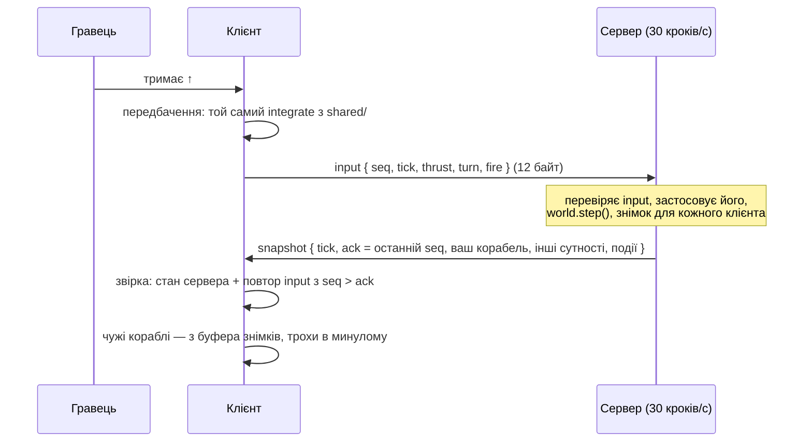

- клієнт шле **керування** (газ, поворот, постріл), ніколи не координати: серверу нічого вірити про те, де він;
- сервер `Match` (по одному на кімнату) рахує 30 кроків на секунду і розсилає кожному клієнту окремий знімок із його `ack`;
- свій корабель клієнт рухає **одразу** тим самим кодом, а коли приходить знімок, ставить корабель у стан сервера й заново
  програє input, яких сервер ще не бачив; різницю плавно «розмиває» за ~100 мс;
- чужі кораблі, кулі й астероїди малюються **трохи в минулому**, між двома знімками (інтерполяція);
- по дроту ходить бінарний протокол на `DataView` (little-endian), JSON лишається за прапорцем `?codec=json` для порівняння;
- сервер уміє навмисно псувати мережу (затримка, джитер, втрати): без цього на `localhost` усе «літає», і нічого не видно.

Код симуляції переїхав із `client/src/sim/` у третій пакет **`shared/`**, який однаково імпортують браузер і Node.

**Що довелося змінити в коді Lab 1–4, щоб симуляція стала детермінованою** (знайдено при перенесенні в `shared/`):

| Було                                                                             | Чому це розбіжність між клієнтом і сервером                       | Стало                                                                      |
| -------------------------------------------------------------------------------- | ----------------------------------------------------------------- | -------------------------------------------------------------------------- |
| `Entity.#nextId`: статичний лічильник у модулі (Lab 2)                           | у браузері й у Node він свій, і лічить усе, що будь-коли створили | id видає `World.spawn()`, у фіксованому порядку, у межах u16 з обгортанням |
| `Math.random()` у `World.randomSafeSpot`, `spawnPickupAt`, `Asteroid`, вибухах   | кожна сторона кидає свої кості                                    | `Rng` (mulberry32) із seed від сервера; частинки вибухів — лише на клієнті |
| `Math.random()` у `main.js` (поява нових астероїдів, відродження)                | те саме, і ще й поза `World`                                      | усе в `World.step()`, через `world.rng`                                    |
| `Ship.update(dt, controls, world)`: корабель рухається разом із годинником світу | клієнт не може повторити «такт світу», у нього є лише свої input  | корабель робить **один крок на кожен input** (`integrate`), світ — решту   |
| частинки вибуху — сутності світу                                                 | їх випадковість потрапляла б у хеш стану                          | вибух — подія в знімку, іскри малює клієнт                                 |
| `Date.now()` / `performance.now()` у симуляції                                   | — (їх там і не було, але тепер це перевіряє тест)                 | `purity.test.js` читає код і забороняє годинники, таймери, DOM і Node      |

### M1 — `shared/`, такт сервера, «дурний» клієнт

#### `shared/`: той самий код у браузері й у Node

```txt
shared/src/
  sim/      Vector2, Entity, Ship, Bullet, Asteroid, Pickup, homing, collision, World, Rng
  codec/    binary.js (специфікація формату — коментар на початку), json.js, errors.js
  protocol.js  input.js  snapshot.js  hash.js  scenario.js  constants.js
```

Правила, які це робить можливим (і які **перевіряються**, а не просто задекларовані):

- **жодного DOM і жодних модулів Node**: ESLint-конфіг для `shared/src` не дає глобалів ні браузера, ні Node (`window`, `process`,
  `console`, `setTimeout`, `performance` стають помилкою `no-undef`); а `test/purity.test.js` читає всі файли пакета й падає на
  `Math.random`, `Date.now`, `performance`, таймери, `window`/`document`, `process`/`Buffer`, `node:`-імпорти, `console`, `crypto`;
  ще один тест імпортує кожен модуль у Node без жодного DOM;
- **детермінізм**: `Rng` (mulberry32) із seed від сервера; фіксований `dt = 1/30`; ітерація лише по `Map` у порядку вставки;
- **серіалізованість**: стан корабля — звичайні числа (`ship.toState()` / `Ship.fromState()`), приватні поля (`#hp`, `#cooldown`)
  лишилися приватними, а `setState` живе всередині класу й може їх писати.

**Корабель рухається не годинником світу, а своїми input.** Це головне рішення, на якому тримається звірка: стан корабля стає
чистою функцією послідовності input (`integrate(controls, dt)`: розворот, тяга, опір `e^(−k·dt)`, ліміт швидкості, обгортання арени), тож
клієнт, який повторює невизнані сервером input, отримує **той самий** результат, а не «приблизно такий самий». Усе інше (кулі,
астероїди, pickup'и, зіткнення, відродження) крутиться в `world.step()`.

Вправи 1 і 5 з нотаток також стали тестами: `codec.test.js` (порядок байтів перевіряється побайтово) і
`determinism.test.js` (хеш стану після 1000 кроків).

#### Такт сервера: `setTimeout` проти абсолютного часу, а не `setInterval`

`server/src/match.js` планує кожен такт на **абсолютний** час `startedAt + n × 33.33 мс`:

```js
#onTimer() {
  const started = this.now();
  this.stats.lateness.add(started - this.nextAt);   // наскільки пізно нас розбудили = джитер таймера
  this.step();                                       // input → world.step() → знімки
  this.nextAt += STEP_MS;                            // наступна ЦІЛЬ, а не «через 33 мс від зараз»
  const behind = this.now() - this.nextAt;
  if (behind > 0) this.stats.overruns++;             // такт тривав довше за бюджет: CPU-bound
  if (behind > STEP_MS * 5) { this.stats.skipped += …; this.nextAt = this.now() + STEP_MS; }  // не наздоганяти нескінченно
  this.#schedule();                                  // setTimeout(…, nextAt − now)
}
```

Різниця видна лише під навантаженням (дослід 4 з нотаток: 150 тактів на кожну схему; навантаження — 12 мс блокування потоку кожні
100 мс):

| Схема                               | середній інтервал | stdev    | min – max, мс | дрейф після 150 тактів |
| ----------------------------------- | ----------------- | -------- | ------------- | ---------------------- |
| `setInterval(…, 33)`, вільна машина | 33.29 мс          | 0.47     | 31.3 – 36.8   | −6.1 мс                |
| абсолютна ціль, вільна машина       | **33.33 мс**      | 0.47     | 31.4 – 34.5   | −0.8 мс                |
| `setInterval(…, 33)`, навантаження  | 33.55 мс          | **1.11** | 32.3 – 45.8   | **+32.0 мс**           |
| абсолютна ціль, навантаження        | 33.41 мс          | 5.96     | 21.4 – 45.5   | **+12.0 мс**           |

Спостереження, яке мене здивувало: **абсолютна ціль має гірший розкид окремих інтервалів** під навантаженням (stdev 5.96 проти 1.11),
бо після запізнілого тіка вона скорочує наступну паузу (звідси min 21 мс). Зате **середня частота** точна, і дрейф не накопичується:
для симуляції, де `dt` фіксований, важливий саме сумарний час. Окрема дрібниця: `setInterval(…, 33)` — це вже 30.3 Гц, а не 30.

Реальний сервер (4 headless-клієнти, 60 с, `GET /api/stats`): **тривалість такту** середня 0.27 мс (p99 0.69, max 2.6), **запізнення
таймера** середнє 0.08 мс (p99 0.87, max 1.2), **інтервал** 33.334 ± 0.63 мс, перевищень бюджету 0, пропущених тактів 0.

#### Сервер не довіряє input

- форма перевіряється одним `validateInput` і для JSON, і для розкодованих байтів: `turn` ∈ {−1, 0, 1} (`turn: 1000` — вічний «швидкісний
  хак»), `seq` ціле > 0, `thrust`/`fire` булеві; зайве поле (скажімо, `x: 800`) — помилка форми, закриття `4000`;
- `seq` має зростати: дублікати й запізнілі пакети відкидаються;
- **ліміт швидкості input**: token bucket на 33/с (1.1 × частоти такту) із запасом 60 для всплеску після джитера; легітимний клієнт
  шле 30/с, тож «прискорити» корабель можна щонайбільше на 10%; понад ліміт — input просто не застосовується, а 300 відмов поспіль
  закінчуються закриттям `1008`;
- `ack` у знімку — це останній **застосований** `seq` саме цього клієнта.

#### Симулятор мережі

`server/src/netsim.js`: у шляху прийому й відправки кожного з'єднання стоїть `Link`. `latency` — **додатковий RTT** (по половині на
кожен бік), `jitter` — ± мс на кожну одностороннюю затримку, `drop` — ймовірність втрати повідомлення. Задається так:

- параметрами URL клієнта `?lag=100&jitter=30&drop=0.02`, які клієнт передає в URL сокета;
- наживо у панелі `F2` (повзунки шлють повідомлення `netsim`), окремо для кожного вікна;
- вимикається в проді: `ENABLE_NETSIM=0`, а при `NODE_ENV=production` вимкнено за замовчуванням (клієнт без змін отримує
  `netsim_disabled`).

Чесне застереження: WebSocket іде по TCP, який нічого не губить і доставляє по порядку. Справжня погана мережа змусила б TCP **чекати**
повторної відправки; тут втрачене повідомлення просто **не доходить** (так поводилась би гра на UDP), а порядок доставки зберігається
(затримане повідомлення притримує наступні, як head-of-line blocking).

#### Netgraph

`F3` вмикає/вимикає. Зверху вниз: **RTT** (останній, середній, джитер; з ping/pong, які клієнт шле двічі на секунду); **вік знімка**
(мс від останнього знімка, середній і найбільший інтервал між ними); **трафік** вниз/вгору; **розмір знімка** й кодек; **черга input**
(відправлені, але не підтверджені; приблизно RTT / 33 мс); **поправка** звірки (остання, середня й найбільша за 5 с; респавни
рахуються окремо); **втрати** знімків і частка кадрів, коли буфер інтерполяції вичерпався; налаштування; і дві історії (RTT та поправка).

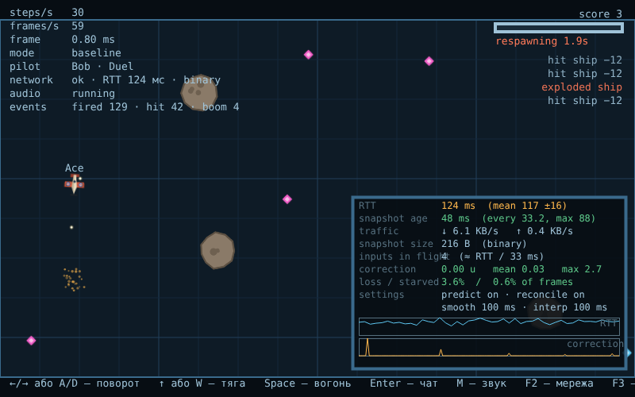

#### «Дурний» клієнт (M1): як це відчувається

`?predict=0`: клієнт лише шле input і малює корабель там, де його поставив останній знімок. Виміряно в справжньому Chromium проти
справжнього сервера: скільки мілісекунд минає від натискання `↑` до першого кадру, де корабель пересунувся хоча б на 0.5 одиниці
(корабель із нерухомого стану набирає швидкість поступово, тому навіть без мережі це два кроки по 33 мс). Медіана з 4 натискань на
кожен рядок, корабель перед кожним натисканням дочікується повної зупинки:

| Додатковий RTT (за netgraph) | без передбачення (M1) | з передбаченням (M2) |
| ---------------------------- | --------------------- | -------------------- |
| 0 мс (1 мс)                  | 98 мс                 | 64 мс                |
| 100 мс (100 мс)              | **190 мс**            | **55 мс**            |
| 200 мс (202 мс)              | **291 мс**            | **38 мс**            |

Без передбачення затримка = RTT + ті самі два кроки; з передбаченням не залежить від RTT (38–64 мс; розкид 24–65 мс — це фаза
30-герцового кроку відносно натискання). Те саме в тестовій лабораторії на віртуальному годиннику (див. нижче): 84 / 134 / 151 / 267 мс
проти сталих 67 мс для RTT 0 / 50 / 100 / 200.

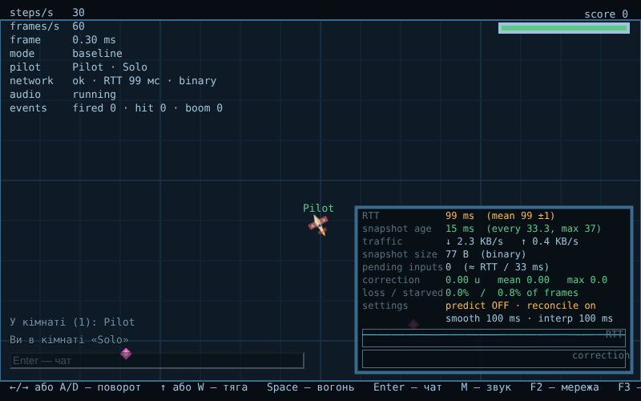

### M2 — Передбачення і звірка

`client/src/game/predictor.js` + `session.js`. Кожен фіксований крок клієнта (1/30 с, той самий `dt`, що в сервера):

1. `input = { seq: ++seq, tick, thrust, turn, fire }`, `ship.integrate(input, STEP)` — **та сама функція з `shared/`**, корабель відповідає
   одразу; input іде в `pending` і на сервер (12 байт);
2. приходить знімок із `ack = N`: корабель переставляється в стан сервера (`ship.setState(snapshot.you)`), з `pending`
   викидаються `seq ≤ N`, решта **програється заново** по черзі;
3. різниця між «де я був» і «де я став після програвання» і є **поправка** (одиниці світу): вона йде в netgraph.

Розбір із питання 3 лаби (клієнт на кроці 104, прийшов знімок для 100-го з `ack = 57`, у буфері `seq` 55–61): `55, 56, 57` відкидаються —
сервер їх уже врахував у стані, що прийшов; `58, 59, 60, 61` програються поверх стану сервера; корабель опиняється там, де сервер
побачить його, коли ці чотири input дійдуть. Якщо передбачення було правильним, результат збігається з тим, що клієнт уже малював.

**Згладжування.** Поправка не малюється як стрибок: корабель малюється там, де гравець його щойно бачив (візуальне зміщення = стара
позиція − нова), а зміщення розсмоктується **критично загальмованою пружиною** (`smooth damp`) за ~100 мс (за цей час лишається < 5%). Порівняно
з простим експоненційним згасанням вона не починає зі стрибка (першим кадром корабель зсувається на ~19% помилки, а не на ~40%) і
не перелітає через нуль (тест). Поправки понад 120 одиниць (респавн: сервер сам переносить корабель) не згладжуються: корабель
телепортується і рахується окремим лічильником `респавн`, щоб одна смерть не псувала всі інші цифри netgraph. Тест: зсув на 20
одиниць від сервера без згладжування виглядає ривком понад 15 одиниць, зі згладжуванням — менш ніж чверть цього.

**Кулі.** Свій постріл клієнт показує **в той самий крок** (куля й звук одразу), із тимчасовим id. Серверна копія тієї самої кулі несе
`seq` input, який її випустив, за ним клієнт її впізнає й бере серверний id. Передбачена куля зникає, коли сервер перестає її
повідомляти (влучила або вийшла за ttl), або коли сервер уже обробив її input (`seq ≤ ack`) і кулі не створив (перезарядка,
смерть). Серверні кулі **свого** корабля не малюються (інакше було б дві); чужі — інтерполюються. Відлуння «fired» від сервера для
нашого корабля пропускається, щоб постріл не лунав двічі.

**Що передбачення вгадати не може.** Зіткнення з астероїдом, влучання кулі, підібраний pickup, смерть — клієнт знає лише свої input, а не
решту світу. Тест `netcode.test.js` кладе астероїд перед кораблем, який клієнт не бачить: поправка стрибає з 0.00 до понад 5 одиниць, а
після зупинки знову сідає на 0.00 (у відкритому космосі поправка лишається на рівні шуму `f32`). Саме так і має бути: це сервер каже клієнту «ти
не там».

#### Навмисний недетермінізм: `Math.random()` в `integrate`

Лаба просить додати `Math.random()` у `integrate`, подивитися на поправки й прибрати. У `shared/` його додати не можна (його не
пропустять тест чистоти й lint), і це якраз добре: тому шум вставлено в **клієнтський** виклик спільного `integrate` (опція `chaos`,
`?chaos=0.02`, повзунок у `F2`): після кожного передбаченого кроку швидкість множиться на `1 + (random − 0.5) · chaos`. Для клієнта
це рівно «`Math.random()` всередині integrate»: сервер такого шуму не має, тож їхні обчислення розходяться. Виміряно в лабораторії
на віртуальному годиннику (RTT 100 мс, 10 с польоту; одиниці світу, корабель завдовжки ~36):

| шум у кроці передбачення | середня поправка | p95   | max   |
| ------------------------ | ---------------- | ----- | ----- |
| 0 (детермінізм)          | 0.0001           | 0.000 | 0.000 |
| 0.2%                     | 0.0084           | 0.020 | 0.037 |
| 1%                       | 0.0421           | 0.102 | 0.184 |
| 5%                       | 0.2104           | 0.505 | 0.924 |

І той самий шум 1% при різному RTT (чим більше input у польоті, тим більше треба програвати, тим більше накопичується помилка):

| RTT    | середня поправка | p95   | max   |
| ------ | ---------------- | ----- | ----- |
| 0 мс   | 0.000            | 0.000 | 0.000 |
| 50 мс  | 0.023            | 0.062 | 0.087 |
| 100 мс | 0.042            | 0.102 | 0.184 |
| 250 мс | 0.167            | 0.416 | 0.730 |

Те саме в справжньому браузері (netgraph, `?lag=100&chaos=0.02`, 9 с польоту): середня поправка **0.12**, максимум 0.4 проти 0.00 / 0.0 без шуму.
Скриншот експерименту (внизу видна підсвічена червоним «ШУМ у integrate» і сходинки в історії поправки), а поруч — той самий політ після того, як
шум прибрано:

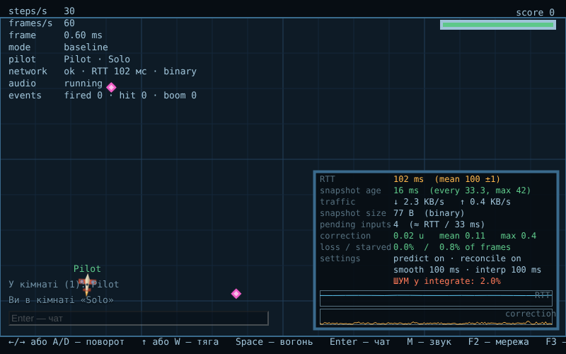 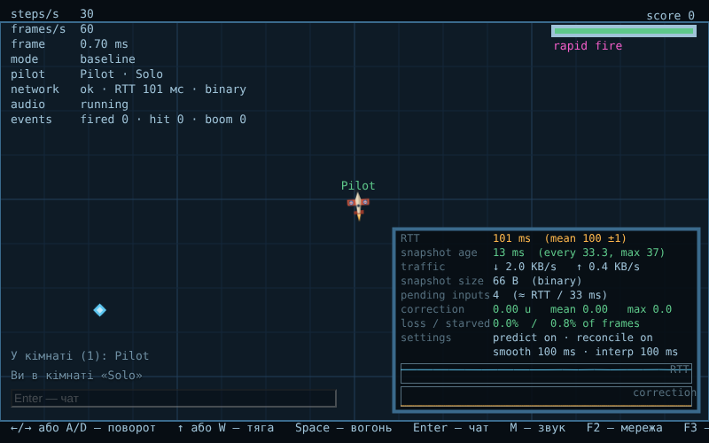

Скільки поправка дорівнює **без** жодного шуму? Не рівно нулю, а ~`0.0001`: стан корабля в знімку летить як `f32` (а на сервері він
`f64`), і програвання стартує з трохи округленого числа. Це «шум квантування», він теж видний у таблиці (рядок «0»).

**Втрата input — теж поправка.** Якщо пакет із input загубився, сервер його не застосує, а клієнт уже передбачив; після `ack` на
сусідній `seq` відрізок руху «зникає» з серверного стану: поправка дорівнює приблизно одному кроку (до ~6 одиниць при швидкому
польоті). Виміряно (RTT 100 ± 30 мс, обидва напрямки, 20 с):

| втрати | середня поправка | p95  | max   |
| ------ | ---------------- | ---- | ----- |
| 0%     | 0.000            | 0.00 | 0.00  |
| 2%     | 0.079            | 0.00 | 6.22  |
| 5%     | 0.170            | 0.00 | 6.16  |
| 10%    | 0.470            | 5.14 | 15.31 |

(Вдосконалення, яке я **не** робив: надсилати в кожному пакеті кілька останніх input, щоб одна втрата не була втратою.)

#### Доказ детермінізму: Node і Chrome дають однаковий хеш

`shared/src/scenario.js`: три кораблі літають і стріляють 1000 кроків за input від окремого seed-генератора, у світі зі скелями,
«мисливцями» і pickup'ами; станом світу рахується відбиток (FNV-1a над байтами кожного числа, тож різниця в 1 ulp змінює хеш).

| Де                                                   | хеш після 1000 кроків  | час                         |
| ---------------------------------------------------- | ---------------------- | --------------------------- |
| Node 22 (`determinism.test.js`)                      | `70a8975d`             | —                           |
| HeadlessChrome 141 (`/?determinism`)                 | `70a8975d` ✓           | 52 мс                       |
| Node, але з `Math.random()` у `integrate` (шум 1e-9) | `5bf6ef45`, `ca0eded8` | прогони **різні** між собою |
| Chrome, те саме                                      | `3bd33f69`, `d549bbb7` | прогони **різні** між собою |

Шум розміром 1e-9, який не побачить жодне око, робить два прогони різними — це і є причина, чому клієнтське передбачення без
детермінізму розходиться з сервером. Застереження: специфікація JS не вимагає однакового результату `Math.sin/cos/exp` у різних рушіях;
ми покладаємось на те, що Chrome і Node — обидва V8 із власними реалізаціями цих функцій. Firefox або Safari могли б дати інший хеш;
саме тому відбиток зберігається в тесті й на сторінці `/?determinism`, а не просто припускається.

### M3 — Інтерполяція й другий гравець

`client/src/game/snapshotBuffer.js`. Чужі кораблі, кулі й астероїди малюються на `interpolationDelay` мс **у минулому**, між двома
знімками, що охоплюють цей момент.

- **Який час на сервері зараз?** Час прибуття знімків «стрибає» через джитер, тому годинником служить номер такту (сервер ставить їх
  рівно через 33.33 мс). Клієнт оцінює одне число: зміщення між годинником сервера й власним, як **мінімум** від (`прибуття −
tick·33.33`) за останні 90 знімків: найшвидші пакети не стояли в черзі, вони найближчі до справжнього каналу; повільніші «запізнюються», і
  саме затримка інтерполяції є запасом, що це поглинає. Мінімум зі «ковзного вікна» ще й слідкує за дрейфом годинників;
- загублені знімки: номери тактів мають дірки, інтерполяція просто охоплює дірку (між 12-м і 14-м знімками, якщо 13-го немає);
- знімок **старіший** за вже відомий (або дублікат) відкидається; якщо буфер вичерпався (час відтворення за межами найновішого
  знімка) — **тримається останній стан**, екстраполяції немає (вгадування гірше за паузу);
- об'єкт, що **з'явився** між знімками, не малюється, доки час відтворення не дійде до нього; що **зник** — лишається на останній
  позиції до того ж моменту; об'єкт, що «перестрибнув» далі, ніж дозволяє швидкість (респавн), не малюється смугою через арену;
- корабель обертається найкоротшим шляхом (±π) і обгортається через край арени найкоротшим шляхом; кулі й астероїди — ні.

#### Яку затримку інтерполяції обрано: 100 мс

Виміряно (RTT 100 ± 30 мс, 2% втрат, 30 с; «голодування» — частка кадрів, коли новішого знімка немає, і чужий корабель стоїть):

| затримка інтерполяції                 | кадрів без нового знімка |
| ------------------------------------- | ------------------------ |
| 16 мс                                 | 92.44%                   |
| 33 мс (1 такт)                        | 68.72%                   |
| 66 мс (2 такти — теоретичний мінімум) | 12.33%                   |
| **100 мс (3 такти)**                  | **0.50%**                |
| 150 мс                                | 0.22%                    |
| 200 мс                                | 0.22%                    |

Теорія радить 2 такти (66 мс), але вона припускає **рівну** доставку. З джитером ±30 мс і втратою знімка потрібно ще ~1 такт запасу,
тому **100 мс** — перше значення, де голодування зникає (0.5%). Далі кожні +50 мс нічого не дають, а ціна лише зростає: ми бачимо
чужих на `100 мс + пів-RTT` у минулому. Тому 100 мс, і це повзунок у `F2`, щоб показати, як виглядає 16 мс.

Окрема знахідка (не про клієнт, а про сервер): навіть при ідеальній інтерполяції чужий корабель **«смикався»**: 12.9% кадрів він стояв на місці при
джитері ±30 мс. Причина на сервері: input приходять пачками (у цей такт жодного, у наступний два), а корабель робить рівно
крок на input. Рішення — **буфер джитера на сервері**: після кожного такту лишати в черзі 1 input про запас
(`INPUT_RESERVE=1`, за замовчуванням). Ціна — один такт (33 мс) зайвої затримки; виграш:

| джитер  | запас input                                    | кадрів, коли чужий корабель нерухомий |
| ------- | ---------------------------------------------- | ------------------------------------- |
| ± 0 мс  | 0 / 1 / 2                                      | 0.7% / 0.7% / 0.7%                    |
| ± 30 мс | 0 (застосовувати все одразу, як у тексті лаби) | **12.9%**                             |
| ± 30 мс | **1**                                          | **1.3%**                              |
| ± 30 мс | 2                                              | 1.3%                                  |

Поправки від цього не змінюються (звірка рахує `ack`, а не момент застосування).

#### Бій удвох (M3)

20 секунд бою двох справжніх вікон Chromium при **100 мс RTT ± 30 мс і 2% втрат** (автопілот у кожному вікні наводиться на найближчого
й стріляє; вікно Bob показує netgraph) — зверху сторінки. Дані з тих самих вікон: RTT 89 і 124 мс, втрати знімків 3.5% і 3.6%, голодування 0.9%, середня
поправка 0.05 і 0.03, максимум 3.1 і 2.7 (смерті й втрачені input), трафік вниз 6.1 КБ/с і вгору 0.36 КБ/с, знімок у середньому 218 байт.

Автоматизований варіант (Stretch лаби): `npm run bots -w server` запускає справжній сервер і **4 headless-клієнти** (справжній `Connection`

- `GameSession`, без canvas), які 60 с літають і б'ються при **RTT 150 мс ± 30, 5% втрат на напрям** (фактично ~7–9% знімків), і
  перевіряє, що середня поправка нижча за поріг:

| бот  | RTT, мс | втрати знімків | голодування | ↓ КБ/с | ↑ КБ/с | байт/знімок | поправка: середня / p95 / max | респавнів |
| ---- | ------- | -------------- | ----------- | ------ | ------ | ----------- | ----------------------------- | --------- |
| bot0 | 133     | 6.9%           | 0.67%       | 7.9    | 0.28   | 349         | 0.196 / 0.54 / 11.7           | 6         |
| bot1 | 192     | 8.9%           | 0.78%       | 8.2    | 0.26   | 346         | 0.220 / 0.47 / 38.3           | 7         |
| bot2 | 155     | 7.2%           | 0.33%       | 8.8    | 0.26   | 341         | 0.163 / 0.10 / 18.3           | 6         |
| bot3 | 174     | 8.0%           | 0.44%       | 9.1    | 0.27   | 341         | 0.240 / 0.77 / 56.0           | 7         |

`max` — це смерть: сервер зупиняє корабель у момент знищення, а клієнт дізнається про це лише через RTT і тим часом «пролітає»
вперед; різниця до ~60 одиниць — це відстань за 150 мс при швидкості ~400. Зафіксований порогом саме **середній** рівень (< 0.5).

### M4 — Бінарний протокол

Повна специфікація — коментар на початку `shared/src/codec/binary.js` (довжини, зміщення, типи). Скорочено:

- **little-endian скрізь** (кожен виклик `DataView` передає `true`) — порядок байтів x86 і ARM, але зафіксований у тексті, а не залишений
  процесору; тест перевіряє байти INPUT по одному (`seq = 0x01020304` → `04 03 02 01`);
- байт 0 — тип повідомлення, **байт 1 — версія формату** (1); декодер відмовляє будь-якій іншій;
- кут — **`Int16` у 1/1000 радіана**: діапазон ±π = ±3142 вміщується у 2 байти; помилка округлення ≤ 0.0005 рад = 0.029°, тобто 0.9 одиниці на
  відстані 1000 (тест проходить кути з кроком 0.00123, усі в межах 0.0005; кути астероїдів, що ростуть без обмеження, кодек спершу
  зводить у діапазон);
- **свій корабель — у повній точності** (`f32` для x, y, vx, vy, кута, cooldown, rapid, respawn), бо клієнт перераховує стан саме від нього;
  чужі кораблі — компактно (`f32` x, y + `Int16` кут);
- id сутностей — `u16` (світ видає їх у 1…65535 з обгортанням і пропуском зайнятих).

| Повідомлення | напрям | розмір                                                                                                                                                                       |
| ------------ | ------ | ---------------------------------------------------------------------------------------------------------------------------------------------------------------------------- |
| INPUT        | C → S  | **12 байт**: тип, версія, `u32 seq`, `u32 tick`, `u8` прапорці (газ, вогонь), `i8` поворот                                                                                   |
| PING / PONG  | C ↔ S  | 6 / 10 байт                                                                                                                                                                  |
| SNAPSHOT     | S → C  | 11 (заголовок: тип, версія, `u32 tick`, `u32 ack`, прапорці) + 38 (свій корабель) + 16 на кожен чужий корабель + 14 на кулю + 14 на астероїд + 11 на pickup + 11–13 на подію |

Раундтрип-тести (`shared/test/codec.test.js`): `decode(encode(msg))` збігається з `msg` у межах квантування для 200 випадкових знімків
(довільна кількість кораблів, куль, астероїдів, подій), розмір знімка дорівнює сумі за специфікацією; **декодер не вміє падати
інакше, ніж `CodecError`**: тест кормить його порожніми, обрізаними й зіпсованими буферами (500 випадкових + усі обрізання); input зі
зіпсованими байтами (`turn = 5`, `seq = 0`) відхиляється тією самою валідацією, що й JSON.

#### JSON проти `DataView`: виміряно

4 гравці, 30 Гц: симуляція 20 с у справжньому `World` (пояс із 8 скель + «мисливець», усі літають і стріляють), у знімку для гравця 0
в середньому **23.1 сутності**. `shared/scripts/measure-codecs.js`, Node 22, час — середнє `encode + decode` на повідомлення:

| Кодек               | Байт / знімок | КБ/с на клієнта (вниз) | КБ/с на клієнта (вгору) | encode + decode, мкс (знімок) | байт / input | encode + decode, мкс (input) |
| ------------------- | ------------- | ---------------------- | ----------------------- | ----------------------------- | ------------ | ---------------------------- |
| JSON                | 2416          | 70.78                  | 2.33                    | 33.6                          | 79           | 1.79                         |
| Binary (`DataView`) | **372**       | **10.90**              | **0.35**                | **6.4**                       | **12**       | 1.10                         |
| виграш              | ×6.5          | ×6.5                   | ×6.7                    | ×5.3                          | ×6.6         | ×1.6                         |

8 гравців (37.2 сутності на знімок): JSON 3783 байт (110.8 КБ/с) проти binary 582 байт (17.05 КБ/с); 67.0 проти 8.1 мкс.

Сума по серверу при 4 клієнтах (з 4-ботового прогону): 36 КБ/с вихідного трафіку проти ≈ 234 КБ/с, якби знімки були JSON (×6.5). Перевірка в
лабораторії на віртуальній мережі показує те саме співвідношення в реальному потоці (2 клієнти, 5 с): JSON 15.5 КБ/с проти binary
2.4 КБ/с вниз і 2.4 проти 0.37 КБ/с вгору.

Дослід 3 із нотаток (8 кораблів × id, x, y, кут): JSON 345 байт проти 128 байт `DataView` (×2.7); те саме у **нашому** знімку з усіма полями
(hp, прапорці, рахунок): 980 проти 145 байт (×6.8). JSON програє не лише розміром, а й тим, що кожне число доводиться
перетворювати на рядок і назад.

#### Дослід із нотаток

| №   | Що                                                        | Очікування (нотатки)                     | Результат                                                                                                              |
| --- | --------------------------------------------------------- | ---------------------------------------- | ---------------------------------------------------------------------------------------------------------------------- |
| 1   | `setFloat32(0, 1.5, true/false)`, байти                   | байти в зворотному порядку               | LE `[0, 0, 192, 63]`, BE `[63, 192, 0, 0]` (Node і Chrome однаково)                                                    |
| 2   | `new Uint16Array(new Uint8Array([1,0,0,1]).buffer)`       | «`256, 256` (залежить від вирівнювання)» | **`[1, 256]`** на little-endian CPU: байти `[1,0]` → 1, `[0,1]` → 256; `DataView` LE дає те саме, BE — `256, 1`        |
| 3   | JSON проти `DataView` для 8 кораблів                      | JSON у рази більший                      | 345 проти 128 байт (×2.7); у нашому повному знімку 980 проти 145 (×6.8)                                                |
| 4   | `setInterval(33)` проти абсолютної цілі                   | інтервали не рівні 33                    | таблиця вище: `setInterval(33)` дає 33.29 мс (це вже 30.3 Гц), абсолютна ціль — 33.33; під навантаженням інакше розкид |
| 5   | один сценарій у Chrome і Node, хеш; потім `Math.random()` | хеші збігаються; з random — ні           | `70a8975d` в обох; з шумом 1e-9 — різні прогони                                                                        |

У дослідi 2 нотатки помиляються: очікування `256, 256` не відповідає жодному порядку байтів; правильна відповідь — `1, 256`.
Скрипт: `node shared/scripts/experiments.js [1..5]`.

### Запис про мережу (netcode write-up)

**Три проблеми і як їх розв'язує дизайн.**

| Проблема         | Що ламається                                                                           | Чим розв'язано                                                                                                                                      |
| ---------------- | -------------------------------------------------------------------------------------- | --------------------------------------------------------------------------------------------------------------------------------------------------- |
| **Затримка**     | корабель відповідає на кнопку через RTT (190 мс при RTT 100, 291 при 200)              | передбачення своїх input тим самим `integrate`: 38–64 мс незалежно від RTT; чужих показано в минулому, але плавно                                   |
| **Узгодженість** | два клієнти й сервер рахують по-різному (плаваюча кома, випадковість, втрачені пакети) | один світ на сервері; симуляція в `shared/` без `Math.random`/годинників (хеш однаковий у Node і Chrome); звірка програє input поверх стану сервера |
| **Чіти**         | клієнт, що шле `x: 800` або `turn: 1000`, телепортується або летить удесятеро швидше   | протокол не має поля позиції; `turn` ∈ {−1,0,1} перевіряється; швидкість input обмежена (33/с + запас) ⇒ швидкісний хак ≤ +10%                      |

**Що показав netgraph до і після передбачення.** Без нього (`?predict=0`, RTT 100 мс): черга input = 0, вік знімка 13–47 мс, але корабель
реагує через 190 мс; з ним: черга input 4 (≈ RTT / 33), корабель реагує через ~55 мс, а поправка стоїть на 0.00. «Дорога» ціна
передбачення — рядок «pending inputs»: це і є ті кроки, які клієнт програє поверх кожного знімка.

**Яку помилку детермінізму я зустрів.** Навмисну (шум у `integrate`: поправка зросла з 0.0001 до 0.04 при 1% і 0.21 при 5%, а при RTT
250 мс — вчетверо більше, ніж при 100) і ненавмисні: таблиця вище перелічує п'ять місць у коді Lab 1–4, які працювали б у «одному вікні»,
але розбіглися б між клієнтом і сервером (`Entity.#nextId`, `Math.random()` у світі й у `main.js`, рух корабля за годинником світу, випадкові
частинки як сутності). Найтонша: **корабель мав рухатись за годинником світу, а не за input**. Тоді повторити його на клієнті було б
неможливо — клієнт не знає, скільки тактів світу минуло між input. Ще одна, «чесна» розбіжність без шуму: стан у знімку приходить у `f32`, і
навіть ідеальне передбачення дає поправку ~0.0001.

**Затримка інтерполяції: 100 мс.** 66 мс (теоретичний мінімум 2 такти) при джитері ±30 мс і 2% втрат лишає 12% кадрів без нового знімка
(чужий корабель стоїть); 100 мс — 0.5%; далі виграшу немає (150 мс — 0.22%), а чужі кораблі лише відстають сильніше. Ціна: ми бачимо
інших гравців на 100 мс + півRTT у минулому. Окремо виявилось, що джитер псує **сервер**: input приходять пачками, і кораблі
рухаються ривками; буфер на 1 input (`INPUT_RESERVE=1`) прибрав «стоячі» кадри з 12.9% до 1.3% за ціну одного такту (33 мс).

**Що з цього НЕ захищає сервер.** Він перевіряє input, але не «вигляд» гри: клієнт отримує позиції **всіх** сутностей, тож
підгляд крізь «туман війни» (його немає) чи автонаведення (aimbot, який бачить усіх) лишаються можливими; лаг-свіч (навмисна
затримка своїх пакетів) теж. Ще не зроблено **компенсацію лагу**: коли гравець стріляє туди, де бачить ворога (на 100+ мс у минулому), сервер
перевіряє влучання за **сьогоднішньою** позицією, тому ворог, що рухається, «ухиляється» від куль, які на екрані влучили (Stretch лаби).

### Reflection

**1. Чому сервер має бути авторитетним?** У моделі «кожен клієнт каже, де він» є дві проблеми. (а) **Чіти**: клієнт, що надсилає
`{ x: 800, y: 450 }`, телепортується куди завгодно; або надсилає потрібні позиції, щоб ніколи не влучала куля. У моїй грі
протокол взагалі не має поля позиції, а input із полем `x` закривається `4000` (тест `game.e2e.test.js`). (б) **Розбіжність**: у кожного
свій світ, різні плаваюча кома й порядок подій, і два гравці бачать дві різні гри; хто «правий» — нема кого спитати. Авторитетний сервер
— єдине джерело правди, клієнти лише пропонують керування.

**2. Передбачення.** Клієнт застосовує **власні** input до свого корабля одразу тим самим `integrate`, що й сервер, не чекаючи RTT.
Вона залежить від **детермінізму** симуляції: однаковий стан + однакові input = однаковий результат. Порушення видно по netgraph: поправка
перестає бути нулем у вільному просторі. Я це перевіряю тричі: тест `determinism.test.js` (хеш), сторінка `/?determinism` (Chrome проти Node)
і експеримент із шумом (поправка росте 0.0001 → 0.04 → 0.21).

**3. Звірка (клієнт на 104, знімок для 100, `ack = 57`, у буфері `seq` 55–61).** (1) `ship.setState(знімок.you)`: корабель ставиться в стан
сервера після input 57. (2) `pending` очищається від `seq ≤ 57` (55, 56, 57), лишається 58–61. (3) 58, 59, 60, 61 програються по
черзі тим самим `integrate`. (4) Результат порівнюється з тим, де корабель був до цього: різниця — поправка (0, якщо передбачення вірне). (5) Різниця
не малюється стрибком, а стає візуальним зміщенням, яке пружина розсмоктує за ~100 мс. Корабель ніколи не «відскакує на 4 кроки назад».

**4. Чому чужих — у минулому?** Знімки приходять 30 разів на секунду з джитером, а екран оновлюється 60 разів і більше. Малювати найновіший
знімок — це 30-герцовий ривок і стрибки при затримці пакета. Малюючи на `interpolationDelay` у минулому, ми завжди маємо **два** знімки, між
якими плавно рухаємо сутність. Ціна: ми бачимо чужих на цей час запізнілими; плюс — плавність. **Обрано 100 мс** (3 такти): 66 мс (мінімум за
теорією) давало 12% кадрів, коли чужий корабель вистоював на місці через загублений знімок; 100 мс — 0.5%.

**5. Компенсація лагу.** Гравець стріляє туди, де **бачить** ворога, а бачить він його в минулому (інтерполяція + затримка мережі), тож на
сервері ворог уже не там — постріл «пройшов би повз», хоча на екрані влучив. Сервер зберігає кільцевий буфер недавніх станів світу й
перевіряє постріл за станом, який бачив стрілець (за його `tick` в input і затримкою інтерполяції). Інтерполяція її й робить необхідною: без
неї всі б бачили «зараз», а з нею «зараз» у кожного інше. У цій лабі не реалізовано (Stretch); `tick` в input — готовий для цього вхід.

**6. `DataView` проти `Float32Array`.** `Float32Array` — це «вигляд» одного типу над буфером у порядку байтів **процесора**; він швидкий для
масових однорідних даних (масив позицій, WebGL). `DataView` читає/пише будь-який тип у будь-якому зміщенні з **явним** порядком байтів — це
інструмент для змішаного формату повідомлення (u8 тип, u32 tick, f32, i16). Для протоколу порядок байтів важливий, бо **два різні
процесори обмінюються байтами**: локальний масив читає те, що сам записав у тому ж порядку; а дріт має вигляд, який не залежить від CPU
(little-endian фіксовано в специфікації). Дослід 2: `Uint16Array` над `[1,0,0,1]` дає `[1, 256]` лише на little-endian CPU.

**7. Кут як `Int16`: точність?** 1/1000 радіана: помилка ≤ 0.0005 рад = 0.029°, тобто 0.9 одиниці світу на відстані 1000 (і менше за піксель на
кораблі завдовжки 36). Вирішував від «що видно»: це кут, який тільки малюється (чужі кораблі, астероїди); **свій** корабель іде у повній
`f32`-точності, бо від нього клієнт ще й рахує рух (там квантування дало б систематичну поправку). Тест проходить весь діапазон ±π.

**8. Чому не `setInterval` для такту?** Він переоформлюється **відносно** того, коли колбек відпрацював, тож кожне запізнення зсуває всі наступні
такти; запізнілі колбеки можуть іти пачкою; і `33` мс — це вже 30.3 Гц, не 30. Абсолютна ціль (`startedAt + n × 33.33`) скорочує паузу після
запізнілого такту, і середня частота лишається точною (дрейф 12 мс проти 32 мс під навантаженням). Якщо такт **перевищує** бюджет (ми
CPU-bound), наступні такти йдуть без паузи, наздоганяючи; якщо відставання більше 5 тактів — зайве **пропускається** (`skippedTicks` у
`/api/stats`), щоб не впасти в спіраль. Ціна: окремі інтервали нерівні (stdev 5.96 проти 1.11) — це видно в моїх вимірах.

**9. Що зламає `Math.random()`, ітерація по `Set`, `Date.now()`?** `Math.random()`: клієнт і сервер кидають різні кості (різний спін астероїда, різне
місце відродження) — поправки ростуть, а гравці бачать різні світи; шум 1e-9 вже міняє хеш стану. Ітерація по `Set`/`Map`: порядок вставки
може відрізнятися (клієнт створив сутності в іншому порядку), а від порядку залежать перша влучена ціль в зіткненні й черговість `rng`; я ітерую лише
по `Map` у порядку, який визначає сам `World`. `Date.now()`: годинники двох машин не збігаються й не стоять на місці — одна й та сама
послідовність input дає різні результати залежно від того, коли її запустили; тому в симуляції є лише фіксований `dt`, а час — це
номер такту.

### Що я вивчив (Lab 5)

Найважливіше — що **передбачення стоїть на чистій функції**: якби `integrate` залежав від годинника світу, випадковості чи порядку
обробки пакетів, звірка не мала б сенсу, бо «повторити невизнані input» не дало б того самого. Тому найбільша частина роботи була не в
мережі, а в тому, щоб зробити симуляцію такою, що її можна запустити двічі й отримати один хеш: перенести id у `World`, прибрати `Math.random`,
привʼязати рух корабля до input. Мережа після цього виявилась прикладною.

Друге: **вимірювання часто спростовують інтуїцію**. Я очікував, що абсолютна ціль таймера дасть кращий «розкид»; насправді вона дає кращу
**середню** частоту, але гірший розкид окремих інтервалів (5.96 проти 1.11 мс). Очікував, що інтерполяція зробить чужий корабель плавним;
12.9% кадрів він стояв, і причина була не в клієнті, а в сервері, який застосовував input пачками. Я не побачив би цього без лабораторії на
віртуальному годиннику й без вимірів «кадрів без руху».

Третє: **те, чого не можна перевірити «на око», треба перевіряти тестом**. Нотатки радять запустити досліди в консолі; я перетворив їх на
тести (порядок байтів, хеш, чистота пакета, фазз декодера, повний цикл «клієнт → сервер → клієнт» на віртуальній мережі), тож кожне твердження в цьому
README хтось може повторити однією командою.

---

## Довідково

Приватні поля (`#hp`, `#cooldown`, `#respawnTimer` у `Ship`; `#id`, `#nextId` у `Entity`) справді
недосяжні ззовні класу — `ship.hp = 9999` кидає `TypeError`, бо в `Ship` оголошено лише `get hp()`, без
сеттера (перевірено тестом у `ship.test.js`). `World` ніколи не чіпає `#hp` напряму: єдиний спосіб вплинути
на нього ззовні — публічні методи `takeDamage()` і `applyPickup()`.
