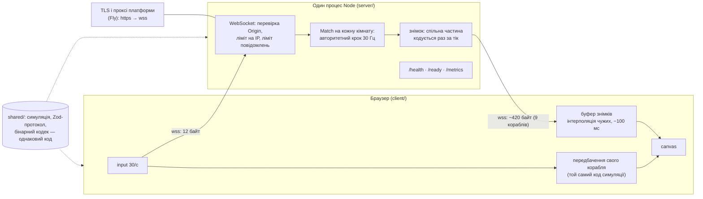
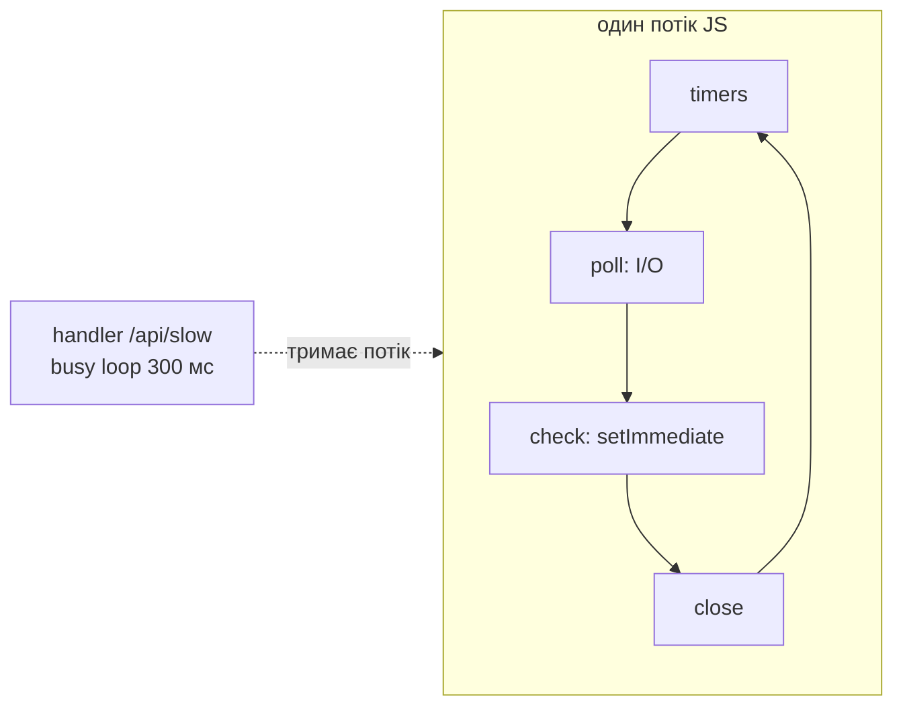
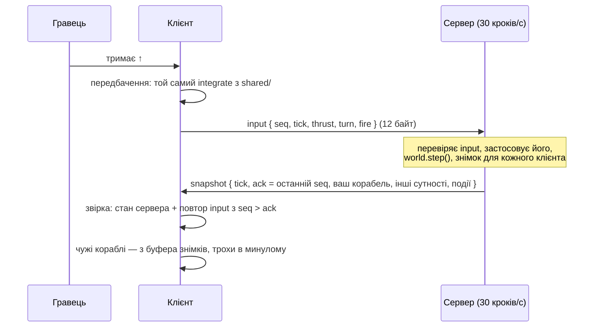
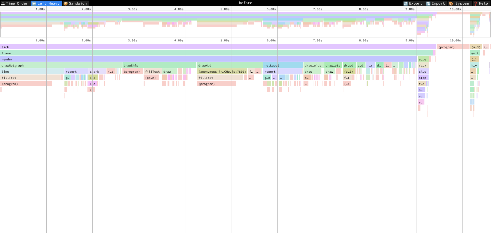
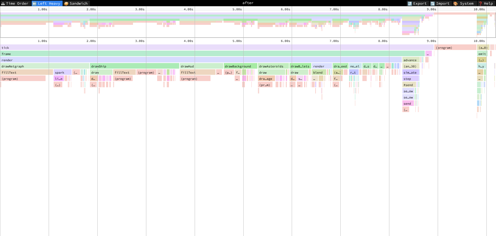
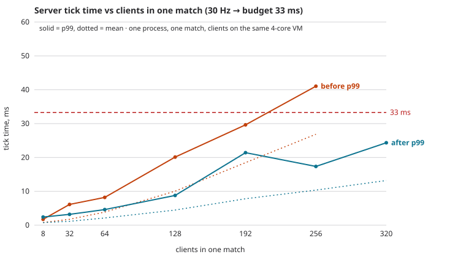
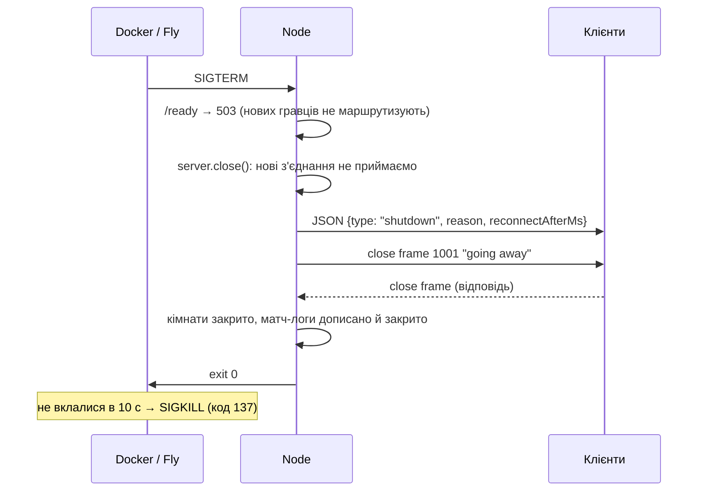

# Clash of Planes


Мультиплеєрна браузерна гра в реальному часі: біплани, повітряні бої, кімнати до 8 гравців, чат. Навчальний проєкт курсу
«Програмування мовою JavaScript» — від кульки на canvas (Lab 1) до гри, яку можна відкрити за посиланням (Lab 8).

> **Грати:** на час перевірки гра піднімається з комп'ютера автора через тимчасовий публічний тунель (Cloudflare Quick Tunnel): адреса виду
> `https://<випадкове-слово>.trycloudflare.com` — це справжній `https`/`wss` без налаштування хостингу; вона діє, **лише поки гру запущено на тому комп'ютері**, і змінюється при кожному запуску.
> Постійне розгортання (Docker-образ, `fly.toml`, `deploy.yml`) написано й підготовлено, але **не запускалось**: без налаштованого хостингу пайплайн деплою пропускається.
>
> **Відео (3–5 хв):** _посилання буде тут після запису._ · **Реальний RTT двох гравців з різних мереж:** таблиця в розділі Lab 08, ще порожня.


_Два справжні вікна Chromium, один сервер, 20 секунд бою при **100 мс RTT ± 30 мс джитера і 2% втрат** (їх додає сервер, див.
Lab 05 нижче). Праворуч — netgraph: RTT, вік знімка, трафік, черга input і розмір поправки._

## Як грати

| Клавіша           | Дія                                    |
| ----------------- | -------------------------------------- |
| `←` `→` / `A` `D` | поворот                                |
| `↑` / `W`         | тяга                                   |
| `Space`           | вогонь                                 |
| `Enter` … `Enter` | чат (`Esc` — повернути клавіатуру грі) |
| `M`, `F2`, `F3`   | звук · панель мережі · netgraph        |

У лобі оберіть кімнату (або створіть свою) й ім'я. Ваш корабель одразу реагує на клавіші (клієнт **передбачає** рух), інших ви бачите
на 100 мс у минулому, але плавно (**інтерполяція**); сервер — єдине джерело правди. Гру можна **встановити** як застосунок (PWA) — у Chrome
і на телефоні: «Додати на головний екран».

## Три команди

```bash
npm install                  # Node ≥ 22.18 (.nvmrc): Node сам знімає типи з .ts, збирати сервер не треба
npm run build                # client/dist
npm start                    # http://127.0.0.1:3000 — відкрийте у двох вкладках
```

Те саме в контейнері, як у проді: `docker compose up --build` → `http://localhost:3000`.

## Як усе влаштовано



Кімната живе **в пам'яті одного процесу**: її гравці мусять сидіти в тому самому процесі, тому розгорнуто **один** екземпляр (чому — «Reflection 2» нижче).

### Що виміряно в курсі (стислі таблиці; деталі й методика — у розділах лаб)

| Що                                     | Було                       | Стало                                         | Де        |
| -------------------------------------- | -------------------------- | --------------------------------------------- | --------- |
| Трафік знімка (9 кораблів)             | JSON 2416 байт · 70,8 КБ/с | **бінарний 372 байт · 10,9 КБ/с** (×6,5)      | Lab 05    |
| Реакція корабля на кнопку при RTT 100  | 190 мс (чекаємо сервер)    | **38–64 мс** (передбачення)                   | Lab 05    |
| Алокації клієнта за 30 с               | ≈119 МБ                    | **≈20 МБ** (−83 %)                            | Lab 07    |
| Major GC за 30 с                       | 10–11 (сума 340–390 мс)    | 8–9 (сума 230–300 мс) — **не зникли**         | Lab 07    |
| Крок сервера, 128 клієнтів в 1 кімнаті | 10,1 мс (p99 20,1)         | **4,5 мс (p99 8,8)**                          | Lab 07    |
| Тести                                  | 341                        | **420 unit + 6 e2e**, покриття `shared/` 96 % | Lab 07–08 |

## Скільки гравців тримає один процес

Виміряно навантажувальним тестом (`server/scripts/loadtest.ts`: справжні headless-клієнти, крок сервера з `/api/stats`). Умови — на 4-ядерній VM без обмежень
і **в Docker-образі з обмеженням 1 CPU / 256 МБ** (найближче, що я зміг виміряти до тарифу хостингу; сам хостинг я не міряв):

| Гравців | по 8 в кімнаті, 4 vCPU: крок / запізнення p99 | по 8 в кімнаті, **1 CPU**: крок / запізнення p99 / пропущено | усі в одній кімнаті, 4 vCPU: крок середній / p99 | …, **1 CPU**: середній / p99 / пропущено |
| ------- | --------------------------------------------- | ------------------------------------------------------------ | ------------------------------------------------ | ---------------------------------------- |
| 32      | 0,4 мс / 1,4 мс                               | 0,5 мс / 24 мс / 0                                           | 1,1 / 3,2 мс                                     | 1,9 / 7,8 мс / 0                         |
| 64      | 0,3 мс / 2,2 мс                               | 0,5 мс / **63 мс** / 0                                       | 2,1 / 4,6 мс                                     | 3,1 / 9,0 мс / 0                         |
| 128     | 0,3 мс / 3,6 мс                               | 0,4 мс / **104 мс** / **238**                                | 4,5 / 8,8 мс                                     | 7,0 / 15,6 мс / **15**                   |
| 192     | —                                             | 0,4 мс / 193 мс / 307                                        | 7,8 / 21,4 мс                                    | 12,8 / **47,9 мс** / 59                  |

Висновок: **сам крок майже ніколи не є вузьким місцем** (сотні мікросекунд на кімнату з 8). Обмеження — це **те, скільки роботи в секунду вміщує один потік
і одне ядро**: розсилка знімків (`writev`) і, на 1 CPU, квота процесора, що «затикає» процес на частки такту. На практиці це **≈ 64 одночасні гравці в кімнатах по 8 на одному
ядрі без пропущених тактів** (запізнення p99 ≈ 63 мс — це вже відчутно як ривок для інших), ≈ 100 з поступовою деградацією, і вище 128 — пропущені такти. На 4 ядрах той самий код тримає 128+ без запізнень.
Деталі й межі цього вимірювання — у Lab 07 і Lab 08 нижче.

## Обмеження, що лишились, і чому

| Обмеження                                   | Чому так                                                                                                                                                         |
| ------------------------------------------- | ---------------------------------------------------------------------------------------------------------------------------------------------------------------- |
| **Один екземпляр сервера**                  | кімната — стан у пам'яті процесу; два екземпляри розвели б гравців однієї кімнати. Масштабування — sticky-маршрутизація за id кімнати або Redis (див. «Що далі») |
| Деплой/перезапуск **закриває всі кімнати**  | стан не зберігається на диску; гравці отримують `shutdown`, потім повертаються в лобі з поясненням (перевірено e2e-тестом)                                       |
| Затримка інтерполяції 100 мс                | ціна плавного руху чужих кораблів при джитері; менше — ривки (виміряно в Lab 05)                                                                                 |
| Немає компенсації лагу                      | куля перевіряється за **сьогоднішньою** позицією цілі; при 100+ мс RTT рухомий ворог «ухиляється» від куль, що на екрані влучили                                 |
| Клієнт бачить усіх                          | сервер надсилає всі сутності (немає «туману війни»): aimbot/wallhack технічно можливі. Це ціна простоти, а не виявлена помилка                                   |
| Не більше 255 кораблів у знімку             | у бінарному протоколі лічильник кораблів — `u8` (специфікація формату); кімната обмежена конфігом `MAX_PLAYERS_PER_ROOM` (8 за замовчуванням)                    |
| Major GC у клієнті лишились (8–9 за 30 с)   | Lab 07: алокації впали вп'ятеро, але залишок (ітератори, `Map`, boxing) я не прибрав                                                                             |
| Немає акаунтів, рейтингу, підбору           | поза темою курсу                                                                                                                                                 |
| Метрики не збираються довго й нема дашборда | `/metrics` віддає поточні значення; щоб бачити графіки, потрібен Prometheus/Grafana (не розгорнуто)                                                              |
| PWA не працює офлайн                        | багатокористувацька гра без сервера нічого показати не може: service worker лише робить застосунок встановлюваним і прискорює друге відкриття                    |

## Що далі

- **Кілька екземплярів:** sticky-маршрутизація за id кімнати (Caddy/nginx `hash $room` або Fly `fly-replay`) — найпростіше; Redis pub/sub між екземплярами — коли кімната має вміти жити на двох.
- **Компенсація лагу** (rewind світу на RTT/2 для перевірки влучань) і **інтерес-менеджмент** (надсилати лише сусідні сутності: прибирає N² трафіку й туман для чітерів).
- **Дельта-знімки** й SoA-стан клієнта (`Float32Array`) — зняти залишкові major GC та `writev`.
- Матчмейкінг, акаунти, збереження рейтингу; Sentry для помилок; дашборд (Prometheus + Grafana) над `/metrics`.

## Історія тегів

| Тег                 | Що                                                                                                  |
| ------------------- | --------------------------------------------------------------------------------------------------- |
| `lab-01` … `lab-02` | цикл подій, фіксований крок; об'єктна модель сутностей                                              |
| `lab-03`            | асинхронний старт, ассети, лобі                                                                     |
| `lab-04`            | Node-сервер: кімнати, чат, потокові логи                                                            |
| `lab-05`            | авторитетний сервер, передбачення, звірка, інтерполяція, бінарний протокол                          |
| `lab-06`            | TypeScript `strict`, Zod-протокол                                                                   |
| `lab-07`            | тести (Vitest, fast-check, Playwright), CI, профайлер, пули, просторовий хеш, навантажувальний тест |
| `lab-08`, `v1.0.0`  | продакшн-процес, Docker, метрики, перевірка Origin, деплой за тегом, PWA                            |

---

# Лабораторні журнали і довідка

## Запуск

Репозиторій — npm workspaces: `shared/` (симуляція, протокол і кодеки — той самий код у браузері й у Node), `client/`
(Vite-застосунок) і `server/` (Node).

```bash
nvm use                 # Node 22 (.nvmrc); потрібен ≥ 22.18: там Node сам знімає типи з .ts
npm install             # ставить усі три пакети

# розробка: два процеси (або `npm run dev` — обидва одразу через concurrently)
npm run dev:server      # http://127.0.0.1:3000  (node --watch, читає server/.env, якщо він є)
npm run dev:client      # http://localhost:5173  (Vite проксує /api і /ws на :3000)

# «продакшн»: Node сам віддає зібраний клієнт
npm run build           # client/dist
PORT=3000 LOG_DIR=./logs npm start      # http://127.0.0.1:3000   (NODE_ENV=production вимикає симулятор мережі)

npm test                # тести всіх пакетів (Vitest; `npm run test:watch` — стежить за змінами)
npm run coverage        # покриття shared/ (поріг 85 %)
npm run e2e             # Playwright: два браузери в одній кімнаті (потрібен `npx playwright install chromium`)
npm run typecheck       # tsc --noEmit у кожному пакеті (strict + noUncheckedIndexedAccess)
npm run check:casts     # «менше п'яти `as` і жодного `any`» (tools/count-casts.ts)
npm run lint
npm run assets          # перегенерувати спрайтшит, звуки й manifest.json (client/public/assets/)
```

Щоб побачити гру вдвох: відкрийте `http://localhost:3000/?lag=100&jitter=30&drop=0.02` у **двох** вікнах, в одному
створіть кімнату, в обох натисніть Join. `lag` — додатковий RTT у мс, `jitter` — ± мс, `drop` — частка втрачених повідомлень;
їх застосовує **сервер** до цього з'єднання. Усе те саме можна крутити наживо в панелі `F2`.

Керування: `←/→` або `A/D` — поворот, `↑` або `W` — тяга, `Space` — вогонь, `Enter` — чат (ще раз `Enter` — надіслати, `Esc` —
повернути клавіатуру грі), `M` — звук, `F2` — панель мережі, `F3` — netgraph, `Esc` на екрані завантаження — скасувати.

Параметри URL клієнта: `?predict=0` (корабель рухається лише за знімками), `?reconcile=0`, `?interp=100` і `?smooth=100`
(мс), `?chaos=0.01` (експеримент із недетермінізмом), `?codec=json` (JSON замість бінарного протоколу). Службові сторінки:
`/?determinism` (Lab 5), `/?puzzles`, `/?bench&latency=150`, `/?fail=…` (Lab 3).

> З Lab 6 усі файли — `.ts`: у розділах Lab 1–5 нижче імена `*.js` (наприклад `shared/src/protocol.js`, `client/src/main.js`)
> відповідають тепер файлам `*.ts` на тому самому шляху.
>
> Шляхи `src/…`, `scripts/…`, `public/…` у розділах Lab 1–3 нижче — з часів, коли клієнт був у корені. Тепер це
> `client/src/…`, `client/scripts/…`, `client/public/…`; `client/src/sim/…` переїхало в `shared/src/sim/…`, а `server/src/protocol.js` — у
> `shared/src/protocol.js` (Lab 5). Dev-middleware
> для галереї збоїв (`server/devApi.js`) став `client/dev/faults.js`; статичний `GET /api/rooms` із Lab 3 замінено справжнім сервером
> (Lab 4). Кроком симуляції тепер є 1/30 с, а не 1/60 (на нього «налаштований» сервер); розділи Lab 1–2 описують свій час.

## Архітектура

```txt
package.json              workspaces: ["shared", "client", "server"]; dev / build / start / test / typecheck / lint
tsconfig.base.json        спільні опції TypeScript: strict, noUncheckedIndexedAccess, verbatimModuleSyntax, erasableSyntaxOnly (Lab 6)
tools/count-casts.ts      лічильник `as` і `any` через compiler API (npm run check:casts)
.github/workflows/ci.yml  на кожен push: типи → check:casts → lint → тести + покриття → збірка → e2e (Lab 7)
e2e/, playwright.config.ts  Playwright: два контексти Chromium в одній кімнаті (Lab 7)
tools/lab07/              запис сесії в Chromium, flame chart, профіль сервера, графік навантаження, бенчмарки (Lab 7)
experiments/lab07/        «Доведи собі»: деоптимізація, форми, fc.float проти fc.double (Lab 7)
eslint.config.js          одна конфігурація (+ typescript-eslint); shared/src НЕ отримує глобалів ні браузера, ні Node (lint заборонить window/process/console)
shared/                   @dogfight/shared: те, що однаково працює в браузері й у Node (Lab 5)
  src/brand.ts            EntityId, Tick, Seq, ShotSeq — «брендовані» числа (єдиний `as` у проєкті)
  src/sim/                чиста симуляція: Vector2 (readonly), abstract Entity + Ship/Bullet/Asteroid/Pickup, AnyEntity (kinds.ts), SimEvent, World, зіткнення, homing, Rng (mulberry32)
  src/protocol.ts         протокол v1: Zod-схеми → типи, parseClientMessage/parseServerMessage, коди закриття
  src/input.ts            типи input і ліміти netsim (валідація тепер у схемах)
  src/codec/              codec.ts (інтерфейс Codec), binary.ts (DataView, специфікація формату в коментарі, перевірки діапазонів), json.ts, index.ts
  src/snapshot.ts         World → логічний знімок (однаковий для обох кодеків)
  src/hash.ts, scenario.ts  відбиток стану симуляції та сценарій для перевірки детермінізму
  src/constants.ts        TICK_RATE = 30, STEP, ліміти input
  tsconfig.json           без DOM і без @types/node: `window` у shared/src не компілюється
  test/                   116 тестів: симуляція, детермінізм, чистота пакета, кодеки, протокол, властивості (fast-check)
  scripts/                measure-codecs.ts, experiments.ts
client/                   Vite-застосунок
  vite.config.ts          proxy: /api → :3000, /ws → :3000 (ws: true)
  dev/faults.ts           ?delay= / ?status= / чесний 404 для галереї збоїв
  scripts/gen-assets.ts   процедурна генерація спрайтів і звуків
  public/assets/          manifest.json, config/game.json (+ presets арен), sprites/, sfx/
  src/
    main.ts               завантаження → лобі → сокет (join) → гра + чат + netgraph; ?predict= ?lag= ?codec= ?determinism …
    game/session.ts       GameSession: input → prediction → send; snapshot → reconcile; render → сцена (без DOM, працює в Node)
    game/predictor.ts     prediction + reconciliation (replay) + згладжування поправки (критично загальмована пружина)
    game/snapshotBuffer.ts  буфер знімків, оцінка годинника сервера, інтерполяція чужих сутностей
    game/netstats.ts      RTT, вік знімка, байти/с, поправки, втрати, голодування буфера
    net/connection.ts     WebSocket: черга send, reconnect з backoff, бінарні кадри, sendNow
    net/protocol.ts       клієнтські побудовники повідомлень і тексти (сам протокол — у shared)
    net/http.ts, assets/, lobby/   fetchJson/withRetry, завантаження ассетів (маніфест — Zod), лобі (Lab 3–4)
    render/               canvas, draw (малює СЦЕНУ), netgraph, particles, sprites, interpolate
    ui/                   chat, netpanel (F2), loadingScreen, hudFeed
    events.ts             типізована Bus<GameEvents> для звуку/HUD/частинок; config.ts (схема game.json), errors.ts, testing.ts (білдери для тестів)
server/                   Node.js, "type": "module"; залежності: ws і @dogfight/shared
  src/
    index.ts              createApp(config); SIGINT/SIGTERM → graceful shutdown
    match.ts              Match: авторитетна симуляція кімнати, тік на 30 Гц через абсолютний таймер, input → snapshot
    netsim.ts             затримка, джитер і втрати для з'єднання (в обидва боки)
    ws.ts                 життєвий цикл сокета: join, ping/pong, ліміти, бінарні/JSON input, snapshot у кодеку клієнта
    rooms.ts              Room/RoomManager = EventEmitter<RoomEvents>, інтерфейс Player
    config.ts             ServerConfig зі Zod-схеми змінних оточення
    schedule.ts           Schedule = (fn, ms) => cancel: таймер без типів-дескрипторів
    http.ts, static.ts, log/, rateLimit.ts   (Lab 4; http.ts отримав /api/stats; тіло POST /api/rooms — Zod)
    rollingStats.ts       ковзне вікно для p50/p99/max тривалості й запізнення тактів (/api/stats)
  scripts/                bots.ts, netcode-report.ts, rss-bench.ts, block-demo.ts, demo-crash.ts, …
  test/                   harness.ts (мережа у віртуальному часі), netcode.test.ts, match.test.ts, game.e2e.test.ts, …
docs/lab-03/ … docs/lab-07/   скриншоти, GIF, CSV, графіки, підсумки вимірювань для README
```

Ключові рішення (Lab 1, без змін):

- `Vector2` **не мутує** себе чи аргумент — тому `prevPos`/`pos` у кожної сутності це просто два посилання
  на різні об'єкти `Vector2`, і рендер може інтерполювати між ними без жодного додаткового копіювання.
- Симуляція працює у _світових одиницях_, а не в пікселях: розмір вікна/DPR не впливають на фізику.
- `justPressed` — по **кроках симуляції**, а не по кадрах.
- Drag — експоненційний (`v *= e^(-k·dt)`), тож його ефект не залежить від того, як нарізано час.

---

## Lab 01 — The Event Loop Is the Game Loop

### Експерименти «зламай і поміряй»

Кожен вмикається параметром URL. HUD показує режим (`mode`). Виміряно в Chrome, 10 с на кожен запуск.
Числа беру зі скріншотів HUD: це ковзне вікно 1 с, тому між запусками вони трохи «пливуть» (наприклад,
jitter базової лінії в різних запусках: 0.10 / 0.39 / 0.46 / 0.61 мс).
Мій дисплей: 60 Гц. Браузер/ОС: Chrome, macOS.

#### Експеримент 1 — блокуючий цикл у кадрі (`/?exp=block`)

`busyWait(100)` у `render` кожен 60-й кадр.

| Метрика       | Базова лінія | З блокуванням |
| ------------- | ------------ | ------------- |
| steps/s       | 59–60        | 60            |
| frames/s      | 60           | 55            |
| max delta, мс | 17.6         | 100.0         |
| jitter, мс    | 0.61         | 10.68         |


Baseline показує то 59, то 60 steps/s: вікно вимірювання закривається на першому кадрі після 1000 мс, тобто
триває трохи довше секунди, і 60 кроків округлюються до 59. Це похибка вимірювання, не втрата кроків.

- Що бачить гравець: приблизно раз на секунду (кожен 60-й кадр) усе завмирає: корабель, сітка й HUD. `max delta = 100.0 мс` — це рівно 6 періодів дисплея (6 × 16.67), тобто ~5 кадрів пропущено. Потім корабель різко «стрибає» вперед: у наступному кадрі в акумуляторі ~0.1 с боргу, і симуляція виконує ~6 кроків підряд. Клавіші, натиснуті під час заморозки, реагують із затримкою.
- Що показує HUD: `frames/s` падає з 60 до 55 (60 кадрів тепер займають ≈ 1000 + 83 ≈ 1083 мс, а 60 / 1.083 ≈ 55), `jitter` зростає з 0.61 до 10.68 мс, а `steps/s` лишається 60: акумулятор наздоганяє прострочений час, тому симуляція не відстає, але картинка смикається. Поле `frame` показує лише останній кадр (на скріншоті 0.40 мс), тому блокування там майже непомітне, а надійний індикатор — `max delta`.
- Чому синхронний блок на 100 мс не можна «обійти» з JavaScript на тому ж потоці (поясніть через стек викликів, event loop та render-крок):
  1. JavaScript виконується до завершення (run-to-completion). Event loop бере наступну задачу лише тоді, коли стек порожній, а `busyWait` тримає стек зайнятим.
  2. rAF-колбеки, обробники подій, таймери й мікротаски не можуть запуститись, а сама відмальовка (style → layout → paint) теж іде на цьому потоці. Браузер не може перервати виконуваний JS. У нашому експерименті за ці 100 мс не виконався жоден rAF-колбек і жоден обробник клавіатури.
  3. `await` чи `setTimeout` усередині циклу нічого не дадуть: вони лише планують роботу на потім, а синхронний код їх не пропускає.
  4. Виходу два: нарізати роботу на шматки менші за бюджет кадру й віддавати керування між ними, або перенести її в Web Worker з окремим потоком (це stretch-завдання лаби).

#### Експеримент 2 — `setInterval(frame, 16)` замість rAF (`/?exp=interval`)

| Метрика       | rAF   | setInterval(16) |
| ------------- | ----- | --------------- |
| steps/s       | 59–60 | 61              |
| frames/s      | 60    | 63              |
| jitter, мс    | 0.61  | 0.48            |
| max delta, мс | 17.6  | 17.0            |


Після повернення з фонової вкладки (перший показ HUD після повернення):

| Метрика       | rAF     | setInterval(16) |
| ------------- | ------- | --------------- |
| steps/s       | 7       | 24              |
| frames/s      | 5       | 2               |
| jitter, мс    | 1163.03 | 371.45          |
| max delta, мс | 7733.4  | 999.7           |


`max delta` для rAF (7733 мс) означає, що вкладка була прихована ≈ 7.7 с, а не рівно 5 с.

- Чим відрізнялось і чому (вирівнювання з дисплеєм, дрейф таймера, throttling фонових вкладок, 16 ≠ 16.667):
  1. **Активна вкладка.** За jitter режими розрізнити не вдалося: 0.48 проти 0.61 мс лежить у межах розкиду між запусками однієї лише базової лінії (0.10–0.61), а головний потік у нас вільний. Я очікував більший jitter у `setInterval`, вимір цього не підтвердив. Реальна різниця у частоті: 63 виклики/с ≈ 1000 / 16 = 62.5, тоді як дисплей оновлюється 60 разів/с (16.67 мс). Таймер не знає про vsync: раз на кілька викликів припадає зайве малювання, яке не потрапляє на екран, а фаза таймера відносно оновлення екрана постійно дрейфує. `steps/s` при цьому ≈ 60–61: саме акумулятор тримає симуляцію на 60 Гц, незалежно від джерела тиків.
  2. **Фонова вкладка, rAF.** Браузер повністю зупиняє rAF у прихованій вкладці: 7.7 с жодного виклику, потім один колбек з delta 7733 мс. Clamp (0.25 с) обмежує наздоганяння 15 кроками, тож решта ~7.5 с ігрового часу свідомо втрачається (захист від «спіралі смерті»). `steps/s = 7` і `frames/s = 5` — це усереднення за вікном, що містить увесь простій, а не швидкість гри.
  3. **Фонова вкладка, setInterval.** Таймер не зупиняється, але Chrome тротлить його до ~1 разу на секунду: `max delta = 999.7 мс`, `frames/s = 2`. Кожен такий виклик має delta ≈ 1 с, яку clamp урізає до 0.25 с, тобто 15 кроків замість 60. Отже, ігровий час у фоні тече приблизно в 4 рази повільніше; `steps/s = 24` — усереднення такого режиму з нормальними кадрами після повернення. Виходить, що rAF коректно «засинає», а `setInterval` продовжує будити вкладку, витрачаючи ресурси, і гра повзе в сповільненні.

#### Експеримент 3 — змінний крок (`/?exp=variable`)

Натисніть `T` — 5 с симульованого часу з однаковим скриптом вводу; результат друкується в консоль і в HUD (`last run`).
Для throttling: DevTools → Performance → ⚙ → CPU: 6× slowdown.

| Режим                      | CPU без throttling     | CPU 6× throttling      | Різниця              |
| -------------------------- | ---------------------- | ---------------------- | -------------------- |
| variable (`?exp=variable`) | x=492.6535, y=692.8162 | x=491.4863, y=692.2484 | Δx=1.1672; Δy=0.5678 |
| fixed                      | x=492.6534, y=692.8149 | x=492.6534, y=692.8149 | 0                    |


###


Кут після 5 с: variable — 2.0292 без throttling і 2.0303 з ним; fixed — 2.0292 в обох випадках.

- Що видно з чисел: фіксований крок дає ідентичний результат до 4 знаків незалежно від навантаження. Змінний крок не збігається з ним навіть без throttling (Δy = 0.0013): реальні інтервали між кадрами за HUD 15.7–17.7 мс, а не рівно 16.667. З throttling розбіжність зростає до ≈ 1.2 одиниці.
- Чому фіксований крок дає однаковий результат, а змінний — ні: у фіксованому режимі `dt` завжди 1/60, тож стан залежить лише від кількості кроків і вводу, а не від часу між кадрами. У змінному `dt` дорівнює реальному інтервалу кадру, а `integrate` залежить від `dt` нелінійно (тяга, експоненційне гальмування, clamp швидкості, зсув позиції), тому інша послідовність `dt` дає інший стан. Крім того, скрипт вимикає поворот на межі кадру, коли `run.time` досягає 1 с, і ця межа залежить від `dt`: кут 2.0303 замість 2.0292 відповідає повороту тривалістю 1.0003 с замість 1.0000 с. Розбіжність невелика, бо кадр дуже легкий (за HUD `frame` ≈ 0–0.3 мс, навіть ×6 це ~2 мс) і `dt` майже не виріс; юніт-тест `npm test` показує ефект «в чистому вигляді»: 5 с тяги при `dt = 1/60` та `dt = 1/10` закінчуються ≈ на 17 одиниць одна від одної.
- Що це означає для мультиплеєра (Lab 5): клієнт і авторитетний сервер мають з однакових вхідних даних отримувати однаковий стан. Якщо симуляція залежить від частоти кадрів, то клієнт на 144 Гц і сервер на 60 Гц рахуватимуть різну фізику, передбачення на клієнті розходитиметься з сервером, і гравця постійно «відкочуватиме» назад (rubber-banding). Детермінізм також потрібен, щоб перерахувати незапідтверджені вводи під час reconciliation, для повторів (replay) і відтворюваних тестів.

### Що я вивчив (Lab 1)

Я зрозумів, що ігровий цикл — це не просто «намалюй кадр», а окремо фізика (симуляція) і окремо
малювання (рендер), і крутяться вони незалежно одне від одного. Симуляція завжди йде рівно 60 разів
на секунду, а малювання — стільки разів, скільки встигає дисплей, тому на різних моніторах гра не
прискорюється і не сповільнюється.

Побачив на власні очі, чому важливий requestAnimationFrame, а не setInterval: rAF синхронізований з
екраном і сам ставиться на паузу, коли вкладка неактивна, а setInterval — ні, і в фоні він марно
будить сторінку й тягне за собою уповільнену симуляцію.

Зрозумів, чому JavaScript одним потоком — це не абстракція: коли код у циклі рендера виконується
довго (наш штучний busyWait), нічого іншого в цей момент статися не може — ні клавіатура, ні
таймери, ні сама відмальовка. Це прямий наслідок того, що event loop бере наступну задачу тільки
коли стек викликів порожній.

Найбільш неочевидним виявилось те, що навіть без жодних штучних гальмувань фіксований і змінний
крок дають трохи різний результат вже на звичайній машині — просто тому, що реальний інтервал між
кадрами ніколи не дорівнює рівно 16.667 мс. Це показало мені, навіщо взагалі потрібен акумулятор:
без нього фізика в грі залежала б від заліза гравця, а для мультиплеєра це неприйнятно, бо сервер і
клієнт мають рахувати однаково.

---

## Lab 02 — Об'єкти, прототипи та `this`: модель сутностей

### Що додано до проєкту

Корабель із Lab 1 перетворено на `class Ship extends Entity` (один рівень успадкування). З'явилися кулі з
TTL, астероїди, що відскакують від країв арени (а не «загортаються», як корабель), вибухи-частки при
знищенні, і два види pickup'ів. `World` зберігає всі сутності в `Map<id, Entity>`, рахує колізії наївним
O(n²)-проходом (окрема, замінна система в `collision.js`) і прибирає мертвих сутностей відкладено — одним
sweep-проходом наприкінці кроку, а не прямо під час ітерації.

### Баг із `this`: `ship.fire` як слухач подій

Лаба попереджає: наївне `button.addEventListener("click", ship.fire)` ламає `this` усередині `fire()`.
Я відтворив це ізольовано (`experiments.js` → `runBugDemo`, URL-прапорець `?bug=…`) і виявив, що насправді
тут **дві різні поламки**, а не одна:

```js
const bareFire = ship.fire;
bareFire(world);
// TypeError: Cannot read properties of undefined (reading '#cooldown')
// — звичайний виклик f(), rule 4 (default binding): this === undefined у строгому режимі модуля.

ship.fire.call(buttonElement, clickEvent);
// TypeError: Cannot read private member #cooldown from an object whose class did not declare it
// — саме так браузер насправді викликає слухача: listener.call(currentTarget, event).
// this === кнопка, а не undefined! Інша, але так само непрацююча помилка.
```


Це розходиться з найпростішим поясненням «this буде undefined»: специфікація DOM каже, що подієва система
викликає слухача як `listener.call(currentTarget, event)` — тобто `this` стає елементом, на якому стався
клік, а не `undefined`. `undefined` буває тільки тоді, коли викликати саму функцію-посилання без жодного
отримувача, як у прикладі `bareFire(world)` вище (і саме так це перевірено в `ship.test.js`).

**Фікс, який використано в реальному коді гри:** `main.js` ніколи не передає `ship.fire` як посилання на
функцію. Стрільба викликається прямо як `ship.fire(world)` усередині `simulate(dt)`:

```js
if (controls.fire) ship.fire(world); // obj.f() — implicit binding, this === ship
```

**Три альтернативні фікси**, якби стрільбу справді треба було повісити на подію (всі перевірені, працюють):

| Фікс                 | Код                                                      | Застереження                                                                                                                                                                                                                                                             |
| -------------------- | -------------------------------------------------------- | ------------------------------------------------------------------------------------------------------------------------------------------------------------------------------------------------------------------------------------------------------------------------ |
| Стрілочна функція    | `addEventListener("click", () => ship.fire(world))`      | Жодних — стрілка не має власного `this` і сама явно передає `world`. Рекомендований варіант.                                                                                                                                                                             |
| `.bind(ship, world)` | `addEventListener("click", ship.fire.bind(ship, world))` | `.bind(ship)` **без** другого аргументу — пастка: прив'язує `this`, але не аргумент, і слухач отримав би `Event` замість `world` (`world.spawn is not a function`) — переконався в цьому на власному прикладі. `.bind` прив'язує і `this`, і додаткові аргументи одразу. |
| Поле-стрілка в класі | `fire = (world) => { … }` замість методу на прототипі    | Кожен екземпляр `Ship` отримує власну функцію — зайва пам'ять, якщо кораблів багато (в мультиплеєрі, Lab 5); виправдано лише для одного-двох об'єктів, що справді передаються як колбеки.                                                                                |

### Композиція замість успадкування: homing і pickup

Дві фічі з M4 навмисно ламають дерево класів, якби я пішов шляхом `Entity → Moving → Homing → …`:

- **Homing** потрібен і кулі, і астероїду (`src/sim/homing.js`). Спільного предка в них немає:
  куля має `ttl`/`damage`, астероїд — `hp` і відскакує від країв. Довести обидва до спільного класу
  `Homing` означало б або дублювати код у двох гілках, або тягнути astronaut-подібного спільного предка,
  якому самі кулі й астероїди не потрібні ніде, крім цієї однієї фічі.
- **Pickup** стоїть на місці, колізиться, але **не корабель** — немає тяги, HP чи стрільби. Засовувати
  його в ту саму гілку, що й `Ship`, заради самої лише здатності колізитись — штучно.

Ієрархія успадкування під ці дві вимоги виглядала б приблизно так:

```
Entity
 └─ Moving
     ├─ Homing
     │   ├─ HomingBullet
     │   └─ HomingAsteroid
     ├─ Ship
     └─ Asteroid   ← не-homing астероїд теж має існувати окремо від HomingAsteroid
 └─ Stationary
     └─ Pickup
```

Це дерево ламається одразу, як тільки з'являється третя комбінація (наприклад, "нерухома приманка, що
сама стріляє"), бо `Moving`/`Stationary` і `Homing`/не-`Homing` — незалежні осі, а `extends` дає лише одну
вісь за раз. Довелося б або дублювати код `Bullet`/`Asteroid` у homing- та non-homing-варіантах, або
городити множинне успадкування, якого в JS просто немає.

**Обраний підхід — «behavior as data» (Section 3 лаби):**

```js
// homing.js — жодного класу, просто дані + одна функція-система
export function attachHoming(entity, target, params = HOMING_PARAMS) {
  entity.homing = { target, turnRate: params.turnRate }; // довільне поле на будь-якій сутності
  return entity;
}
export function applyHoming(entity, dt) {
  if (!entity.homing) return; // O(1) для переважної більшості сутностей, які homing не мають
  // … керує entity.vel у бік entity.homing.target.pos
}
```

`World.step` викликає `applyHoming(e, dt)` для кожної сутності й нічого не питає про її клас — тільки
про наявність поля `.homing`. Та сама функція однаково працює і для `attachHoming(bullet, ship)`, і для
`attachHoming(asteroid, ship)` (саме так у грі з'являється astrероїд, що полює на гравця — `main.js`).
`Pickup` узагалі не успадковується глибше за `Entity`: це окремий клас на тому самому рівні, що й `Ship`,
`Bullet`, `Asteroid`, і система зіткнень (`world.js`) розпізнає його просто за `kind === "pickup"`.

Переваги цього підходу тут: нуль дублювання коду між homing-кулею і homing-астероїдом, нуль витрат для
сутностей без homing (одна перевірка `if`), і додавання третьої homing-сутності (наприклад, у майбутньому
pickup, що тікає від гравця) не потребує жодної нової гілки класів — тільки один виклик `attachHoming`.

### Що я вивчив (Lab 2)

Найкорисніше — що «`this` буде `undefined`» це спрощення, яке справджується тільки для голого виклику
функції; подієва система DOM насправді викликає слухача методом `.call(currentTarget, event)`, тож `this`
стає елементом, а не `undefined` — я в цьому переконався, побачивши в консолі дві різні помилки для двох
різних наївних варіантів. Також зрозумів, що `.bind()` без додаткових аргументів — лише половина фіксу,
якщо функція очікує ще один параметр крім `this`: аргумент, який мав прийти від виклику, підміняється на
те, що насправді передав викликач (у моєму випадку — об'єкт `Event` замість `World`). І головне про
композицію: `Map`-сховище сутностей плюс «behavior as data» (просте поле + одна системна функція) замінює
цілу вісь успадкування там, де дві незалежні властивості (рухається/нерухомий, homing/не-homing) не
вкладаються в одне дерево `extends`.

---

## Lab 03 — Асинхронний JavaScript: Promises, async/await і екран завантаження

### Що додано до проєкту

Гра більше не стартує одразу. Тепер порядок такий:

1. **Екран завантаження.** `main.js` спершу завантажує `manifest.json`, потім усі ассети з нього через `await loadAll(...)`.
   На canvas малюється справжній прогрес-бар: загальний (у байтах, за розмірами з маніфесту) і окремий рядок для кожного файлу
   з його статусом (`очікує` / байти / `повтор #N` / `✓` / `✗` / `—` скасовано). `Esc` скасовує завантаження.
2. **Лобі.** `GET /api/rooms` (поки це middleware у Vite, `server/devApi.js` + `server/rooms.json`; Lab 4 замінить його справжнім сервером).
   Гравець вводить ім'я, обирає кімнату й натискає «Join».
3. **Гра.** Конфіг арени з кімнати (кількість астероїдів, «мисливців», швидкість) потрапляє в `startGame`. Кораблі, кулі, астероїди
   й pickup'и малюються зі спрайтшита. Постріл, влучання й вибух озвучуються через Web Audio.

 

### Пайплайн ассетів

```txt
manifest.json ──loadManifest──► { assets: [{ id, type, url, size, optional? }] }
                                      │  loadAll: усі entries одночасно, Promise.all
          ┌───────────────┬───────────┴───────┬────────────────┐
     loadJson         loadImage           loadAudio          (type → loader)
          └──────────┬────┴───────────────────┘
                fetchBytes(url, { signal, onBytes, onRetry, timeoutMs, attempts })
                     │  withRetry: на кожну спробу AbortSignal.any([signal, AbortSignal.timeout(ms)])
                     │  res.ok? → ні: HttpError(status)
                     │  for await (const chunk of chunksOf(res.body)) → onBytes(loaded, total)
                fetchJson = fetchBytes + JSON.parse (SyntaxError → ParseError)
```

- **Єдиний `fetchJson`** (`src/net/http.js`): ним користуються і `loadJson`, і `loadManifest`, і лобі. `ok` перевіряється в одному
  місці (`fetchBytes`), тому `404` ніколи не дійде до `JSON.parse` чи до декодера зображення як «дані».
- **Кожен loader приймає `AbortSignal`.** Сигнал проходить у `fetch`, у читання тіла і в декодування (`abortable(...)` для
  `img.onload` і `decodeAudioData`, які самі сигналу не приймають).
- **Retry з exponential backoff + full jitter:** затримка = `random() · min(cap, base · 2^n)`, `base = 250 мс`, `cap = 4 с`.
  Jitter потрібен, щоб клієнти, які впали одночасно (наприклад, після перезапуску сервера), не повторювали запити теж одночасно.

  | Помилка                                | Повтор? | Чому                                                                      |
  | -------------------------------------- | ------- | ------------------------------------------------------------------------- |
  | `HttpError` 4xx (404, 403, 429…)       | ні      | запит сам по собі неправильний, повтор дасть ту саму відповідь            |
  | `HttpError` 5xx                        | так     | сервер може бути тимчасово перевантажений                                 |
  | `TimeoutError` (таймаут однієї спроби) | так     | мережа могла «підвиснути»; кожна спроба має власний `AbortSignal.timeout` |
  | `TypeError` від `fetch`                | так     | так `fetch` повідомляє про обрив мережі                                   |
  | `AbortError` (гравець скасував)        | ні      | скасування — це рішення, а не збій; перериває навіть паузу backoff        |
  | `ParseError` (битий JSON)              | ні      | той самий файл буде так само битим                                        |

  429 теж не повторюється, бо лаба вимагає «без ретраю на 4xx». У реальному клієнті 429 варто повторювати з урахуванням `Retry-After`.

- **`loadAll` через `Promise.all`** (`src/assets/loadAll.js`). Обов'язкові ассети (`config/game.json`) і необов'язкові
  (`optional: true` — спрайти, атлас, звуки) обробляються по-різному:
  - необов'язковий файл, що впав, перетворюється на `null` усередині власного `.catch`. `Promise.all` про це не дізнається,
    а гра бере запасний варіант: векторні фігури з Lab 1–2 замість спрайтів, тишу замість звуку;
  - обов'язковий файл, що впав, відхиляє `Promise.all`. Сам `Promise.all` **нічого не скасовує**: інші запити тривали б
    далі. Тому `loadAll` тримає власний `AbortController`, зв'язаний із сигналом гравця через `AbortSignal.any`, і перериває ним
    сусідні завантаження (fail-fast; видно на скриншоті «битий JSON» нижче: два звуки позначені «Скасовано: "config" не завантажився»).
- **Гра стартує лише після `await loadAll`:** `main()` спочатку виконує `await loadUntilReady()` і тільки потім створює лобі й світ.

#### Sequential `await` vs concurrent `Promise.all`

`/?bench&latency=N` (`src/lab3/bench.js`) завантажує ті самі 6 файлів (≈122 KB) двома способами: `loadSequential` (`for…of` +
`await` на кожному файлі) і `loadAll` (усі одразу + `Promise.all`). Кожен прогін має унікальний query, щоб HTTP-кеш не впливав
на результат. `latency` — це затримка, яку dev-сервер додає до **кожної** відповіді (`?delay=`): так локальна мережа поводиться
як віддалений сервер. 5 прогонів, у таблиці медіана.

Умови: headless Chromium 141, Linux, `vite` dev-сервер (HTTP/1.1), та сама машина.

| Затримка на файл | Sequential, мс | Concurrent, мс | Різниця |
| ---------------- | -------------- | -------------- | ------- |
| 0 мс (localhost) | 25             | 12             | ×2.2    |
| 50 мс            | 336            | 68             | ×4.9    |
| 150 мс           | 941            | 164            | ×5.7    |

Сирі прогони при 150 мс: sequential `949, 943, 941, 939, 940`, concurrent `164, 162, 167, 165, 162`.

- Послідовно час ≈ **сума**: 6 × (150 + ~7) ≈ 941 мс. Кожен `await` чекає завершення попереднього файлу, хоча файли
  між собою не залежать.
- Конкурентно час ≈ **максимум**: 150 мс затримки + найдовший окремий файл (`explode.wav`, 78 KB, його ще й треба декодувати) ≈ 164 мс.
- Зі збільшенням затримки множник прямує до кількості файлів (6). На localhost без затримки виграш лише ×2.2: тут
  основний час іде на розбір і декодування, а не на очікування мережі.
- Обмеження чесності: штучна затримка не обмежує пропускну здатність. На вузькому каналі паралельні файли ділять смугу, тож
  виграш буде меншим. Ще одне: браузер відкриває до 6 з'єднань HTTP/1.1 на хост. Файлів у нас рівно 6, тому всі йдуть
  паралельно, а сьомий уже чекав би в черзі.

### Спрайти й звук

- **Спрайтшит** — один `sheet.png` (768×320) + атлас `sheet.json`. Кожен кадр має прямокутник у шиті, точку опори (pivot)
  і `r` — радіус зіткнення в пікселях шита. `SpriteSheet.draw(ctx, name, x, y, { angle, radius })` масштабує кадр так, що `r`
  збігається з радіусом сутності, тож один кадр астероїда годиться для будь-якого розміру. Кадри малюються з подвійною
  роздільністю (`pxPerUnit: 2`) і не розмиваються на HiDPI. Корабель має 3 кадри (без тяги + 2 кадри полум'я, що чергуються),
  астероїд — 3 варіанти + червоний «мисливець». Картинки згенеровано процедурно (`scripts/gen-assets.js`, власний
  мінімальний растеризатор + PNG-кодер на `node:zlib`). У репозиторії немає графіки невідомого походження, і `npm run assets`
  відтворює ті самі файли байт у байт.
- **Звук через Web Audio** (`src/audio/audio.js`). Браузер не дозволяє запускати звук без жесту користувача (autoplay
  policy): `AudioContext`, створений до жесту, лишається у стані `suspended`. Тому:
  - буфери **декодуються під час завантаження** через `OfflineAudioContext`, якому жест не потрібен. `AudioBuffer` не
    прив'язаний до контексту, що його декодував, тому той самий буфер потім грає в «живому» контексті;
  - сам `AudioContext` створюється в першому обробнику `pointerdown`/`keydown`. На практиці це клік по «Join» у лобі, тож у грі
    звук уже працює. HUD показує стан (`audio running` / `locked` / `muted`);
  - кожен звук — це новий `AudioBufferSourceNode` → `GainNode` → master gain з невеликим випадковим `detune`, щоб серія
    пострілів не звучала однаково.

### Шина подій: симуляція не знає про звук і HUD

`src/sim/events.js`: `class EventBus extends EventTarget` з методом `emit(type, detail)` → `dispatchEvent(new CustomEvent(type, { detail }))`.
`World` отримує шину в конструкторі (`new World({ events: bus })`). `Ship.fire` надсилає `"fired"`, розв'язання зіткнень —
`"hit"`, `spawnExplosion` — `"exploded"`. Підписуються ззовні:

```txt
sim/ship.js, sim/world.js ── emit ──►  bus (EventTarget)  ──►  audio/audio.js   (звук)
                                                          └──►  ui/hudFeed.js    (лічильники + стрічка подій у HUD)
```

Усі `import` у `src/sim/` (крім тестів) ведуть лише в `./…` всередині `sim/` (перевірка: `grep -h "^import" src/sim/*.js`). Симуляція
не імпортує ні `audio.js`, ні HUD. `EventTarget` і `CustomEvent`
є і в Node, тому тести симуляції (`src/sim/events.test.js`) працюють без DOM. Важливо: `dispatchEvent` **синхронний**
(див. головоломку 5). Слухачі виконуються всередині кроку симуляції, тому вони мають бути дешевими: запустити звук,
збільшити лічильник. Окремо зауважу: виняток у слухачі `EventTarget` не перериває `dispatchEvent`, браузер просто
повідомляє про нього, тож зламаний звук не зупинить фізику.

### Лобі

- **`class Lobby extends EventTarget`** (`src/lobby/lobby.js`) — лише логіка, без DOM. Події: `"rooms"`, `"status"`, `"join"`.
  `src/lobby/lobbyView.js` — окремий DOM-модуль: будує форму, слухає події лобі, викликає `lobby.join(roomId, name)` / `lobby.refresh()`.
  Усі підписки в'ю мають `{ signal }`, тому `unmount()` знімає їх одним `abort()`.
- **Опитування по інтервалу, поки лобі видиме:** `for await (const tick of ticks(intervalMs, signal))`, де `ticks` — асинхронний
  генератор у `src/async.js`. На відміну від `setInterval`, наступна пауза починається лише **після** відповіді, тож повільний
  сервер не накопичить купу паралельних запитів. Коли вкладка прихована (`visibilityState === "hidden"`), тики пропускаються,
  а після повернення список одразу оновлюється.
- **`AbortSignal.timeout` на кожен запит:** `AbortSignal.any([stopSignal, AbortSignal.timeout(2500)])`. Таймаут перетворюється
  на рядок статусу «Сервер не відповів за 2.5 с. Повтор автоматично». Останній отриманий список при цьому лишається на екрані.
- **Abort, щойно гравець пішов:** `join()` і `stop()` викликають `abort()` на контролері лобі. Це зупиняє цикл тиків
  (`sleep` між тиками відхиляється) і скасовує запит, що саме виконується. Таке скасування не показується як помилка
  (тест `stop() aborts the request in flight, silently`).
- **`/api/rooms`** повертає 4 кімнати з `rooms.json`. Сервер щоразу трохи змінює кількість гравців, тому видно, що список
  справді оновлюється. Повна кімната (`4/4`) вимкнена, ім'я перевіряється (1–16 символів) і запам'ятовується в `localStorage`.

### Головоломки порядку мікрозадача / задача

Перевірено двома способами: `/?puzzles` запускає всі п'ять у браузері й порівнює з очікуваним виводом (у Chromium збіглися всі 5,
у трьох запусках поспіль), а `src/lab3/puzzles.test.js` перевіряє 1, 2, 3 і 5 у Node (там немає `requestAnimationFrame`).
У файлі замість `console.log` стоїть `log`, щоб вивід можна було зібрати.


**1. `await` проти `.then`, `queueMicrotask` і `setTimeout`**

```js
console.log("A");
setTimeout(() => console.log("B"), 0);
Promise.resolve().then(() => console.log("C"));
(async () => {
  console.log("D");
  await null;
  console.log("E");
})();
queueMicrotask(() => console.log("F"));
console.log("G");
```

Вивід: `A D G C E F B`. Тіло async-функції до першого `await` виконується синхронно (`D`). Решта функції після `await` стає
мікрозадачею, у черзі вона йде між `C` і `F` у порядку постановки. `B` — задача, тому вона виконується після всіх мікрозадач.

**2. `setTimeout` всередині `.then`**

```js
setTimeout(() => console.log("T1"), 0);
Promise.resolve()
  .then(() => {
    console.log("P1");
    setTimeout(() => console.log("T2"), 0);
  })
  .then(() => console.log("P2"));
setTimeout(() => console.log("T3"), 0);
```

Вивід: `P1 P2 T1 T3 T2`. Увесь ланцюжок мікрозадач (`P1`, `P2`) виконується до першої задачі. `T2` ставиться в чергу задач
лише під час `P1`, тобто після `T1` і `T3`, які вже стоять у черзі з синхронного коду.

**3. `return promise` проти `return await`**

```js
async function viaReturn() {
  return Promise.resolve("return");
}
async function viaAwait() {
  return await Promise.resolve("await");
}
viaReturn().then(console.log);
viaAwait().then(console.log);
Promise.resolve()
  .then(() => console.log("t1"))
  .then(() => console.log("t2"))
  .then(() => console.log("t3"));
```

Вивід: `t1 await t2 return t3`. `await` на вже виконаному нативному промісі коштує один тік, і `.then` спрацьовує на другому.
Повернення промісу з async-функції потребує ще двох тіків (`NewPromiseResolveThenableJob` → `then`), тому `"return"`
з'являється аж на третьому тіку, після `t2`.

**4. `requestAnimationFrame`, мікрозадача, таймер і вкладений rAF**

```js
requestAnimationFrame(() => {
  console.log("raf A");
  requestAnimationFrame(() => console.log("raf C"));
  setTimeout(() => console.log("timeout"), 0);
  Promise.resolve().then(() => console.log("micro"));
});
requestAnimationFrame(() => console.log("raf B"));
```

Вивід: `raf A micro raf B timeout raf C`. Після **кожного** rAF-колбека браузер виконує мікрозадачі (`micro` до `raf B`).
Обидва rAF, зареєстровані до кадру, виконуються в одному кадрі, раніше за таймер, поставлений усередині. rAF, зареєстрований
під час кадру, переноситься на **наступний** кадр (~16 мс), а `setTimeout(0)` спрацьовує раніше. Через це в ігровому циклі
Lab 1 `requestAnimationFrame(tick)` усередині `tick` ніколи не виконується двічі за кадр.

**5. `dispatchEvent` на нашій шині — синхронний**

```js
const bus = new EventTarget();
bus.addEventListener("fired", () => {
  console.log("listener 1");
  Promise.resolve().then(() => console.log("micro"));
});
bus.addEventListener("fired", () => console.log("listener 2"));
console.log("before");
bus.dispatchEvent(new CustomEvent("fired"));
console.log("after");
```

Вивід: `before listener 1 listener 2 after micro`. `dispatchEvent`, викликаний зі скрипта, просто синхронно викликає всіх
слухачів. Між ними стек не порожній, тому мікрозадача чекає до кінця всього скрипта. Інакше буває при справжньому кліку
користувача: тоді браузер викликає слухачів сам і виконує мікрозадачі після кожного. Саме тому `emit("fired")` у `Ship.fire`
відпрацьовує до наступного рядка симуляції.

### Галерея збоїв: гра не падає

Кожен збій вмикається параметром URL (`src/assets/faults.js`) і діє **лише на першу спробу завантаження**. Тому «Retry»
показує саме відновлення, а не той самий збій вдруге. Таймаут і `503` імітує dev-сервер (`?delay=`, `?status=`).
Довелося виправити одну річ: Vite на відсутній файл у `/assets/` повертав `index.html` зі статусом **200** (SPA-fallback).
Middleware тепер відповідає чесним `404`, як справжній статичний сервер.

| Збій                         | Як відтворити            | Що відбувається в коді                                                                                                                                                                                   | Результат                                                       |
| ---------------------------- | ------------------------ | -------------------------------------------------------------------------------------------------------------------------------------------------------------------------------------------------------- | --------------------------------------------------------------- |
| 404 спрайта                  | `/?fail=404`             | `HttpError 404`, 4xx не повторюється (рівно 1 запит). Ассет необов'язковий, тож `null`; `createSpriteSheet` повертає `null`, і `draw.js` малює векторні фігури                                           | **гра стартує**; у лобі примітка про векторну графіку           |
| Таймаут мережі               | `/?fail=timeout`         | `config/game.json` відповідає через 10 с. Кожна спроба обривається `AbortSignal.timeout(3000)`, потім 2 повтори з backoff. Ассет обов'язковий, тому `Promise.all` відхиляється (≈10 с, виміряно 9979 мс) | **кнопка Retry**, після неї — лобі                              |
| Abort посеред завантаження   | `/?fail=abort` або `Esc` | `ac.abort()` через `AbortSignal.any` доходить до кожного `fetch`, читання тіла й декодування; всі файли «— скасовано». Скасування не вважається «необов'язковим» збоєм                                   | **кнопка Retry** («Завантаження скасовано»)                     |
| Битий JSON                   | `/?fail=json`            | `JSON.parse` кидає `SyntaxError`, з нього виходить `ParseError` (не повторюється). Конфіг обов'язковий, тому fail-fast `abort()` скасовує сусідні файли                                                  | **кнопка Retry**                                                |
| 503 один раз (бонус)         | `/?fail=flaky`           | кожен файл спершу отримує `503`, тоді `повтор #2` після випадкової паузи                                                                                                                                 | **гра стартує**, рядки «повтор #2» видно на екрані завантаження |
| Таймаут `/api/rooms` (бонус) | `/?fail=rooms-timeout`   | перші два опитування обриває `AbortSignal.timeout(2500)`, лобі показує помилку й опитує далі; третє успішне                                                                                              | **лобі відновлюється саме** (≈11 с від завантаження сторінки)   |

 

 

 

 

Скриншоти зроблено в headless Chromium (1100×640). Сценарії перевірено автоматично: після «Retry» у кожному випадку з'являється лобі.

### Де які комбінатори і чому

- **`Promise.all`** — у `loadAll`: потрібні всі результати, порядок відповідає маніфесту, і першу фатальну помилку треба
  отримати одразу. Необов'язкові ассети перехоплюються до `Promise.all`, тому один битий звук не валить усе.
- **`Promise.allSettled`** дав би той самий результат для необов'язкових файлів, але без fail-fast: на битому конфігу гра чекала б
  найповільніший звук, перш ніж показати Retry. Тому я його не використовую.
- **`Promise.race`** замінений на `AbortSignal.timeout` + `AbortSignal.any`. `race` лише ігнорує запит, що «програв»,
  а сигнал справді його скасовує: з'єднання закривається, байти більше не завантажуються.
- **`Promise.any`** знадобився б для дзеркал (взяти перший успішний із кількох CDN). Тут джерело одне.
- **Колбек → Promise:** `decodeImage` (`img.onload` / `onerror`) і `sleep` (`setTimeout`) у `src/async.js`.
- **Асинхронна ітерація:** `chunksOf(res.body)` (прогрес по байтах) і `ticks()` (опитування лобі) — обидва async-генератори,
  споживаються через `for await`.

### Що reject, а що ні: 404, мережа, тіло, JSON

`fetch` має два кроки, і три «поламані» кадри галереї потрапляють у різні місця:

| Що сталося                       | Проміс `fetch`                | Хто кидає                       | Що бачить код                 | Повтор? |
| -------------------------------- | ----------------------------- | ------------------------------- | ----------------------------- | ------- |
| 404 спрайта                      | **fulfilled**, `ok === false` | наш `fetchBytes`: `HttpError`   | `err.status === 404`          | ні      |
| 503 від сервера                  | **fulfilled**, `ok === false` | `HttpError`                     | `err.status === 503`          | так     |
| Хоста немає / обрив до відповіді | **rejected**, `TypeError`     | сам `fetch`                     | `err instanceof TypeError`    | так     |
| Обрив під час читання тіла       | fulfilled, тіло — reject      | `reader.read()` у `chunksOf`    | `TypeError` з другого кроку   | так     |
| Таймаут запиту                   | rejected, `TimeoutError`      | `AbortSignal.timeout`           | `err.name === "TimeoutError"` | так     |
| `abort()` гравцем                | rejected, `AbortError`        | `controller.abort()`            | `err.name === "AbortError"`   | ні      |
| Битий JSON                       | fulfilled, `ok === true`      | `JSON.parse` → наш `ParseError` | `SyntaxError` у `cause`       | ні      |

Правило: `fetch` відхиляється лише коли **запиту не відбулось** (мережа, таймаут, abort). Усе, що сервер відповів, навіть
`404`, це fulfilled; помилку HTTP кидаємо самі в єдиному місці, `fetchBytes`.

### Досліди з нотаток (§1–§7)

Усі фрагменти виконано в Chromium на сторінці з dev-сервером. Замість `httpbin.org` для 404 і abort використано власний
сервер (`/assets/…` і `/api/rooms?delay=…`), бо потрібен лише факт «сервер відповів 404» / «відповідь довга».

| §   | Дослід                                                | Передбачення             | Результат                                         |
| --- | ----------------------------------------------------- | ------------------------ | ------------------------------------------------- |
| 1   | `resolve(1); resolve(2)` + `.then(log)`               | лише `1`                 | `1`                                               |
| 1   | `Promise.resolve('ready').then(…)`; `log('after…')`   | `after subscribe`, потім | `after subscribe`, `then ready`                   |
| 2   | `Promise.resolve(1).then(log); log(2)`                | `2, 1`                   | `2, 1`                                            |
| 2   | те саме + `setTimeout(log 4)` зверху                  | `2, 1, 4`                | `2, 1, 4`                                         |
| 2   | `async a(){log 1; await null; log 2}; a(); log 3`     | `1, 3, 2`                | `1, 3, 2`                                         |
| 2   | головоломка з `setTimeout`, `.then.then`, `await 0`   | `4 6 2 5 3 1`            | `4 6 2 5 3 1`                                     |
| 3   | забутий `return` у `.then`                            | `forgot undefined`       | `forgot ` (порожньо) і `returned 2`               |
| 3   | `throw` → `.then` → `.catch` → `.then`                | `a 1, c boom, d`         | `a 1, c boom, d`, рядка `b` немає                 |
| 4   | `fetch(404)`: `r.ok`, `r.status`                      | fulfilled, `false 404`   | `ok false status 404`                             |
| 4   | `fetch('https://no-such-host.invalid/')`              | `reject TypeError`       | `reject TypeError`                                |
| 4   | заголовки, потім `await r.json()`                     | два кроки                | `headers 200 true`, потім ключі `version,assets`  |
| 5   | два `wait(1000)` послідовно vs `Promise.all`          | ≈2000 / ≈1000 мс         | `seq 2001`, `all 1000`                            |
| 5   | `all([slow(300), reject('fast')])`                    | `all fast`, пізніше slow | `all fast`, через ~300 мс `slow still ran`        |
| 6   | `abort()` одразу після `fetch` зі `signal`            | `AbortError`             | `AbortError`                                      |
| 6   | `fetch(…, { signal: AbortSignal.timeout(300) })`      | `AbortError`?            | **`TimeoutError`**, не `AbortError`               |
| 7   | проміс, підписка до і після; `EventTarget` до і після | `early`+`late`; `heard`  | `early ship.png`, `late ship.png`; лише `heard 1` |

Єдина розбіжність із очікуваним: §6. Нотатки пишуть, що `AbortSignal.timeout` дає те саме ім'я помилки, але насправді
це **`TimeoutError`**, а `AbortError` дає лише ручний `abort()`. Це корисно: код може відрізнити «гравець пішов» від «сервер
мовчить». На цьому тримається `isRetryable`: `TimeoutError` повторюємо, `AbortError` — ні.

Ще два результати, які в цих дослідах видно і які відповідають §6 нотаток: необроблений reject у браузері лише
друкує помилку і викликає подію `unhandledrejection`, а `node -e "Promise.reject(new Error('x'))"` завершується з кодом `1`.

### Reflection

**1. Три стани проміса і чому `.then` на готовому промісі все одно асинхронний.** `pending` → `fulfilled` (з
значенням) або `rejected` (з причиною), перехід лише один раз і лише вперед; другий `resolve` ігнорується (дослід §1). Реакція
`.then` ставиться в чергу **мікрозадач**, навіть якщо проміс уже виконаний. Якби готовий проміс кликав колбек синхронно, а
неготовий пізніше, той самий код мав би два порядки виконання залежно від кешу. У грі так само: `onload` картинки з кешу
може спрацювати синхронно, а обгортка `new Promise` дає один порядок для кешу і для мережі.

**2. Десугаринг `async function f() { const a = await g(); return a + 1; }`:**

```js
function f() {
  return Promise.resolve(g()).then((a) => a + 1);
}
```

`g()` викликається синхронно, всередині `f`. Керування повертається в event loop **на `await`**, тобто одразу після
виклику `g()`: `f` віддає викликачеві ще не виконаний проміс, а решта тіла (`a + 1`) стає мікрозадачею, коли `g()` виконається.

**3. Порядок `setTimeout(log1); Promise.resolve().then(log2).then(log3); (async()=>{log4; await 0; log5})(); log6`:**
`4 6 2 5 3 1`. `4` і `6` синхронні (async-функція виконується до першого `await`). Потім спустошується черга мікрозадач:
`2` стояв першим (`.then` на вже готовому промісі), `await 0` поставив `5` слідом, а `3` потрапляє в чергу лише коли відпрацював
`2` (кожен `.then` це новий проміс), тому `5` випереджає `3`. `1` це задача `setTimeout`, вона чекає, поки мікрочерга спорожніє
повністю. Це дослід §2, виконаний у браузері.

**4. Комбінатори в моїй грі.**

- `Promise.all`: `loadAll`, потрібні всі потрібні файли одночасно, перша фатальна помилка завершує все.
- `Promise.allSettled`: «показати лобі, навіть якщо звук не доїхав». У мене це зроблено на рівні файлу: необов'язковий
  ассет повертає `null`, тож `all` його не бачить. `allSettled` дав би те саме, але без fail-fast на битому конфігу.
- `Promise.race`: «хто перший». У мене таймаут зроблено через `AbortSignal.timeout`, бо `race` програвший запит не зупиняє.
- `Promise.any`: перший успішний із кількох дзеркал ассетів (у мене одне джерело, тож не застосовано).

Коли `all` відхиляється, **решта промісів не зупиняється**: вони добігають і витрачають мережу (дослід §5: `slow still ran`
через 300 мс). Тому `loadAll` сам скасовує сусідів через `AbortController`.

**5. Чому `fetch` не відхиляється на 404 і чому тіло — другий `await`.** Проміс `fetch` виконується, коли прийшли
**заголовки**. 404 це повноцінна відповідь сервера, мережа спрацювала, тому проміс fulfilled з `ok === false`. Reject означає
«запиту не було» (мережа, таймаут, abort). Тіло читається окремо, бо воно може бути великим і приходить потоком: заголовки
доступні одразу, а `await r.json()` чекає на решту байтів. Між кроками з'єднання може впасти, тож перший крок fulfilled, а
другий reject. Через це в мене `fetchBytes` перевіряє `ok` і читає тіло чанками (`for await`).

**6. Як `AbortController` скасовує без `.cancel()` у промісі і як зробити свою функцію скасовуваною.** Проміс лише
значення, скасовує роботу той, хто її запустив. `controller.signal` передається в `fetch`, і при `abort()` `fetch` сам
відхиляє свій проміс причиною скасування (`signal.reason`). Своя async-функція приймає `signal`, перевіряє `signal.aborted`
на вході і підписується на `"abort"`, щоб відхилити проміс і прибрати таймери. Приклади в коді: `sleep(ms, signal)` очищає
`setTimeout`, `abortable(promise, signal)` обгортає `img.onload` і `decodeAudioData`, які сигналу не приймають, `Lobby.stop()` скасовує
запит, що виконується зараз.

**7. Проміс чи подія.** Проміс для значення, яке з'являється **один раз** і яке має отримати й той, хто підписався пізно
(картинка, відповідь `/api/rooms`, дослід §7: `late ship.png`). Подія для того, що відбувається **знову і знову**, а хто спізнився,
той пропустив (`fired`, `hit`, `exploded`; `too late` не спрацював). Конвертація подія → проміс:

```js
const once = (target, type) =>
  new Promise((resolve) => target.addEventListener(type, resolve, { once: true }));
```

У проєкті це `once(lobby, "join")` у `main.js`: «чекаємо, поки гравець натисне Join» справді відбувається один раз. Проміс →
подія: `lobby.dispatchEvent(new CustomEvent("rooms", …))` після кожного `await` у `refresh()`.

**8. Необроблений reject у браузері і в Node.** У браузері: помилка в консолі й подія `unhandledrejection`, сторінка
працює далі. У Node (≥ 15): процес падає з кодом `1` (перевірено). Різниця навмисна. Вкладка належить користувачеві й одна
нерозчута помилка не має вбивати всю гру, а серверний процес із тихо проковтнутою помилкою працював би зі зіпсованим станом.
Йому краще впасти гучно й одразу, щоб супервізор його перезапустив. Тому в моєму коді жодного reject без `.catch` чи
`try/catch`: `main().catch(...)` в кінці `main.js` і `#poll` у лобі, що ловить лише `AbortError`.

### Що я вивчив (Lab 3)

Головне: `async/await` — це не окремий механізм, а синтаксис над тими самими промісами й тією самою чергою мікрозадач.
Це добре видно в головоломці 3: різниця між `return promise` і `return await` — це рівно два зайві тіки мікрозадач, і її можна
порахувати вручну.

Другий висновок: «паралельно» в JS означає «одночасно чекати», а не «одночасно рахувати». `Promise.all` не прискорює жоден
окремий файл, він лише не чекає попередній, перш ніж почати наступний. Тому виграш дорівнює майже кількості файлів при великій
затримці мережі й зовсім невеликий на localhost, де очікування майже немає.

Третій: скасування треба проєктувати явно. Ні `Promise.all`, ні `Promise.race` нічого не скасовують, вони лише перестають
чекати. Справжнє скасування робить тільки `AbortSignal`, протягнутий через усі шари: `fetch`, читання тіла, декодування,
паузу backoff, цикл опитування. І лише так abort від гравця можна відрізнити від збою мережі..

---

## Lab 04 — Node.js: EventEmitter, streams, WebSocket-сервер

### Що додано до проєкту

Репозиторій поділено на `client/` (Vite-застосунок із Lab 1–3) і `server/` (Node, без фреймворків: лише `node:http` і бібліотека
`ws`). Сервер віддає зібраний клієнт, має JSON API, кімнати, чат по WebSocket і пише лог матчу потоком на диск. Координати
кораблів по мережі **не** передаються (це Lab 5): світ у кожному вікні поки локальний, а сокет несе лише вхід у кімнату,
ростер і чат.

Шлях гравця тепер: **loading** (Lab 3) → **лобі** (список кімнат із `GET /api/rooms`, створення кімнати через
`POST /api/rooms`) → **`join` по WebSocket** → гра з чатом. Якщо сервер відмовив (кімната заповнена, ім'я зайняте, кімнату
вже видалено), гравець повертається в лобі з причиною.

 

 

Два вікна: Ace створює кімнату «Belt» і входить, Bob бачить її в лобі (`1/8`) і входить; обидва бачать ростер і чат. Текст
`<b>hi</b>` у чаті лишається текстом (рядки будуються через `textContent`, у DOM не з'являється жодного `<b>`). Другий Ace
отримує відмову «ім'я зайняте» й повертається в лобі.

### M1 — HTTP-сервер на `node:http`

| Маршрут                               | Що робить                                                                                                 |
| ------------------------------------- | --------------------------------------------------------------------------------------------------------- |
| `GET /health`                         | `{ status, uptime, rooms, rss }`                                                                          |
| `GET /api/rooms`                      | список кімнат `{ rooms: [{ id, name, players, maxPlayers, arena }] }`                                     |
| `POST /api/rooms`                     | створити кімнату; тіло ≤ `MAX_BODY_BYTES` (413), валідація (400), ліміт кімнат (409); `201` + `Location`  |
| `GET /api/replays`, `…/:id`           | список логів матчу й **потокова** віддача файлу (M3)                                                      |
| `GET /*`                              | статика з `client/dist`: MIME, `ETag`/304, `Cache-Control` (hash-імена — `immutable`, решта — `no-cache`) |
| `/api/slow`, `/api/replays-naive/:id` | лише з `ENABLE_DEBUG_ROUTES=1`: демонстрації для M3/M4, у звичайному режимі — 404                         |

**Захист від `..`.** `new URL("/a/../b", base)` мовчки нормалізує `..` і тим самим ховає саму спробу, тому перевірка
виконується над **сирим** `req.url` до будь-якого парсингу: percent-decode, потім відмова на сегмент `..` (403), NUL-байт чи
зворотний слеш; зламане кодування — 400. Другий рубіж: розв'язаний шлях має лежати всередині `client/dist`. Тест
(`server/test/http.test.js`) шле запити «сирим» TCP-сокетом, бо `fetch` нормалізує шлях сам. Усі вони дають 403:

```txt
/../package.json                  /assets/../../package.json         /%2e%2e/package.json
/%2E%2E%2Fpackage.json            /assets/..%2f..%2fpackage.json     /..%5cpackage.json
/assets/%2e%2e/%2e%2e/etc/passwd  /api/rooms/../../x
```

А файл, що лише _називається_ з крапками (`a..b.txt`), віддається нормально.

**Конфіг** (`server/src/config.js`): усе з `process.env`, розібране й перевірене в одному місці. Некоректне значення
(`PORT=abc`) — процес не стартує: усі проблеми друкуються разом, код виходу `2`. `ConfigError` ловить тільки `main`.

| Змінна                               | За замовчуванням | Перевірка / призначення                                             |
| ------------------------------------ | ---------------- | ------------------------------------------------------------------- |
| `PORT`                               | `3000`           | ціле 0–65535 (0 — випадковий, для тестів)                           |
| `HOST`                               | `127.0.0.1`      | непорожній (у контейнері — `0.0.0.0`)                               |
| `LOG_DIR`                            | `./logs`         | непорожній; якщо існує — має бути каталогом; створюється при старті |
| `CLIENT_DIST`                        | `../client/dist` | звідки віддавати клієнт                                             |
| `MAX_MESSAGE_BYTES`                  | `2048`           | `maxPayload` для `ws` і ліміт у `validate`                          |
| `JOIN_TIMEOUT_MS`                    | `5000`           | скільки чекати `join`                                               |
| `HEARTBEAT_MS`                       | `15000`          | період ping; `MAX_MISSED_PONGS=2`                                   |
| `RATE_PER_SEC`/`RATE_BURST`          | `10` / `20`      | token bucket на з'єднання                                           |
| `MAX_ROOMS`/`MAX_PLAYERS_PER_ROOM`   | `20` / `8`       | ліміти сервера                                                      |
| `SLOW_DROP_BYTES`/`SLOW_CLOSE_BYTES` | 64 KiB / 1 MiB   | політика повільного клієнта (див. M4)                               |

Всі пороги можна змінити через середовище, тому тести запускають справжній сервер із `HEARTBEAT_MS=40` чи
`JOIN_TIMEOUT_MS=80`, замість того щоб чекати 15 і 5 секунд.

**Graceful shutdown (`SIGINT`/`SIGTERM`).** `app.shutdown()` виконує по порядку: (1) `server.close()` — перестати приймати
нові з'єднання; (2) кожному сокету `close(1001, "server shutting down")` і чекаємо, доки вони закриються (до
`SHUTDOWN_GRACE_MS`, далі `terminate`); (3) `rooms.closeAll()` — кожна кімната пише у свій лог останній рядок
`room_closed`; (4) `logs.closeAll()` чекає, поки кожен NDJSON-файл дописаний і закритий; (5) `process.exit(0)`. Другий сигнал
під час зупинки — негайний вихід з кодом `1`. Тест (`shutdown.test.js`) запускає **справжній процес**, підключає сокет, шле
`SIGTERM` (і окремо `SIGINT`) і перевіряє: клієнт отримав `1001`, код виходу `0`, а останній рядок лог-файла — `room_closed`,
тобто лог дописано до виходу.

### M2 — Кімнати й життєвий цикл WebSocket

**`Room extends EventEmitter`** (`server/src/rooms.js`) нічого не знає про сокети й JSON: гравці — це
`{ id, name, send }`, а кімната лише емітить події. Слухачі виконуються синхронно, у порядку реєстрації.

| Подія            | Коли                                                                                | Хто слухає                            |
| ---------------- | ----------------------------------------------------------------------------------- | ------------------------------------- |
| `join` / `leave` | гравець зайшов / вийшов                                                             | `attachBroadcast` (розсилає `roster`) |
| `chat`           | повідомлення чату                                                                   | `attachBroadcast` (розсилає `chat`)   |
| `empty`          | вийшов останній гравець                                                             | `RoomManager` — видаляє кімнату       |
| `event`          | **кожна** з подій вище + `room_opened`/`room_closed` у формі `{ t, room, type, … }` | `MatchLogs` (лог на диск)             |

`RoomManager` створює, шукає й видаляє кімнати; порожню видаляє по `"empty"`. Кімнату, у яку ніхто не зайшов за
`ROOM_IDLE_MS` (60 с), теж видаляє: інакше забуті `POST /api/rooms` забили б сервер. `RoomError` має код
(`room_full`, `name_taken`, `too_many_rooms`), який сервер перетворює на повідомлення клієнту.

**Протокол v1** (`server/src/protocol.js`): JSON-повідомлення `{ v: 1, type, … }`. Кожне вхідне повідомлення проходить
`validate()`: розмір у **байтах** (кирилиця — 2 байти на літеру), JSON, версія, `type`, і **точна** форма (зайве поле —
помилка, `name` 1–16 друкованих символів, `text` 1–200).

| Напрям | `type`   | Поля              | Відповідь                                                     |
| ------ | -------- | ----------------- | ------------------------------------------------------------- |
| C → S  | `join`   | `room`, `name`    | `joined { room, you, players }` або `error` + закриття `4004` |
| C → S  | `chat`   | `text`            | усім у кімнаті `chat { from, text, t }`                       |
| C → S  | `leave`  | —                 | закриття `1000`                                               |
| S → C  | `roster` | `players`         | коли хтось зайшов/вийшов                                      |
| S → C  | `error`  | `code`, `message` | перед закриттям через відмову входу                           |

| Код    | Значення                                         | Клієнт перепідключається? |
| ------ | ------------------------------------------------ | ------------------------- |
| `1000` | нормальне закриття (`leave`)                     | ні (він сам пішов)        |
| `1001` | сервер зупиняється                               | **так**                   |
| `1003` | бінарний кадр                                    | ні                        |
| `1008` | перевищено ліміт повідомлень                     | ні                        |
| `1009` | повідомлення більше `MAX_MESSAGE_BYTES`          | ні                        |
| `1013` | повільний клієнт, розірвано щоб захистити сервер | **так**                   |
| `4000` | не JSON / не та версія / зламана форма           | ні                        |
| `4001` | невідомий `type`                                 | ні                        |
| `4002` | повідомлення до `join`                           | ні                        |
| `4003` | `join` не прийшов за 5 с                         | ні                        |
| `4004` | кімнати немає / заповнена / ім'я зайняте         | ні                        |
| `4005` | повторний `join`                                 | ні                        |
| `1006` | обрив без закриття (мережа, `terminate`)         | **так**                   |

**Що робить `ws.js` на кожне з'єднання:**

- **`join` протягом 5 с**, інакше закриття `4003` (таймер скасовується успішним `join`).
- **Heartbeat:** один таймер на весь сервер, раз на 15 с. Кожен тик шле `ping` і збільшує лічильник пропущених; `pong`
  обнуляє його. Сокет із двома безвідповідними `ping` на наступному тику `terminate()`-иться: TCP про ноутбук із закритою
  кришкою чи NAT, що «забув» з'єднання, повідомить лише за хвилини. Тест із `HEARTBEAT_MS=40`: клієнт без автоматичного
  `pong` розривається приблизно за три тики, виходить із кімнати, а сервер продовжує працювати.
- **Rate limit** — token bucket (`rateLimit.js`): до `RATE_BURST` повідомлень одразу, далі `RATE_PER_SEC` на секунду, потім `1008`.
  Короткий сплеск проходить, постійний флуд — ні. Тест: 30 повідомлень підряд → `1008`; чотири повідомлення з паузою — живий.
- **`maxPayload`** у `ws` = `MAX_MESSAGE_BYTES`: завелике повідомлення `ws` відкидає сам (`1009`), ще до JSON.parse.
- **Повільний клієнт** (`createSender`): вимірюємо `socket.bufferedAmount`. Понад `SLOW_DROP_BYTES` — **некритичні**
  повідомлення (чат; у Lab 5 це будуть знімки світу) для цього клієнта відкидаємо; понад `SLOW_CLOSE_BYTES` — закриваємо `1013`.
  Критичні (`joined`, `error`, `roster`) проходять, поки не спрацює друга межа.
- **`socket.on("error")` на кожному сокеті**, інакше одна помилка транспорту завалила б процес (див. «`error` без слухача» нижче).
- **Виняток в обробнику повідомлення** ловиться: клієнт, чиє повідомлення зламало обробник, втрачає з'єднання (`terminate`),
  а решта гравців лишаються на сервері.

**Клієнт** (`client/src/net/connection.js`) — обгортка WebSocket:

```txt
idle ─connect()─► connecting ─open─► open ─close (не фатальний)─► reconnecting ─┐
                      ▲                                                       │
                      └────────────────────── таймер ◄────────────────────────┘
будь-де ─close() або фатальний код─► closed
```

- **Черга `send`**: поки сокет не відкритий (підключення, обрив), повідомлення стають у чергу (ліміт 100, далі `send`
  повертає `false`).
- **Handshake на кожне підключення:** `handshake()` повертає `join`, який відправляється **першим** на кожному новому
  сокеті (сервер забув нас разом зі старим сокетом), і лише потім скидається черга. Тож повідомлення, надруковані під час
  обриву, приходять уже після повторного входу, у тому ж порядку.
- **Reconnect з дедалі довшою паузою:** `min(10 с, 0.5 с · 2ⁿ)`, половина кроку фіксована, половина випадкова («equal jitter»,
  на відміну від full jitter він ніколи не дає ~0 і не довбе сервер, що «моргає»). Лічильник спроб обнуляється, коли сервер
  відповів повідомленням.
- **Фатальні коди** (`1003`, `1008`, `1009`, `4000–4099`) зупиняють перепідключення: сервер прочитав і відхилив повідомлення,
  повтор нічого б не змінив.
- **Таймаут самого підключення** (8 с): спроба, що ні відкрилась, ні впала, залишила б клієнта в `connecting` на хвилини.

Перевірено в справжньому браузері через TCP-проксі, який можна «перерізати» (як нестабільну мережу): клієнт помічає обрив і
показує «немає зв'язку, повтор через 0.4 с», повідомлення, надруковане під час обриву, лишається в черзі; після відновлення
клієнт сам входить у кімнату знову, і друге вікно отримує повідомлення.

```txt
0.1s  connected, chat works
0.1s  client noticed: У кімнаті (2): Keeper, Ace · немає зв'язку, повтор через 0.4 с
1.7s  keeper has heard so far: ["Ace: before the outage"]
3.2s  back online. keeper heard: ["Ace: before the outage","Ace: typed while offline"]
```

 

### M3 — Лог матчу потоками

```txt
room.emit("event") ─► events.on(room) ─► async generator ─► Readable.from ─► NdjsonEncoder ─► createWriteStream
                      (підписка одразу,   (yield event)      (objectMode)     (Transform)       LOG_DIR/<room>-<t>.ndjson
                       не лениво)
                                         └───────────── stream.pipeline: backpressure + прибирання при помилці ─────────────┘
```

`NdjsonEncoder extends Transform` із `writableObjectMode: true`: на вході об'єкти `{ t, room, type, … }`, на виході рядки
NDJSON. `createMatchLog` підписується на `room` через `events.on` **синхронно** у момент створення: лениво запущений
генератор пропустив би події між створенням і першим читанням. `stop()` викликає `abort()`: `events.on` віддає всі вже
накопичені події й лише потім завершується, а генератор повертається нормально, тому `pipeline` дописує й закриває файл.
Якщо запис упав (немає каталогу, диск повний), `pipeline` знищує всі ланки (відписує і кімнату), помилка йде в `onError`, а
сервер живе далі (тест перевіряє `room.listenerCount("event") === 0`).

Справжній лог із двох вікон вище (його створив сам сервер):

```txt
{"t":1793534026798,"room":"belt-8479","type":"room_opened","name":"Belt","arena":{"asteroids":8,"hunters":1,"asteroidSpeed":[50,120]},"maxPlayers":8}
{"t":1793534026923,"room":"belt-8479","type":"join","player":"7db2c9e1","name":"Ace"}
{"t":1793534027374,"room":"belt-8479","type":"join","player":"64c57f0b","name":"Bob"}
{"t":1793534027454,"room":"belt-8479","type":"chat","player":"7db2c9e1","name":"Ace","text":"привіт, Bob! Space works"}
{"t":1793534027504,"room":"belt-8479","type":"chat","player":"64c57f0b","name":"Bob","text":"<b>hi</b> Ace"}
{"t":1793534027962,"room":"belt-8479","type":"leave","player":"64c57f0b","name":"Bob"}
{"t":1793534028423,"room":"belt-8479","type":"leave","player":"7db2c9e1","name":"Ace"}
{"t":1793534028423,"room":"belt-8479","type":"room_closed","reason":"empty"}
```

**Повтор матчу тим самим потоком, без читання файла в пам'ять.** `GET /api/replays/:id` робить
`pipeline(createReadStream(file), res)`: файл тече диск → сокет по 64 KiB, а коли клієнт читає повільно, `res.write`
повертає `false`, `pipeline` ставить файл на паузу, і пам'ять не росте. `replay.js` — асинхронний генератор над
`createReadStream` + `readline`: віддає по одному розібраному рядку (`for await (const e of replayEvents(file))`), биті
рядки або кидають помилку з номером рядка, або пропускаються через `onBadLine`. `id` реплею — лише `<slug>-<мс>`
(`replayPath()` відхиляє крапки й слеші), ще й `..` ловить загальний захист.

#### Графік пам'яті (rss) при повільному завантаженні

Умови: лог **200 МБ** (згенерований `server/scripts/make-log.js`, теж потоком), клієнт читає **2 МБ/с** (≈ 16 Мбіт/с; клієнт
ставить сокет на паузу, ядро заповнює вікно прийому, і `res.write` на сервері починає повертати `false`), **60 с** на запуск.
rss вимірюється в самого серверного процесу (`/proc/<pid>/status`, кожні 200 мс), сервер працює як окремий дочірній процес.
Той самий файл і той самий клієнт, дві реалізації на сервері: `pipeline(createReadStream, res)` проти
`readFile` → `res.end(buffer)` (останній — лише `ENABLE_DEBUG_ROUTES=1`). Linux, Node 22.


| Реалізація                        | rss до завантаження | пік під час завантаження | приріст     |
| --------------------------------- | ------------------- | ------------------------ | ----------- |
| `pipeline(createReadStream, res)` | 71 МБ               | 92 МБ                    | **+21 МБ**  |
| `readFile` → `res.end(buffer)`    | 92 МБ ¹             | 281 МБ                   | **+188 МБ** |

¹ другий запуск іде в тому самому серверному процесі, тож стартує з rss, на якому закінчився перший.

Як читати графік: крива `pipeline` **не залежить від розміру файла**. Спершу вона трохи піднімається (≈ 40 с, це прогрів
V8-купи й буферів, rss росте, поки не спрацює GC), а потім лежить на **92 МБ** без змін (останні 20 с: 91–92 МБ); за 60 с
клієнт отримав 120 МБ із 200. `readFile` же за мить читає весь файл, rss стрибає на 188 МБ (≈ розмір файла) і лежить там увесь
час, поки повільний клієнт не забере дані. З десятьма такими клієнтами це 2 ГБ.

Те саме з клієнтом, названим у лабі: **Chromium з DevTools-тротлінгом** (`Network.emulateNetworkConditions`,
2 МБ/с, `fetch` читає тіло й відкидає) за 30 с: rss сервера 72 → **макс. 86 МБ** (+14), браузер отримав 56 МБ із 200
(`server/scripts/browser-download.js`, Playwright не є залежністю репозиторію).

Окремо дослід 4 з нотаток (швидкий виробник, повільний споживач, 64 КБ-шматки, споживач потребує 100 мс на шматок):

```txt
pipeline: start, rss 44 MB                      naive: start, rss 44 MB
  t+1.0s  rss 45 MB  consumed 10 chunks           chunk 500   rss 66 MB   writable buffer 31 MB
  t+2.0s  rss 46 MB  consumed 20 chunks           chunk 1500  rss 112 MB  writable buffer 94 MB
  t+3.0s  rss 46 MB  consumed 30 chunks           chunk 2500  rss 157 MB  writable buffer 156 MB
pipeline: end, rss 47 MB                          write() returned false 3000 times and we kept writing
                                                  after the loop: rss 180 MB, writable buffer 188 MB, consumed 1 chunks
```

`write()` повернув `false` 3000 разів, а наївний цикл усе писав: 188 МБ осіло в `writableLength` (внутрішній буфер
потоку), тоді як споживач встиг прийняти один шматок. Цикл обмежено 3000 ітераціями, щоб не вбити машину; без обмеження він
ріс би до смерті процесу.

### M4 — Зловживання та цикл подій

Ліміти й політика повільного клієнта описані вище: token bucket, `maxPayload`, `MAX_ROOMS`/`MAX_PLAYERS_PER_ROOM`,
`bufferedAmount`. Кожен має тест (`ws.test.js`, `rooms.test.js`, `rateLimit.test.js`).

#### Що буде, якщо обробник HTTP займе цикл подій на 300 мс

Цикл подій Node (libuv) іде фазами: **timers → pending → poll (I/O) → check (`setImmediate`) → close**, а між ними
виконуються `process.nextTick` і мікрозадачі промісів. Твій JavaScript при цьому **один потік**: libuv лише передає
диск і мережу на ядро й у свій thread pool, але колбеки повертаються в ту саму єдину чергу. Поки твій код не повернув
керування, жодна фаза не рухається: не приймаються з'єднання, не читаються сокети, не спрацьовують таймери.



Демонстрація (`server/scripts/block-demo.js`, `ENABLE_DEBUG_ROUTES=1`): Ace шле чат кожні 150 мс із міткою часу, Bob
вимірює, наскільки пізно воно приходить; тим часом третій клієнт чотири рази викликає `GET /api/slow?ms=300` (синхронний
`while (performance.now() < end);`), а ще й міряє `GET /health`:

| Затримка доставки чату A → B через сервер | зразків | p50  | **max**    |
| ----------------------------------------- | ------- | ---- | ---------- |
| без блокування                            | 17      | 1 мс | 2 мс       |
| з чотирма `/api/slow` по 300 мс           | 35      | 1 мс | **302 мс** |

`GET /health`, відправлений у момент блокування, відповів за **286, 282, 282, 283 мс**: звичайний, «безкоштовний» запит
простояв у черзі за чужим обробником. Нічого не впало, але **усі** клієнти одночасно отримали паузу в 300 мс. Для
гри Lab 5 з кроком 60 Гц це 18 пропущених тіків, а ще ping/pong, таймери `join`-timeout і розриви сокетів сервер
обробляє із запізненням. Важка робота в обробнику (JSON.parse великого тіла, хешування, цикл по масиву з мільйона
елементів) шкодить усім, а не лише тому, хто її викликав. Лікування: не робити CPU-роботу в обробниках, нарізати її на шматки
з поверненням керування (`setImmediate`), віддавати файли потоками, а справді важке — у `worker_threads` (Lab 7).

#### Чому `"error"` без слухача валить увесь процес

`EventEmitter.emit("error", err)` — єдина подія зі спеціальним правилом: якщо слухача немає, `emit` **кидає** `err`. Кидок
стається всередині колбека таймера/I/O, без жодного `try/catch` вище, тож це необроблений виняток, і Node завершує процес із
кодом `1`. Потоки (`fs.createWriteStream`, сокети, `ws`) є emitter-ами, тому забута обробка `"error"` на одному з них зупиняє
сервер для всіх. Усі ці режими запускаються `server/scripts/demo-crash.js`; таймер «server is alive» показує момент смерті:

```txt
$ node server/scripts/demo-crash.js stream          # LOG_DIR не існує, на потоці немає "error"
mode: stream
  … server is alive
node:events:497
      throw er; // Unhandled 'error' event
      ^

Error: ENOENT: no such file or directory, open '/no/such/dir/match.ndjson'
Emitted 'error' event on WriteStream instance at:
    at emitErrorNT (node:internal/streams/destroy:170:8)
    …
  code: 'ENOENT',
  syscall: 'open',
  path: '/no/such/dir/match.ndjson'
}
Node.js v22.22.0
exit code: 1
```

Те саме для `bare` (`new EventEmitter().emit("error", …)`) і для `rejection` (відхилений проміс без `await`/`.catch`: з Node 15
`unhandledRejection` теж кінчається `exit code: 1`). **Виправлення** — режим `fixed`: слухач `.on("error", …)` на emitter-і та
потоці, `.catch` на `pipeline`:

```txt
$ node server/scripts/demo-crash.js fixed
  … server is alive
  handled emitter error: boom
  handled stream error: ENOENT
  handled pipeline rejection: ENOENT
  … server is alive
  … server is alive
  survived: shutting down normally
exit code: 0
```

Саме тому в сервері **кожен** сокет має `socket.on("error")`, відповідь і запит — `res.on("error")` / `req.on("error")`,
`wss.on("error")`, а лог матчу ходить через `pipeline`, який сам вішає обробники на всі ланки.

### Знайдене під час тестування (чесний список)

1. **Чат мовчав після входу.** `joinRoom` чекав на `joined`, споживав його, а чат монтувався вже після: панель лишалась
   порожньою. Тепер `mountChat` отримує вже спожите `joined` як початковий стан. Це той самий урок §7 нотаток: подія не
   запам'ятовується, на відміну від проміса.
2. **Падіння сервера через причину закриття.** `socket.close(code, reason)` кидає `RangeError`, якщо `reason` довший за
   123 **байти**, а в причині могла опинитись довга кирилична назва невідомого `type` від клієнта (це перевірено: `close()
threw: RangeError - The message must not be greater than 123 bytes`). Виняток із виняткового обробника став би
   неперехопленим. Тепер `closeReason()` ріже по байтах на межі символа, а помилка в обробнику закінчується `terminate()`;
   є тест із 500 кириличних літер, 900 `x` і 100 емодзі.
3. **Зависле підключення.** e2e-тест перепідключення «падав» приблизно в кожному 5-му запуску під навантаженням: клієнт
   лишався в `connecting`. Причини в нестабільному середовищі я не відтворив окремо, але прогалина реальна: у `Connection`
   не було таймауту на саму спробу. Додано `connectTimeoutMs`; після цього 14 запусків поспіль без збоїв (до цього — 4 збої на 25 запусків).
4. **Обрив клієнта під час завантаження логувався як помилка 500.** Тепер `ERR_STREAM_PREMATURE_CLOSE` (клієнт пішов) — не
   помилка.

### Досліди з нотаток

| #   | Дослід                                                             | Очікування (нотатки)                  | Результат                                                                                                               |
| --- | ------------------------------------------------------------------ | ------------------------------------- | ----------------------------------------------------------------------------------------------------------------------- |
| 1   | `setTimeout(0)`, `setImmediate`, `nextTick`, `Promise.then`        | `n p`, а `t` vs `i` може плавати      | `n p t i` у 10 запусках із 10 на цій машині                                                                             |
| 1b  | те саме всередині колбека `fs.readFile`                            | `setImmediate` раніше `setTimeout(0)` | `i t` у 10 із 10                                                                                                        |
| 2   | `new EventEmitter().emit("error", …)`                              | процес упав; зі слухачем — живий      | `Unhandled 'error' event`, exit code `1`; зі слухачем `handled: boom`, `still alive`                                    |
| 3   | `Buffer.from("привіт").length` / `"привіт".length`; `readUInt16BE` | буфер довший за рядок; `65280`        | `12 6`; `65280`                                                                                                         |
| 4   | швидкий виробник → повільний споживач                              | `pipeline` — пласко, цикл — росте     | `44 → 47 МБ` проти `44 → 180 МБ` (див. вище)                                                                            |
| 5   | `maxPayload: 1024` і 2 КБ повідомлення                             | помилка / закриття на сервері         | сервер: `error: Max payload size exceeded (code WS_ERR_UNSUPPORTED_MESSAGE_LENGTH)`, `close 1006`; клієнт: `close 1009` |

§1: нотатки застерігають, що порядок `t` / `i` з головного модуля нестабільний. На моїй машині він був стабільним (`t` перед
`i` у всіх запусках), що не суперечить документації: це залежить від того, чи встиг пройти 1 мс до входу в фазу timers.
Усередині I/O-колбека порядок детермінований: після poll йде check, тому `setImmediate` завжди першим. §5: на сервері
`close 1006`, а не `1009`, бо сервер сам обриває сокет після помилки (закриваючого кадра він не отримав); клієнт же отримав
від сервера кадр `1009 Message too big`.

Скрипти: `server/scripts/exp-backpressure.js`, `exp-ws-maxpayload.js`, `demo-crash.js`.

### Тести

`npm test` запускає обидва пакети: **81** тест клієнта і **79** сервера (усі `node:test`, без додаткових залежностей).
Сервер перевіряється **справжніми** з'єднаннями: HTTP-запити на сервер із випадковим портом, `ws`-клієнти, сирий TCP для
`..`, дочірній процес із `SIGTERM`/`SIGINT`, e2e клієнтського `Connection` проти справжнього сервера (вбитий сокет → reconnect →
повторний `join` → доставка повідомлення з черги; рестарт сервера → стара кімната зникла → фатальний `4004`, без нескінченного
циклу).

### Reflection

**1. Фази циклу подій Node.** `timers` (колбеки `setTimeout`/`setInterval`) → `pending callbacks` → `idle/prepare` → `poll`
(I/O: сокети, файли; тут Node може чекати) → `check` (`setImmediate`) → `close callbacks`. Між кожними двома колбеками (і між
фазами) спустошуються `process.nextTick`, а потім черга мікрозадач промісів: `nextTick` раніше за `.then`, і ним можна
виморити I/O, якщо запускати його без кінця. `setTimeout(0)` фактично `setTimeout(1)`, тож з головного модуля порядок
`setTimeout(0)` / `setImmediate` залежить від того, чи минула 1 мс до входу в цикл (нестабільно), а всередині I/O-колбека ми
щойно пройшли poll, наступна фаза check, тож `setImmediate` завжди першим.

**2. Single-threaded і читання файла.** Лише твій JavaScript виконується в одному потоці. Операцію `fs.readFile` JS лише
ініціює: libuv виконує її в **thread pool** (за замовчуванням 4 потоки: файли, DNS через `getaddrinfo`, частина `crypto`/`zlib`),
а колбек повертається в головний потік через poll. Мережевий I/O взагалі не використовує пул: ядро ОС сповіщає про готовність
сокета (epoll/kqueue/IOCP). Пул **не** виконує твій JS: цикл по масиву з мільйона елементів він не врятує.

**3. CommonJS проти ESM.** (а) `require` синхронний і динамічний, `import` статичний, розбирається до виконання, `import()` —
асинхронний; (б) CommonJS експортує через `module.exports`, ESM — іменовані/default-експорти, з live-зв'язками; (в) в ESM
немає `__dirname`/`__filename`/`require`, а модуль завжди в strict mode і підтримує top-level `await`. `import.meta.dirname`
(Node 20.11+) замінює `__dirname` (використано в `config.js` для шляху до `client/dist`). `"type": "module"` у `package.json`
змушує вважати `.js` ESM-ом.

**4. Backpressure.** `writable.write(chunk)` повертає `false`, коли внутрішній буфер перевищив `highWaterMark`: це сигнал
«досить, чекай `"drain"`». Якщо його ігнорувати, буфер росте без обмежень (дослід 4: 3000 викликів `false`, 188 МБ у
`writableLength`, rss 44 → 180 МБ). `pipeline` робить це за нас: призупиняє читання, коли записувана сторона не встигає,
відновлює на `drain`, а при помилці в будь-якій ланці знищує всі й повертає її в `catch`. У проєкті: віддача логу клієнту й
запис логу на диск.

**5. Readable / Writable / Duplex / Transform.** Readable — джерело (файл, тіло запиту, вхідна половина сокета); Writable —
приймач (файл, відповідь, вихідна половина сокета); Duplex — обидва незалежно; Transform — Duplex, де вихід обчислюється з
входу (gzip, мій `NdjsonEncoder`). **TCP-сокет — Duplex** (WebSocket поверх нього теж).

**6. Рукостискання WebSocket і чому не polling/SSE.** Клієнт шле звичайний HTTP `GET` із `Connection: Upgrade`,
`Upgrade: websocket`, `Sec-WebSocket-Key`; сервер відповідає `101 Switching Protocols` і `Sec-WebSocket-Accept` (SHA-1 від
ключа + GUID з RFC 6455), після чого той самий TCP-сокет несе кадри в обидва боки. Грі потрібен **двосторонній** потік 20–60
повідомлень/с із малою затримкою й малим накладом: polling платить заголовками HTTP й затримкою інтервалу за кожне опитування,
SSE односторонній (сервер → клієнт) і лише текстовий, а вхід гравця все одно потребував би окремих POST-ів.

**7. Чому в кожного емітера, що може впасти, має бути `"error"`.** Без слухача `emit("error")` кидає виняток у місці
виклику, без `try/catch` це необроблений виняток, і процес завершується (код 1): один зламаний сокет вбиває сервер для
всіх (демо вище). Еквівалент для промісів: **необроблений reject** (`unhandledRejection`), який із Node 15 теж завершує
процес. Тому кожна async-функція або `await`-иться, або має `.catch`.

**8. Клієнт на 2G, сервер шле 30 знімків/с.** Клієнт читає повільніше, ніж ми пишемо: `socket.send()` не блокує, дані копляться
в користувацькому буфері (`bufferedAmount`) і в пам'яті сервера, rss росте для кожного такого клієнта, плюс усе більше
застарілих знімків. Виявлення: `socket.bufferedAmount` (вимірюється на кожному `send`). Варіанти: (1) **пропускати**
некритичні повідомлення для цього клієнта (у мене: чат понад 64 KiB), бо старий знімок уже нікому не потрібен;
(2) зменшувати частоту / надсилати лише останній стан; (3) **закрити** з'єднання (`1013`, у мене понад 1 MiB), щоб клієнт
перепідключився; (4) для великих відповідей — `pipeline`, який сам ставить виробника на паузу.

**9. Чому перевіряти форму повідомлення на сервері, якщо клієнт мій.** Сервер не бачить мого клієнта, він бачить байти з
мережі: хто завгодно може підключитися `ws`-скриптом чи DevTools і надіслати що завгодно, у тому числі повідомлення завеликого
розміру, зламаного JSON, без `type` чи з довгим кириличним `type`, що зламав би `close()` (мій реальний баг №2). Валідація на
клієнті лише для зручності користувача, а межа довіри проходить по мережі, тому на сервері перевіряються розмір, версія, `type`
і точна форма кожного поля.

### Що я вивчив (Lab 4)

Найбільше здивувало, що **багато «серверних» проблем — це проблеми черги й пам'яті, а не логіки**: 300 мс у
одному обробнику — це 300 мс для всіх клієнтів одразу, а `write()`, що повертає `false`, — не дрібниця, а різниця між
стабільними 92 МБ і сервером, який росте з розміром файла. Тому `pipeline` я тепер вважаю стандартним способом з'єднувати
джерело з приймачем, а не оптимізацією.

Друге: **протокол — це контракт із недовіреною стороною**. Найцінніші тести в сервері — не «щасливий шлях», а ті, що
шлють біле шумне сміття: `..` у шести написаннях, 500 кириличних літер у `type`, флуд, бінарний кадр, мовчазний клієнт без
`pong`. Один із них знайшов справжнє падіння, яке я сам написав.

Третє: **події не запам'ятовуються, проміси запам'ятовують** (Lab 3 §7). Це вкусило мене тричі: `joined`, споживане до
монтування чату; `chat`, що прийшов до того, як тест підписався; `closed`, яке не можна «наздогнати». Рішення завжди однакове:
підписуйся **до** того, як подія може статися, або перетворюй одиничну подію на проміс.

---

## Lab 05 — Мережа в реальному часі: авторитетний сервер, передбачення, звірка, бінарний протокол

### Що додано до проєкту

Раніше (Lab 4) по мережі ходили лише кімнати й чат, а кожен гравець літав у власному світі. Тепер **світ один, і його рахує
лише сервер**:



- клієнт шле **керування** (газ, поворот, постріл), ніколи не координати: серверу нічого вірити про те, де він;
- сервер `Match` (по одному на кімнату) рахує 30 кроків на секунду і розсилає кожному клієнту окремий знімок із його `ack`;
- свій корабель клієнт рухає **одразу** тим самим кодом, а коли приходить знімок, ставить корабель у стан сервера й заново
  програє input, яких сервер ще не бачив; різницю плавно «розмиває» за ~100 мс;
- чужі кораблі, кулі й астероїди малюються **трохи в минулому**, між двома знімками (інтерполяція);
- по дроту ходить бінарний протокол на `DataView` (little-endian), JSON лишається за прапорцем `?codec=json` для порівняння;
- сервер уміє навмисно псувати мережу (затримка, джитер, втрати): без цього на `localhost` усе «літає», і нічого не видно.

Код симуляції переїхав із `client/src/sim/` у третій пакет **`shared/`**, який однаково імпортують браузер і Node.

**Що довелося змінити в коді Lab 1–4, щоб симуляція стала детермінованою** (знайдено при перенесенні в `shared/`):

| Було                                                                             | Чому це розбіжність між клієнтом і сервером                       | Стало                                                                      |
| -------------------------------------------------------------------------------- | ----------------------------------------------------------------- | -------------------------------------------------------------------------- |
| `Entity.#nextId`: статичний лічильник у модулі (Lab 2)                           | у браузері й у Node він свій, і лічить усе, що будь-коли створили | id видає `World.spawn()`, у фіксованому порядку, у межах u16 з обгортанням |
| `Math.random()` у `World.randomSafeSpot`, `spawnPickupAt`, `Asteroid`, вибухах   | кожна сторона кидає свої кості                                    | `Rng` (mulberry32) із seed від сервера; частинки вибухів — лише на клієнті |
| `Math.random()` у `main.js` (поява нових астероїдів, відродження)                | те саме, і ще й поза `World`                                      | усе в `World.step()`, через `world.rng`                                    |
| `Ship.update(dt, controls, world)`: корабель рухається разом із годинником світу | клієнт не може повторити «такт світу», у нього є лише свої input  | корабель робить **один крок на кожен input** (`integrate`), світ — решту   |
| частинки вибуху — сутності світу                                                 | їх випадковість потрапляла б у хеш стану                          | вибух — подія в знімку, іскри малює клієнт                                 |
| `Date.now()` / `performance.now()` у симуляції                                   | — (їх там і не було, але тепер це перевіряє тест)                 | `purity.test.js` читає код і забороняє годинники, таймери, DOM і Node      |

### M1 — `shared/`, такт сервера, «дурний» клієнт

#### `shared/`: той самий код у браузері й у Node

```txt
shared/src/
  sim/      Vector2, Entity, Ship, Bullet, Asteroid, Pickup, homing, collision, World, Rng
  codec/    binary.js (специфікація формату — коментар на початку), json.js, errors.js
  protocol.js  input.js  snapshot.js  hash.js  scenario.js  constants.js
```

Правила, які це робить можливим (і які **перевіряються**, а не просто задекларовані):

- **жодного DOM і жодних модулів Node**: ESLint-конфіг для `shared/src` не дає глобалів ні браузера, ні Node (`window`, `process`,
  `console`, `setTimeout`, `performance` стають помилкою `no-undef`); а `test/purity.test.js` читає всі файли пакета й падає на
  `Math.random`, `Date.now`, `performance`, таймери, `window`/`document`, `process`/`Buffer`, `node:`-імпорти, `console`, `crypto`;
  ще один тест імпортує кожен модуль у Node без жодного DOM;
- **детермінізм**: `Rng` (mulberry32) із seed від сервера; фіксований `dt = 1/30`; ітерація лише по `Map` у порядку вставки;
- **серіалізованість**: стан корабля — звичайні числа (`ship.toState()` / `Ship.fromState()`), приватні поля (`#hp`, `#cooldown`)
  лишилися приватними, а `setState` живе всередині класу й може їх писати.

**Корабель рухається не годинником світу, а своїми input.** Це головне рішення, на якому тримається звірка: стан корабля стає
чистою функцією послідовності input (`integrate(controls, dt)`: розворот, тяга, опір `e^(−k·dt)`, ліміт швидкості, обгортання арени), тож
клієнт, який повторює невизнані сервером input, отримує **той самий** результат, а не «приблизно такий самий». Усе інше (кулі,
астероїди, pickup'и, зіткнення, відродження) крутиться в `world.step()`.

Вправи 1 і 5 з нотаток також стали тестами: `codec.test.js` (порядок байтів перевіряється побайтово) і
`determinism.test.js` (хеш стану після 1000 кроків).

#### Такт сервера: `setTimeout` проти абсолютного часу, а не `setInterval`

`server/src/match.js` планує кожен такт на **абсолютний** час `startedAt + n × 33.33 мс`:

```js
#onTimer() {
  const started = this.now();
  this.stats.lateness.add(started - this.nextAt);   // наскільки пізно нас розбудили = джитер таймера
  this.step();                                       // input → world.step() → знімки
  this.nextAt += STEP_MS;                            // наступна ЦІЛЬ, а не «через 33 мс від зараз»
  const behind = this.now() - this.nextAt;
  if (behind > 0) this.stats.overruns++;             // такт тривав довше за бюджет: CPU-bound
  if (behind > STEP_MS * 5) { this.stats.skipped += …; this.nextAt = this.now() + STEP_MS; }  // не наздоганяти нескінченно
  this.#schedule();                                  // setTimeout(…, nextAt − now)
}
```

Різниця видна лише під навантаженням (дослід 4 з нотаток: 150 тактів на кожну схему; навантаження — 12 мс блокування потоку кожні
100 мс):

| Схема                               | середній інтервал | stdev    | min – max, мс | дрейф після 150 тактів |
| ----------------------------------- | ----------------- | -------- | ------------- | ---------------------- |
| `setInterval(…, 33)`, вільна машина | 33.29 мс          | 0.47     | 31.3 – 36.8   | −6.1 мс                |
| абсолютна ціль, вільна машина       | **33.33 мс**      | 0.47     | 31.4 – 34.5   | −0.8 мс                |
| `setInterval(…, 33)`, навантаження  | 33.55 мс          | **1.11** | 32.3 – 45.8   | **+32.0 мс**           |
| абсолютна ціль, навантаження        | 33.41 мс          | 5.96     | 21.4 – 45.5   | **+12.0 мс**           |

Спостереження, яке мене здивувало: **абсолютна ціль має гірший розкид окремих інтервалів** під навантаженням (stdev 5.96 проти 1.11),
бо після запізнілого тіка вона скорочує наступну паузу (звідси min 21 мс). Зате **середня частота** точна, і дрейф не накопичується:
для симуляції, де `dt` фіксований, важливий саме сумарний час. Окрема дрібниця: `setInterval(…, 33)` — це вже 30.3 Гц, а не 30.

Реальний сервер (4 headless-клієнти, 60 с, `GET /api/stats`): **тривалість такту** середня 0.27 мс (p99 0.69, max 2.6), **запізнення
таймера** середнє 0.08 мс (p99 0.87, max 1.2), **інтервал** 33.334 ± 0.63 мс, перевищень бюджету 0, пропущених тактів 0.

#### Сервер не довіряє input

- форма перевіряється одним `validateInput` і для JSON, і для розкодованих байтів: `turn` ∈ {−1, 0, 1} (`turn: 1000` — вічний «швидкісний
  хак»), `seq` ціле > 0, `thrust`/`fire` булеві; зайве поле (скажімо, `x: 800`) — помилка форми, закриття `4000`;
- `seq` має зростати: дублікати й запізнілі пакети відкидаються;
- **ліміт швидкості input**: token bucket на 33/с (1.1 × частоти такту) із запасом 60 для всплеску після джитера; легітимний клієнт
  шле 30/с, тож «прискорити» корабель можна щонайбільше на 10%; понад ліміт — input просто не застосовується, а 300 відмов поспіль
  закінчуються закриттям `1008`;
- `ack` у знімку — це останній **застосований** `seq` саме цього клієнта.

#### Симулятор мережі

`server/src/netsim.js`: у шляху прийому й відправки кожного з'єднання стоїть `Link`. `latency` — **додатковий RTT** (по половині на
кожен бік), `jitter` — ± мс на кожну одностороннюю затримку, `drop` — ймовірність втрати повідомлення. Задається так:

- параметрами URL клієнта `?lag=100&jitter=30&drop=0.02`, які клієнт передає в URL сокета;
- наживо у панелі `F2` (повзунки шлють повідомлення `netsim`), окремо для кожного вікна;
- вимикається в проді: `ENABLE_NETSIM=0`, а при `NODE_ENV=production` вимкнено за замовчуванням (клієнт без змін отримує
  `netsim_disabled`).

Чесне застереження: WebSocket іде по TCP, який нічого не губить і доставляє по порядку. Справжня погана мережа змусила б TCP **чекати**
повторної відправки; тут втрачене повідомлення просто **не доходить** (так поводилась би гра на UDP), а порядок доставки зберігається
(затримане повідомлення притримує наступні, як head-of-line blocking).

#### Netgraph

`F3` вмикає/вимикає. Зверху вниз: **RTT** (останній, середній, джитер; з ping/pong, які клієнт шле двічі на секунду); **вік знімка**
(мс від останнього знімка, середній і найбільший інтервал між ними); **трафік** вниз/вгору; **розмір знімка** й кодек; **черга input**
(відправлені, але не підтверджені; приблизно RTT / 33 мс); **поправка** звірки (остання, середня й найбільша за 5 с; респавни
рахуються окремо); **втрати** знімків і частка кадрів, коли буфер інтерполяції вичерпався; налаштування; і дві історії (RTT та поправка).


#### «Дурний» клієнт (M1): як це відчувається

`?predict=0`: клієнт лише шле input і малює корабель там, де його поставив останній знімок. Виміряно в справжньому Chromium проти
справжнього сервера: скільки мілісекунд минає від натискання `↑` до першого кадру, де корабель пересунувся хоча б на 0.5 одиниці
(корабель із нерухомого стану набирає швидкість поступово, тому навіть без мережі це два кроки по 33 мс). Медіана з 4 натискань на
кожен рядок, корабель перед кожним натисканням дочікується повної зупинки:

| Додатковий RTT (за netgraph) | без передбачення (M1) | з передбаченням (M2) |
| ---------------------------- | --------------------- | -------------------- |
| 0 мс (1 мс)                  | 98 мс                 | 64 мс                |
| 100 мс (100 мс)              | **190 мс**            | **55 мс**            |
| 200 мс (202 мс)              | **291 мс**            | **38 мс**            |

Без передбачення затримка = RTT + ті самі два кроки; з передбаченням не залежить від RTT (38–64 мс; розкид 24–65 мс — це фаза
30-герцового кроку відносно натискання). Те саме в тестовій лабораторії на віртуальному годиннику (див. нижче): 84 / 134 / 151 / 267 мс
проти сталих 67 мс для RTT 0 / 50 / 100 / 200.


### M2 — Передбачення і звірка

`client/src/game/predictor.js` + `session.js`. Кожен фіксований крок клієнта (1/30 с, той самий `dt`, що в сервера):

1. `input = { seq: ++seq, tick, thrust, turn, fire }`, `ship.integrate(input, STEP)` — **та сама функція з `shared/`**, корабель відповідає
   одразу; input іде в `pending` і на сервер (12 байт);
2. приходить знімок із `ack = N`: корабель переставляється в стан сервера (`ship.setState(snapshot.you)`), з `pending`
   викидаються `seq ≤ N`, решта **програється заново** по черзі;
3. різниця між «де я був» і «де я став після програвання» і є **поправка** (одиниці світу): вона йде в netgraph.

Розбір із питання 3 лаби (клієнт на кроці 104, прийшов знімок для 100-го з `ack = 57`, у буфері `seq` 55–61): `55, 56, 57` відкидаються —
сервер їх уже врахував у стані, що прийшов; `58, 59, 60, 61` програються поверх стану сервера; корабель опиняється там, де сервер
побачить його, коли ці чотири input дійдуть. Якщо передбачення було правильним, результат збігається з тим, що клієнт уже малював.

**Згладжування.** Поправка не малюється як стрибок: корабель малюється там, де гравець його щойно бачив (візуальне зміщення = стара
позиція − нова), а зміщення розсмоктується **критично загальмованою пружиною** (`smooth damp`) за ~100 мс (за цей час лишається < 5%). Порівняно
з простим експоненційним згасанням вона не починає зі стрибка (першим кадром корабель зсувається на ~19% помилки, а не на ~40%) і
не перелітає через нуль (тест). Поправки понад 120 одиниць (респавн: сервер сам переносить корабель) не згладжуються: корабель
телепортується і рахується окремим лічильником `респавн`, щоб одна смерть не псувала всі інші цифри netgraph. Тест: зсув на 20
одиниць від сервера без згладжування виглядає ривком понад 15 одиниць, зі згладжуванням — менш ніж чверть цього.

**Кулі.** Свій постріл клієнт показує **в той самий крок** (куля й звук одразу), із тимчасовим id. Серверна копія тієї самої кулі несе
`seq` input, який її випустив, за ним клієнт її впізнає й бере серверний id. Передбачена куля зникає, коли сервер перестає її
повідомляти (влучила або вийшла за ttl), або коли сервер уже обробив її input (`seq ≤ ack`) і кулі не створив (перезарядка,
смерть). Серверні кулі **свого** корабля не малюються (інакше було б дві); чужі — інтерполюються. Відлуння «fired» від сервера для
нашого корабля пропускається, щоб постріл не лунав двічі.

**Що передбачення вгадати не може.** Зіткнення з астероїдом, влучання кулі, підібраний pickup, смерть — клієнт знає лише свої input, а не
решту світу. Тест `netcode.test.js` кладе астероїд перед кораблем, який клієнт не бачить: поправка стрибає з 0.00 до понад 5 одиниць, а
після зупинки знову сідає на 0.00 (у відкритому космосі поправка лишається на рівні шуму `f32`). Саме так і має бути: це сервер каже клієнту «ти
не там».

#### Навмисний недетермінізм: `Math.random()` в `integrate`

Лаба просить додати `Math.random()` у `integrate`, подивитися на поправки й прибрати. У `shared/` його додати не можна (його не
пропустять тест чистоти й lint), і це якраз добре: тому шум вставлено в **клієнтський** виклик спільного `integrate` (опція `chaos`,
`?chaos=0.02`, повзунок у `F2`): після кожного передбаченого кроку швидкість множиться на `1 + (random − 0.5) · chaos`. Для клієнта
це рівно «`Math.random()` всередині integrate»: сервер такого шуму не має, тож їхні обчислення розходяться. Виміряно в лабораторії
на віртуальному годиннику (RTT 100 мс, 10 с польоту; одиниці світу, корабель завдовжки ~36):

| шум у кроці передбачення | середня поправка | p95   | max   |
| ------------------------ | ---------------- | ----- | ----- |
| 0 (детермінізм)          | 0.0001           | 0.000 | 0.000 |
| 0.2%                     | 0.0084           | 0.020 | 0.037 |
| 1%                       | 0.0421           | 0.102 | 0.184 |
| 5%                       | 0.2104           | 0.505 | 0.924 |

І той самий шум 1% при різному RTT (чим більше input у польоті, тим більше треба програвати, тим більше накопичується помилка):

| RTT    | середня поправка | p95   | max   |
| ------ | ---------------- | ----- | ----- |
| 0 мс   | 0.000            | 0.000 | 0.000 |
| 50 мс  | 0.023            | 0.062 | 0.087 |
| 100 мс | 0.042            | 0.102 | 0.184 |
| 250 мс | 0.167            | 0.416 | 0.730 |

Те саме в справжньому браузері (netgraph, `?lag=100&chaos=0.02`, 9 с польоту): середня поправка **0.12**, максимум 0.4 проти 0.00 / 0.0 без шуму.
Скриншот експерименту (внизу видна підсвічена червоним «ШУМ у integrate» і сходинки в історії поправки), а поруч — той самий політ після того, як
шум прибрано:

 

Скільки поправка дорівнює **без** жодного шуму? Не рівно нулю, а ~`0.0001`: стан корабля в знімку летить як `f32` (а на сервері він
`f64`), і програвання стартує з трохи округленого числа. Це «шум квантування», він теж видний у таблиці (рядок «0»).

**Втрата input — теж поправка.** Якщо пакет із input загубився, сервер його не застосує, а клієнт уже передбачив; після `ack` на
сусідній `seq` відрізок руху «зникає» з серверного стану: поправка дорівнює приблизно одному кроку (до ~6 одиниць при швидкому
польоті). Виміряно (RTT 100 ± 30 мс, обидва напрямки, 20 с):

| втрати | середня поправка | p95  | max   |
| ------ | ---------------- | ---- | ----- |
| 0%     | 0.000            | 0.00 | 0.00  |
| 2%     | 0.079            | 0.00 | 6.22  |
| 5%     | 0.170            | 0.00 | 6.16  |
| 10%    | 0.470            | 5.14 | 15.31 |

(Вдосконалення, яке я **не** робив: надсилати в кожному пакеті кілька останніх input, щоб одна втрата не була втратою.)

#### Доказ детермінізму: Node і Chrome дають однаковий хеш

`shared/src/scenario.js`: три кораблі літають і стріляють 1000 кроків за input від окремого seed-генератора, у світі зі скелями,
«мисливцями» і pickup'ами; станом світу рахується відбиток (FNV-1a над байтами кожного числа, тож різниця в 1 ulp змінює хеш).

| Де                                                   | хеш після 1000 кроків  | час                         |
| ---------------------------------------------------- | ---------------------- | --------------------------- |
| Node 22 (`determinism.test.js`)                      | `70a8975d`             | —                           |
| HeadlessChrome 141 (`/?determinism`)                 | `70a8975d` ✓           | 52 мс                       |
| Node, але з `Math.random()` у `integrate` (шум 1e-9) | `5bf6ef45`, `ca0eded8` | прогони **різні** між собою |
| Chrome, те саме                                      | `3bd33f69`, `d549bbb7` | прогони **різні** між собою |

Шум розміром 1e-9, який не побачить жодне око, робить два прогони різними — це і є причина, чому клієнтське передбачення без
детермінізму розходиться з сервером. Застереження: специфікація JS не вимагає однакового результату `Math.sin/cos/exp` у різних рушіях;
ми покладаємось на те, що Chrome і Node — обидва V8 із власними реалізаціями цих функцій. Firefox або Safari могли б дати інший хеш;
саме тому відбиток зберігається в тесті й на сторінці `/?determinism`, а не просто припускається.

### M3 — Інтерполяція й другий гравець

`client/src/game/snapshotBuffer.js`. Чужі кораблі, кулі й астероїди малюються на `interpolationDelay` мс **у минулому**, між двома
знімками, що охоплюють цей момент.

- **Який час на сервері зараз?** Час прибуття знімків «стрибає» через джитер, тому годинником служить номер такту (сервер ставить їх
  рівно через 33.33 мс). Клієнт оцінює одне число: зміщення між годинником сервера й власним, як **мінімум** від (`прибуття −
tick·33.33`) за останні 90 знімків: найшвидші пакети не стояли в черзі, вони найближчі до справжнього каналу; повільніші «запізнюються», і
  саме затримка інтерполяції є запасом, що це поглинає. Мінімум зі «ковзного вікна» ще й слідкує за дрейфом годинників;
- загублені знімки: номери тактів мають дірки, інтерполяція просто охоплює дірку (між 12-м і 14-м знімками, якщо 13-го немає);
- знімок **старіший** за вже відомий (або дублікат) відкидається; якщо буфер вичерпався (час відтворення за межами найновішого
  знімка) — **тримається останній стан**, екстраполяції немає (вгадування гірше за паузу);
- об'єкт, що **з'явився** між знімками, не малюється, доки час відтворення не дійде до нього; що **зник** — лишається на останній
  позиції до того ж моменту; об'єкт, що «перестрибнув» далі, ніж дозволяє швидкість (респавн), не малюється смугою через арену;
- корабель обертається найкоротшим шляхом (±π) і обгортається через край арени найкоротшим шляхом; кулі й астероїди — ні.

#### Яку затримку інтерполяції обрано: 100 мс

Виміряно (RTT 100 ± 30 мс, 2% втрат, 30 с; «голодування» — частка кадрів, коли новішого знімка немає, і чужий корабель стоїть):

| затримка інтерполяції                 | кадрів без нового знімка |
| ------------------------------------- | ------------------------ |
| 16 мс                                 | 92.44%                   |
| 33 мс (1 такт)                        | 68.72%                   |
| 66 мс (2 такти — теоретичний мінімум) | 12.33%                   |
| **100 мс (3 такти)**                  | **0.50%**                |
| 150 мс                                | 0.22%                    |
| 200 мс                                | 0.22%                    |

Теорія радить 2 такти (66 мс), але вона припускає **рівну** доставку. З джитером ±30 мс і втратою знімка потрібно ще ~1 такт запасу,
тому **100 мс** — перше значення, де голодування зникає (0.5%). Далі кожні +50 мс нічого не дають, а ціна лише зростає: ми бачимо
чужих на `100 мс + пів-RTT` у минулому. Тому 100 мс, і це повзунок у `F2`, щоб показати, як виглядає 16 мс.

Окрема знахідка (не про клієнт, а про сервер): навіть при ідеальній інтерполяції чужий корабель **«смикався»**: 12.9% кадрів він стояв на місці при
джитері ±30 мс. Причина на сервері: input приходять пачками (у цей такт жодного, у наступний два), а корабель робить рівно
крок на input. Рішення — **буфер джитера на сервері**: після кожного такту лишати в черзі 1 input про запас
(`INPUT_RESERVE=1`, за замовчуванням). Ціна — один такт (33 мс) зайвої затримки; виграш:

| джитер  | запас input                                    | кадрів, коли чужий корабель нерухомий |
| ------- | ---------------------------------------------- | ------------------------------------- |
| ± 0 мс  | 0 / 1 / 2                                      | 0.7% / 0.7% / 0.7%                    |
| ± 30 мс | 0 (застосовувати все одразу, як у тексті лаби) | **12.9%**                             |
| ± 30 мс | **1**                                          | **1.3%**                              |
| ± 30 мс | 2                                              | 1.3%                                  |

Поправки від цього не змінюються (звірка рахує `ack`, а не момент застосування).

#### Бій удвох (M3)

20 секунд бою двох справжніх вікон Chromium при **100 мс RTT ± 30 мс і 2% втрат** (автопілот у кожному вікні наводиться на найближчого
й стріляє; вікно Bob показує netgraph) — зверху сторінки. Дані з тих самих вікон: RTT 89 і 124 мс, втрати знімків 3.5% і 3.6%, голодування 0.9%, середня
поправка 0.05 і 0.03, максимум 3.1 і 2.7 (смерті й втрачені input), трафік вниз 6.1 КБ/с і вгору 0.36 КБ/с, знімок у середньому 218 байт.

Автоматизований варіант (Stretch лаби): `npm run bots -w server` запускає справжній сервер і **4 headless-клієнти** (справжній `Connection`

- `GameSession`, без canvas), які 60 с літають і б'ються при **RTT 150 мс ± 30, 5% втрат на напрям** (фактично ~7–9% знімків), і
  перевіряє, що середня поправка нижча за поріг:

| бот  | RTT, мс | втрати знімків | голодування | ↓ КБ/с | ↑ КБ/с | байт/знімок | поправка: середня / p95 / max | респавнів |
| ---- | ------- | -------------- | ----------- | ------ | ------ | ----------- | ----------------------------- | --------- |
| bot0 | 133     | 6.9%           | 0.67%       | 7.9    | 0.28   | 349         | 0.196 / 0.54 / 11.7           | 6         |
| bot1 | 192     | 8.9%           | 0.78%       | 8.2    | 0.26   | 346         | 0.220 / 0.47 / 38.3           | 7         |
| bot2 | 155     | 7.2%           | 0.33%       | 8.8    | 0.26   | 341         | 0.163 / 0.10 / 18.3           | 6         |
| bot3 | 174     | 8.0%           | 0.44%       | 9.1    | 0.27   | 341         | 0.240 / 0.77 / 56.0           | 7         |

`max` — це смерть: сервер зупиняє корабель у момент знищення, а клієнт дізнається про це лише через RTT і тим часом «пролітає»
вперед; різниця до ~60 одиниць — це відстань за 150 мс при швидкості ~400. Зафіксований порогом саме **середній** рівень (< 0.5).

### M4 — Бінарний протокол

Повна специфікація — коментар на початку `shared/src/codec/binary.js` (довжини, зміщення, типи). Скорочено:

- **little-endian скрізь** (кожен виклик `DataView` передає `true`) — порядок байтів x86 і ARM, але зафіксований у тексті, а не залишений
  процесору; тест перевіряє байти INPUT по одному (`seq = 0x01020304` → `04 03 02 01`);
- байт 0 — тип повідомлення, **байт 1 — версія формату** (1); декодер відмовляє будь-якій іншій;
- кут — **`Int16` у 1/1000 радіана**: діапазон ±π = ±3142 вміщується у 2 байти; помилка округлення ≤ 0.0005 рад = 0.029°, тобто 0.9 одиниці на
  відстані 1000 (тест проходить кути з кроком 0.00123, усі в межах 0.0005; кути астероїдів, що ростуть без обмеження, кодек спершу
  зводить у діапазон);
- **свій корабель — у повній точності** (`f32` для x, y, vx, vy, кута, cooldown, rapid, respawn), бо клієнт перераховує стан саме від нього;
  чужі кораблі — компактно (`f32` x, y + `Int16` кут);
- id сутностей — `u16` (світ видає їх у 1…65535 з обгортанням і пропуском зайнятих).

| Повідомлення | напрям | розмір                                                                                                                                                                       |
| ------------ | ------ | ---------------------------------------------------------------------------------------------------------------------------------------------------------------------------- |
| INPUT        | C → S  | **12 байт**: тип, версія, `u32 seq`, `u32 tick`, `u8` прапорці (газ, вогонь), `i8` поворот                                                                                   |
| PING / PONG  | C ↔ S  | 6 / 10 байт                                                                                                                                                                  |
| SNAPSHOT     | S → C  | 11 (заголовок: тип, версія, `u32 tick`, `u32 ack`, прапорці) + 38 (свій корабель) + 16 на кожен чужий корабель + 14 на кулю + 14 на астероїд + 11 на pickup + 11–13 на подію |

Раундтрип-тести (`shared/test/codec.test.js`): `decode(encode(msg))` збігається з `msg` у межах квантування для 200 випадкових знімків
(довільна кількість кораблів, куль, астероїдів, подій), розмір знімка дорівнює сумі за специфікацією; **декодер не вміє падати
інакше, ніж `CodecError`**: тест кормить його порожніми, обрізаними й зіпсованими буферами (500 випадкових + усі обрізання); input зі
зіпсованими байтами (`turn = 5`, `seq = 0`) відхиляється тією самою валідацією, що й JSON.

#### JSON проти `DataView`: виміряно

4 гравці, 30 Гц: симуляція 20 с у справжньому `World` (пояс із 8 скель + «мисливець», усі літають і стріляють), у знімку для гравця 0
в середньому **23.1 сутності**. `shared/scripts/measure-codecs.js`, Node 22, час — середнє `encode + decode` на повідомлення:

| Кодек               | Байт / знімок | КБ/с на клієнта (вниз) | КБ/с на клієнта (вгору) | encode + decode, мкс (знімок) | байт / input | encode + decode, мкс (input) |
| ------------------- | ------------- | ---------------------- | ----------------------- | ----------------------------- | ------------ | ---------------------------- |
| JSON                | 2416          | 70.78                  | 2.33                    | 33.6                          | 79           | 1.79                         |
| Binary (`DataView`) | **372**       | **10.90**              | **0.35**                | **6.4**                       | **12**       | 1.10                         |
| виграш              | ×6.5          | ×6.5                   | ×6.7                    | ×5.3                          | ×6.6         | ×1.6                         |

8 гравців (37.2 сутності на знімок): JSON 3783 байт (110.8 КБ/с) проти binary 582 байт (17.05 КБ/с); 67.0 проти 8.1 мкс.

Сума по серверу при 4 клієнтах (з 4-ботового прогону): 36 КБ/с вихідного трафіку проти ≈ 234 КБ/с, якби знімки були JSON (×6.5). Перевірка в
лабораторії на віртуальній мережі показує те саме співвідношення в реальному потоці (2 клієнти, 5 с): JSON 15.5 КБ/с проти binary
2.4 КБ/с вниз і 2.4 проти 0.37 КБ/с вгору.

Дослід 3 із нотаток (8 кораблів × id, x, y, кут): JSON 345 байт проти 128 байт `DataView` (×2.7); те саме у **нашому** знімку з усіма полями
(hp, прапорці, рахунок): 980 проти 145 байт (×6.8). JSON програє не лише розміром, а й тим, що кожне число доводиться
перетворювати на рядок і назад.

#### Дослід із нотаток

| №   | Що                                                        | Очікування (нотатки)                     | Результат                                                                                                              |
| --- | --------------------------------------------------------- | ---------------------------------------- | ---------------------------------------------------------------------------------------------------------------------- |
| 1   | `setFloat32(0, 1.5, true/false)`, байти                   | байти в зворотному порядку               | LE `[0, 0, 192, 63]`, BE `[63, 192, 0, 0]` (Node і Chrome однаково)                                                    |
| 2   | `new Uint16Array(new Uint8Array([1,0,0,1]).buffer)`       | «`256, 256` (залежить від вирівнювання)» | **`[1, 256]`** на little-endian CPU: байти `[1,0]` → 1, `[0,1]` → 256; `DataView` LE дає те саме, BE — `256, 1`        |
| 3   | JSON проти `DataView` для 8 кораблів                      | JSON у рази більший                      | 345 проти 128 байт (×2.7); у нашому повному знімку 980 проти 145 (×6.8)                                                |
| 4   | `setInterval(33)` проти абсолютної цілі                   | інтервали не рівні 33                    | таблиця вище: `setInterval(33)` дає 33.29 мс (це вже 30.3 Гц), абсолютна ціль — 33.33; під навантаженням інакше розкид |
| 5   | один сценарій у Chrome і Node, хеш; потім `Math.random()` | хеші збігаються; з random — ні           | `70a8975d` в обох; з шумом 1e-9 — різні прогони                                                                        |

У дослідi 2 нотатки помиляються: очікування `256, 256` не відповідає жодному порядку байтів; правильна відповідь — `1, 256`.
Скрипт: `node shared/scripts/experiments.js [1..5]`.

### Запис про мережу (netcode write-up)

**Три проблеми і як їх розв'язує дизайн.**

| Проблема         | Що ламається                                                                           | Чим розв'язано                                                                                                                                      |
| ---------------- | -------------------------------------------------------------------------------------- | --------------------------------------------------------------------------------------------------------------------------------------------------- |
| **Затримка**     | корабель відповідає на кнопку через RTT (190 мс при RTT 100, 291 при 200)              | передбачення своїх input тим самим `integrate`: 38–64 мс незалежно від RTT; чужих показано в минулому, але плавно                                   |
| **Узгодженість** | два клієнти й сервер рахують по-різному (плаваюча кома, випадковість, втрачені пакети) | один світ на сервері; симуляція в `shared/` без `Math.random`/годинників (хеш однаковий у Node і Chrome); звірка програє input поверх стану сервера |
| **Чіти**         | клієнт, що шле `x: 800` або `turn: 1000`, телепортується або летить удесятеро швидше   | протокол не має поля позиції; `turn` ∈ {−1,0,1} перевіряється; швидкість input обмежена (33/с + запас) ⇒ швидкісний хак ≤ +10%                      |

**Що показав netgraph до і після передбачення.** Без нього (`?predict=0`, RTT 100 мс): черга input = 0, вік знімка 13–47 мс, але корабель
реагує через 190 мс; з ним: черга input 4 (≈ RTT / 33), корабель реагує через ~55 мс, а поправка стоїть на 0.00. «Дорога» ціна
передбачення — рядок «pending inputs»: це і є ті кроки, які клієнт програє поверх кожного знімка.

**Яку помилку детермінізму я зустрів.** Навмисну (шум у `integrate`: поправка зросла з 0.0001 до 0.04 при 1% і 0.21 при 5%, а при RTT
250 мс — вчетверо більше, ніж при 100) і ненавмисні: таблиця вище перелічує п'ять місць у коді Lab 1–4, які працювали б у «одному вікні»,
але розбіглися б між клієнтом і сервером (`Entity.#nextId`, `Math.random()` у світі й у `main.js`, рух корабля за годинником світу, випадкові
частинки як сутності). Найтонша: **корабель мав рухатись за годинником світу, а не за input**. Тоді повторити його на клієнті було б
неможливо — клієнт не знає, скільки тактів світу минуло між input. Ще одна, «чесна» розбіжність без шуму: стан у знімку приходить у `f32`, і
навіть ідеальне передбачення дає поправку ~0.0001.

**Затримка інтерполяції: 100 мс.** 66 мс (теоретичний мінімум 2 такти) при джитері ±30 мс і 2% втрат лишає 12% кадрів без нового знімка
(чужий корабель стоїть); 100 мс — 0.5%; далі виграшу немає (150 мс — 0.22%), а чужі кораблі лише відстають сильніше. Ціна: ми бачимо
інших гравців на 100 мс + півRTT у минулому. Окремо виявилось, що джитер псує **сервер**: input приходять пачками, і кораблі
рухаються ривками; буфер на 1 input (`INPUT_RESERVE=1`) прибрав «стоячі» кадри з 12.9% до 1.3% за ціну одного такту (33 мс).

**Що з цього НЕ захищає сервер.** Він перевіряє input, але не «вигляд» гри: клієнт отримує позиції **всіх** сутностей, тож
підгляд крізь «туман війни» (його немає) чи автонаведення (aimbot, який бачить усіх) лишаються можливими; лаг-свіч (навмисна
затримка своїх пакетів) теж. Ще не зроблено **компенсацію лагу**: коли гравець стріляє туди, де бачить ворога (на 100+ мс у минулому), сервер
перевіряє влучання за **сьогоднішньою** позицією, тому ворог, що рухається, «ухиляється» від куль, які на екрані влучили (Stretch лаби).

### Reflection

**1. Чому сервер має бути авторитетним?** У моделі «кожен клієнт каже, де він» є дві проблеми. (а) **Чіти**: клієнт, що надсилає
`{ x: 800, y: 450 }`, телепортується куди завгодно; або надсилає потрібні позиції, щоб ніколи не влучала куля. У моїй грі
протокол взагалі не має поля позиції, а input із полем `x` закривається `4000` (тест `game.e2e.test.js`). (б) **Розбіжність**: у кожного
свій світ, різні плаваюча кома й порядок подій, і два гравці бачать дві різні гри; хто «правий» — нема кого спитати. Авторитетний сервер
— єдине джерело правди, клієнти лише пропонують керування.

**2. Передбачення.** Клієнт застосовує **власні** input до свого корабля одразу тим самим `integrate`, що й сервер, не чекаючи RTT.
Вона залежить від **детермінізму** симуляції: однаковий стан + однакові input = однаковий результат. Порушення видно по netgraph: поправка
перестає бути нулем у вільному просторі. Я це перевіряю тричі: тест `determinism.test.js` (хеш), сторінка `/?determinism` (Chrome проти Node)
і експеримент із шумом (поправка росте 0.0001 → 0.04 → 0.21).

**3. Звірка (клієнт на 104, знімок для 100, `ack = 57`, у буфері `seq` 55–61).** (1) `ship.setState(знімок.you)`: корабель ставиться в стан
сервера після input 57. (2) `pending` очищається від `seq ≤ 57` (55, 56, 57), лишається 58–61. (3) 58, 59, 60, 61 програються по
черзі тим самим `integrate`. (4) Результат порівнюється з тим, де корабель був до цього: різниця — поправка (0, якщо передбачення вірне). (5) Різниця
не малюється стрибком, а стає візуальним зміщенням, яке пружина розсмоктує за ~100 мс. Корабель ніколи не «відскакує на 4 кроки назад».

**4. Чому чужих — у минулому?** Знімки приходять 30 разів на секунду з джитером, а екран оновлюється 60 разів і більше. Малювати найновіший
знімок — це 30-герцовий ривок і стрибки при затримці пакета. Малюючи на `interpolationDelay` у минулому, ми завжди маємо **два** знімки, між
якими плавно рухаємо сутність. Ціна: ми бачимо чужих на цей час запізнілими; плюс — плавність. **Обрано 100 мс** (3 такти): 66 мс (мінімум за
теорією) давало 12% кадрів, коли чужий корабель вистоював на місці через загублений знімок; 100 мс — 0.5%.

**5. Компенсація лагу.** Гравець стріляє туди, де **бачить** ворога, а бачить він його в минулому (інтерполяція + затримка мережі), тож на
сервері ворог уже не там — постріл «пройшов би повз», хоча на екрані влучив. Сервер зберігає кільцевий буфер недавніх станів світу й
перевіряє постріл за станом, який бачив стрілець (за його `tick` в input і затримкою інтерполяції). Інтерполяція її й робить необхідною: без
неї всі б бачили «зараз», а з нею «зараз» у кожного інше. У цій лабі не реалізовано (Stretch); `tick` в input — готовий для цього вхід.

**6. `DataView` проти `Float32Array`.** `Float32Array` — це «вигляд» одного типу над буфером у порядку байтів **процесора**; він швидкий для
масових однорідних даних (масив позицій, WebGL). `DataView` читає/пише будь-який тип у будь-якому зміщенні з **явним** порядком байтів — це
інструмент для змішаного формату повідомлення (u8 тип, u32 tick, f32, i16). Для протоколу порядок байтів важливий, бо **два різні
процесори обмінюються байтами**: локальний масив читає те, що сам записав у тому ж порядку; а дріт має вигляд, який не залежить від CPU
(little-endian фіксовано в специфікації). Дослід 2: `Uint16Array` над `[1,0,0,1]` дає `[1, 256]` лише на little-endian CPU.

**7. Кут як `Int16`: точність?** 1/1000 радіана: помилка ≤ 0.0005 рад = 0.029°, тобто 0.9 одиниці світу на відстані 1000 (і менше за піксель на
кораблі завдовжки 36). Вирішував від «що видно»: це кут, який тільки малюється (чужі кораблі, астероїди); **свій** корабель іде у повній
`f32`-точності, бо від нього клієнт ще й рахує рух (там квантування дало б систематичну поправку). Тест проходить весь діапазон ±π.

**8. Чому не `setInterval` для такту?** Він переоформлюється **відносно** того, коли колбек відпрацював, тож кожне запізнення зсуває всі наступні
такти; запізнілі колбеки можуть іти пачкою; і `33` мс — це вже 30.3 Гц, не 30. Абсолютна ціль (`startedAt + n × 33.33`) скорочує паузу після
запізнілого такту, і середня частота лишається точною (дрейф 12 мс проти 32 мс під навантаженням). Якщо такт **перевищує** бюджет (ми
CPU-bound), наступні такти йдуть без паузи, наздоганяючи; якщо відставання більше 5 тактів — зайве **пропускається** (`skippedTicks` у
`/api/stats`), щоб не впасти в спіраль. Ціна: окремі інтервали нерівні (stdev 5.96 проти 1.11) — це видно в моїх вимірах.

**9. Що зламає `Math.random()`, ітерація по `Set`, `Date.now()`?** `Math.random()`: клієнт і сервер кидають різні кості (різний спін астероїда, різне
місце відродження) — поправки ростуть, а гравці бачать різні світи; шум 1e-9 вже міняє хеш стану. Ітерація по `Set`/`Map`: порядок вставки
може відрізнятися (клієнт створив сутності в іншому порядку), а від порядку залежать перша влучена ціль в зіткненні й черговість `rng`; я ітерую лише
по `Map` у порядку, який визначає сам `World`. `Date.now()`: годинники двох машин не збігаються й не стоять на місці — одна й та сама
послідовність input дає різні результати залежно від того, коли її запустили; тому в симуляції є лише фіксований `dt`, а час — це
номер такту.

### Що я вивчив (Lab 5)

Найважливіше — що **передбачення стоїть на чистій функції**: якби `integrate` залежав від годинника світу, випадковості чи порядку
обробки пакетів, звірка не мала б сенсу, бо «повторити невизнані input» не дало б того самого. Тому найбільша частина роботи була не в
мережі, а в тому, щоб зробити симуляцію такою, що її можна запустити двічі й отримати один хеш: перенести id у `World`, прибрати `Math.random`,
привʼязати рух корабля до input. Мережа після цього виявилась прикладною.

Друге: **вимірювання часто спростовують інтуїцію**. Я очікував, що абсолютна ціль таймера дасть кращий «розкид»; насправді вона дає кращу
**середню** частоту, але гірший розкид окремих інтервалів (5.96 проти 1.11 мс). Очікував, що інтерполяція зробить чужий корабель плавним;
12.9% кадрів він стояв, і причина була не в клієнті, а в сервері, який застосовував input пачками. Я не побачив би цього без лабораторії на
віртуальному годиннику й без вимірів «кадрів без руху».

Третє: **те, чого не можна перевірити «на око», треба перевіряти тестом**. Нотатки радять запустити досліди в консолі; я перетворив їх на
тести (порядок байтів, хеш, чистота пакета, фазз декодера, повний цикл «клієнт → сервер → клієнт» на віртуальній мережі), тож кожне твердження в цьому
README хтось може повторити однією командою.

---

## Lab 06 — TypeScript: типи як контракт протоколу

### Що додано до проєкту

Гра поводиться **так само**, як у Lab 5: усі три пакети (`shared/`, `server/`, `client/`) тепер написані на TypeScript під
`strict` + `noUncheckedIndexedAccess` + `verbatimModuleSyntax`. Тест детермінізму проходить без змін (`70a8975d` у Node **і** в Chromium
зібраного клієнта — перевірено, див. нижче). Усі 120 `.js`-файлів перейменовано на `.ts` (`git mv`, тож історія файлів збережена) і
дописано ~20 нових (`brand.ts`, `kinds.ts`, `codec/codec.ts`, `schedule.ts`, `testing.ts`, …).

| Критерій з лаби                                 | Результат                                                                                                                 |
| ----------------------------------------------- | ------------------------------------------------------------------------------------------------------------------------- |
| `npm run typecheck` у корені й у кожному пакеті | **0 помилок** (shared 4.7 с, client 4.7 с, server 6.9 с, корінь 14.3 с — холодний запуск, Linux)                          |
| `any`                                           | **0** (`npm run check:casts` лічить через compiler API, а не regex-ом)                                                    |
| `as`-касти                                      | **1** на весь репозиторій (`shared/src/brand.ts`), з коментарем-обґрунтуванням. `as const` і `satisfies` — не касти       |
| `switch` по `type`/`kind` з `default: never`    | 9 місць: `snapshot.ts`, `hash.ts`, `codec/binary.ts` (×2), `codec/index.ts`, `game/session.ts`, `events.ts`, `ws.ts` (×2) |
| тести                                           | shared **89** (було 83), client **115** (було 112), server **137** (було 136): разом 341, усі зелені                      |
| CI                                              | `.github/workflows/typecheck.yml`: `npm ci && npm run typecheck && npm run check:casts`                                   |
| тег                                             | `lab-06`                                                                                                                  |

Для запуску `.ts` без збірки потрібен **Node ≥ 22.18** (там зняття типів увімкнене за замовчуванням; `.nvmrc` = `22` бере свіжу 22.x,
у мене 22.22). `engines` у `package.json` оновлено. `tsc` ніде нічого не емітить: типи прибирає Node (сервер, тести, скрипти) або
Vite/esbuild (клієнт), а `tsc --noEmit` — **лише перевіряє**.

### M1 — Інструментарій і `shared/` першим

`tsconfig.base.json` (корінь) + по одному `tsconfig.json` у пакеті:

```jsonc
"strict": true,
"noUncheckedIndexedAccess": true,   // xs[i] має тип T | undefined: той самий урок, що Map.get, але для масивів
"verbatimModuleSyntax": true,       // `import type` для типів: те, що лишається в рантаймі, — чесне
"erasableSyntaxOnly": true,         // жодного enum / namespace / parameter properties: Node зніме типи з кожного файлу
"noImplicitOverride", "noImplicitReturns", "noFallthroughCasesInSwitch", "noUnusedLocals", "noUnusedParameters"
```

Різні пакети — різні `module`/`lib`: `shared/` і `server/` — `NodeNext`, клієнт — `ESNext` + `Bundler` + DOM. Найцікавіше — `shared/`:
`"lib": ["ES2023"]`, `"types": []`, тобто **ні DOM, ні `@types/node`**. Тест чистоти пакета з Lab 5 («у `shared/src` немає
`window`, `process`, `setTimeout`…») тепер має ще й **компіляторну** версію: `window` у `shared/src` просто не існує як ім'я.
(`TextEncoder`/`TextDecoder` — єдине, що є в обох рантаймах; вони оголошені двома рядками в `shared/src/env.d.ts`.)
Для тестів і скриптів `shared` і `server` мають окремий `tsconfig.test.json` (`types: ["node"]`; у сервера ще й DOM, бо
`test/harness.ts` ганяє клієнтський `GameSession` у Node).

Перший `tsc` одразу після `git mv *.js *.ts` дав у `shared/` **368 помилок** — майже всі «Parameter implicitly has an `any` type» (JS
без типів = усе `any`). Далі йшло по файлу: sim → entity/world → протокол → кодеки → тести.

**Що змінилось у типах `shared/`:**

- `Vector2` — `readonly x, y`. Те, що в Lab 1 було _домовленістю_ («вектор не мутують»), стало _правилом компілятора_:
  `v.x = 5` не компілюється. (Методи `addInPlace`/`scaleInPlace` «на майбутнє, для Lab 7» ніхто не викликав — видалив.)
- `EntityId`, `Tick`, `Seq`, `ShotSeq` — **branded**: у рантаймі це числа, для компілятора — чотири різні типи (докладніше нижче).
- `Entity` — `abstract`, кожен підклас має літеральний `kind` (`readonly kind = "ship"`), тому
  `type AnyEntity = Ship | Bullet | Asteroid | Pickup` — **розрізнювальне об'єднання**, і `switch (e.kind)` сам звужує `e`.
  `world.ofKind("ship")` повертає `Generator<Ship>` без жодного касту (через type predicate `isKind`).
- Сутності **в знімку** тепер мають поле `kind` (`{ kind: "ship", id, x, y, … } | { kind: "bullet", … }`). Через це підтип пікапа
  (`shield`/`rapid`), що називався `kind`, став `variant`.
- Події симуляції — `SimEvent = FiredEvent | HitEvent | ExplodedEvent`, розрізнювальне по `type`.

### M2 — Протокол: одна схема, один тип, обидва напрямки

`shared/src/protocol.ts` — **джерело істини**: Zod-схеми → `z.infer` → типи. Схеми описують повідомлення **без `v`**; обгортку
(`{ v: 1, … }`) перевіряє й додає тільки один код (`openEnvelope`, `toClient.*`), а не кожне повідомлення окремо.

```ts
export const clientMessageSchema = z.discriminatedUnion("type", [
  joinSchema,
  chatSchema,
  leaveSchema,
  inputSchema,
  pingSchema,
  netsimSchema,
]);
export type ClientMessage = z.infer<typeof clientMessageSchema>;

export function parseClientMessage(
  raw: unknown,
  { maxBytes = 2048 } = {},
): ParseResult<ClientMessage>;
//   ParseResult<T> = { ok: true, msg: T } | { ok: false, code: number, reason: string }
```

`parseClientMessage` приймає **`unknown`** (бо компілятор не знає, що `ws` дав `Buffer`, а зловмисник міг прислати що завгодно) і
**ніколи не кидає**: розмір → UTF-8 → JSON → версія → відомий `type` (→ `4001`) → форма (→ `4000`). У `ws.ts` невдалий результат
логується (`log.warn("bad message", …)`) і сокет закривається з кодом з результату — як у Lab 4. Ту саму роль для клієнта грають
`parseServerMessage` (JSON-кадр сервера: `joined`/`roster`/`chat`/`error` і, в JSON-режимі, `snapshot`/`pong`) та `parseGameMessage`
(для `jsonCodec`).

**Видалено ручний валідатор Lab 4:** `validate()`, `SHAPES`, `checkFields`, `checkName`, `validateInput`, ручний `parseRooms` у лобі,
ручний `parseRoomRequest` у `POST /api/rooms` і `loadConfig` із власними `int()/bool/text`. Замість них — схеми. Неочікувані поля,
як і раніше, відхиляються (`z.strictObject`), діапазони ті самі (`turn ∈ {-1,0,1}`, `seq ≥ 1`, `netsim`-ліміти).

**Де тепер перевіряється `unknown` (у кожній межі, а не «десь у середині»):**

| Межа                                                 | Хто перевіряє                                                                                                                             |
| ---------------------------------------------------- | ----------------------------------------------------------------------------------------------------------------------------------------- |
| WebSocket, клієнт → сервер (текстовий кадр)          | `parseClientMessage` (Zod)                                                                                                                |
| WebSocket, клієнт → сервер (бінарний `input`/`ping`) | `binaryCodec.decode`: довжина, байт версії, `seq ≥ 1`, `turn ∈ {-1,0,1}`, невідомі біти прапорців, нескінченні `f32`, зайві байти в кінці |
| WebSocket, сервер → клієнт (текст)                   | `parseServerMessage` у `Connection`: кадр, що не пройшов, відкидається                                                                    |
| WebSocket, сервер → клієнт (бінарний знімок)         | `binaryCodec.decode` у `GameSession.handleBinary` (`CodecError` → `badFrames++`)                                                          |
| JSON-кодек (`?codec=json`)                           | `jsonCodec.decode` → ті самі схеми (`snapshotSchema`, `inputSchema`, …)                                                                   |
| змінні оточення                                      | `ServerConfig` — Zod-схема з дефолтами; усі проблеми одним `ConfigError`                                                                  |
| `POST /api/rooms`                                    | `roomRequestSchema` (Zod)                                                                                                                 |
| `GET /api/rooms` у лобі                              | `roomListSchema`                                                                                                                          |
| `manifest.json`, `config/game.json`, атлас           | `manifestSchema`, `gameConfigSchema`, `atlasSchema`                                                                                       |

**Бінарний кодек** — тепер `Codec`-інтерфейс із двома реалізаціями (`shared/src/codec/codec.ts`):

```ts
interface Codec<Wire extends string | Uint8Array, Incoming = Wire> {
  readonly name: CodecName;
  readonly binary: boolean;
  encode(message: GameMessage): Wire;
  decode(data: Incoming): GameMessage; // кидає CodecError, інакше повертає вже коректне повідомлення
}
type JsonCodec = Codec<string> & { name: "json"; binary: false };
type BinaryCodec = Codec<Uint8Array, ArrayBuffer | Uint8Array> & { name: "binary"; binary: true };
```

(Лаба пише `encode(msg): ArrayBuffer`; в мене `Uint8Array` — те, що справді приймає `socket.send`.) `Reader` у `binary.ts` кожне
читання перевіряє на довжину, кожен `f32` — на скінченність, а `end()` відкидає зайві байти; повертає одразу брендовані `EntityId`,
`Tick`, `Seq`. Після `decode` нічого не треба перевіряти вдруге.

**`never` у `default`.** Усюди, де `switch` іде по типізованому об'єднанню (`type` повідомлення, `kind` сутності, `type` події,
`CodecName`), `default` присвоює значення змінній типу `never` (список — у таблиці вище). Виняток чесно позначений: у
`binary.ts` `readEvent`/`decode` перемикаються по **числу з дроту** (`u8`), а не по типізованому об'єднанню, тому їхній `default` —
це справжній шлях помилки (`throw new CodecError`), а не `never`.

### M3 — Сервер і клієнт під `strict`

- **`Room extends EventEmitter<RoomEvents>`**, де `RoomEvents = { join: [Player]; leave: [Player]; chat: [ChatMessage]; empty: []; event: [RoomLogEntry] }`.
  `room.on("chat", (m) => m.text)` знає, що `m` — `ChatMessage`; `room.emit("chat", 42)` і `room.on("explode", …)` не компілюються
  (перевірено в `rooms.test.ts` двома `@ts-expect-error`). Те саме — `RoomManager` (`created`/`removed`).
  `Room` описує гравця інтерфейсом `Player`, а не «чимось із `send`»: тестові «гравці» тепер мусять бути справжніми гравцями.
- **Клієнтська `Bus<GameEvents>`** (замість `EventTarget` + `CustomEvent`), `GameEvents = { fired: FiredEvent; hit: HitEvent; exploded: ExplodedEvent }`.
  `Connection`, `Lobby` теж успадковують `Bus<…>` зі своїм словником подій.
- **`ServerConfig`** виводиться зі схеми (`z.output<…>`); проблеми зі змінними оточення збираються всі разом, як і було.
- **`catch (err: unknown)` скрізь**; текст помилки бере `errorMessage(err)` (клієнт) або `err instanceof Error ? … : String(err)`.
- **Таймери без типів-дескрипторів**: `setTimer`/`clearTimer` у `Match` і `Link` замінено на один `Schedule = (fn, ms) => cancel`.
  Це прибрало необхідність типізувати «те, що повертає `setTimeout`» (в Node це `Timeout`, у браузері `number`), а заодно й каст.
- **CI**: `.github/workflows/typecheck.yml` (`npm ci` → `npm run typecheck` → `npm run check:casts`).

### Що TypeScript знайшов

Не вигадані, а виписані з реальних повідомлень `tsc` під час міграції:

1. **`bullet.seq === fired.seq` (тест `game.e2e`) — порівняння «16 біт» з «32 бітами».** `This comparison appears to be unintentional because
the types 'ShotSeq' and 'Seq' have no overlap.` Куля несе лише молодші 16 біт `seq` (так у бінарному форматі), а тест порівнював її з
   повним `seq` вхідного повідомлення. Тест був правильним лише поки `seq < 65536` (≈36 хв гри при 30 input/с) — потім би «зламався сам». Тепер
   порівняння пишеться `shotSeq(fired.seq)`, і це видно в коді.
2. **Предиктор ховав у `id` кулі від'ємне число.** `bullet.id = -input.seq` — «локальний id, поки сервер не підтвердить». `Type 'number'
is not assignable to type 'EntityId'`: id сутностей — це `1…65535` від `World.spawn`, а від'ємне туди не належить. Довелося
   чесно змоделювати: `PredictedBullet { bullet, id: number, confirmed }` — «ще не справжня» куля тепер окремий тип.
3. **`ship.fire` як слухач — компілятор ловить половину.** У `experiments.ts` (демо `this`-бага з Lab 2) `ship.fire.call(fakeButton, fakeEvent)`
   дало `Argument of type 'FakeEvent' is not assignable to parameter of type 'World'` (подія кліку потрапляє в параметр `world`), а
   `ship.fire.bind(ship, world)` як слухач — `'(seq?: Seq | undefined) => Bullet | null' is not assignable to parameter of type '(event: FakeEvent) => unknown'`
   (подія потрапляє в `seq`). А от `const bareFire = ship.fire; bareFire(world)` (втрата `this`) **компілюється** — TypeScript не бачить,
   що метод відв'язали, поки не оголосити `this: Ship` параметром. Тож ці два рядки в демо помічені `@ts-expect-error`, а справжній
   `this`-баг, як і раніше, ловить лише тест `ship.fire called as a bare function throws`.
4. **`turn` — це `-1 | 0 | 1`, а не `number`.** 9 помилок `Type 'number' is not assignable to type 'Turn'` у тестах і скриптах `shared/`
   (`script.int(3) - 1`, `(i % 3) - 1`, …); `readControls` (`(right ? 1 : 0) - (left ? 1 : 0)` має тип `number`) я переписав за тією ж
   схемою одразу. Раніше «може прийти 1000» ловив лише рантайм-валідатор на сервері; тепер клієнт навіть не може _скласти_ таке
   повідомлення, а `number → Turn` проходить через явну функцію (`turnFrom`).
5. **Невідомий тип ассета був перевіркою в рантаймі, а став типом.** `loadAll.test`: `Type '"video"' is not assignable to type
'"json" | "audio" | "image"'`. Тест «невідомий тип — помилка» перенесено туди, де це справді можливо: у `loadManifest` (схема), бо
   до `loadAll` невалідний маніфест тепер просто не доходить.
6. **`undefined`, якого не було видно (`noUncheckedIndexedAccess`).** Багато місць (я їх не рахував): `sockets[0].open()` у тестах `Connection`,
   `snap.bullets[0].owner`, `all[i].tick` у циклі пошуку в `SnapshotBuffer.sample`, `CRC_TABLE[…]` і `px[i]` у генераторі ассетів. У
   `sample()` гілка «елемента `i` чи `i + 1` немає» була недосяжною лише _за домовленістю_ — тепер її треба написати, і вона повертає
   «starved» замість `NaN` у `t`.
7. **`shipId` у `joined` може бути `null`.** Сервер ставив `shipId` у `player` уже _всередині_ `room.join`, але `Player.shipId` до цього — `null`.
   В `GameSession.render` це могло б дати `{ id: null, isMe: true }` і `names.get(null)`. Тепер `shipId: EntityId | null`, `render` явно
   обробляє `null`, а `ws.ts` перед `join` відмовляє кімнаті без матчу (`no_match`).
8. **Тест слав «`joined`», якого сервер ніколи не пошле.** У `connection.test.js` був `receive({ type: "joined" })` — без кімнати, без гравців.
   Старий `Connection` приймав будь-який JSON із полем `type`; новий проганяє `parseServerMessage`, і такий кадр відкидається. Довелося
   відправляти справжнє повідомлення (`joinedMsg()`).
9. **Структурна типізація не пускає «майже Vector2».** `ship.pos.add({ x: 40, y: 0 })` у тестах працювало (метод читає лише `.x/.y`);
   TypeScript: `Argument of type '{ x: number; y: number; }' is not assignable to parameter of type 'Vector2'` — у `Vector2` є методи,
   а звичайний об'єкт їх не має. Ще один приклад, коли «качина» типізація у JS була випадковістю.
10. **`ZodType<SimEvent>` _не_ ловить забуту схему** (мій власний промах, знайдений експериментом нижче). Спершу я записав
    `const simEventSchema: z.ZodType<SimEvent> = …`. Але схема, що приймає **лише частину** подій, теж присвоюється `ZodType<SimEvent>`
    (повернення коваріантне), тож нова подія, про яку схема не знає, **скомпілювалася б** — а на дроті JSON-режим відкидав би її.
    Виправлено перевіркою «рівні в обидва боки»: `Exact<z.infer<typeof schema>, SimEvent>` (`protocol.ts`), яка при розбіжності
    стає `never`.

Які з цього **не** є «помилкою типу» в наївному розумінні (питання 8 Reflection): №2 і №7 — це не «змінна не того типу», а
**модель даних, якої не було**: «куля, якої сервер ще не бачив» і «гравець без корабля». №10 — взагалі помилка _в самих типах_.
№8 — тест, який прикидався, що перевіряє протокол.

### Три найцікавіші типи

**1. Branded numbers — число, що пам'ятає, чим воно є** (`shared/src/brand.ts`).

```ts
declare const brandTag: unique symbol; // існує лише для типів: у рантаймі його немає
type Brand<T, Name extends string> = T & { readonly [brandTag]: Name };
type EntityId = Brand<number, "EntityId">;
type Tick = Brand<number, "Tick">;
type Seq = Brand<number, "Seq">;
type ShotSeq = Brand<number, "ShotSeq">;

function brand<T extends Brand<number, string>>(n: number): T {
  return n as T; // a brand has no runtime form: this changes the type and nothing else   ← єдиний `as` у проєкті
}
const entityId = (n: number): EntityId => brand<EntityId>(n);
```

Простими словами: у JS `entityId`, `tick` і `seq` — просто числа, і `world.get(tick)` не видасть жодної помилки (знайде `undefined` і мовчки
піде далі). Бренд — це «наклейка» на число, яку бачить лише компілятор: `EntityId` можна використати як `number` (додати, порівняти), але
звичайне `number` не можна передати туди, де чекають `EntityId`, а `Tick` — туди, де `Seq`. Створити брендоване значення можна лише
через конструктор (`entityId(…)`, `tick(…)`), тобто в тих місцях, де ми _знаємо_, що число саме таке (декодер дроту, `World.spawn`).
Баг, який це зловило: пункт 1 вище (`ShotSeq` проти `Seq`) і пункт 2 (від'ємний «id»).

**2. `ConnectionEvents` — тип подій, виведений із типу повідомлень** (`client/src/net/connection.ts`).

```ts
type ConnectionEvents = {
  status: StatusInfo;
  message: ServerMessage;
  binary: ArrayBuffer;
  frame: FrameInfo;
  closed: CloseInfo;
} & { [M in ServerMessage as M["type"]]: M }; // ← «для кожного повідомлення M — подія з іменем M["type"] і корисним навантаженням M»
```

Простими словами: у `ServerMessage` чотири (а з snapshot/pong — шість) варіантів, у кожного поле `type`. Цей рядок каже: «зроби
словник, де ключ — значення `type`, а значення — саме це повідомлення». Тож `connection.on("roster", m => m.players)` знає, що в
`m` є `players`, а `connection.on("snapshot", m => m.players)` не скомпілюється. Додаєш нове повідомлення в протокол — у `Connection`
**з'являється нова типізована подія без жодного рядка коду**. Для JS-розробника: це «словник, який сам себе будує з переліку варіантів».

**3. `world.ofKind("ship")` без каста: `Extract` + type predicate** (`shared/src/sim/kinds.ts`).

```ts
type AnyEntity = Ship | Bullet | Asteroid | Pickup;
type EntityOfKind<K extends EntityKind> = Extract<AnyEntity, { readonly kind: K }>;   // «з об'єднання вибери ті, у кого kind = K»

function isKind<K extends EntityKind>(e: AnyEntity, kind: K): e is EntityOfKind<K> {   // "e is …" — обіцянка, яку компілятор бере на віру
  return e.kind === kind;
}
*ofKind<K extends EntityKind>(kind: K): Generator<EntityOfKind<K>> { for (const e of this) if (isKind(e, kind)) yield e; }
```

Простими словами: `ofKind("ship")` у Lab 5 повертала «щось», і кожен викликач гадав, що це `Ship`. Тут тип результату **залежить від
значення аргументу**: передали `"ship"` — отримали `Ship` (`.hp`, `.isDead`, `.takeDamage()`), передали `"asteroid"` — `Asteroid`. Це
і є «коли функція має бути generic»: тип виходу залежить від типу входу (`K`). Функція `isKind` — це «охоронець типу»: її тіло
перевіряє справжнє поле `kind`, і лише після цього компілятор дозволяє звузити тип. Через це в проєкті немає жодного `as Ship`.

### Експеримент «додай нову літеру в union» (§3 нотаток, на справжньому коді)

Додав до `SimEvent` четвертий варіант `RespawnedEvent { type: "respawned" }` і запустив `tsc`. Компілятор показав **усі** місця, які треба
навчити новому типу (на проде це були б мовчазно загублені події):

```txt
shared/src/codec/binary.ts(237)  SIZES.events["respawned"] — немає розміру в таблиці байтів
shared/src/codec/binary.ts(265)  writeEvent: Type 'RespawnedEvent' is not assignable to type 'never'
shared/src/codec/binary.ts(489)  encodeSnapshot: події не вміщаються в схему знімка
shared/src/protocol.ts(198)      Type 'true' is not assignable to type 'never'   ← Exact<схема, SimEvent>: схема не знає нової події
shared/src/snapshot.ts(32)       SimEvent[] not assignable to схема знімка
client/src/events.ts(92)         emitSimEvent: Type 'RespawnedEvent' is not assignable to type 'never'
```

Це і є «`never` у `default` ловить рівно тоді, коли ти додаєш варіант, і ніколи — у рантаймі»: помилка з'являється при _збірці_, у
файлах, про які ти міг би й не згадати. Зміну я після цього відкотив.

### «Доведи собі» (§1–§5 нотаток) — на `tsc` 5.9 і Node 22.22

1. `const p = {x:1,y:2}; const q: {x:number} = p;` — **компілюється**; `const r: {x:number;z:number} = p;` —
   `Property 'z' is missing in type '{ x: number; y: number; }'`; літерал із зайвим полем напряму —
   `Object literal may only specify known properties, and 'y' does not exist in type '{ x: number; }'`. Це дві різні перевірки: зайве поле
   у **змінній** — просто «ширший» об'єкт (структурна сумісність), а в **свіжому літералі** — майже напевно друкарська помилка, тож
   TypeScript її показує (_excess property check_).
2. `const s: string = m.get(1)` → `Type 'string | undefined' is not assignable to type 'string'`. Три виправлення, від гіршого: `m.get(1)!`
   (обіцянка компілятору без перевірки: «я точно знаю» — і падіння в рантаймі пізніше), `m.get(1) ?? ""` (мовчки підставляє вигадане
   значення — ховає баг, але не падає), `if (s !== undefined)` (єдине, що змушує обробити _відсутність_ і лишає вибір гілки автору).
3. Четверте повідомлення `{type:"chat"}` у `switch` → `Type '{ type: "chat"; text: string; }' is not assignable to type 'never'` (див. експеримент вище на справжньому коді).
4. `JSON.parse` повертає `any`; я присвоюю його `unknown` _одразу_ (`const value: unknown = JSON.parse(text)`), і `.type` читати вже не можна, поки схема
   не скаже `success` — так працює `openEnvelope`.
5. `node e5.ts` із `enum Kind {…}`: `SyntaxError [ERR_UNSUPPORTED_TYPESCRIPT_SYNTAX]: TypeScript enum is not supported in strip-only mode`. Тому
   `erasableSyntaxOnly` у tsconfig: ту саму помилку компілятор показує _в редакторі_, а не при запуску. У проєкті `enum` немає;
   `PICKUP_KINDS` — об'єкт `as const` + `type PickupType = (typeof PICKUP_KINDS)[keyof typeof PICKUP_KINDS]`.

### Рантайм не змінився: що я перевірив

- `shared/test/determinism.test.ts` (хеш `70a8975d`) — зелений; у справжньому Chromium зібраного клієнта `/?determinism` дає ті самі `70a8975d` (прогін 1 і 2),
  а експеримент із шумом `1e-9` усе ще розводить хеші.
- Справжній браузер (Playwright): лобі → `Join` → `window.__net.session.predictor` з'являється, 1.5 с тяги: `seq 46 = ack 46`, `pending 0`,
  `correctionMax 5.6e-5`, `badFrames 0`, жодної помилки в консолі (скриншот — як у Lab 5: сцена, netgraph, чат).
- `node server/scripts/bots.ts --spawn --bots=3 --seconds=8 --lag=80 --jitter=20 --drop=0.02 --max-correction=2`: середня поправка 0.149 ≤ 2 (поріг), сервер
  `tick duration mean 0.354 ms`, `overruns 0`.
- `npm run assets` (генератор спрайтів і звуків теж став `.ts`) відтворює **ті самі байти**: після прогону `git status` для `client/public` чистий.

### Чого це коштувало (виміряно)

| Що                                    | Lab 5               | Lab 6                 | Чому                                                                                                         |
| ------------------------------------- | ------------------- | --------------------- | ------------------------------------------------------------------------------------------------------------ |
| JSON-знімок (4 гравці, 23.1 сутності) | 2416 байт           | **2778 байт** (+15%)  | кожна сутність у знімку тепер несе `"kind":"…"` (розрізнювальне об'єднання на дроті)                         |
| binary-знімок                         | 372 байт            | 372 байт              | `kind` у бінарному форматі — це масив, до якого сутність належить: дріт не змінився                          |
| JSON encode + decode, знімок          | 33.6 мкс            | **≈55 мкс** (×1.6)    | `decode` тепер проганяє знімок через Zod, а не просто `JSON.parse` — це і є ціна валідації                   |
| binary encode + decode, знімок        | 6.4 мкс             | 6.0–6.3 мкс           | декодер так само читає `DataView`; перевірки діапазонів майже безкоштовні                                    |
| JSON, 8 гравців (37.2 сутності)       | 3783 байт, 67.0 мкс | 4360 байт, 108 мкс    |                                                                                                              |
| головний бандл клієнта                | —                   | 171 КБ (54.6 КБ gzip) | Zod тепер їде в браузер, бо клієнт перевіряє те, що приходить від сервера; окремо порівняння «до» я не міряв |

Висновок чесний: відношення JSON/binary зросло (×6.5 → ×7.5 за розміром, ×5.3 → ×9 за часом), але не тому, що binary став швидшим, а тому, що
**JSON тепер перевіряється, а binary і раніше перевірявся власним кодом**.

### M4 — Фреймворк для лобі й HUD: **не використовував**

Рішення — свідома відмова, а не «не встиг дійти»:

- Лобі — одна форма на ~200 рядків (`lobbyView.ts`), HUD — ~10 викликів `ctx.fillText` на canvas. Реактивність тут одноразова:
  `Lobby` вже віддає чотири типізовані події (`rooms`, `status`, `created`, `join`), а DOM-код — їхній єдиний споживач.
- Єдине, чого DOM-коду бракувало до TS, — перевірка властивостей елемента. Її дає один типізований помічник
  `el<K extends keyof HTMLElementTagNameMap>(tag: K, props: Partial<HTMLElementTagNameMap[K]>)` (`ui/dom.ts`): `el("input", { maxLenght: 5 })`
  не компілюється, і це все, що мені від шаблонів потрібно було.
- Ціна фреймворка — залежність, ще один етап збірки і ще одна модель «оновлення» поряд із rAF-циклом canvas, який однаково лишається ванільним.
  Для 200 рядків форми це більше, ніж вона коштує. Коли в лобі з'являться фільтри, сортування й чат-кімната в одному екрані, питання варто
  перерозглянути; сьогодні вигоди від нього я виміряти не можу, тож не вдаю, що вони є.

### Тести

`npm test` — **341** тест (shared 89, client 115, server 137). Нове: Zod-розбір (`parseClientMessage` ніколи не кидає на сміття, `parseServerControl`
відхиляє неправильну форму), бінарний декодер (зайві байти, `NaN` у `f32`, невідомі біти прапорців), JSON-знімок із неправильним `kind`/`id`,
`Bus` (виняток слухача не зупиняє інших, `once`, `signal`), `loadManifest` з невідомим типом. Тестові двійники тепер мусять **реалізувати справжні інтерфейси** (`Player`,
`SenderSocket`, `SocketLike`, `Schedule`), а не бути «схожими на щось» об'єктами.

Один тест я змінив **без зміни поведінки коду**: `netsim via the URL: ?lag=200` перевіряв `RTT ≥ 185 мс`, але `lag=200` з джитером `±10` по кожному напрямку
дозволяє мінімум `200 − 2·10 = 180 мс` — тест був нестабільним із Lab 5 (впав у мене 1 раз зі 183 мс). Поріг тепер 178.

### Reflection

**1. Що таке структурна типізація?** Два типи сумісні, якщо мають потрібні поля/методи, а не якщо один оголошений «наслідником» іншого.
`class Cat { name = ""; }` і `class Robot { name = "R2"; }` — взаємозамінні там, де потрібен `{ name: string }`; у C#/Java — ні, бо
вони не пов'язані спадкуванням/інтерфейсом. У проєкті: функція `interpolatedPose(entity: Pick<Entity, "kind" | "pos" | "angle" | "prevPos" | "prevAngle">, …)`
приймає і `Ship`, і `Bullet`, і `Pickup` — для неї важлива лише форма. Зворотний бік — пункт 9 вище: об'єкт `{x, y}` _не_ є `Vector2`, бо в нього немає методів.

**2. `any` проти `unknown`.** З `any` можна робити що завгодно (читати поле, викликати, присвоїти кудись) — він вимикає перевірку. З
`unknown` можна лише передати далі, порівняти й **звузити**: `typeof`, `instanceof`, `in`, схема. `unknown` у системі входить у чотирьох
місцях: `JSON.parse`, кадр з сокета (`parseClientMessage(raw: unknown)`), `catch (err)` і `fetchJson`. Виходить він тільки через
`safeParse` (Zod), `instanceof` або `isKind`-подібний предикат — і вже як справжній тип. Явних `any` в репозиторії 0.

**3. Розрізнювальне об'єднання й `never`.** Див. `GameMessage = InputMessage | PingMessage | SnapshotMessage | PongMessage` і `binaryCodec.encode`:
`switch (message.type) { case "input": … default: { const unreachable: never = message; throw … } }`. У `default` TypeScript вважає `message`
тим, що лишилось після всіх `case` — тобто `never`, **якщо всі варіанти розібрано**. Додаєш п'ятий тип — у `default` лишається він,
присвоєння `never` не компілюється. Ловить це **під час збірки**, у кожному місці зі `switch`, а не під час гри; у рантаймі `default` не
спрацює ніколи (хіба що значення прийшло з неперевіреного JS — для цього й `throw`).

**4. Що зупиняє `{ type: "input", turn: 1e9 }`?** Не типи — вони стерті. Це `parseClientMessage` для JSON (`turnSchema = z.union([-1, 0, 1])`
— `1e9` не підходить, закриття `4000`) і `binaryCodec.decode` для бінарного (`toTurn`: `-1/0/1` або `CodecError`) — **на
сервері, у межі**, бо тільки сервер контролює, чиї байти він приймає (клієнту довіряти не можна: він може бути не нашим). Є й друга
лінія: навіть коли `turn` пройшов, `Match.receiveInput` обмежує частоту input (`TokenBucket`), а `integrate` усе одно рухає корабель на
`turnRate · dt`, а не на скільки попросили. Типи ж роблять так, щоб _наш_ клієнт не міг скласти таке повідомлення.

**5. Branded type.** Див. «Три типи», №1. Баг: `bullet.seq === fired.seq` (`ShotSeq` проти `Seq`), і «від'ємний `EntityId`» в предикторі.

**6. Коли функція generic і як `K extends keyof E` пов'язує ім'я з навантаженням.** Коли тип виходу залежить від типу входу.
`Bus<E>` (`client/src/events.ts`):

```ts
on<K extends keyof E>(type: K, handler: (payload: E[K]) => void): void
emit<K extends keyof E>(type: K, payload: E[K]): void
```

`K` — «яке саме ім'я подання передали» (літеральний тип `"hit"`), `E[K]` — «тип навантаження під цим ім'ям» (`E["hit"]` = `HitEvent`).
`K` один і той самий у двох місцях сигнатури, тому компілятор бачить: `bus.emit("hit", 5)` — `5` не `HitEvent`;
`bus.on("hit", (e) => e.damage)` — `e` це `HitEvent`. Без generic довелося б писати `on(type: string, handler: (payload: unknown) => void)`
і кастувати всередині кожного слухача.

**7. Чому Vite не перевіряє типи і як їх перевіряємо ми.** Vite використовує esbuild, який лише **прибирає** типи (кожен файл окремо,
без знання про сусідні) — це на порядок швидше, але esbuild не вміє «бачити» помилку між файлами. Перевірку дає `tsc --noEmit`, що
читає весь проєкт: у `npm run typecheck` (у кожному пакеті й у корені), у редакторі (мовний сервер) і в CI (`typecheck.yml`) на кожен
push. У Node 22.18+ те саме: типи знімаються без перевірки, перевіряє знову `tsc`.

**8. Три баги міграції.** №1 (`ShotSeq` проти `Seq`), №7 (`shipId: null`), №10 (`ZodType<SimEvent>` пропускає забуту подію). Не «наївні»
помилки типів: №7 — пропущений `null` (не помилка типу змінної, а модель, якої не було), №10 — недолік самих типів, виявлений експериментом.

**9. Коли `as` прийнятний.** Коли ти знаєш те, чого не може знати компілятор, і не можеш довести це кодом. У проєкті єдиний — `n as T` у
`brand()`: бренд не має рантайм-форми, тож «перетворити `number` на `EntityId`» не можна виразити інакше. Він сховано в одну функцію, з
коментарем, а всі конструктори (`entityId`, `tick`, `seq`, `shotSeq`) йдуть через неї. Усе інше, де в JS-версії був би каст, — type predicate (`isKind`),
`satisfies` (`COLORS`), `instanceof`/`safeParse`. Поряд — 7 `@ts-expect-error` (це не касти, а позначки «тут компілятор
**має** відмовити»; усі в тестах і в демо-файлі для `this`-бага: `ship.hp = …` без сеттера, `emit("chat", 42)`, `getCodec("xml")`, `config.port = 1`, …).

### Що я вивчив (Lab 6)

Найважливіше — що **типи в TypeScript не є захистом; вони є документацією, яку компілює машина**. Межа, де чужі байти стають моїм типом, одна —
схема (Zod) або декодер, — і саме вона має бути написана дуже уважно. Усе, що за межею, може на неї покластися; усе, що перед нею, — `unknown`.

Друге: **найкорисніші типи — вузькі**. `Turn = -1 | 0 | 1` замість `number` і `ShotSeq` замість `number` знайшли більше, ніж будь-який складний generic: вони зробили
неправильне повідомлення неможливим для _складання_, а не лише для _приймання_.

Третє: **експеримент вартий більше, ніж упевненість**. Я був певен, що `ZodType<SimEvent>` захищає від забутої події. Лише спроба додати четверту
подію показала, що не захищає. Тому в README є не «що я зробив», а «що ламається, коли я щось додаю».

Чого в цій лабораторній **немає**: UI-фреймворка (рішення вище), `tsc -b` з project references і type-driven бінарного протоколу зі Stretch — не робив.

---

## Lab 07 — V8, пам'ять і тести


Гра не змінилася: ті самі два клієнти, той самий протокол і ті самі правила. Змінилося те, **як я знаю, що вона працює**: тести, які
доводять, що клієнт і сервер рахують один і той самий стан; CI, що ганяє їх на кожен push; і вимірювання — що саме в грі створює
сміття, скільки це коштує і де сервер упирається в стелю.

> **Усі числа нижче виміряні в цьому середовищі**: headless Chromium 141 без GPU (software-растеризація), 4 vCPU, Node 22.22
> (V8 12.4). Це не ігровий ПК: абсолютні мілісекунди тут гірші, ніж у вас, а важливі лише _відношення до_ і _після_ на тій самій
> машині. Усе відтворюється командами в розділі «Як відтворити». Де результат не дотягнув до цілі — так і написано.

### Що додано

| Що                  | Де                                                                                                                                                  |
| ------------------- | --------------------------------------------------------------------------------------------------------------------------------------------------- |
| Vitest (3 проєкти)  | `vitest.config.ts` + `{shared,client,server}/vitest.config.ts`; `npm test`, `npm run test:watch`                                                    |
| fast-check          | `shared/test/properties.test.ts`, `…/fanout.test.ts`, `…/sim/collision.test.ts`, `client/src/game/predictor.properties.test.ts`                     |
| Playwright          | `playwright.config.ts`, `e2e/two-players.spec.ts` (`npm run e2e`)                                                                                   |
| CI                  | `.github/workflows/ci.yml`: типи → бюджет `as` → лінтер → тести + покриття → збірка → e2e                                                           |
| Лінтер              | `eslint.config.js`: **type-checked** правила, `no-floating-promises`, `no-misused-promises`                                                         |
| Боти                | `server/src/bots.ts`, `POST/DELETE /api/rooms/:id/bots` (вимкнено у `NODE_ENV=production`)                                                          |
| Вимірювання клієнта | `client/src/perf.ts` (кільця без алокацій; `?trace` додає `performance.mark/measure`), `tools/lab07/record-session.ts`                              |
| Вимірювання сервера | `/api/stats` (+ heap, event-loop utilization), `tools/lab07/server-profile.ts`, `server/scripts/loadtest.ts`                                        |
| Оптимізації         | `shared/src/codec/recycler.ts`, `SnapshotFanout` (`binary.ts`), просторовий хеш (`sim/collision.ts`), пул частинок, `SceneScratch`, `RemoteScratch` |

### Тести

`npm test` — **386** тестів (shared 116, client 123, server 147); було 341. Покриття `shared/` — **96 % рядків / 91 % гілок**
(поріг у `shared/vitest.config.ts` — 85 %, CI падає нижче; `npm run coverage`).

Усі старі `node:test`-файли перейшли на `import { test } from "vitest"` — тіла тестів не змінювалися. Нове за темами завдання:

| Вимога                        | Де і що саме                                                                                                                              |
| ----------------------------- | ----------------------------------------------------------------------------------------------------------------------------------------- |
| вектор, `integrate`, колізії  | `shared/test/sim/*` (вже були з Lab 5–6) + `collision.test.ts`: хеш знаходить **ті самі пари в тому самому порядку**, що й повний перебір |
| детермінізм кроку             | `determinism.test.ts`: відбиток `70a8975d` не змінився після жодної оптимізації нижче                                                     |
| звірка з сервером             | `client/src/game/predictor.properties.test.ts` і `server/test/netcode.test.ts` (мережа у віртуальному часі)                               |
| ліміт частоти                 | `server/test/rateLimit.test.ts`, `server/test/heartbeat.test.ts` (новий: pong-и, відключення «мертвих» сокетів)                           |
| ігровий цикл, фейкові таймери | `client/src/loop.timers.test.ts`: `vi.useFakeTimers()`, 30 і 144 fps дають однакову кількість кроків; `connection.test.ts`                |
| боти                          | `server/test/bots.test.ts`: бот діє лише через `receiveInput(InputMessage)` — ту саму функцію, що викликає сокет                          |

**Властивості (fast-check), 19 викликів `fc.assert`, з них 5 обов'язкових:**

1. `binary: decode(encode(m)) is m, up to the documented rounding` — кут округлюється до 1/1000 рад (≤ 0,0005), `f32`-координати через `fc.float`, не `fc.double`;
2. `binary: the frame length is exactly what the format description says` — довжина кадру = формула з коментаря в `binary.ts` для довільної кількості кораблів/куль/подій;
3. `binary: arbitrary bytes give a message or a CodecError — never anything else` + варіант «правильний кадр, де змінено/обрізано байти»;
4. `a ship never leaves the arena, and never exceeds its top speed, over 1000 random steps`;
5. `parseClientMessage` приймає **кожне** згенероване правильне повідомлення і повертає його без змін, відхиляє правильне з **одним** полем неправильного типу, і ніколи не кидає.

Додатково: детермінізм за seed, `Vector2` (обертання зберігає довжину), «корекція дорівнює розбіжності» для предиктора, `SnapshotFanout` (кадр кожного клієнта
байт-у-байт дорівнює `binaryCodec.encode`), просторовий хеш = повний перебір.

**Що fast-check знайшов, а я б не написав приклад-тестом:** генератор `fc.double()` видає `-0`, і `JSON.parse(JSON.stringify(-0))` повертає `0` — round-trip
JSON-кодека «ламався» на значенні, якого гра ніколи не породжує. Shrinking звів контрприклад до `{ x: -0 }`. Я не змінив кодек, а звузив генератор:
`real(min, max) = fc.double(...).map((n) => n + 0)` (`-0 + 0` це `+0`), і написав у коментарі чому. А експеримент 5 з нотаток (`fc.float` проти `fc.double`) —
у розділі «Доведи собі».

**Playwright** (`e2e/two-players.spec.ts`): справжній сервер і зібраний клієнт, **два незалежні контексти** Chromium в одній кімнаті; Аліса тримає `↑`, Боб бачить,
що її корабель зрушив у _його_ сцені (`window.__net.lastScene`), Аліса пише в чат — рядок з'являється у Боба. Скріншот Боба: `docs/lab-07/e2e-bob-sees-alice.png`.
Локально: `npx playwright install chromium && npm run e2e` (≈4 с).

**CI** (`.github/workflows/ci.yml`, на кожен `push` і `pull_request`): `npm ci` → `typecheck` → `check:casts` → `lint` → `npm test` + `coverage` → `build` → `playwright install` → `e2e`.
Бейдж зверху розділу. Попередній `typecheck.yml` з Lab 6 цей файл поглинув (типи — його перший крок).

#### Що знайшов лінтер з типами

Перехід з «синтаксичного» ESLint на `recommendedTypeChecked` дав **56 зауважень**; більшість — «async-функція там, де очікується синхронна» (`no-misused-promises`) і `reject` без `Error`
(`prefer-promise-reject-errors`). Те, що було справді небезпечним, а що лише неявним:

- **справжні діри:** `main.ts` — три динамічні `import("./lab…")` (`?puzzles`, `?determinism`, `?bench`) без `.catch`: якщо чанк не завантажився, це було `unhandledRejection` і порожній екран; тепер `.catch(showFatal)`.
  `client/dev/faults.ts` — `async`-обробник, переданий у Connect-middleware Vite: його відмова не доходила до `next(err)`, запит просто зависав; тепер `handler(req, res, next).catch(next)`;
- **неявне, але працювало:** `server/src/index.ts` — `process.on(signal, async () => …)` (усередині був `try/catch`, тож помилки не втрачалися, але ніщо цього не гарантувало; тепер `void shutdownOn(signal)`);
  `lobby.ts` — `this.#poll(signal)` і `this.refresh()` у слухачах без `await` (вони самі ловлять помилки; `void` робить намір видимим); `http.ts` — `async`-слухач `request`.

Це і є відповідь на питання 8 з Reflection.

### Боти

Для запису потрібно вісім гравців, яких не треба вісім людей. `BotManager` додає в кімнату ботів (`POST /api/rooms/:id/bots {"count":8}`, `DELETE` — прибирає). Бот має
`ChaserAi`: крутиться на найближчого, газує, стріляє, коли ціль у конусі. **Єдиний спосіб, яким він діє — `match.receiveInput(player, InputMessage)`**: те саме повідомлення з `seq`,
що браузер надсилає через сокет, і воно проходить ту саму `TokenBucket`-перевірку та `applyInput`. Тому боти нічого не «обходять»: сервер їх не відрізняє від людей
(окрім того, що йому не треба будувати для них знімок — `wantsSnapshots: false`). Без ботів у продакшні: `ENABLE_BOTS` за замовчуванням `false` при `NODE_ENV=production`.

### Вимірювання: як і що

**Клієнт** (`tools/lab07/record-session.ts`): справжній Chromium проти справжнього сервера, 8 ботів у кімнаті, «пілот» крутить корабель клавішами; 6 с прогріву, потім **30 с запису**:

- час кадру беру з `performance.now()` у самій грі (`client/src/perf.ts` — `Float64Array`-кільця, жодної алокації на вимір): робота кадру (CPU, `frame`) і
  інтервал між кадрами; плюс окремо `simulate`, `render`, `decode`, `reconcile`. Це p50/p95/p99 нижче;
- паузи GC — з трасування самого V8 (`MinorGC` / `MajorGC` події браузерного трейсу), не з оцінки;
- хто алокує — **семплувальний профайлер купи** через CDP (`HeapProfiler.startSampling`, включно з об'єктами, зібраними обома GC), і CPU-профіль (`Profiler`);
- flame chart — той самий `.cpuprofile`, відкритий у `speedscope`, скріншот робить `tools/lab07/flamechart.ts`;
- збірка для профілю — **не мінімізована** (`npm run build:readable -w client`), інакше функції в профайлері називаються `a`, `b`, `c`.

Рівно ті самі інструмент, сценарій і кількість ботів — до і після; «до» — це коміт `5454ad7` + `perf.ts`.

### Клієнт: до і після

Три повні 30-секундні прогони «до» і три «після» (без профайлера, щоб він не псував виміри):

| Прогін   | кадр CPU p50 / p95 / p99 / max, мс | інтервал p99 / max, мс | minor GC (шт. / сума мс) | **major GC (шт. / сума мс / найдовша)** | купа, МБ мін–макс |
| -------- | ---------------------------------- | ---------------------- | ------------------------ | --------------------------------------- | ----------------- |
| до #1    | 0,9 / 1,3 / 1,7 / 5,6              | 16,8 / 83,3            | 23 / 26                  | **11 / 391 / 52**                       | 4,7–10,8          |
| до #2    | 0,9 / 1,3 / 1,6 / 4,5              | 16,8 / 66,7            | 30 / 31                  | **10 / 390 / 73**                       | 4,5–11,1          |
| до #3    | 0,9 / 1,3 / 1,9 / 6,0              | 16,8 / 50,1            | 32 / 34                  | **10 / 343 / 61**                       | 4,6–10,9          |
| після #1 | 0,7 / 1,1 / 1,4 / 4,5              | 16,8 / 33,4            | 15 / 15                  | **9 / 232 / 42**                        | 4,6–7,5           |
| після #2 | 0,7 / 1,1 / 1,8 / 6,2              | 16,8 / 116,6 (викид)   | 14 / 14                  | **8 / 228 / 47**                        | 4,6–7,4           |
| після #3 | 0,7 / 1,1 / 1,5 / 6,4              | 16,8 / 66,7            | 13 / 13                  | **9 / 304 / 64**                        | 4,6–7,4           |

(«кадр CPU» — скільки JS і canvas-викликів коштує сам кадр; «інтервал» — час між кадрами; 16,8 мс — це vsync 60 Гц, а `max` — випадкові пропущені кадри.)

**Що це означає — чесно:**

- Ціль «p99 кадру < 16,7 мс» **виконана і до змін**: кадр коштує 1,6–1,9 мс CPU. Тут кадр ніколи не був задовгим сам по собі — сіпання давали **паузи GC**.
- Сума роботи кадру стала меншою (p50 0,9 → 0,7 мс), купа менша (максимум 11 → 7,5 МБ), minor GC удвічі рідші (≈28 → ≈14) і удвічі дешевші по сумі.
- Ціль «немає довгої паузи GC» — **не виконана**. Major GC лишилися: 10–11 → 8–9 за 30 с, сумарна пауза 340–390 → 230–300 мс, найдовша 52–73 → 42–64 мс. Це
  зменшення, але його видно на фоні розкиду між прогонами лише по сумі, а не по найдовшій паузі. Пропущені кадри (`max` інтервалу 33–117 мс) теж лишилися.
- Що це не вина браузера, перевірено: порожнє лобі за ті самі 20 с з тим самим трасуванням — **0** GC обох видів. Тобто major GC створює гра.
- Чому вони лишаються: кожен — «finalize incremental marking via task» на купі ~4–7 МБ, що звільняє лише 0,1–2,4 МБ (значення з `usedHeapSizeBefore/After` події). Алокації впали
  вп'ятеро (нижче), але ~130 КБ/с ще переживають дві scavenge-и і потрапляють у стару пам'ять; їх лишилося шукати серед дрібних джерел (див. «Що лишилося»). На цій
  машині одна така пауза коштує 20–60 мс — на швидшому процесорі вона була б коротшою, але я цього не міряв.

#### Хто створює найбільше об'єктів (семплувальний профайлер купи, 30 с)

Усього проалоковано **≈119 МБ → ≈20 МБ** (−83 %).

| До                                                           | МБ   | %   | Після                                              | МБ  | %   |
| ------------------------------------------------------------ | ---- | --- | -------------------------------------------------- | --- | --- |
| `reduce` (сума й `slice`/`spread` у `NetStats` та `History`) | 15,8 | 13  | `next` (ітератори `Map`/`for…of` в інтерпретаторі) | 2,3 | 11  |
| `slice`                                                      | 10,8 | 9   | `Map.set` (`#index` в інтерполяції)                | 1,3 | 6   |
| `NetStats.report` (новий об'єкт зі звітом кожного кадру)     | 9,6  | 8   | `spark` (малювання sparkline)                      | 1,1 | 6   |
| `next`                                                       | 8,1  | 7   | `drawParticles`                                    | 1,1 | 5   |
| `blend` (кілька об'єктів на кожну сутність кожного кадру)    | 7,0  | 6   | `#blendBullets`                                    | 1,0 | 5   |
| `get max` (`Math.max(...масив)` у History)                   | 6,3  | 5   | `drawShip`                                         | 0,8 | 4   |

Головна знахідка: **найбільший алокатор — не гра, а HUD і статистика**: `NetStats.report()` викликався кожен кадр, будуючи нові масиви й `Math.max(...)`
над ними, а `netgraph` форматував рядки й масиви для sparkline-ів. Наступний — інтерполяція (`blend`: об'єкт на сутність на кадр). Третє — `SnapshotBuffer` тримав **3 с знімків** (90 шт. ≈ 3 000 записів), що
якраз і є «довгоживучі об'єкти», які переживають scavenge і потрапляють у стару пам'ять.

Flame chart — **до** і **після** (один і той самий 30-секундний сценарій, `speedscope`, режим Left Heavy):




На обох основний час — не в нашому JS, а в `fillText` / `drawImage` (canvas-виклики) та `(program)` (рендер браузера); власний JS гри — одиниці відсотків. Звідси
й результат: оптимізація алокацій не зменшує час кадру радикально (він і так 0,7–0,9 мс), а зменшує тиск на GC.

Скріншоти гри під час запису: `docs/lab-07/before-profile/game.png`, `docs/lab-07/after-profile/game.png`.

#### Що саме змінено на клієнті

| Було                                                                              | Стало                                                                                                                                 |
| --------------------------------------------------------------------------------- | ------------------------------------------------------------------------------------------------------------------------------------- |
| `NetStats`: `History` з `push` + `slice` + `Math.max(...)`; `report()` кожен кадр | кільця (`Float64Array`), `liveReport()` кешується на 100 мс                                                                           |
| `netgraph`: рядки/масиви на кожен кадр                                            | кешовані підписи, scratch-буфери sparkline                                                                                            |
| `blend()` — об'єкт на сутність на кадр, `Map` на кожен вид                        | `RemoteScratch`: записи й масиви створюються раз, перезаписуються кожен кадр                                                          |
| знімок з ~30 об'єктів на кожне повідомлення (30 /с на гравця)                     | `SnapshotRecycler` (`shared/src/codec/recycler.ts`): декодер бере записи з пулу; буфер віддає знімок у пул при витісненні (`onEvict`) |
| `SnapshotBuffer`: 3 с історії (90 знімків) і `Math.min(...offsets)`               | 20 знімків (2/3 с, інтерполяція дивиться на 100–300 мс) + кільце зсувів з інкрементальним мінімумом                                   |
| `render()`: масив кораблів/куль/сцена новими об'єктами                            | `SceneScratch`: записи `DrawShip`/`DrawBullet` повторно, один об'єкт сцени                                                            |
| частинки: об'єкт на іскру, `filter` + `map` на кадр                               | **пул** (`ParticleSystem`): живі/вільні списки, swap-remove; `list` повертає живі записи без копії                                    |
| кулі: нові `DrawBullet`/опції спрайта                                             | повторні записи; `sprites.draw(ctx, name, x, y, angle, radius, alpha)` — позиційні аргументи замість `{...}`                          |
| `for…of`/`Map` для `matchBullets`, `visual()` повертав новий `{x,y,angle}`        | індексні цикли; `visual(alpha, out)` пише у вихідний об'єкт                                                                           |

Правило з завдання «у циклі не створюємо новий вектор на кадр»: у **клієнтському** циклі це виконано для рендера (`visual`, сцена, інтерполяція). Симуляція в `shared/` лишається на
незмінному `Vector2` (кожен `pos.add(...)` створює новий) — це свідоме рішення Lab 2 (`prevPos`/`pos` — два посилання), яке дає детермінізм і безкоштовну інтерполяцію; на клієнті вона
крутить лише **один** корабель і кілька власних куль. Переписувати її на мутабельні вектори я не став: профіль не показує `Vector2.add` серед алокаторів (< 2 %), а ціна — ризик зламати `70a8975d`.

#### Що лишилося

- Major GC не зникли (див. вище): лишкові ~20 МБ — це ітератори в інтерпретаторі (`next`), `Map.set`, boxing `double`-ів (`spark`, `hypot`) і `Predictor` (`filter` на `pending` і `bullets` на кожен знімок, `new Bullet`).
- Наступний крок — SoA у `Float32Array` для _всього_ стану на клієнті (Stretch), я його не робив.
- `?trace` в URL вмикає `performance.mark/measure` на кожен span (видно в панелі Performance Chrome); без нього обгортки нічого не пишуть.

### Сервер: де він упирається

**Профіль (`--cpu-prof`) однієї кімнати зі 192 клієнтами** (на межі: до змін tick mean 18 мс, p99 31 мс):

| Функція (self time)                 | до змін         | після          |
| ----------------------------------- | --------------- | -------------- |
| `(idle)`                            | 38 %            | 65 %           |
| `writev` (системний запис у сокети) | 21 %            | 15 %           |
| `encodeSnapshot` + `Writer`         | 7,4 % + 1,8 %   | —              |
| `buildSnapshot`                     | 6,6 %           | —              |
| `findCollisions`                    | 5,3 % (1428 мс) | 2,9 % (765 мс) |
| `send` (ws.ts)                      | 2,7 %           | 2,7 %          |
| GC                                  | 2,5 %           | 0,9 %          |

Припущення з завдання «час кроку з'їдає перебір колізій усіх з усіма» **у цій системі не підтвердилося**: колізії — 5 % CPU, а по 192 гравцях основне — **розсилка**: кожен
із N клієнтів отримує знімок, у якому N кораблів, тобто `O(N²)` байтів і `O(N²)` записів у `DataView`. Тому спершу виправлено це, а колізії — після (коли вони стали найбільшою JS-функцією у профілі):

1. **`SnapshotFanout`** (`shared/src/codec/binary.ts`): частина знімка, однакова для всіх клієнтів (кораблі, кулі, астероїди, пікапи, події), кодується **один раз за тік**; кадр клієнта —
   це власний заголовок + `you` + ті самі байти кораблів без його корабля (`Uint8Array.set` замість ~N·10 викликів `DataView`) + спільний хвіст. Кадр **байт-у-байт** дорівнює
   `binaryCodec.encode(buildSnapshot(…))` — це перевіряє тест і властивість на 1–40 гравцях. JSON-клієнти та тестові двійники без `deliverFrame` ідуть старим шляхом. Боти не отримують знімків узагалі.
2. **Просторовий хеш** (`findCollisionsHashed`): арена (тор) нарізана на клітинки не вужче ніж 2 × найбільший радіус, кандидати — сусідні 3×3 клітинки; пари повертаються **в тому самому порядку**,
   що й у повного перебору (інакше інший порядок `resolvePair` змінив би, хто кого вбив, і відбиток детермінізму). Під 48 сутностей повний перебір швидший, тому там він і лишається.

Мікробенчмарк колізій (`node tools/lab07/collision-bench.ts`, рівномірно розкидані сутності):

| сутностей | перебір, мкс | хеш, мкс | прискорення       |
| --------- | ------------ | -------- | ----------------- |
| 22        | 7,5          | 21,1     | 0,4× (тому поріг) |
| 34        | 26,6         | 24,6     | 1,1×              |
| 54        | 66,6         | 40,3     | 1,7×              |
| 94        | 114          | 61       | 1,9×              |
| 174       | 477          | 166      | 2,9×              |
| 334       | 1956         | 645      | 3,0×              |
| 654       | 7249         | 2163     | 3,4×              |

#### Навантажувальний тест (8, 32, 64, 128 клієнтів і далі)

`server/scripts/loadtest.ts`: для кожного N — свіжий сервер, N headless-клієнтів (бібліотека `ws`, без браузера, розкладені на 3 процеси, щоб виміри не крали CPU у сервера), які шлють input
бота, 20 с; метрики — з `/api/stats` (тривалість такту сервера, запізнення, `eventLoopUtilization`, байти/с). Два режими: **rooms** — по 8 у кімнаті (гра, як задумана) і **room** — усі в _одній_ кімнаті (найгірший випадок для всього, що росте як N²).

Режим rooms (по 8 в кімнаті; середній крок, мс): 8 → 0,8; 32 → 0,4; 64 → 0,3–0,4; 128 → 0,3 — крок кожної кімнати не залежить від кількості кімнат; росте лише загальне навантаження
на цикл подій (`eventLoopUtilization` 5 → 25–31 % на 128 клієнтів). **Тут крок не перевищує 33 мс ні на 128, ні, за екстраполяцією, набагато далі** (я не доводив до відмови).

Режим «одна кімната» (крок такту сервера, мс; `p99` — 99-й перцентиль; лінія 33 мс — бюджет 30 Гц):

| клієнтів | **до**: середній / p99 / пропущено тактів              | **після**: середній / p99 / пропущено тактів | трафік, МБ/с |
| -------- | ------------------------------------------------------ | -------------------------------------------- | ------------ |
| 8        | 0,80 / 1,7 / 0                                         | 0,76 / 2,4 / 0                               | 0,13         |
| 32       | 1,74 / 6,1 / 0                                         | 1,14 / 3,2 / 0                               | 1,4          |
| 64       | 3,86 / 8,2 / 0                                         | 2,13 / 4,6 / 0                               | 4,4          |
| 128      | 10,1 / 20,1 / 0                                        | 4,5 / 8,8 / 0                                | 14           |
| 192      | 18,5 / 29,6 / 0                                        | 7,8 / 21,4 / 0 (інший прогін: 7,7 / 15,2)    | 27           |
| 256      | 26,9 / **41,0** / 66                                   | 10,4 / 17,4 / 17                             | 42           |
| 320      | сервер перестав вкладатися в такт (384: жодного матчу) | 13,2 / 24,3 / 61                             | 62           |



**Висновок про ємність N.** До змін p99 кроку перетинає 33 мс між 192 і 256 клієнтами в одній кімнаті (≈ 220–240); середній крок — близько 27 мс на 256, а на 384 сервер уже не робить
жодного такту. Після змін p99 на 320 клієнтах — 24 мс: **N, за якого крок перевищує 33 мс, я не знайшов** — і тут обмеження самого вимірювання, а не системи:

- у бінарному протоколі кількість кораблів — `u8` (максимум 255, див. специфікацію формату): на 256+ клієнтах лічильник переповнюється, тож кадри для них вже **некоректні** (клієнти навантаження не декодують, лише рахують байти, тому вимір кроку сервера
  лишається чесним, але «гра» на 256+ не працює). Реальна межа для однієї кімнати зараз — 255 гравців;
- генератори навантаження живуть на тих самих 4 vCPU, що й сервер; «пропущені такти» (17 і 61 на 256 і 320) при середньому кроці 10–13 мс — це, ймовірно, голодування сервера процесами-клієнтами, але
  причину я напевно не встановлював.

**Яке було вузьке місце і звідки я це знаю:** CPU у такті, а не GC і не пам'ять. `eventLoopUtilization` 83 % на 192 клієнтах до змін; GC — 2,5 % профілю; купа ~30 МБ і стабільна. Усередині CPU — не
симуляція і не колізії, а **розсилка**: `writev` (21 %) + кодування (≈ 10 %) + побудова знімків (7 %). Трафік росте як N² (14 МБ/с на 128 → 62 МБ/с на 320); на реальній мережі це наступна стіна — гігабітна лінія
(~125 МБ/с) закінчилась би близько 450 клієнтів в одній кімнаті, раніше за CPU. Після змін `writev` залишається найбільшим пунктом профілю (15 %): це вже не про наш код, а про кількість окремих записів у сокети.
Далі — не оптимізація, а **зміна моделі**: інтерес-менеджмент (кожен клієнт отримує лише сусідні сутності) і дельта-знімки.

### Web Worker: рішення — **ні**

Кандидат: декодування знімків (байти → об'єкти) — єдина відокремлювана робота клієнта над кожним повідомленням. `tools/lab07/worker-bench.ts` міряє **CPU основного потоку на знімок**
(`Performance.getMetrics → TaskDuration` з CDP, у справжньому Chromium): декодування «на місці» (з рециклером) проти «передати байти воркеру (transfer), декодувати там, прислати об'єкт назад»:

| кораблів | байтів у кадрі | основний потік, декодуємо сам, мкс | через воркер, мкс | вердикт        |
| -------- | -------------- | ---------------------------------- | ----------------- | -------------- |
| 9        | 418            | 7,2                                | 12,1              | воркер програє |
| 64       | 1312           | 21,2                               | 22,6              | воркер програє |
| 128      | 2336           | 19,0                               | 50,8              | воркер програє |

Декодування коштує 7 мкс з 16 700 мкс кадру; а повернення результату з воркера — це **structured clone** (копія всіх об'єктів), яка в основному потоці дорожча за саме декодування.
Воркер не виграє, поки результат — граф об'єктів. Він мав би сенс, якби воркер віддавав `Float32Array` (передається без копії) — але це вимагає SoA-переписування стану клієнта (Stretch).
**У грі воркера немає**; у репозиторії лишився лише бенчмарк і цей висновок.

### «Доведи собі» (нотатки, §1–§5)

Вивід — у `docs/lab-07/experiments/`; скрипти — `experiments/lab07/` і `tools/lab07/`.

1. **Деоптимізація** (`node --allow-natives-syntax --trace-deopt experiments/lab07/1-deopt.js`): `add(a, b) { return a + b }` після 200 000 викликів з цілими й `%OptimizeFunctionOnNextCall` має
   статус 81 (оптимізована TurboFan); перший виклик `add("a", "b")` дає `bailout (deopt-eager, reason: not a Smi)` і статус 1 (оптимізований код викинуто); після нового прогріву — знову 81, уже з урахуванням рядків.
   Маркер із V8: `reason: hot and stable` — так вона вирішує, що функцію пора оптимізувати.
2. **Форми й типізований масив** (`2-shapes.js`, 1 млн об'єктів, мс на прохід, два прогони): 1 форма — 6,4 / 5,9; 2 — 6,3 / 5,7; 4 — 6,0 / 5,9; 5 форм — 8,2 / 8,1 (+35 %, megamorphic ключ); 20 форм — 12,0 / 8,2;
   **`Float32Array` — 1,45 / 1,26 (≈ 4,5× швидше)**. Два–чотири види об'єктів у шарі (polymorphic) V8 переживає без втрат; п'ять і більше — вже ні. Розкид між прогонами для 20 форм (12,0 і 8,2) показує, що точні числа тут — шум,
   а порядок — надійний. Висновок для коду: об'єкти одного типу створюю одним конструктором/літералом з однаковим порядком полів (так і зроблено в `newShip()`/`newBullet()` рециклера).
3. **Алокації в DevTools/GC**: це розділ «Клієнт: до і після» — те саме, що DevTools показує, через CDP (`HeapProfiler.startSampling`, `Profiler`), тільки автоматично й відтворювано.
4. **Clone проти transfer, 50 МБ** (`tools/lab07/transfer-bench.ts`, Chromium, медіана з 5): clone — основний потік заблоковано в `postMessage` **48,1 мс** (воркер відповів за 88,4 мс), буфер лишається в відправника (`byteLength` 52 428 800);
   **transfer — 0,10 мс** (відповідь за 1,2 мс), у відправника `byteLength` стає 0 — буфер перейшов. Дві копії 50 МБ — два кадри пропущено; transfer — безкоштовний, але тепер ти більше не власник.
5. **`fc.float` проти `fc.double`** (`5-float-vs-double.js`): через `Float32` проходить **4939 з 5000** згенерованих `double` змінилися (округлення до 24-бітної мантиси), а `fc.float` — **0 з 5000**. Тому в тесті бінарного кодека
   координати генеруються як `fc.float`, а в JSON-кодеку — як `double`.

### Reflection

**1. Конвеєр V8.** Парсер будує AST → **Ignition** генерує байткод і виконує його, збираючи зворотний зв'язок (які типи бачили операнди, які форми об'єктів) → гарячі функції («hot and stable» у `--trace-opt`) V8 компілює
спочатку **Maglev**, потім **TurboFan** у машинний код, спеціалізований під _побачені_ типи. Деопт настає, коли припущення порушено: у `1-deopt.js` `add` оптимізували на цілих, перший рядок дав `reason: not a Smi` — код викинуто, виконання повернулося
в Ignition. У проєкті те саме загрожує функції, яка бачить то `number`, то `undefined` (звідси `noUncheckedIndexedAccess` і `if (!x) continue;` у гарячих циклах).

**2. Прихований клас (shape).** V8 дає кожному об'єкту «форму» — перелік полів у порядку їх додавання; `obj.x` стає читанням за фіксованим зсувом, якщо _цей_ рядок коду бачив одну форму (inline cache мономорфний). Дві–чотири форми — поліморфний
кеш (перебір кількох перевірок), п'ять і більше — мегаморфний (повільний пошук): на моєму вимірі 5 форм −35 %. Конструктор має ставити **всі поля в одному порядку й одразу** (`newShip()` повертає літерал з усіма 9 полями), не додавати
поля пізніше й не видаляти їх (`delete` ламає форму).

**3. Покоління в GC.** Більшість об'єктів вмирає молодими, тому **young generation** (scavenge) копіює лише живих — вартість пропорційна _живим_, а не виділеним; у мене 14 scavenge-ів сумарно коштують 13–15 мс. **Old generation** обходять повністю
(mark-compact, частково паралельно/інкрементально), і вартість ∝ розміру живої купи + пауза на фіналізацію: у мене 8–9 таких за 30 с, 20–60 мс кожна. Довгоживуча іскра гірша за короткоживучу, бо переживає дві scavenge-и, її копіюють
двічі й переносять у стару пам'ять, де після смерті вона лежить сміттям до наступного mark-compact; саме так 3 секунди буфера знімків робили major GC частішими.

**4. Топ-алокатор і ціна пулу.** До: `NetStats.report()`/`History` (`reduce`, `slice`, `Math.max(...)` — разом ≈ 40 % усіх алокацій), HUD-рядки й `blend`. Робив: кільця на `Float64Array`, кеш звіту на 100 мс, `RemoteScratch`, `SceneScratch`, рециклер знімків, пул
частинок. Мінус пулів: код стає **мутабельним і тримає посилання** — запис, який «віддали» в пул, не можна тримати далі (помилка use-after-release; тому `render()` без `out` повертає незалежну сцену, а тести з нею працюють як раніше),
пул не звільняє пам'ять назад (його розмір = пік), і складніше міркувати про код. Виграш — лише там, де профіль показав тиск на GC; я не пулив нічого «про запас».

**5. Типізовані масиви проти масивів об'єктів.** `Float32Array` — суцільний шматок пам'яті без заголовків об'єктів і boxing: виміряно 1,3 мс проти 5,9 мс на 1 млн елементів (≈ 4,5×), нуль тиску на GC, дружньо до кешу, передається в воркер без копії. Втрачаєш:
(а) **точність і тип** — тільки числа, `f32` округляє (див. експеримент 5), немає `null`/рядків/вкладених об'єктів; (б) **виразність і безпеку типів** — замість `ship.pos.x` індекси й «ручний» вказівник, `noUncheckedIndexedAccess` повертає `number | undefined` на кожне читання, а видалення сутності потребує free-list.

**6. Три способи передати дані воркеру.** (1) **Structured clone** (`postMessage(obj)`): копія; 50 МБ блокували відправника на 48 мс. (2) **Transfer** (`postMessage(buf, [buf])`): передача володіння, 0,1 мс, але відправник втрачає буфер. (3) **`SharedArrayBuffer`**: спільна
пам'ять без копії, але потрібні `Atomics` і заголовки COOP/COEP (Stretch). Мій воркер для декодування **програв** (12 проти 7 мкс на 9 кораблів, 51 проти 19 на 128): вхід передавався безкоштовно (transfer), але **результат** — граф із сотень об'єктів — повертався
через structured clone, що дорожче за саме декодування (яке коштує 7 мкс з 16 700).

**7. Властивість проти прикладу.** Приклад-тест перевіряє _мою_ думку про граничні випадки; властивість — інваріант для тисяч випадків, яких я не вигадав: добре для кодеків, парсерів, симуляції (де простір входів величезний), погано, коли немає простого інваріанта
(UI, інтеграція). Моя властивість: `decode(encode(m))` дорівнює `m` з точністю до округлення кута (≤ 0,0005 рад) і `f32` для координат. **Shrinking**: коли властивість падає, fast-check пробує спрощувати контрприклад (менші числа, коротші масиви, менше полів), доки
не лишиться найменший, що ще падає. Так `-0` у JSON-кодеку з випадкового повідомлення на кілька кораблів перетворився на `{ x: -0 }` — і причина стала очевидною за секунду.

**8. `no-floating-promises` на сервері.** `async` функція, виклик якої ніхто не `await`-ить і не `.catch`-ить, перетворює свою помилку на `unhandledRejection`; з Node 15 це за замовчуванням **валить процес** (а до того — тихо ковтає помилку).
Сервер — один процес на всі кімнати, тож одна забута обіцянка в обробнику сокета або сигналу зупиняє всіх гравців. У цьому проєкті правило знайшло дві справжні діри (динамічні `import()` без `.catch`, `async`-обробник у Vite-middleware) і кілька місць, де безпека трималася лише на тому, що всередині є `try/catch` (обробник `SIGTERM`, лобі).

**9. Яка ємність і яке вузьке місце.** Одна кімната на одному процесі: p99 кроку 33 мс до змін — між 192 і 256 клієнтами; після змін межу не знайдено до 320 (обмежує протокол: `u8` для кількості кораблів = 255). Вузьке місце — **CPU у такті на розсилці**, а не GC і не симуляція. Звідки знаю:
(а) `--cpu-prof`: `writev` 21 % + кодування/побудова знімків ≈ 16 % при 62 % зайнятості, колізії 5 %, GC 2,5 %; (б) `eventLoopUtilization` 83 % на 192; (в) після зміни розсилки (кодування один раз за тік) середній крок на 128 клієнтах упав у 2,2 раза (10,1 → 4,5 мс), на 192 — у 2,4 (18,5 → 7,8), а просторовий хеш додав менше — як і казав
профіль (колізії були 5 %). Наступна межа — смуга: трафік росте як N² (62 МБ/с на 320).

### Як відтворити

```bash
npm install && npx playwright install chromium
npm test                       # 386 тестів (Vitest)
npm run coverage               # shared/: ≥ 85 % (поріг)
npm run e2e                    # два браузери в одній кімнаті (Playwright)
npm run lint && npm run typecheck && npm run check:casts

# клієнт: 3 прогони по 30 с (потрібна збірка), потім профіль + flame chart
npm run build && npm run build:readable -w client
node tools/lab07/record-session.ts --label=after-run1             # → docs/lab-07/after-run1/summary.json
node tools/lab07/record-session.ts --label=after-profile --profile --dist=client/dist-readable
node tools/lab07/flamechart.ts docs/lab-07/after-profile/client.cpuprofile out.png --view=2

# сервер
node server/scripts/loadtest.ts --sizes=8,32,64,128 --mode=both --label=after-load
node server/scripts/loadtest.ts --sizes=192,256,320 --mode=room --cpu-prof --label=after-load-big
node tools/lab07/load-chart.ts            # графік docs/lab-07/load-chart.svg
node tools/lab07/collision-bench.ts       # перебір проти хеша
node tools/lab07/worker-bench.ts          # воркер для декодування
```

Сирі `.cpuprofile` у git не потрапляють (`.gitignore`; вони по 1 МБ) — у `docs/lab-07/` лишаються підсумки (`summary.json`, `loadtest.json`), скріншоти та flame chart-и.

### Що я вивчив (Lab 7)

Найважливіше — що **інтуїція про швидкість у цьому проєкті щоразу помилялася**. Я був певен, що найбільше коштують колізії всіх з усіма (їх у завданні прямо названо) — вони 5 % профілю; і що сіпання дає кадр — кадр коштує 1,6 мс. Сіпання давав
GC, а GC — HUD, який ніхто не вважав «грою». Без профайлера я б оптимізував не те.

Друге: **оптимізація без регресійних тестів небезпечна**. Просторовий хеш і `SnapshotFanout` легко «покращити» так, що порядок пар чи байти зміняться на один бік; тут їх стерегли тест-еквівалентності (хеш = перебір, кадр = `encode`) і відбиток `70a8975d`.

Третє: **чесне «не вийшло» теж результат**. Major GC я не прибрав (було 10–11, стало 8–9 за 30 с), воркер програв, межу сервера в одній кімнаті не знайшов (її закриває протокол раніше, ніж CPU). Я записав це як є.

Чого немає: SoA-переписування симуляції, `SharedArrayBuffer`, запуску під Bun/Deno (Stretch); інтерес-менеджменту й дельта-знімків (вони б зняли N² з мережі); тесту на втрати GC на швидшому залізі.

---

## Lab 08 — Ship It: Docker, метрики і жива адреса

Гра не змінилася. Змінилося те, **як процес живе в чужому середовищі**: його вбивають сигналом і чекають, що він чемно піде; перед ним стоїть проксі з TLS;
з інтернету до нього йдуть не лише гравці; і вночі, коли щось падає, треба швидко побачити що. Усе нижче перевірено в цьому середовищі
(Docker-демон тут вдалося підняти, тож образ **справді зібрано, запущено й зупинено**); чого перевірити не міг — у розділі «Чого тут немає».

### Що додано

| Що                                          | Де                                                                                                             |
| ------------------------------------------- | -------------------------------------------------------------------------------------------------------------- |
| Образ у два етапи, non-root, `HEALTHCHECK`  | `Dockerfile`, `.dockerignore`, `docker-compose.yml`                                                            |
| Деплой за тегом `v*`                        | `.github/workflows/deploy.yml` (GHCR → Fly.io → перевірка, що публічний `/health` показує цей тег), `fly.toml` |
| CI-перевірка образу на кожен push           | `.github/workflows/ci.yml`, job `docker`: розмір < 200 МБ, не root, healthy, `docker stop` < 9 с з кодом 0     |
| `/health`, `/ready`, `/metrics`             | `server/src/http.ts`, `server/src/metrics.ts` (`prom-client`)                                                  |
| JSON-логи (`pino`), `LOG_LEVEL`             | `server/src/logger.ts`                                                                                         |
| Падіння на невідомому                       | `server/src/crash.ts`                                                                                          |
| Origin, ліміт з'єднань на IP                | `server/src/ws.ts` (`verifyClient`), конфіг `server/src/config.ts`                                             |
| Повідомлення `shutdown` і повернення в лобі | `shared/src/protocol.ts`, `client/src/net/lobbyReturn.ts`, `client/src/ui/notice.ts`                           |
| PWA                                         | `client/public/manifest.webmanifest`, `sw.js`, іконки (`tools/lab08/make-icons.ts`)                            |
| Версія збірки                               | `/health` → `version`, `sha`; у куті сторінки (`client/src/ui/version.ts`)                                     |
| Збої «на зло»                               | `server/test/chaos.test.ts`, `server/scripts/chaos.ts`, `e2e/production.spec.ts`                               |

### M1 — процес, який можна запускати за кимось

**`SIGTERM` → вихід 0.** Що відбувається між сигналом і виходом (`server/src/index.ts`, `ws.ts`):



Є ще страховка: якщо `shutdown` не завершується за 8 с, процес сам виходить з кодом 1, не чекаючи SIGKILL; другий сигнал виходить одразу.

**Виміряно через `docker stop`** (`tools/lab08/docker-stop.ts`: двоє справжніх WebSocket-клієнтів у кімнаті, потім `docker stop`; сирі результати — `docs/lab-08/docker-stop-*.json`):

| `CMD` образу                                            | `docker stop` | код виходу        | клієнти                                         |
| ------------------------------------------------------- | ------------- | ----------------- | ----------------------------------------------- |
| **`["node", "server/src/index.ts"]`** (exec form, наш)  | **138 мс**    | **0**             | отримали `shutdown`, потім `1001` (через 62 мс) |
| `npm start -w server`                                   | 251 мс        | 0                 | так само                                        |
| `sh -c "node server/src/index.ts; echo …"` (shell form) | **10 322 мс** | **137** (SIGKILL) | **без** `shutdown`, обрив `1006`                |

Чесно про те, що **не** підтвердилося: нотатки кажуть, що `CMD npm start` «часто не доносить сигнал до Node». На цьому образі (npm 10 у `node:22-alpine`) **доносить**: `npm` пересилає `SIGTERM`
дочірньому процесу і виходить з тим самим кодом. Ламається саме **shell form з `;`/`&&`** — там PID 1 це `sh`, він сигнал не пересилає, Docker чекає 10 с і б'є `SIGKILL`.
Але й `npm start` — це зайвий процес у PID 1, який лише гріє пам'ять і залежить від поведінки конкретної версії npm; тому образ запускає `node` напряму (і `npm` з нього видалено).

**Проби.** `GET /health` — **liveness**: «процес відповідає» (200 `{status, version, sha, uptime, rooms, players, rss}`); не залежить ні від чого, що може бути зламаним, поки процес цілий. `GET /ready` — **readiness**:
200, поки можна приймати гравців; 503 `{reason}`, коли йде вимкнення (`"shutting down"`) або немає зібраного клієнта (`"client build not found"`). Платформа з `/health`, що провалився, **перезапускає** процес;
з `/ready`, що провалився, лише **перестає слати до нього нових гравців** і чекає. Тому Fly перевіряє `/ready` (`fly.toml`), а Docker `HEALTHCHECK` — `/health`.

**Метрики** (`GET /metrics`, текст Prometheus; з `METRICS_TOKEN` потрібен `Authorization: Bearer …`). Усе, що просить лаба, плюс причини відмов:

| Метрика                                                                        | Що                                                                                                                         |
| ------------------------------------------------------------------------------ | -------------------------------------------------------------------------------------------------------------------------- |
| `dogfight_players`, `dogfight_rooms`, `dogfight_connections`                   | гравці в кімнатах, кімнати, відкриті сокети (зараз)                                                                        |
| `dogfight_messages_in_total{type}`, `…_out_total`                              | кадри; **повідомлень/с** = `rate(…[1m])`                                                                                   |
| `dogfight_bytes_in_total`, `dogfight_bytes_out_total`                          | байти; **байтів/с** = `rate(…[1m])`                                                                                        |
| `dogfight_tick_duration_seconds` (гістограма), `dogfight_tick_p99_seconds`     | час кроку: усі такти / p99 найповільнішої кімнати за останні 300 тактів                                                    |
| `dogfight_event_loop_utilization`                                              | частка часу з минулого скрейпу, коли цикл подій був зайнятий (0…1)                                                         |
| `process_resident_memory_bytes`, `nodejs_heap_*`, GC, `nodejs_eventloop_lag_*` | пам'ять і стандартні метрики `prom-client`                                                                                 |
| `dogfight_rejections_total{reason}`                                            | `origin`, `ip_limit`, `bad_message`, `rate_limit`, `join_timeout`, `join_rejected`, `heartbeat`, `slow_client`, `shutdown` |
| `dogfight_build_info{version,git_sha}`                                         | що саме запущено                                                                                                           |

Справжня сторінка під час матчу з 6 ботами й двома гравцями: [`docs/lab-08/metrics-sample.txt`](docs/lab-08/metrics-sample.txt) (`node tools/lab08/metrics-sample.ts`). Уривок:

```txt
dogfight_players 8
dogfight_rooms 1
dogfight_connections 2
dogfight_messages_out_total 363
dogfight_bytes_out_total 132351
dogfight_tick_p99_seconds 0.00255
dogfight_event_loop_utilization 0.046
dogfight_build_info{version="v1.0.0",git_sha="0123456789abcdef"} 1
```

Дашборда (Grafana) я **не розгортав**; запити, які вона мала б: `rate(dogfight_messages_in_total[1m])`, `rate(dogfight_bytes_out_total[1m])`,
`histogram_quantile(0.99, rate(dogfight_tick_duration_seconds_bucket[5m]))`, `sum by (reason) (rate(dogfight_rejections_total[5m]))`.

**Логи — pino, JSON, у stdout** (файл у контейнері зникає разом із ним). Кожен рядок має `level`, `time`, `msg`; після входу в кімнату — ще `roomId`, `playerId`, `connId`. Справжній рядок із контейнера:

```json
{
  "level": "info",
  "time": 1793551577276,
  "service": "dogfight",
  "version": "v-test",
  "sha": "abc1234def",
  "connId": "c1b80f6d",
  "roomId": "stop-test-5092",
  "playerId": "17a5e63b",
  "name": "bob",
  "codec": "binary",
  "msg": "joined"
}
```

Секрети не потрапляють у лог: `redact` викреслює `password`, `token`, `secret`, `apiKey`, `authorization`, `cookie`, `dsn` (на верхньому рівні й на один рівень углиб; тест у `production.test.ts`),
а сам код нічого з цього й не логує — `METRICS_TOKEN` лише порівнюється (у постійний час). `LOG_LEVEL` (`debug`…`fatal`) — змінна оточення.

**Необроблений виняток.** `uncaughtException` / `unhandledRejection` → один рядок `level: "fatal"` зі стеком → `exit(1)`; ніякого порожнього обробника (`server/src/crash.ts`). Перевірено **справжніми процесами**: `throw` у таймері й відхилений проміс без `await`
обидва дають код 1, рядок зі стеком, а наступний `setTimeout` уже не спрацьовує.

**Конфіг (Zod, падає на старті)** — нове: `ALLOWED_ORIGINS` (список origin; `*`, шлях чи `ftp://` — помилка старту; порожній = «лише сторінки з цього сервера»), `MAX_CONNECTIONS_PER_IP` (1…100000, 20),
`MAX_ROOMS`, `MAX_PLAYERS_PER_ROOM` (були), `TRUSTED_PROXY_HOPS` (0…5), `LOG_LEVEL`, `APP_VERSION`, `GIT_SHA`, `METRICS_TOKEN` (секрет). Усе — `.env.example`; секрети живуть у сховищі платформи, не в образі й не в git.

### M2 — захист і збої

**Origin.** Браузер не застосовує CORS до WebSocket: сторінка на `evil.example` може відкрити `new WebSocket("wss://наш.сервер/ws")`, і з'єднання пройде. Єдине, що їх розрізняє, — заголовок `Origin`, який браузер підставляє сам і підробити його
зі сторінки не можна. Тому перевірка стоїть **на рукостисканні** (`verifyClient`): сторінка з чужого origin отримує `403`, до створення сокета. Правила: заголовка немає (боти, `curl`, навантажувальний тест) → пускаємо, бо скрипт
може послати який завгодно `Origin`, і відмова нічого б не захистила; список `ALLOWED_ORIGINS` задано → точний збіг; список порожній → лише `Origin`, чий host збігається з `Host`. Доказ у справжньому Chromium (`tools/lab08/origin-demo.ts`):

```txt
до Lab 8 (без перевірки):  сторінка з http://evil.example → ws://…/ws  →  CONNECTED
Lab 8 (перевірка Origin):  сторінка з http://evil.example → ws://…/ws  →  refused
```

**Ліміт з'єднань з одного IP.** `MAX_CONNECTIONS_PER_IP` (20): 21-ше отримує `429` на рукостисканні. За проксі адреса клієнта — у `X-Forwarded-For`, але клієнт може прислати **свій** заголовок; тому беремо запис, дописаний
**нашим** проксі: `TRUSTED_PROXY_HOPS = n` → n-й з кінця (на Fly — 1). З 0 заголовок ігнорується. Ліміти Lab 4 (розмір повідомлення, частота, таймаут входу, повільний клієнт) лишилися й тепер **рахуються**: `dogfight_rejections_total{reason}`.

**Збої «на зло».** Перевірено тестами (`server/test/chaos.test.ts`, `e2e/production.spec.ts`) і вимірювано (`server/scripts/chaos.ts`):

1. **Клієнт зник посеред матчу** (`terminate()` без close-кадру: висмикнутий кабель): інші отримують оновлений ростер, матч далі тіка, `dogfight_players` зменшується.
2. **Сервер убито посеред матчу** (в браузері, `SIGKILL`, без жодного прощання; потім піднято новий порожній процес): клієнт перепідключається з наростальними паузами, новий процес відповідає «такої кімнати немає» (`4004`), і гравець
   **повертається в лобі з фразою «Сервер перезапустився, і кімнати вже немає. Оберіть кімнату знову.»** (e2e, ≈ 4 с). Якщо сервер **не повертається**: через 15 с — «Сервер недоступний — ви повернулися в лобі.»; якщо він встиг сказати `shutdown` —
   «…перезапускається і ще не відповідає…» (тест, з прискореним таймером).
3. **Клієнт шле сміття ~1000 кадрів/с.** Перший непридатний кадр → `4000` (чат-флуд → `1008`), далі все, що клієнт ще шле, **ігнорується без розбору й без логу**, а якщо він не відповідає на close-кадр, через 2 с з'єднання обривається.
   Доказ ізоляції — числа з `chaos.ts`: у кімнаті «Victim» 8 ботів і гравець; 6 «зловмисників» у циклі «підключився → ~1000 сміттєвих кадрів/с → відрізано → підключився знову» 10 с проти базової лінії 10 с:

   | Кімната-жертва                        | без атаки           | під атакою (≈ 290 відрізань на секунду) |
   | ------------------------------------- | ------------------- | --------------------------------------- |
   | крок сервера: середній / p99 / max    | 0,61 / 1,6 / 2,3 мс | 0,27 / 0,47 / 0,70 мс                   |
   | інтервал між тактами: p99 / max       | 36,0 / 45,3 мс      | 40,0 / 40,4 мс                          |
   | зайнятість циклу подій                | 5,7 %               | 52,6 %                                  |
   | `rejections{bad_message}`, з'єднань/с | 0                   | 289,8 / 289,5                           |

   Атака з'їла половину цикла подій (відхилення — це робота: 290 рукостискань на секунду), але **крок жертви не зріс** (вимірювання точніше «не погіршився»: середній крок під атакою навіть менший — вікно в 300 тактів ловить JIT,
   тож порівнювати середні між фазами не варто), а інтервал між тактами p99 змістився лише на ≈ 4 мс (36 → 40; пропущених тактів немає). `bytesOut` ≈ 780 КБ/с під атакою — це відповіді самим атакувальникам (`joined` і кілька знімків, поки їх не відрізали), а не трафік жертви.

**Проба «заморозити процес»** (`tools/lab08/freeze.ts`: `kill -STOP` ≈ 5 с під час матчу, потім `kill -CONT`): `/health`, `/ready` і `/metrics` **усі три не відповіли** за 1 с, після `CONT` — 200 за 2 мс. Нотатки очікують, що «ELU покаже мертве»; **не показало**:
після розморожування `dogfight_event_loop_utilization` = 0,10 (було 0,02), бо заморожений процес не «зайнятий» — він просто не працює, і цей час лічиться як простій. Реально заморозку видно в трьох інших місцях: зовнішня проба `/health` (тайм-аут), `tickIntervalMs.max` = **5040 мс**
(норма 33), `skippedTicks` = **149**. Висновок: ELU ловить цикл, що **забитий роботою**; цикл, що **стоїть**, ловлять зовнішній health-check і інтервал між тактами. Тому uptime-монітор у плані обов'язковий, а не «приємний».

### M3 — образ, пайплайн, розгортання

**Dockerfile** у два етапи: етап `build` має Vite, TypeScript і dev-залежності й лише збирає клієнт; етап `runtime` стартує з чистого `node:22-alpine` і отримує **тільки** `npm ci --omit=dev -w server -w shared`, `server/src`, `shared/src`
(Node 22.18+ сам знімає типи — ні `tsx`, ні кроку компіляції) і зібраний `client/dist`. Виміряно (`docker image inspect`, `docker run`):

| Вимога лаби                                  | Результат                                                                                                                          |
| -------------------------------------------- | ---------------------------------------------------------------------------------------------------------------------------------- |
| розмір < 200 МБ                              | **180,9 МБ** (з них базовий `node:22-alpine` 168 МБ; наш код і залежності ≈ 13 МБ; `npm`/`yarn` видалено)                          |
| без dev-залежностей                          | у `/app/node_modules` — `ws`, `zod`, `pino`, `prom-client` і їхні залежності; жодного Vite/TypeScript/Vitest                       |
| не root                                      | `USER node`, `docker exec game id -u` → **1000**; писати може лише `/app/logs`                                                     |
| `CMD` — `node` і файл                        | `["node", "server/src/index.ts"]` (exec form): Node — PID 1 і сам отримує `SIGTERM`; експеримент вище                              |
| `HEALTHCHECK`                                | `node -e fetch('/health')`; `docker inspect` → `healthy` через ≈ 12 с                                                              |
| `/health` показує SHA, що збігається з тегом | `docker run` образу, зібраного з `GIT_SHA=abc1234def`: `{"version":"v-test","sha":"abc1234def",…}`; у CI/деплої — SHA коміту й тег |

**Порядок шарів і кеш** (експеримент 2 з нотаток; `docs/lab-08/docker-cache.txt`): збірка двічі з правкою **одного рядка** в `client/src/ui/version.ts`:

| Порядок у Dockerfile                             | перша збірка (холодна) | після правки одного рядка |
| ------------------------------------------------ | ---------------------- | ------------------------- |
| `package*.json` → `npm ci` → **потім** код (наш) | 74,5 с                 | **10,2 с**                |
| `COPY . .` → `npm ci`                            | 61,3 с                 | 58,5 с                    |

**Mixed content** (експеримент 3; `tools/lab08/mixed-content.ts`): сторінка `https://` + `new WebSocket("ws://…")` — Chromium відмовляє: `SecurityError: Failed to construct 'WebSocket': An insecure WebSocket connection may not be initiated from a page loaded over HTTPS.`
і в консолі `Mixed Content: … This request has been blocked; this endpoint must be available over WSS.` Тому клієнт будує адресу від протоколу сторінки (`https:` → `wss://`), а Fly з `force_https = true` не віддає сторінку інакше, ніж по TLS. (У Chromium
loopback-адреса `127.0.0.1` від цього правила звільнена, тож локально `ws://` працює.)

**CI на кожен push** (`ci.yml`): типи → бюджет `as` → лінтер → тести + покриття → збірка → e2e **+ job `docker`**: збирає образ і перевіряє розмір, non-root, `healthy`, SHA в `/health` і `docker stop` (код 0, < 9 с).
**Деплой** (`deploy.yml`, тег `v*`): `image` (збірка, `APP_VERSION=$тег`, `GIT_SHA=$коміт`, пуш у GHCR) → `deploy` (`flyctl deploy --image … --ha=false`) → `verify` (опитує **публічний** `/health`, поки `version` і `sha` не збіжаться з тегом і комітом; інакше падає).
`--ha=false` важливий: Fly за замовчуванням запускає **дві** машини, а кімната існує лише в одній.

#### Як це розгорнуто (одноразове налаштування; зробити має власник репозиторію)

```bash
fly auth login
fly apps create clash-of-planes                 # якщо ім'я зайняте — змініть `app` і ALLOWED_ORIGINS у fly.toml
fly tokens create deploy -a clash-of-planes     # → секрет репозиторію FLY_API_TOKEN (Settings → Secrets → Actions)
# Settings → Variables → Actions:  PUBLIC_URL = https://clash-of-planes.fly.dev
git tag -a v1.0.0 -m "v1.0.0" && git push origin v1.0.0     # пайплайн збирає, пушить, розгортає, перевіряє
# перший раз: GitHub → Packages → clash-of-planes → Package settings → Change visibility → Public (інакше Fly не витягне образ)
```

### M4 — запуск і фініш

**PWA.** `manifest.webmanifest` (`display: standalone`, іконки 192/512 і maskable), мінімальний `sw.js`, `<meta theme-color>`. Service worker **не чіпає** `/api`, `/ws`, `/health`, `/ready`, `/metrics` (живі дані мають бути живими; e2e: два запити `/health`
з інтервалом дають різний `uptime`); навігації — спершу мережа (новий деплой видно одразу), решта файлів — «віддай із кешу й онови». **Офлайн гра не працює** (їй потрібен сервер) — worker лише робить застосунок встановлюваним і прискорює друге відкриття.
Перевірено в Chromium: маніфест і всі іконки віддаються, worker зареєстровано, а `Page.getInstallabilityErrors` повертає **порожній список**. **На телефоні я установку не пробував.**

**Версія.** У куті сторінки: `версія · sha` клієнта і, з `/health`, чи збігається збірка сервера (інакше «інша збірка: оновіть сторінку» — вкладка, залишена через деплой).

**Реальний RTT двох людей з різних мереж** — таблиця для заповнення після гри (на сторінці гри: `F3` — netgraph, або в консолі `JSON.stringify(__net.debug().stats)`):

| Гравець (місто / провайдер, без імен) | RTT, мс (p50 / p95) | вік знімка, мс | поправка передбачення | коментар                                                      |
| ------------------------------------- | ------------------- | -------------- | --------------------- | ------------------------------------------------------------- |
| _не заповнено_                        | —                   | —              | —                     | потрібні двоє людей поза моєю мережею; цього я зробити не міг |

**Uptime-монітор**: безкоштовний UptimeRobot / Better Stack на `https://<app>.fly.dev/health` раз на хвилину (з email). Дає саме те, чого не дає ELU (див. «заморожений процес»). **Не налаштовано.**

### Тести

`npm test` — **420** (shared 116, client 132, server 172; було 386) + **6 e2e** (Playwright; було 1). Нове: `production.test.ts` (проби, `/metrics`, Origin, ліміт на IP, `X-Forwarded-For`, маскування секретів, конфіг, падіння справжнім процесом), `chaos.test.ts`
(збої 1–3, таймаут входу), `lobbyReturn.test.ts` (повернення в лобі, фейкові таймери), `version.test.ts`, `e2e/production.spec.ts` (PWA, чужий origin у справжньому браузері, mixed content, сервер убито посеред матчу).

### Reflection

**1. Між `SIGTERM` і виходом.** `/ready` → 503 → `server.close()` (нових з'єднань немає) → кожному клієнту `shutdown` і close-кадр `1001` → кімнати закрито, матч-логи дописано → `exit(0)`; якщо щось висить — страховий вихід за 8 с. `CMD npm start` / shell form
ставить між Docker і Node ще один процес (PID 1 — `sh` або `npm`): сигнал отримує він, а не Node. У shell form з `;` він його не пересилає — Docker чекає 10 с і б'є `SIGKILL`: у моєму вимірі **10,3 с, код 137, клієнти без `shutdown` з обривом `1006`**.
(У npm 10 сигнал пересилається — це я теж виміряв і описав вище.) Ігнорування `SIGTERM` скидає гравців, бо SIGKILL не залишає часу ні на `shutdown`, ні на `1001`, ні на дописаний лог: гравець бачить обрив і не знає, що то деплой.

**2. Чому WebSocket-сервер важче масштабувати, ніж REST.** REST-запит самодостатній: будь-який екземпляр за балансувальником його обробить, бо стан у БД. У WebSocket-грі **кімната — стан у пам'яті процесу**, а з'єднання живе годинами; два екземпляри за round-robin
розкидають гравців однієї кімнати по процесах, що не знають один про одного. **Sticky-сесії** — маршрутизувати за id кімнати (хеш у Caddy/nginx, `fly-replay`) на фіксований екземпляр: кімната ціла, але екземпляр, що впав, забирає свої кімнати, і навантаження вирівнюється нерівно.
**Redis pub/sub** — екземпляри обмінюються подіями кімнати, кімната може жити на двох, але кожен знімок 30 разів на секунду йде через Redis (додана затримка, нова точка відмови). **Я розгорнув один екземпляр** (`--ha=false`): за виміром вище він тримає ≈ 64–100 гравців на одному ядрі, а друга машина
дала б складність без потреби.

**3. Чому `wss://` і де TLS.** Браузер забороняє `ws://` зі сторінки `https://` (mixed content; вище — точний текст помилки), а `https://` потрібен для PWA, service worker і будь-якої довіри. TLS завершується **на краю Fly** (їхній проксі має сертифікат), до нашого процесу
доходить звичайний HTTP з `Upgrade` усередині мережі. Звідси: проксі мусить підтримувати `Upgrade` (Fly підтримує), а **idle-таймаут проксі** (типово ≈ 60 с тиші) різатиме мовчазні з'єднання — тому наш heartbeat `ping` кожні 15 с (Lab 4) тримає їх живими; і тому адреса клієнта
в нашому процесі — це адреса проксі, а справжня — в `X-Forwarded-For` (`TRUSTED_PROXY_HOPS=1`).

**4. Що зупиняє чужу сторінку** (CORS на WebSocket не діє): перевірка `Origin` на рукостисканні (`verifyClient`, `ws.ts`), бо тільки браузер ставить цей заголовок, і сторінка його змінити не може. Доказ — таблиця вище: `CONNECTED` до Lab 8, `refused` після. Це захист від _сторінок_, а не від
скриптів: `curl` пришле будь-який `Origin`, тому від скриптів захищають ліміти (на IP, частоту, розмір).

**5. Liveness і readiness.** Liveness відповідає на «чи цей процес справний» (`/health`; провал → платформа **перезапускає**). Readiness — «чи можна слати йому гравців» (`/ready`; провал → платформа **не маршрутизує** нових, але не вбиває). Під час вимкнення я живий, але не готовий —
тож `/ready` стає 503 першим. Якби health залежав від готовності, платформа перезапускала б процес, що акуратно вимикається.

**6. Чому JSON у stdout, а не текст у файл; чому pino поза основним потоком.** Контейнер ефемерний: файл зникає з ним, а stdout збирає платформа (`fly logs`, будь-який агрегатор), і `grep`/`jq` читають JSON-поля (`roomId`, `playerId`), чого не вміє фраза «гравець зайшов». Форматування й
запис — робота, що відбирає час у циклу подій; `pino` її мінімізує (прекомпільована серіалізація, швидкий запис), і це **урок Lab 4/7**: заблокований цикл — це пропущені такти (демо `block-demo` у Lab 4; профіль сервера в Lab 7 показав, що кожна мікросекунда в тіку — це частка бюджету 33 мс).

**7. Multi-stage.** З етапу 1 у фінальний образ **не** має потрапити: Vite, TypeScript, Vitest, Playwright, ESLint (dev-залежності), вихідники клієнта, кеш npm — це сотні МБ і поверхня атаки, і жодне з них не потрібне під час роботи. Переходить лише `client/dist`. `package*.json` копіюється перед кодом, бо шар
з `npm ci` перебудовується тільки коли змінилися залежності: правка одного рядка коду коштує **10,2 с замість 58,5 с** (таблиця вище).

**8. Ємність N і RTT X.** N — це про **процесор і мережу**, X — про **час**, і вони майже не перетинаються: RTT не додає роботи серверу (кроків рівно 30/с), а лише зсуває те, що бачить гравець. За моїм виміром на **одному ядрі (Docker `--cpus=1`)** кімнати по 8 тримають ≈ 64 гравці без пропущених тактів
(запізнення p99 ≈ 63 мс) і ≈ 100 з деградацією; на 4 ядрах — 128+ із запізненням ≈ 4 мс. Реальний RTT з Європи — це 30–60 мс (мій вимір у таблиці вище поки порожній, тож це **оцінка, а не вимір**); при ній 100 мс інтерполяції з Lab 5 лишаються достатніми
(при 100 мс RTT і 2 % втрат вони давали 0,5 % кадрів без нового знімка). Отже, перше, що змінювати для більшої аудиторії, — **не країну**, а **вузьке місце роздачі**: інтерес-менеджмент (кожен гравець отримує лише сусідні сутності: N² → N) і дельта-знімки; друге — кілька екземплярів із sticky-маршрутизацією за кімнатою.

**9. Якщо о 3-й ночі впав сервер.** Спершу про це має дізнатися **не я**: зовнішній монітор `/health` (план: UptimeRobot, 1 хв, email — не налаштовано) і платформа (Fly перезапускає машину; health-check `/ready` у `fly.toml`). Подивитися першим: `fly logs` — **останній рядок `level: "fatal"`** зі стеком
(так я зроблю причину видимою, а не здогадкою), далі `dogfight_build_info` і `version` у `/health` (чи не свіжий деплой), `dogfight_rejections_total` (чи не атака), `dogfight_tick_p99_seconds`/`event_loop_utilization` (чи не перевантаження). Помилки без стеку на мій телефон (Sentry) — у плані, **не зроблено**.

### Що я вивчив (Lab 8)

Найважливіше — що **«працює» і «можна запускати за кимось» — різні речі, і різницю видно лише там, де щось ламають**. `docker stop` на shell form це 10 секунд і код 137; той самий образ з `["node", …]` — 138 мілісекунд і код 0. Нотатки обіцяли мені, що `npm start` ламає сигнали, а
вимірювання показало, що ні, а ламає shell form; ще вони очікували, що ELU покаже замерзлий процес, а він не показав. Обидва «очікування» я залишив у тексті разом із виміряним — бо інакше README був би гладкішим і менш правдивим.

Друге: **захист — це не окрема функція, а місце, де проходить межа**. Перевірка Origin — п'ять рядків на рукостисканні, але вона працює лише тому, що там єдине місце, де браузер ще не став сокетом; ліміт на IP без `TRUSTED_PROXY_HOPS` рахував би весь Fly одним клієнтом.

Третє: **вимірювання за обмежень чесніше за вимірювання «на ноутбуці»**: ті самі 128 гравців без обмежень мають запізнення тактів 3,6 мс, а на одному ядрі — 104 мс і 238 пропущених тактів.

### Чого тут немає

- **Постійної живої адреси.** Пайплайн (`deploy.yml`) і `fly.toml` написані, але **жодного разу не запускались**: у цьому середовищі немає доступу до GitHub Actions, GHCR і Fly. Натомість **образ зібрано, запущено і зупинено локально** (`docker build`/`run`/`stop`; усі числа вище), а команди з CI-job `docker` — ті самі, що я виконав вручну.
  Тому те, що воно **спрацює з першого разу** на GitHub/Fly, не доведено; перший `git push origin v1.0.0` — це і є перевірка.
- **Двох чужих гравців із RTT, відео, uptime-монітора, установки PWA на телефон, itch.io, Sentry** — це потребує людей, акаунтів і пристроїв, яких у мене немає. Таблиця RTT і місце для відео залишені в README порожніми й позначені.
- **Ємності на справжньому хостингу.** Виміряно лише Docker з обмеженням `--cpus=1 --memory=256m` на 4-ядерній VM; генератори навантаження ділили з ним решту ядер. Shared-CPU Fly може бути і повільніше, і швидше.
- **Docker у цьому середовищі** працює на драйвері `vfs` без мережевого моста; для збірки npm у контейнері потрібен був CA-сертифікат проксі (секрет збірки, який у фінальний образ не потрапляє), тож Dockerfile у репозиторії — «чистий», а локально я збирав його копію з цим секретом. Розмір 180,9 МБ — розмір образу в цьому сховищі; реєстр показуватиме стиснений.

---

## Довідково

Приватні поля (`#hp`, `#cooldown`, `#respawnTimer` у `Ship`; `#id`, `#nextId` у `Entity`) справді
недосяжні ззовні класу — `ship.hp = 9999` кидає `TypeError`, бо в `Ship` оголошено лише `get hp()`, без
сеттера (перевірено тестом у `ship.test.js`). `World` ніколи не чіпає `#hp` напряму: єдиний спосіб вплинути
на нього ззовні — публічні методи `takeDamage()` і `applyPickup()`.
