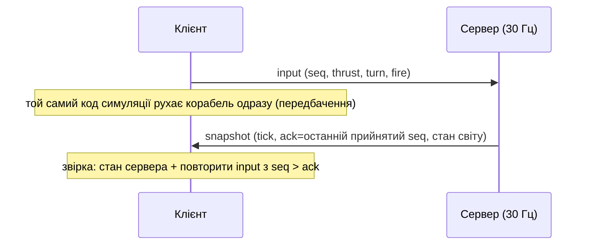

# Шпаргалка по роботі: Lab 3–8

Одна гра («Clash of Planes»), шість лаб. Кожна лаба додає шар, а не нову механіку. Читати по порядку: далі ніщо не ламає попереднє.

```txt
Lab 3  клієнт: асинхронний старт, ассети, лобі
Lab 4  сервер на Node: кімнати, WebSocket, логи
Lab 5  мережа: сервер рахує, клієнт передбачає, бінарний протокол
Lab 6  TypeScript: типи й схеми як контракт
Lab 7  тести, профайлер, швидкість
Lab 8  як гра живе поза ноутбуком: Docker, метрики, захист
```

## Карта репозиторію

| Де                               | Що там                                                                                                                                |
| -------------------------------- | ------------------------------------------------------------------------------------------------------------------------------------- |
| `shared/`                        | Код, що однаково працює в браузері й Node: симуляція (`sim/`), протокол і Zod-схеми (`protocol.ts`), кодеки (`codec/`), `snapshot.ts` |
| `client/`                        | Браузер: `main.ts` (з'єднує все), `game/` (передбачення, інтерполяція), `render/`, `net/`, `lobby/`, `assets/`, `ui/`                 |
| `server/`                        | Node: `index.ts` (збирає застосунок), `ws.ts`, `match.ts` (крок 30 Гц), `rooms.ts`, `http.ts`, `config.ts`, `metrics.ts`, `logger.ts` |
| `e2e/`, `tools/`, `experiments/` | Playwright; скрипти вимірювань; досліди «Доведи собі»                                                                                 |
| `docs/lab-0N/`                   | Результати вимірювань і скріншоти, на які посилається README                                                                          |

Запуск: `npm install`, `npm run build`, `npm start` (порт 3000). Перевірки: `npm test`, `npm run e2e`, `npm run lint`, `npm run typecheck`.

---

## Lab 3 — Асинхронний JavaScript

**Суть:** клієнт не повинен «зависати» на завантаженні; помилки мережі — норма, а не виняток.

| Що                   | Як зроблено                                                                                                               |
| -------------------- | ------------------------------------------------------------------------------------------------------------------------- |
| Завантаження ассетів | `manifest.json` перевіряється Zod; файли вантажаться **паралельно** (`Promise.all`), а не по черзі (`client/src/assets/`) |
| Екран завантаження   | прогрес по файлах, скасування (`AbortController`, `Esc`)                                                                  |
| Мережа               | `fetchJson` з таймаутом і повторами з наростальною паузою (`net/http.ts`)                                                 |
| Лобі                 | опитує `/api/rooms`, створення й вхід у кімнату (`lobby/`); сховане вікно не опитує                                       |
| Шина подій           | типізована `Bus<Events>`: звук, HUD і частинки слухають події, а симуляція про них не знає (`events.ts`)                  |
| Збої                 | сторінка збоїв `?fail=…`; гра показує помилку, а не падає                                                                 |
| Головоломки          | `/?puzzles` — порядок мікрозадач і задач (`lab3/puzzles.ts`)                                                              |

**Запам'ятати:** `Promise.all` швидше за послідовні `await`; `reject` лише на справжній збій (404 — це відповідь, а не `reject`); мікрозадачі виконуються до наступної задачі.

---

## Lab 4 — Node.js: сервер

**Суть:** сервер без фреймворків, який не падає від поганих клієнтів.

| Що         | Як зроблено                                                                                                                                                             |
| ---------- | ----------------------------------------------------------------------------------------------------------------------------------------------------------------------- |
| HTTP       | голий `node:http`, маршрутизатор на ~10 рядків, ліміт тіла (`http.ts`); статика з захистом від `..` (`static.ts`)                                                       |
| Кімнати    | `Room`/`RoomManager` — `EventEmitter` з типізованими подіями (`rooms.ts`); кімната нічого не знає про сокети                                                            |
| WebSocket  | бібліотека `ws`; перше повідомлення — `join`; без нього — закриття (`ws.ts`)                                                                                            |
| Захист     | ліміт частоти (`TokenBucket`, `rateLimit.ts`), `maxPayload`, таймаут входу, повільний клієнт (за `bufferedAmount`: спершу відкидаємо знімки, потім закриваємо з `1013`) |
| Heartbeat  | ping/pong, мертвий сокет обривається (`heartbeat.ts`)                                                                                                                   |
| Логи матчу | потоки: події пишуться у `.ndjson`, віддаються як download через `pipeline` (пам'ять не росте) (`log/`)                                                                 |
| Завершення | `SIGTERM`/`SIGINT` → закрити сокети з `1001`, дописати логи, вийти                                                                                                      |
| Конфіг     | змінні оточення + перевірка при старті (`config.ts`)                                                                                                                    |

**Запам'ятати:** блокуючий код у обробнику зупиняє _всіх_ (цикл подій один); `"error"` без слухача валить процес; потоки дають зворотний тиск.

---

## Lab 5 — Мережа в реальному часі

**Суть:** сервер — єдиний хазяїн світу, але клієнту не можна чекати відповіді, щоб рухатись.



| Що                    | Як зроблено                                                                                                                          |
| --------------------- | ------------------------------------------------------------------------------------------------------------------------------------ |
| Авторитетний сервер   | `Match` крутить світ 30 разів/с за **абсолютним** часом (не `setInterval`, що дрейфує) (`match.ts`)                                  |
| Спільна симуляція     | `shared/src/sim/`: без `Math.random` і годинників, генератор `mulberry32`; відбиток `70a8975d` однаковий у Node і Chrome             |
| Передбачення + звірка | клієнт програє непідтверджені input поверх стану сервера; різниця згладжується за ~100 мс (`game/predictor.ts`)                      |
| Інтерполяція          | чужі кораблі малюються на **100 мс у минулому** між двома знімками; годинник сервера оцінюється за `tick` (`game/snapshotBuffer.ts`) |
| Бінарний протокол     | `DataView`, little-endian: input 12 байт, знімок ~372 байти (JSON — 2416, ×6,5 менше) (`shared/src/codec/binary.ts`)                 |
| Симулятор мережі      | `?lag=100&jitter=30&drop=0.02`: затримка, джитер, втрати на стороні сервера (`netsim.ts`)                                            |
| Netgraph              | `F3`: RTT, вік знімка, черга input, розмір поправки                                                                                  |

**Запам'ятати:** передбачення працює лише тому, що симуляція **детермінована**; клієнт не шле позицію (нічого підробляти), лише керування; інтерполяція — плата 100 мс за плавність.

---

## Lab 6 — TypeScript

**Суть:** типи й схеми — контракт між клієнтом і сервером, який перевіряє компілятор.

| Що                   | Як зроблено                                                                                                                                |
| -------------------- | ------------------------------------------------------------------------------------------------------------------------------------------ |
| Режим                | `strict` + `noUncheckedIndexedAccess` + `verbatimModuleSyntax` + `erasableSyntaxOnly`; Node ≥ 22.18 сам знімає типи — збірки сервера немає |
| Протокол             | **Zod-схеми — джерело правди**, тип виводиться (`z.infer`) (`shared/src/protocol.ts`)                                                      |
| Межа                 | усе зовнішнє — `unknown`, і лише схема або декодер робить його типом; `parseClientMessage` ніколи не кидає                                 |
| Брендовані типи      | `EntityId`, `Tick`, `Seq`, `ShotSeq` — різні числа не сплутаєш (`brand.ts`)                                                                |
| Об'єднання + `never` | `switch (msg.type)` з `const x: never = msg` у `default` — нове повідомлення не скомпілюється, поки його не обробили                       |
| Generic шина         | `on<K extends keyof E>(type: K, handler: (payload: E[K]) => void)`                                                                         |
| Бюджет `as`          | `npm run check:casts`: менше 5 приведень типів, 0 `any` (рахується через compiler API)                                                     |

**Запам'ятати:** типи стираються в рантаймі, тому _захищає схема на межі_, а не тип; `as` — це обіцянка компілятору, тому їх майже немає.

---

## Lab 7 — Тести, V8, швидкість

**Суть:** довести, що все працює, і виміряти, а не вгадувати.

| Що                  | Як зроблено                                                                                                                                                                                               |
| ------------------- | --------------------------------------------------------------------------------------------------------------------------------------------------------------------------------------------------------- |
| Тести               | Vitest у `shared/client/server`; fast-check (властивості: кодек туди-назад, довжина кадру, битий буфер, корабель в арені, розбір повідомлень); Playwright: два браузери в одній кімнаті; CI на кожен push |
| Боти                | `POST /api/rooms/:id/bots`; бот діє лише через `match.receiveInput` — те саме, що сокет (`server/src/bots.ts`)                                                                                            |
| Вимірювання клієнта | 30 с гри з 8 ботами в Chromium: час кадру, паузи GC, хто алокує (`tools/lab07/`)                                                                                                                          |
| Знахідка            | найбільший алокатор — **HUD і статистика**, а не гра; кадр і так 1,7 мс, сіпання давав GC                                                                                                                 |
| Оптимізації         | пули й повторне використання об'єктів: `SnapshotRecycler`, `RemoteScratch`, `SceneScratch`, пул частинок; алокації ≈119 → ≈20 МБ                                                                          |
| Сервер              | профіль: колізії лише 5 %, основне — розсилка знімків. Тому `SnapshotFanout` (спільна частина кодується раз за тік) і просторовий хеш. Крок на 128 клієнтах: 10,1 → 4,5 мс                                |
| Web Worker          | **не лишили**: повернення результату з воркера (clone) дорожче за декодування                                                                                                                             |
| Навантаження        | `server/scripts/loadtest.ts`: 8…192+ клієнтів                                                                                                                                                             |

**Запам'ятати:** оптимізувати треба те, що показав профайлер; major GC не зникли (8–9 за 30 с) — про це чесно в README; хеш колізій дає **ті самі пари в тому самому порядку**, інакше зламався б детермінізм.

---

## Lab 8 — Ship It

**Суть:** процес має поводитись як добре вихований гість на чужому сервері.

| Що        | Як зроблено                                                                                                                                  |
| --------- | -------------------------------------------------------------------------------------------------------------------------------------------- |
| Вимкнення | `SIGTERM` → `/ready` 503 → повідомлення `shutdown` → закриття `1001` → вихід 0; `docker stop` = 138 мс, у shell-формі `CMD` — 10 с і код 137 |
| Проби     | `/health` (живий?), `/ready` (приймати гравців?), `/metrics` (Prometheus)                                                                    |
| Логи      | `pino`, JSON у stdout, `roomId`/`playerId`, секрети викреслюються (`logger.ts`)                                                              |
| Падіння   | невідомий виняток → рядок `fatal` зі стеком → `exit(1)` (`crash.ts`)                                                                         |
| Захист    | перевірка `Origin` на рукостисканні (CORS на WebSocket не діє), ліміт з'єднань на IP                                                         |
| Збої      | клієнт зник; сервер убито — гравець повертається в лобі з поясненням; флуд сміттям — відрізається, інші кімнати не страждають                |
| Docker    | два етапи, не root, `HEALTHCHECK`, 181 МБ; шари: спочатку `package*.json`, потім код (10 с замість 58 с)                                     |
| Деплой    | `deploy.yml` + `fly.toml` написані, **не запускались**; на здачі — тимчасовий тунель до ноутбука                                             |
| PWA       | `manifest.webmanifest`, `sw.js` (не чіпає `/api`, `/ws`), встановлення з Chrome                                                              |

**Запам'ятати:** `wss://` обов'язковий з `https` (інакше mixed content); кімната живе в одному процесі, тому один екземпляр; ELU **не** покаже зависший процес, його видно по тайм-ауту `/health` і інтервалу між тактами; нотатки «`npm start` ламає сигнали» на нашому npm 10 не підтвердилось, ламається shell-форма.

---

## Числа, які варто знати

|                |                                                 |
| -------------- | ----------------------------------------------- |
| Крок сервера   | 30 Гц, 33,3 мс                                  |
| Знімок         | 372 байти бінарний, 2416 JSON                   |
| Тести          | 420 unit + 6 e2e; покриття `shared/` 96 %       |
| Образ Docker   | 181 МБ (ліміт 200)                              |
| Ємність, 1 CPU | ≈64 гравці по 8 в кімнаті без пропущених тактів |
| `as` у коді    | менше 5, `any` — 0                              |

## Що відповідати на «чому так»

- **Чому авторитетний сервер?** Клієнт не шле позицію, тому чітерам нічого підробляти; один світ — одна правда.
- **Чому передбачення?** Інакше кнопка реагує через RTT (190 мс); з ним 38–64 мс.
- **Чому бінарний протокол?** ×6,5 менше трафіку й швидше розбір.
- **Чому Zod на межі?** Типи стираються в рантаймі; байти ззовні перевіряє лише схема.
- **Чому один екземпляр?** Кімната в пам'яті процесу; два екземпляри розвели б гравців. Далі: sticky-маршрутизація за кімнатою або Redis.
- **Чому тунель, а не хостинг?** Безкоштовно й достатньо для показу; ціна — адреса живе, поки ноутбук увімкнений. Постійний деплой підготовлено, але не запускався.
- **Що не вдалося?** Major GC у клієнті лишились; воркер програв; реальний RTT двох чужих гравців не виміряно; деплой за тегом не перевірено.

Деталі й методика — в `README.md` (розділи Lab 03–Lab 08).
